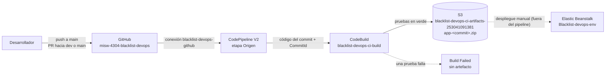

# Entrega 2 · Diseño del pipeline de integración continua

Issue #95 · Épica E2 · Implementación · Milestone `Entrega 2`

Este documento junta en un solo diseño las decisiones de #93 (disparo y acceso a GitHub) y de #94
(`docs/ci/1.2-decisiones-pipeline.md`: pruebas, artefacto, build fallido y nombres), para que las
tareas de implementación 1.4 a 1.12 partan de lo mismo. Si contradice el enunciado
(`docs/entrega-2-integracion-continua.md`), prevalece el enunciado.

## 1. Alcance

El pipeline valida cada cambio y genera el artefacto desplegable: ejecuta las pruebas unitarias en
AWS CodeBuild y, si pasan, publica un `.zip` en Amazon S3. **No despliega**: la carga del artefacto en
Elastic Beanstalk es manual, como exige la entrega (sin CD).

## 2. Flujo



| Paso | Qué ocurre | Tarea |
|---|---|---|
| 1. Disparo | Un *push* a `main`, o un PR abierto o actualizado hacia `dev` o `main`, inicia una ejecución del pipeline. Los PR que solo tocan `docs/**`, `postman/**` o `**/*.md` no disparan; el *push* a `main` no excluye ninguna ruta (versión 2 del pipeline) | #103 |
| 2. Origen | CodePipeline obtiene el código del commit por la conexión de GitHub y lo entrega a la etapa siguiente como ZIP, sin la carpeta `.git` | #98, #103 |
| 3. Construcción | CodeBuild instala dependencias, ejecuta `pytest` y, si todas las pruebas pasan, genera el paquete con `scripts/empaquetar.py` | #99, #100, #101 |
| 4. Artefacto | El paquete `app-<commit-corto>.zip` queda en el bucket privado de S3 | #96, #101 |
| 5. Despliegue | Fuera del pipeline: una persona crea la versión de aplicación en Beanstalk desde el objeto de S3 y la despliega | #115 |

Si una prueba falla, el build termina en `Failed`, la ejecución del pipeline termina en `Failed` y no
se publica artefacto (sección 5).

## 3. Etapas del pipeline

| Etapa | Acción | Proveedor | Entrada | Salida |
|---|---|---|---|---|
| Origen | `Source` | GitHub (por conexión de CodeConnections) | Rama o PR del disparo | Código del commit y la variable `#{SourceVariables.CommitId}` |
| Construcción | `Build` | AWS CodeBuild | Código del origen | Resultado de las pruebas y `app-<commit-corto>.zip` en S3 |

Configuración del pipeline: tipo **V2**, modo de ejecución **`QUEUED`** (una ejecución de un PR no
reemplaza a una de `main` en curso) y región `us-east-2`.

## 4. Archivo de construcción (`buildspec.yml`)

Lo implementan #100 (instalación y pruebas) y #101 (artefacto). Estructura propuesta:

```yaml
version: 0.2

env:
  shell: bash
  variables:
    APP_ENV: "testing"
  # COMMIT_ID llega como variable de entorno de la acción Build: #{SourceVariables.CommitId}

phases:
  install:
    runtime-versions:
      python: 3.13
    commands:
      - pip install -r requirements-dev.txt
  build:
    commands:
      - python -m pytest -q --cov=app
      - ETIQUETA="${COMMIT_ID:0:7}"
      - python scripts/empaquetar.py "$ETIQUETA" --omitir-pruebas
  post_build:
    commands:
      - |
        if [ "$CODEBUILD_BUILD_SUCCEEDING" = "1" ]; then
          aws s3 cp "dist/app-${COMMIT_ID:0:7}.zip" "s3://blacklist-devops-ci-artifacts-253041091381/app-${COMMIT_ID:0:7}.zip"
        fi
```

Criterios del diseño:

- **Pruebas en su propio paso.** `pytest` corre antes de empaquetar, para que la fase de pruebas se vea
  sola en los registros. Por eso `empaquetar.py` se llama con `--omitir-pruebas`; sin esa opción el
  script volvería a ejecutar la suite completa.
- **Etiqueta del commit sin `git`.** El origen llega sin `.git` (decisión de #94), así que la etiqueta
  sale de `COMMIT_ID`, que el pipeline pasa como variable de entorno de la acción Build, recortada a
  7 caracteres con `${COMMIT_ID:0:7}`; esa sintaxis es de `bash`, por eso el archivo fija
  `shell: bash`. `empaquetar.py` acepta letras, números, punto, guion y guion bajo, hasta 50.
- **Sin artefacto si falla.** CodeBuild ejecuta `post_build` aunque `build` falle; la condición
  `CODEBUILD_BUILD_SUCCEEDING` evita publicar un paquete de un build fallido.
- **Sin secretos.** El proyecto no define `DATABASE_URL`, `JWT_SECRET_KEY` ni tokens. Esto importa:
  `TestConfig` usa `DATABASE_URL` si existe, y las pruebas dejarían de usar SQLite en memoria.
- **Versión de Python.** Verificar en la consola que la imagen administrada ofrece Python 3.13 en
  `runtime-versions` (#99). Si no lo ofrece, se instala 3.13 en la fase `install` y se anota.

## 5. Recursos y permisos

| Recurso | Nombre | Tarea | Configuración y permisos mínimos |
|---|---|---|---|
| Bucket S3 | `blacklist-devops-ci-artifacts-253041091381` | #96 | `us-east-2`, acceso público bloqueado, cifrado por defecto (SSE-S3). Guarda los `app-<commit>.zip` y, en un prefijo propio, los artefactos internos del pipeline |
| Conexión de GitHub | `blacklist-devops-github` | #98 | Aplicación de GitHub limitada a este repositorio, en estado disponible |
| Rol de CodeBuild | `blacklist-devops-codebuild-role` | #97 | Confianza: `codebuild.amazonaws.com`. Permisos: `logs:CreateLogGroup`, `logs:CreateLogStream` y `logs:PutLogEvents` sobre los grupos `/aws/codebuild/blacklist-devops-ci-build*`; `s3:GetObject`, `s3:GetObjectVersion` y `s3:PutObject` solo sobre el bucket. No necesita la conexión, porque el código llega del pipeline |
| Rol de CodePipeline | `blacklist-devops-codepipeline-role` | #97 | Confianza: `codepipeline.amazonaws.com`. Permisos: `codeconnections:UseConnection` (y su nombre anterior `codestar-connections:UseConnection`) sobre la conexión; `s3:GetObject`, `s3:GetObjectVersion`, `s3:PutObject` y `s3:GetBucketVersioning` sobre el bucket; `codebuild:StartBuild` y `codebuild:BatchGetBuilds` sobre el proyecto |
| Proyecto de CodeBuild | `blacklist-devops-ci-build` | #99 | Origen: CodePipeline. Imagen administrada de Amazon Linux, cómputo pequeño. Variables: `APP_ENV=testing` y `COMMIT_ID` desde el pipeline. Registros en CloudWatch |
| Pipeline | `blacklist-devops-ci-pipeline` | #103 | V2, `QUEUED`, disparadores de la sección 2 |

Ningún recurso usa llaves de acceso estáticas ni permisos de administrador, y ninguno debe mostrar el
aviso de "características avanzadas" del plan gratuito. Los recursos de la Entrega 1 (`blacklist-devops`,
`Blacklist-devops-env`, `blacklist-db` y sus roles) no cambian.

## 6. Despliegue manual del artefacto

Fuera del pipeline (#115), con el ambiente encendido (#114):

1. Tomar el `app-<commit>.zip` del último build exitoso de `main` en el bucket.
2. Elastic Beanstalk → `blacklist-devops` → *Versiones de la aplicación* → crear la versión con la
   etiqueta del commit y el objeto de S3.
3. Desplegarla en `Blacklist-devops-env` y comprobar que `/ping` responde esa etiqueta.

## 7. Ejecuciones para el documento

| Ejecución | Cómo se provoca | Resultado esperado | Tareas |
|---|---|---|---|
| Exitosa | Commit en `main` (promoción desde `dev`) con el `buildspec.yml` | Pipeline `Succeeded`, pruebas en verde y `app-<commit>.zip` en S3 | #109, #110, #111 |
| Fallida | *Pull request* hacia `dev` con la rama `test/build-fallido`, que se cierra sin fusionar | Pipeline `Failed` en la etapa Build, en la fase de pruebas, y sin artefacto nuevo en S3 | #112, #113 |

**Decisión tomada sobre la ejecución fallida (25 de octubre de 2026).** #94 había decidido iniciar
CodeBuild a mano sobre la rama `test/build-fallido`, sin PR. Eso deja un *build* fallido en CodeBuild,
pero ninguna *ejecución fallida del pipeline*, que es lo que pide la rúbrica (documento, punto 2:
"ejecución fallida documentada"). Además, el proyecto de CodeBuild tiene origen `CODEPIPELINE` y su rol
no tiene permiso sobre la conexión de GitHub, así que un `start-build` manual no puede apuntar a una
rama: solo construye el código que la etapa Origen ya descargó. Por eso se usa el disparador de *pull
request* de la sección 2:

1. Crear `test/build-fallido` desde `dev` con una prueba que falla a propósito (tarea 2.8, #112).
2. Abrir un PR hacia `dev`: el pipeline se ejecuta y falla en la etapa Build.
3. Tomar la evidencia en CodePipeline y en CodeBuild (fase, mensaje de la prueba y ausencia de
   artefacto en S3).
4. Cerrar el PR **sin fusionar** (las reglas de `dev` exigen la aprobación de otra persona, así que no
   se habría podido fusionar) y borrar la rama.

La prueba fallida nunca llega a `dev` ni a `main`. El resultado está en
`docs/ci/2.3-pipeline-fallido.md`.

## 8. Verificaciones antes de cerrar la Épica 1

- [ ] El bucket existe, es privado y está cifrado (#96).
- [ ] Los dos roles tienen solo los permisos de la sección 5 (#97).
- [ ] La conexión está disponible y limitada al repositorio (#98).
- [ ] El proyecto de CodeBuild no tiene variables con secretos ni `DATABASE_URL` (#99).
- [ ] Un build local o de prueba ejecuta `pytest` una sola vez y genera el `.zip` con `VERSION` (#100, #101, #102).
- [ ] Un commit en `main` dispara el pipeline sin intervención (#103).
- [ ] Ningún paso desplegó automáticamente en Beanstalk.
