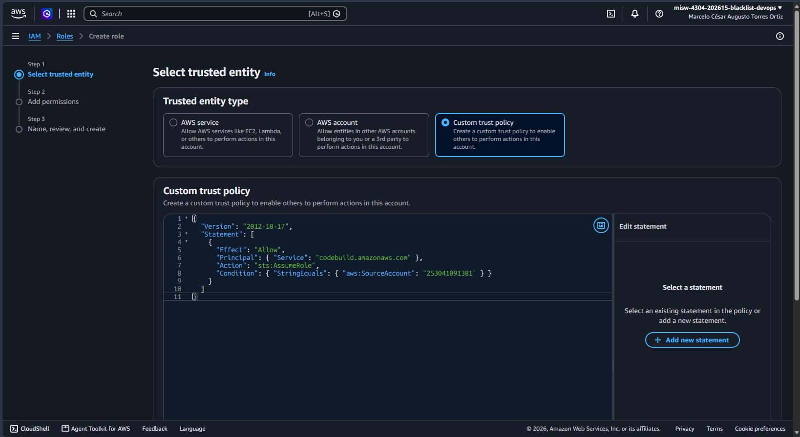
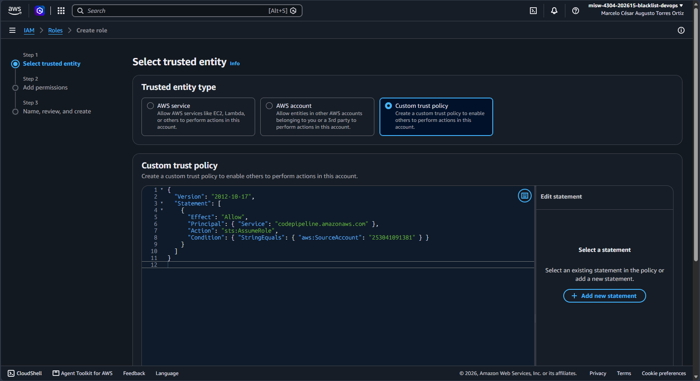
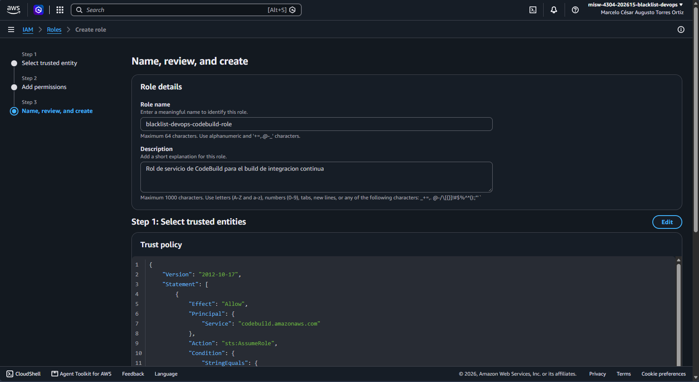
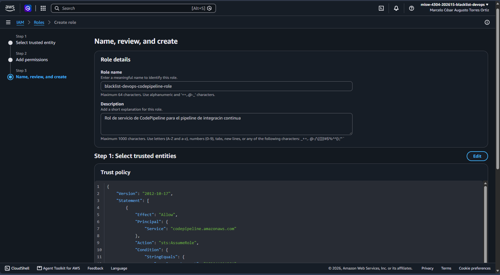
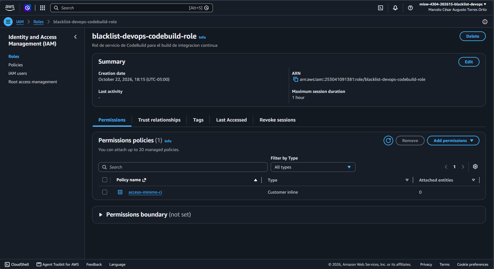
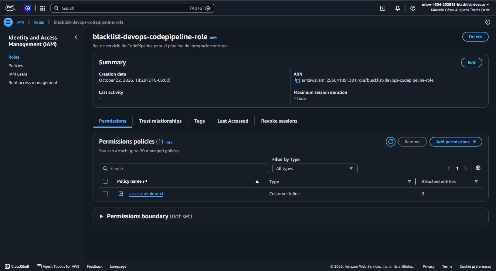

# Entrega 2 · Roles de servicio de CodeBuild y CodePipeline

Tarea 1.5 (#97) · Épica E2 · Implementación

Este documento registra la creación de los dos roles de IAM con los que se ejecuta el pipeline de
integración continua: uno para que CodeBuild ejecute el build y otro para que CodePipeline orqueste el
pipeline. Cada rol tiene permisos mínimos y limitados a los recursos del proyecto. Parte de los nombres
fijados en la tarea 1.2 (#94), del bucket de la tarea 1.4 (#96) y de la conexión de la tarea 1.6 (#98); no
reemplaza el enunciado oficial de `docs/entrega-2-integracion-continua.md`.

La creación se hizo el **22 de octubre de 2026** desde la consola de AWS, en la cuenta del proyecto, para
conservar la evidencia visual. Los roles se crearon antes que el proyecto de CodeBuild (1.7, #99) y que el
pipeline (1.11, #103): las políticas los referencian por nombre y por ARN, que se resuelven al usarlos.

## 1. Resultado

| Dato | Rol de CodeBuild | Rol de CodePipeline |
|---|---|---|
| Nombre | `blacklist-devops-codebuild-role` | `blacklist-devops-codepipeline-role` |
| ARN | `arn:aws:iam::253041091381:role/blacklist-devops-codebuild-role` | `arn:aws:iam::253041091381:role/blacklist-devops-codepipeline-role` |
| Servicio de confianza | `codebuild.amazonaws.com` | `codepipeline.amazonaws.com` |
| Política en línea | `acceso-minimo-ci` | `acceso-minimo-ci` |
| Políticas administradas | Ninguna | Ninguna |
| Creación | 22 de octubre de 2026, 18:15 (UTC-05:00) | 22 de octubre de 2026, 18:29 (UTC-05:00) |

Los ARN no son secretos. Los usan el proyecto de CodeBuild (1.7, #99) y el pipeline (1.11, #103).

## 2. Qué hace cada rol

| Rol | Para qué | Qué puede hacer |
|---|---|---|
| CodeBuild | Ejecuta las fases de instalación y pruebas del `buildspec.yml` | Escribir registros en su grupo de CloudWatch; leer y escribir objetos del bucket de artefactos |
| CodePipeline | Entrega el código al build y lo lanza | Leer y escribir objetos del bucket de artefactos; usar la conexión de GitHub; iniciar y consultar el proyecto de CodeBuild |

Ninguno de los dos roles tiene permisos de administrador ni acceso a otros recursos de la cuenta. No se
crearon llaves de acceso estáticas.

## 3. Relación de confianza

La relación de confianza indica qué servicio puede asumir el rol. Se limitó a la cuenta del proyecto con
`aws:SourceAccount`, para que otro servicio de otra cuenta no pueda usar el rol.

Rol de CodeBuild:

```json
{
  "Version": "2012-10-17",
  "Statement": [
    {
      "Effect": "Allow",
      "Principal": { "Service": "codebuild.amazonaws.com" },
      "Action": "sts:AssumeRole",
      "Condition": { "StringEquals": { "aws:SourceAccount": "253041091381" } }
    }
  ]
}
```

Rol de CodePipeline:

```json
{
  "Version": "2012-10-17",
  "Statement": [
    {
      "Effect": "Allow",
      "Principal": { "Service": "codepipeline.amazonaws.com" },
      "Action": "sts:AssumeRole",
      "Condition": { "StringEquals": { "aws:SourceAccount": "253041091381" } }
    }
  ]
}
```

## 4. Política de permisos

Cada rol tiene una sola política en línea, `acceso-minimo-ci`. Las acciones se listan una por una y los
recursos son los ARN exactos del proyecto: ninguna usa `*` como acción ni como recurso completo.
El rol de CodeBuild tuvo inicialmente una sentencia sobre la conexión de GitHub; se quitó tras la revisión
del PR #146 por no ser necesaria (ver la nota al final de la sección 4.1).

### 4.1 Rol de CodeBuild

| Sentencia | Acciones | Recurso |
|---|---|---|
| `Registros` | `logs:CreateLogGroup`, `logs:CreateLogStream`, `logs:PutLogEvents` | Grupo `/aws/codebuild/blacklist-devops-ci-build` y sus flujos |
| `ArtefactosLeerYEscribir` | `s3:GetObject`, `s3:GetObjectVersion`, `s3:PutObject` | Objetos del bucket `blacklist-devops-ci-artifacts-253041091381` |
| `ArtefactosListar` | `s3:ListBucket`, `s3:GetBucketLocation` | El bucket `blacklist-devops-ci-artifacts-253041091381` |

```json
{
  "Version": "2012-10-17",
  "Statement": [
    {
      "Sid": "Registros",
      "Effect": "Allow",
      "Action": ["logs:CreateLogGroup", "logs:CreateLogStream", "logs:PutLogEvents"],
      "Resource": [
        "arn:aws:logs:us-east-2:253041091381:log-group:/aws/codebuild/blacklist-devops-ci-build",
        "arn:aws:logs:us-east-2:253041091381:log-group:/aws/codebuild/blacklist-devops-ci-build:*"
      ]
    },
    {
      "Sid": "ArtefactosLeerYEscribir",
      "Effect": "Allow",
      "Action": ["s3:GetObject", "s3:GetObjectVersion", "s3:PutObject"],
      "Resource": "arn:aws:s3:::blacklist-devops-ci-artifacts-253041091381/*"
    },
    {
      "Sid": "ArtefactosListar",
      "Effect": "Allow",
      "Action": ["s3:ListBucket", "s3:GetBucketLocation"],
      "Resource": "arn:aws:s3:::blacklist-devops-ci-artifacts-253041091381"
    }
  ]
}
```

El rol de CodeBuild **no** tiene permisos sobre la conexión de GitHub: el pipeline le entrega el código
como un ZIP sin `.git` (decisión de #94), así que no necesita clonar el repositorio. Si más adelante se
usa el clonado completo, se agrega solo `codeconnections:UseConnection` sobre la conexión
`blacklist-devops-github`.

### 4.2 Rol de CodePipeline

| Sentencia | Acciones | Recurso |
|---|---|---|
| `ArtefactosLeerYEscribir` | `s3:GetObject`, `s3:GetObjectVersion`, `s3:PutObject` | Objetos del bucket `blacklist-devops-ci-artifacts-253041091381` |
| `ArtefactosListar` | `s3:ListBucket`, `s3:GetBucketLocation`, `s3:GetBucketVersioning` | El bucket `blacklist-devops-ci-artifacts-253041091381` |
| `ConexionGitHub` | `codeconnections:UseConnection` | Conexión `blacklist-devops-github` |
| `LanzarCodeBuild` | `codebuild:StartBuild`, `codebuild:BatchGetBuilds` | Proyecto `blacklist-devops-ci-build` |

```json
{
  "Version": "2012-10-17",
  "Statement": [
    {
      "Sid": "ArtefactosLeerYEscribir",
      "Effect": "Allow",
      "Action": ["s3:GetObject", "s3:GetObjectVersion", "s3:PutObject"],
      "Resource": "arn:aws:s3:::blacklist-devops-ci-artifacts-253041091381/*"
    },
    {
      "Sid": "ArtefactosListar",
      "Effect": "Allow",
      "Action": ["s3:ListBucket", "s3:GetBucketLocation", "s3:GetBucketVersioning"],
      "Resource": "arn:aws:s3:::blacklist-devops-ci-artifacts-253041091381"
    },
    {
      "Sid": "ConexionGitHub",
      "Effect": "Allow",
      "Action": "codeconnections:UseConnection",
      "Resource": "arn:aws:codeconnections:us-east-2:253041091381:connection/78ec2a5d-2f14-4972-bc66-b54a9571b2f9"
    },
    {
      "Sid": "LanzarCodeBuild",
      "Effect": "Allow",
      "Action": ["codebuild:StartBuild", "codebuild:BatchGetBuilds"],
      "Resource": "arn:aws:codebuild:us-east-2:253041091381:project/blacklist-devops-ci-build"
    }
  ]
}
```

## 5. Procedimiento

Se repite para cada rol, cambiando el nombre, la relación de confianza y la política.

1. Abrir la consola de AWS en la cuenta `253041091381`. IAM es un servicio global, pero se mantiene la
   región **us-east-2** para que quede visible en las capturas.
2. Ir a *IAM* → *Roles* → *Create role*.
3. En *Trusted entity type* elegir **Custom trust policy** y pegar la relación de confianza de la
   sección 3.

   

   

4. En *Add permissions* **no seleccionar ninguna política administrada**.
5. Escribir el nombre y la descripción del rol y revisar el resumen antes de crearlo.

   

   

6. Abrir el rol creado → *Permissions* → *Add permissions* → *Create inline policy*, elegir la pestaña
   **JSON** y pegar la política de la sección 4. Guardarla con el nombre `acceso-minimo-ci`.

   

   

7. Comprobar en la pestaña *Permissions* que hay una sola política, de tipo *Customer inline*, y anotar el
   ARN.

   

   

8. Comprobar en la lista de roles que están los dos.

   

Si la consola muestra el aviso de **características avanzadas** en cualquier paso, detenerse: el proyecto
no activa esas características ni cambia de plan. No apareció en este procedimiento.

## 6. Equivalente con la CLI

La creación se hizo desde la consola. Estos son los comandos equivalentes para reproducirla; se
documentan como referencia y no se ejecutaron. Los roles los crea la persona propietaria de la cuenta.

```bash
aws iam create-role \
  --role-name blacklist-devops-codebuild-role \
  --description "Rol de servicio de CodeBuild para el build de integracion continua" \
  --assume-role-policy-document file://trust-codebuild.json

aws iam put-role-policy \
  --role-name blacklist-devops-codebuild-role \
  --policy-name acceso-minimo-ci \
  --policy-document file://policy-codebuild.json

aws iam create-role \
  --role-name blacklist-devops-codepipeline-role \
  --description "Rol de servicio de CodePipeline para el pipeline de integracion continua" \
  --assume-role-policy-document file://trust-codepipeline.json

aws iam put-role-policy \
  --role-name blacklist-devops-codepipeline-role \
  --policy-name acceso-minimo-ci \
  --policy-document file://policy-codepipeline.json
```

Los archivos `trust-*.json` y `policy-*.json` contienen los JSON de las secciones 3 y 4.

## 7. Notas

- **Descripciones:** las descripciones de los roles quedaron sin tilde: "Rol de servicio de CodeBuild para
  el build de integracion continua" y "Rol de servicio de CodePipeline para el pipeline de integracion
  continua" (esta última se escribió al crearla como "integracin" y se corrigió después, con un salto de
  línea al final). Verificado con `aws iam get-role` el 23 de octubre de 2026. Es solo texto descriptivo y no
  afecta a los permisos; las capturas de la creación del rol muestran el texto original.
- **Revisión del PR #146:** se quitó del rol de CodeBuild la sentencia `ConexionGitHub` (propuesta de la
  revisión), porque el código llega al build como ZIP desde CodePipeline y no se usa la conexión. El rol
  de CodePipeline conserva `codeconnections:UseConnection`, que sí necesita para leer el repositorio.
- **Proyecto aún inexistente:** las políticas apuntan a `blacklist-devops-ci-build`, que se crea en la
  tarea 1.7 (#99). Si el proyecto se crea con otro nombre, hay que actualizar las dos políticas.
- **Permisos del rol de CodePipeline:** incluye `s3:GetBucketVersioning` porque CodePipeline lo consulta
  al usar el bucket como almacén de artefactos. Si al crear el pipeline (1.11, #103) la consola pide algún
  permiso más, se agrega solo ese y se anota aquí.
- **Sin secretos:** las capturas no muestran llaves, tokens ni variables de entorno. El ID de cuenta, los
  ARN y el nombre de la persona en la barra de la consola no son secretos.

## 8. Cumplimiento de la tarea

| Criterio de la tarea 1.5 (#97) | Evidencia |
|---|---|
| Rol de CodeBuild con relación de confianza para CodeBuild | Sección 3; capturas `1.5-codebuild-confianza.png` y `1.5-codebuild-rol.png` |
| Política mínima de CodeBuild: registros y bucket de 1.4 (sin conexión de GitHub, ver sección 4.1) | Sección 4.1; captura `1.5-codebuild-politica.png` |
| Rol de CodePipeline: conexión, bucket y lanzar el proyecto, sin administrador | Sección 4.2; captura `1.5-codepipeline-politica.png` |
| ARN de cada rol anotado | Sección 1 |
| Los roles solo acceden al bucket del proyecto | Secciones 4.1 y 4.2: recursos limitados a un bucket, una conexión, un proyecto y un grupo de registros |
| Sin llaves de acceso estáticas ni permisos de administrador | Sección 2; las capturas `1.5-codebuild-rol.png` y `1.5-codepipeline-rol.png` muestran una sola política en línea y ninguna administrada |
