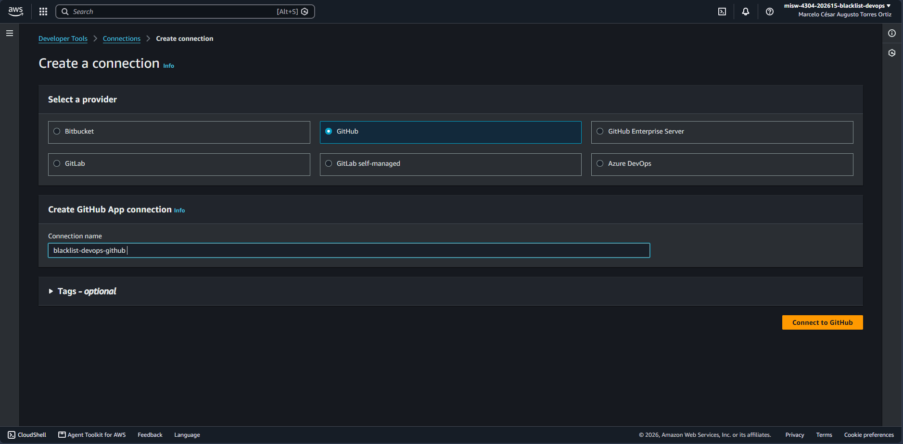
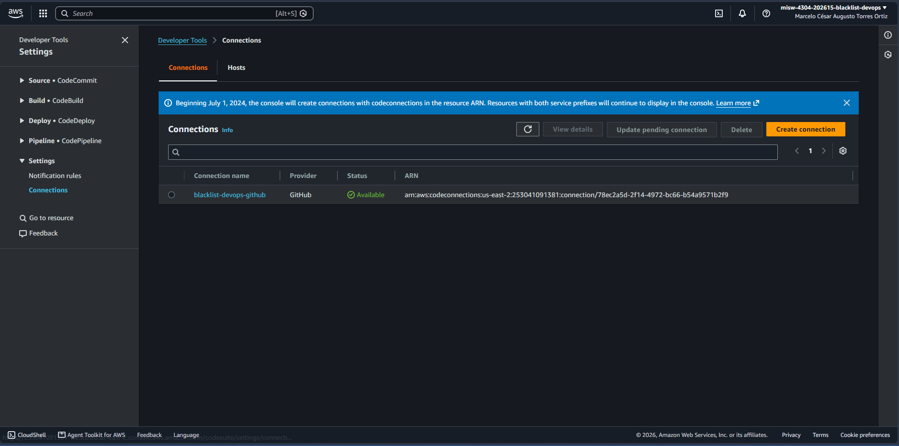

# Entrega 2 · Conexión de GitHub autorizada

Tarea 1.6 (#98) · Épica E2 · Implementación

Este documento deja el procedimiento para crear la conexión que permite a AWS leer el repositorio
privado y recibir sus eventos (*push* y *pull requests*), y la evidencia de que quedó disponible y
limitada a este repositorio. Parte de la decisión de acceso de la tarea 1.1 (#93) y del nombre fijado en
la tarea 1.2 (#94); no reemplaza el enunciado oficial de `docs/entrega-2-integracion-continua.md`.

## 1. Resultado

| Dato | Valor |
|---|---|
| Nombre | `blacklist-devops-github` |
| Proveedor | GitHub (aplicación de GitHub, sin tokens personales ni llaves estáticas) |
| Región | `us-east-2` (Ohio) |
| Cuenta | `253041091381` |
| Estado | `AVAILABLE` |
| ARN | `arn:aws:codeconnections:us-east-2:253041091381:connection/78ec2a5d-2f14-4972-bc66-b54a9571b2f9` |
| Aplicación en GitHub | AWS Connector for GitHub, instalada en la cuenta `mc-torreso1-uniandes-edu-co` |
| Acceso al repositorio | Solo `mc-torreso1-uniandes-edu-co/misw-4304-blacklist-devops` |

El ARN no es un secreto. Lo usan el proyecto de CodeBuild (1.7, #99) y el pipeline (1.11, #103).

## 2. Procedimiento

Quien crea la conexión debe ser la persona propietaria del repositorio en GitHub: en un repositorio de
cuenta personal, solo esa persona puede autorizar la aplicación.

1. Abrir la consola de AWS en la cuenta `253041091381` y verificar que la región es **us-east-2**.
2. Ir a *Developer Tools* → *Settings* → *Connections* y elegir *Create connection*.
3. Elegir el proveedor **GitHub** y escribir el nombre `blacklist-devops-github`
   (máximo 32 caracteres, sin espacios al inicio ni al final).

   

4. Elegir *Connect to GitHub*. En GitHub, iniciar sesión con la cuenta propietaria del repositorio y autorizar
   *AWS Connector for GitHub*.
5. En *Repository access* marcar **Only select repositories** y elegir solo `misw-4304-blacklist-devops`.
   No usar *All repositories*.

   

6. Volver a AWS y elegir *Connect*. La conexión pasa de *Pending* a **Available**.

   

7. Comprobar la lista de conexiones y anotar el ARN.

   

Si la consola muestra el aviso de **características avanzadas** en cualquier paso, detenerse: el proyecto
no activa esas características ni cambia de plan. No apareció en este procedimiento.

## 3. Equivalente con la CLI

La CLI crea la conexión en estado *Pending*; la autorización en GitHub (pasos 4 y 5) solo se puede hacer
en el navegador.

```bash
aws codeconnections create-connection \
  --provider-type GitHub \
  --connection-name blacklist-devops-github \
  --region us-east-2

aws codeconnections list-connections --region us-east-2
aws codeconnections get-connection --connection-arn <ARN> --region us-east-2
```

Verificación realizada el 21 de octubre de 2026:

```text
'blacklist-devops-github' AVAILABLE GitHub
arn:aws:codeconnections:us-east-2:253041091381:connection/78ec2a5d-2f14-4972-bc66-b54a9571b2f9
1 conexión
```

## 4. Permisos de la aplicación en GitHub

La aplicación pide lectura de acciones, despliegues, entornos, incidencias y metadatos, y lectura y
escritura de administración, código, estados de *commit*, *pull requests* y *webhooks* del repositorio.
Esos permisos los necesita CodePipeline para leer el código y registrar el *webhook* que avisa de cada
*push* y *pull request*. Quedan limitados al único repositorio seleccionado.

## 5. Lecciones

- **Longitud del nombre:** `CreateConnection` acepta como máximo 32 caracteres. El nombre inicial
  `blacklist-devops-github-connection` tenía 34 y se corrigió en la tarea 1.2 (#94).
- **Espacio al final:** la primera conexión se creó con un espacio al final del nombre. Los servicios usan
  el ARN y no el nombre, pero el nombre no se puede cambiar: se eliminó la conexión y se creó otra con el
  mismo nombre, sin el espacio. Las capturas de los pasos 6 y 7 se repitieron con la conexión vigente
  (ARN `78ec2a5d-…`). La instalación de la aplicación en GitHub se conservó, y la captura del paso 5 sigue
  siendo válida. El formulario del paso 3 es del primer intento y solo ilustra el procedimiento.
- **Conexión borrada:** al eliminar una conexión, su ARN no se reutiliza. Nada lo había referenciado
  todavía, porque el proyecto de CodeBuild y el pipeline se crean después.

## 6. Cumplimiento de la tarea

| Criterio de la tarea 1.6 (#98) | Evidencia |
|---|---|
| Conexión creada en `us-east-2` y autorizada por la persona propietaria del repositorio | Secciones 1 y 2, verificación por CLI |
| Aplicación limitada a este repositorio | Captura `1.6-github-acceso-repositorio.png` |
| Conexión en estado disponible | Estado `AVAILABLE` por CLI; capturas de los pasos 6 y 7, tomadas con la conexión vigente |
| Ningún token personal guardado | La autorización es por la aplicación de GitHub; no se creó ni guardó ningún token |
