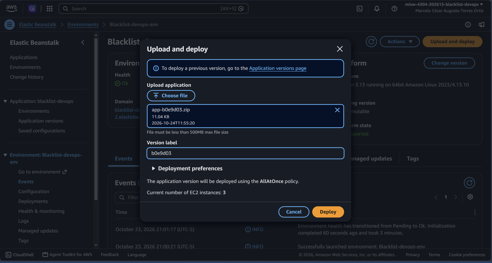
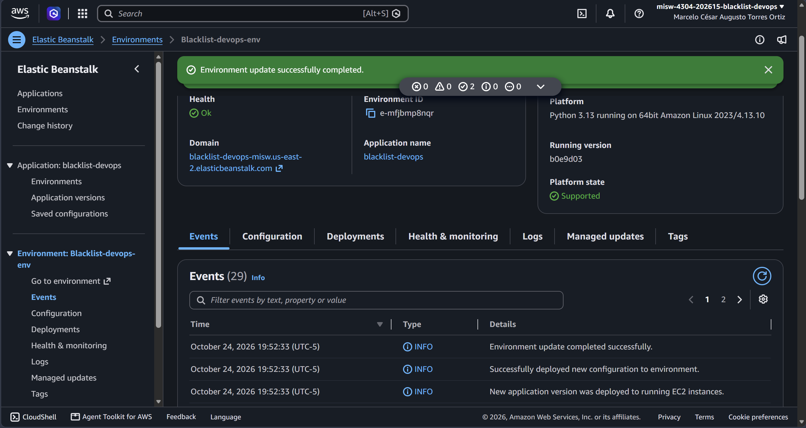
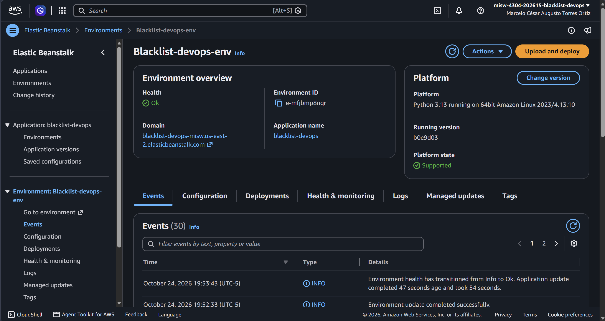
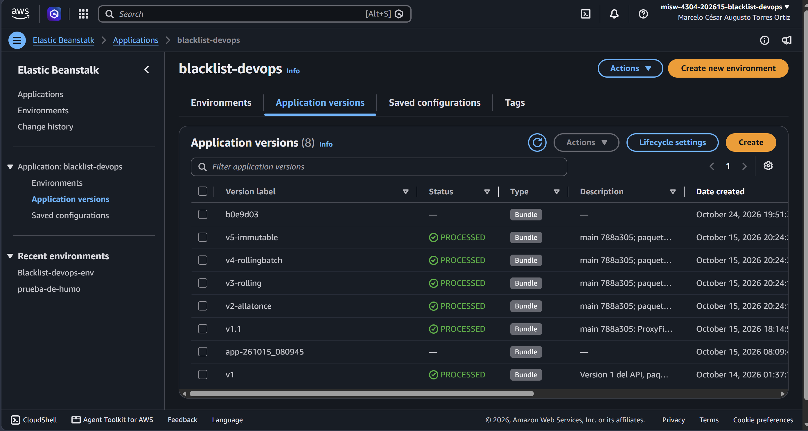

# Entrega 2 · Despliegue manual del artefacto del pipeline

Tarea 2.11 (#115) · Épica E2 · Pruebas

Este documento registra el despliegue manual, en AWS Elastic Beanstalk, del paquete que generó el pipeline
de integración continua en su primera ejecución exitosa (tareas 2.6 y 2.7, `docs/ci/2.2-pipeline-exitoso.md`).
El enunciado excluye el despliegue automatizado (CD): el pipeline termina al generar el artefacto, y la
carga en Beanstalk la hace una persona desde la consola. No reemplaza el enunciado oficial de
`docs/entrega-2-integracion-continua.md`.

El despliegue se hizo el **24 de octubre de 2026** sobre el entorno reprovisionado en la tarea 2.10 (#114).

## 1. Resultado

| Dato | Valor |
|---|---|
| Paquete | `app-b0e9d03.zip`, 11 040 bytes, SHA-256 `a3e8730252a313aaff865bfe4e97ff773e42a92d237dfe153ab925fe77187b0e`, 31 archivos |
| Origen del paquete | Artefacto del pipeline `blacklist-devops-ci-/BuildArtif/QZJkTHW` (ejecución `ff3146a4…`, commit `b0e9d03` de `main`) |
| Versión de la aplicación | `b0e9d03`, aplicación `blacklist-devops`, creada a las 19:51:30 (UTC-05:00) |
| Copia en S3 de Beanstalk | `s3://elasticbeanstalk-us-east-2-253041091381/1792889489458-app-b0e9d03.zip` (la crea la consola al subir) |
| Entorno | `Blacklist-devops-env`, plataforma Python 3.13 en Amazon Linux 2023 4.13.10 |
| Política de despliegue | *All at once*, 3 instancias |
| Duración | 54 segundos (19:51:31 a 19:52:33) |
| Estado final | *Ready*, salud **Ok**, versión en ejecución **`b0e9d03`** en las 3 instancias |
| `GET /ping` | `{"version": "b0e9d03"}` |
| `GET /blacklists/<email>` sin token | 401, como define el contrato |

## 2. Procedimiento

1. Extraer `app-b0e9d03.zip` del objeto del pipeline. CodePipeline guarda la salida del build como un zip
   con nombre generado que contiene el paquete; se descargó el objeto, se extrajo `app-b0e9d03.zip` y se
   comprobó que su SHA-256 coincide con el registrado en la tarea 2.7.
2. En la consola de Elastic Beanstalk (región `us-east-2`), abrir el entorno `Blacklist-devops-env` y elegir
   **Upload and deploy**.
3. Elegir el archivo `app-b0e9d03.zip`, escribir la etiqueta de versión `b0e9d03` y dejar las preferencias
   de despliegue sin cambios (política *AllAtOnce*, 3 instancias).

   

4. Seguir los eventos del entorno hasta *Environment update completed successfully*.

   

5. Comprobar la salud *Ok* y la versión en ejecución `b0e9d03`.

   

6. Comprobar que `/ping` responde la versión del artefacto.

   

7. La versión queda registrada en la aplicación junto a las de la Entrega 1.

   

No se guardó la configuración del entorno ni se cambió la política de despliegue.

## 3. Eventos del despliegue

Horas en UTC-05:00 del 24 de octubre de 2026, tomadas de `aws elasticbeanstalk describe-events`:

| Hora | Evento |
|---|---|
| 19:51:31 | Environment update is starting |
| 19:51:39 | Updating environment Blacklist-devops-env's configuration settings |
| 19:51:43 | Environment health has transitioned from Ok to Info. Application update in progress |
| 19:51:57 | Deploying new version to instance(s) |
| 19:52:00 | Instance deployment used the commands in your 'Procfile' to initiate startup of your application |
| 19:52:08 | Instance deployment completed successfully |
| 19:52:33 | New application version was deployed to running EC2 instances |
| 19:52:33 | Environment update completed successfully |
| 19:53:43 | Environment health has transitioned from Info to Ok. Application update completed 47 seconds ago and took 54 seconds |

## 4. Hallazgos

1. **El paquete del pipeline se despliega sin cambios.** El mismo zip que generó CodeBuild, con la misma
   SHA-256, arrancó con el `Procfile` y quedó saludable en las 3 instancias.
2. **La versión en ejecución se puede rastrear hasta el commit.** `/ping` devuelve `b0e9d03`, que es la
   etiqueta del commit de `main` que disparó el pipeline: del entorno se llega al build, a la ejecución del
   pipeline y al PR #156.
3. **Paso intermedio por la forma del artefacto.** Como CodePipeline guarda el paquete dentro de su propio
   objeto, hay que extraerlo antes de subirlo. Si se publica `app-<commit>.zip` con su nombre en el bucket
   (propuesta en #103), la versión se puede crear directamente desde S3.
4. **La consola no ofreció el botón *Upload* en la lista de versiones**; se usó *Upload and deploy* desde el
   entorno, que sube y despliega en un solo paso. La versión queda sin descripción y con estado vacío en la
   lista de versiones, lo cual no afecta al despliegue.
5. **Breve indisponibilidad esperada.** Con *All at once*, las 3 instancias se actualizan a la vez; es el
   comportamiento medido en la Entrega 1 (`docs/despliegues/2.4a-all-at-once.md`).

## 5. Cumplimiento de la tarea

| Criterio de la tarea 2.11 (#115) | Estado | Evidencia |
|---|---|---|
| Cargar el zip del artefacto como versión de la aplicación | Cumplido | Secciones 1 y 2; captura de versiones |
| Desplegarla en el entorno | Cumplido | Secciones 2 y 3; capturas de eventos y del entorno |
| `GET /ping` devuelve la versión del artefacto | Cumplido | `{"version": "b0e9d03"}`; captura de `/ping` |
| El entorno corre el artefacto del pipeline | Cumplido | Versión en ejecución `b0e9d03` en las 3 instancias |
