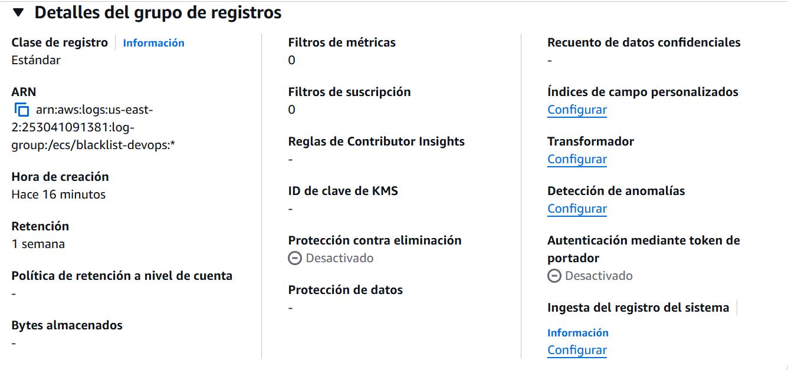
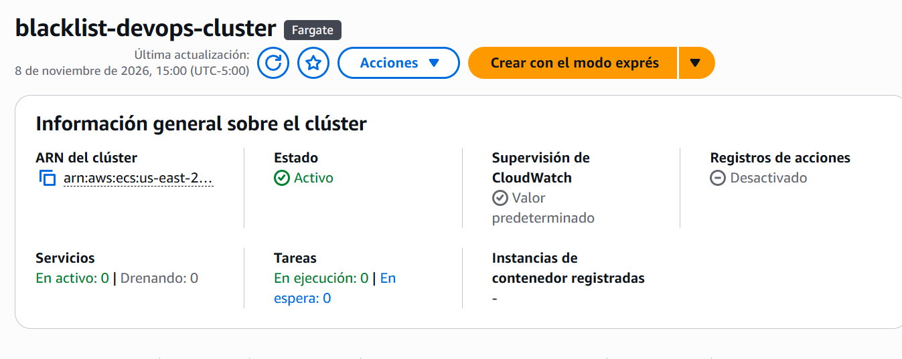
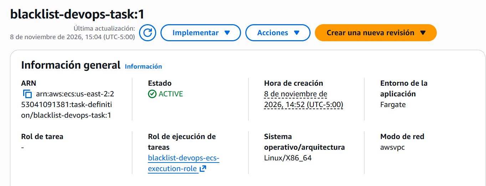

# Entrega 3 · Clúster de ECS y definición de la tarea

Tarea 1.10 (#198) · Épica E3 · Implementación

Este documento registra el clúster de ECS, el grupo de registros y la definición de la tarea de Fargate que usan el
despliegue manual de la 1.11 (#199) y, después, el pipeline. Parte de la decisión 3 de la 1.1 (#189) y aplica los nombres
y el diseño de la 1.3 (#191, `docs/ci/entrega-3/1.3-diseno-pipeline.md`, secciones 5.5 y 6.2); no reemplaza el enunciado
oficial de `docs/entrega-3-entrega-continua.md`.

Todo se creó con la AWS CLI en AWS CloudShell, en la cuenta del proyecto y la región **us-east-2**, el **8 de noviembre
de 2026**. Cada comando de creación se ejecutó una sola vez, con confirmación previa.

## 1. Resultado

| Recurso | Nombre | Identificador |
|---|---|---|
| Clúster de ECS | `blacklist-devops-cluster` | `arn:aws:ecs:us-east-2:253041091381:cluster/blacklist-devops-cluster` |
| Grupo de registros | `/ecs/blacklist-devops` | Retención de 7 días (sección 3.2) |
| Definición de la tarea | `blacklist-devops-task`, revisión 1 | `arn:aws:ecs:us-east-2:253041091381:task-definition/blacklist-devops-task:1` |

| Dato de la definición | Valor |
|---|---|
| Estado | `ACTIVE`, registrada el 8 de noviembre de 2026 a las 14:52:21 (UTC-05:00) |
| Compatibilidad y red | Fargate, modo de red `awsvpc` |
| Plataforma | Linux, `X86_64` |
| CPU y memoria | 256 (0,25 vCPU) y 512 MB |
| Rol de ejecución | `arn:aws:iam::253041091381:role/blacklist-devops-ecs-execution-role` (1.6) |
| Contenedor | `blacklist-devops`, esencial, puerto 8000 |
| Imagen | `253041091381.dkr.ecr.us-east-2.amazonaws.com/blacklist-devops:f224bef` (1.7) |
| Variable sin secreto | `APP_ENV=production` |
| Secretos (`secrets`) | `DATABASE_URL` y `JWT_SECRET_KEY`, por referencia a los parámetros de la 1.8 |
| Registros | `awslogs`, grupo `/ecs/blacklist-devops`, región `us-east-2`, prefijo `ecs` |

## 2. Decisiones

| Aspecto | Decisión | Motivo |
|---|---|---|
| Capacidad del clúster | Solo el proveedor `FARGATE`, con estrategia por defecto de peso 1. Sin `FARGATE_SPOT` | La tarea pide un clúster solo de Fargate. En `FARGATE_SPOT` AWS puede interrumpir las tareas |
| Container Insights | Desactivado | Es la configuración por defecto y no suma costo de métricas |
| CPU y memoria | 256 y 512 MB, el mínimo de Fargate | Es lo que propone la sección 10 del diseño. Se confirma en la 1.11 con la tarea corriendo; si 512 MB no alcanza para los dos procesos de Gunicorn, se registra una revisión con 512 y 1024 |
| Imagen | La de la 1.7 con la etiqueta del commit, `f224bef`, y no `latest` | `latest` se mueve en cada envío: ya apunta a otra imagen (`43d6a65`). La etiqueta del commit mantiene la versión que responde `/ping` y que se puede rastrear |
| Plataforma | `X86_64` | La de la imagen de la 1.7 (`linux/amd64`) y la de CodeBuild |
| Secretos | Por referencia en `secrets`, no en `environment` | Decisión 3 de la 1.1: los valores no van en el repositorio, en la imagen ni en la definición. Solo el rol de ejecución puede leerlos |
| Variables sin secreto | `APP_ENV=production` en `environment` | No es un secreto. `PROXY_FIX_X_FOR` no se define: su valor por defecto, `1`, corresponde a un solo intermediario, el balanceador |
| Rol de la tarea | Ninguno | La aplicación no llama a ningún servicio de AWS (sección 6.6 del diseño) |
| Grupo de registros | Creado antes de la definición, con retención de 7 días | El rol de ejecución no tiene `logs:CreateLogGroup` (1.6): sin el grupo, la tarea no arranca |
| Puerto | 8000 | El del `Dockerfile` y el de los grupos de destino de la 1.9 |

## 3. Procedimiento

Región `us-east-2`. En CloudShell no se usa `--profile`; con la CLI local se agrega `--profile blacklist`.

### 3.1 Comprobar los insumos

Son comandos de solo lectura. La imagen, el rol y los parámetros deben existir antes de registrar la definición:

```bash
aws ecr describe-images --repository-name blacklist-devops --region us-east-2 --query "imageDetails[].imageTags"
aws iam get-role --role-name blacklist-devops-ecs-execution-role --query Role.Arn --output text
aws ssm get-parameters --names /blacklist-devops/DATABASE_URL /blacklist-devops/JWT_SECRET_KEY --region us-east-2 --query "Parameters[].Name"
```

Resultado: el repositorio tiene dos imágenes, la de la 1.7 con la etiqueta `f224bef` y otra más reciente con `latest` y
`43d6a65`; el rol existe, con el ARN de la tabla de la sección 1; y salen los dos nombres de parámetros. El último comando
no usa `--with-decryption`, así que no muestra ningún valor.

### 3.2 Grupo de registros

```bash
aws logs create-log-group --log-group-name /ecs/blacklist-devops --region us-east-2
aws logs put-retention-policy --log-group-name /ecs/blacklist-devops --retention-in-days 7 --region us-east-2
```

Los dos comandos terminaron sin errores. La retención se comprobó con:

```bash
aws logs describe-log-groups --log-group-name-prefix /ecs/blacklist-devops --region us-east-2 \
  --query "logGroups[].{nombre:logGroupName,retencion:retentionInDays}"
```

```json
[
    {
        "nombre": "/ecs/blacklist-devops",
        "retencion": 7
    }
]
```



### 3.3 Clúster

```bash
aws ecs create-cluster --cluster-name blacklist-devops-cluster \
  --capacity-providers FARGATE \
  --default-capacity-provider-strategy capacityProvider=FARGATE,weight=1 \
  --region us-east-2
```

La respuesta muestra `"status": "ACTIVE"`, `"capacityProviders": ["FARGATE"]`, la estrategia por defecto con
`"weight": 1`, sin tareas ni servicios, y `containerInsights` en `disabled`.



### 3.4 Definición de la tarea

El archivo `taskdef-base.json` se escribió en CloudShell. Los secretos son referencias a Parameter Store: el archivo no
contiene ningún valor.

```json
{
  "family": "blacklist-devops-task",
  "networkMode": "awsvpc",
  "requiresCompatibilities": ["FARGATE"],
  "runtimePlatform": { "cpuArchitecture": "X86_64", "operatingSystemFamily": "LINUX" },
  "cpu": "256",
  "memory": "512",
  "executionRoleArn": "arn:aws:iam::253041091381:role/blacklist-devops-ecs-execution-role",
  "containerDefinitions": [
    {
      "name": "blacklist-devops",
      "image": "253041091381.dkr.ecr.us-east-2.amazonaws.com/blacklist-devops:f224bef",
      "essential": true,
      "portMappings": [{ "containerPort": 8000, "protocol": "tcp" }],
      "environment": [{ "name": "APP_ENV", "value": "production" }],
      "secrets": [
        { "name": "DATABASE_URL", "valueFrom": "arn:aws:ssm:us-east-2:253041091381:parameter/blacklist-devops/DATABASE_URL" },
        { "name": "JWT_SECRET_KEY", "valueFrom": "arn:aws:ssm:us-east-2:253041091381:parameter/blacklist-devops/JWT_SECRET_KEY" }
      ],
      "logConfiguration": {
        "logDriver": "awslogs",
        "options": {
          "awslogs-group": "/ecs/blacklist-devops",
          "awslogs-region": "us-east-2",
          "awslogs-stream-prefix": "ecs"
        }
      }
    }
  ]
}
```

```bash
aws ecs register-task-definition --cli-input-json file://taskdef-base.json --region us-east-2
```

La respuesta devuelve la revisión 1 (`blacklist-devops-task:1`) en estado `ACTIVE`. ECS completó por su cuenta
`hostPort: 8000`, que con `awsvpc` es igual al puerto del contenedor.



## 4. Verificación con la CLI

La definición registrada no tiene secretos en texto plano: en `environment` solo está `APP_ENV` y los dos secretos
aparecen como referencias.

```bash
aws ecs describe-task-definition --task-definition blacklist-devops-task --region us-east-2 \
  --query "taskDefinition.containerDefinitions[0].{environment:environment,secrets:secrets}"
```

```json
{
    "environment": [
        { "name": "APP_ENV", "value": "production" }
    ],
    "secrets": [
        {
            "name": "DATABASE_URL",
            "valueFrom": "arn:aws:ssm:us-east-2:253041091381:parameter/blacklist-devops/DATABASE_URL"
        },
        {
            "name": "JWT_SECRET_KEY",
            "valueFrom": "arn:aws:ssm:us-east-2:253041091381:parameter/blacklist-devops/JWT_SECRET_KEY"
        }
    ]
}
```

## 5. Base para el `taskdef.json` de la 1.13

La definición registrada se exportó sin los campos que ECS agrega al registrarla y que `register-task-definition` no
acepta:

```bash
aws ecs describe-task-definition --task-definition blacklist-devops-task --region us-east-2 \
  --query taskDefinition \
  | jq 'del(.taskDefinitionArn,.revision,.status,.requiresAttributes,.compatibilities,.registeredAt,.registeredBy)' \
  > taskdef-exportada.json
```

Los campos que se quitan son `taskDefinitionArn`, `revision`, `status`, `requiresAttributes`, `compatibilities`,
`registeredAt` y `registeredBy`. La 1.13 (#200) parte de ese archivo y cambia la imagen por el marcador
`<IMAGE1_NAME>`, que CodeDeploy sustituye con la imagen que entrega el pipeline en `imageDetail.json`.

## 6. Costo

| Recurso | Costo |
|---|---|
| Clúster de ECS y definición de la tarea | Sin costo: ECS cobra por los recursos que usan las tareas |
| Tareas de Fargate | Se cobran cuando corren (1.11): unos 0,0123 USD/h con 0,25 vCPU y 0,5 GB (sección 8.1 del diseño) |
| Grupo de registros | CloudWatch Logs cobra por ingesta y almacenamiento; con la retención de 7 días y el tráfico de pruebas, es mínimo |

## 7. Notas

- **Dónde quedan los archivos:** `taskdef-base.json` y `taskdef-exportada.json` están en CloudShell, no en el
  repositorio. El `taskdef.json` del repositorio es el de la 1.13.
- **Revisiones:** cada cambio de la definición, por ejemplo el tamaño de la tarea, crea una revisión nueva. La 1.13 y
  CodeDeploy registran una revisión por cada despliegue.
- **Imagen `latest`:** ya apunta a una imagen posterior a la de la 1.7. La definición no la usa.
- **Qué falta para que corra:** el servicio de ECS (1.11, #199) con las subredes públicas, `blacklist-devops-tareas-sg`
  y `assignPublicIp: ENABLED`, y el grupo de destino azul.

## 8. Cumplimiento de la tarea

| Criterio de la tarea 1.10 (#198) | Evidencia |
|---|---|
| Clúster de ECS solo Fargate, con el nombre de la 1.3 | Secciones 1 y 3.3; captura `1.10-cluster-detalle.png` |
| Definición de la tarea: Fargate, CPU y memoria mínimas, imagen de ECR con la etiqueta del commit, puerto y registros en CloudWatch | Secciones 1, 2, 3.2 y 3.4; capturas `1.10-registros-grupo.png` y `1.10-tarea-detalle.png` |
| Secretos por referencia (`secrets`, desde la 1.8); variables sin secreto en `environment` | Secciones 3.4 y 4 |
| Rol de ejecución de la 1.6 | Secciones 1 y 3.4 |
| Exportar la definición como base de `taskdef.json` (1.13) | Sección 5 |
| DoD: definición registrada (`aws ecs describe-task-definition`) | Secciones 3.4 y 4; captura `1.10-tarea-detalle.png` |
| DoD: sin secretos en texto plano en la definición | Sección 4 |
