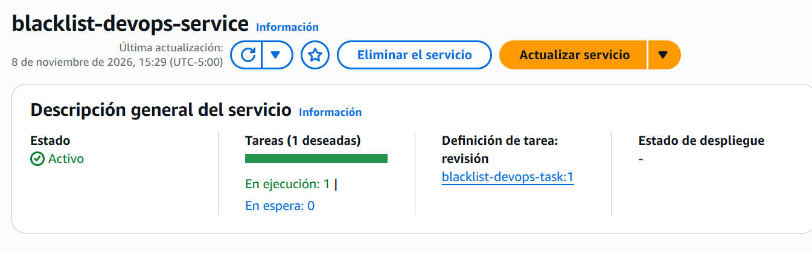
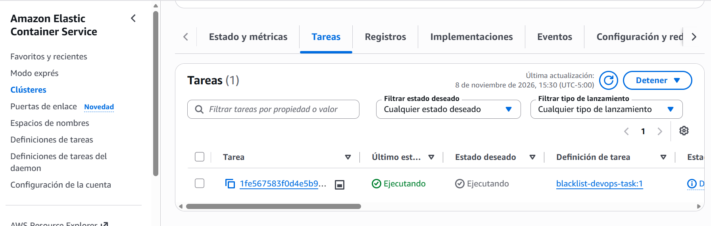
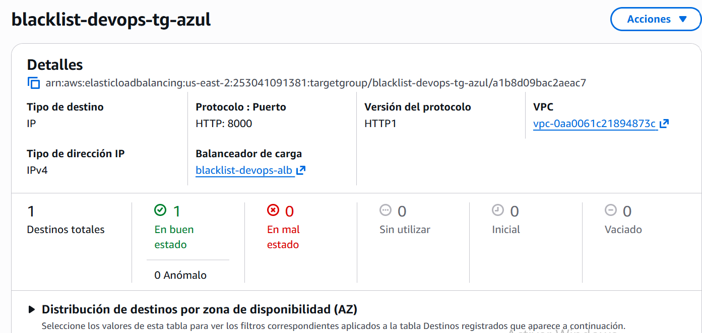
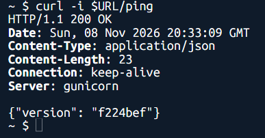
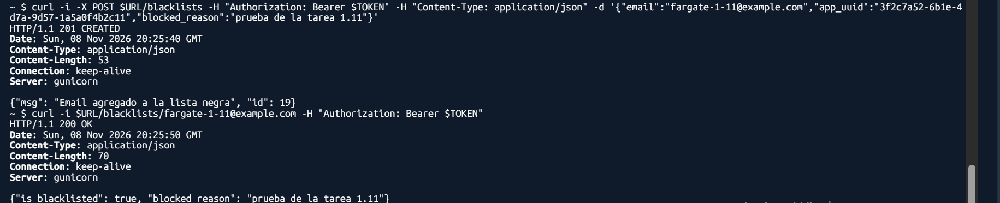

# Entrega 3 · Servicio de Fargate y validación del microservicio

Tarea 1.11 (#199) · Épica E3 · Implementación

Este documento registra el servicio de ECS que ejecuta el microservicio en Fargate, creado a mano con la definición de la
tarea de la 1.10 detrás del balanceador de la 1.9, y la validación de sus tres endpoints. Parte de la decisión 6 de la
1.1 (#189) y de la decisión 1 de la 1.2 (#190), y aplica los nombres del diseño de la 1.3 (#191,
`docs/ci/entrega-3/1.3-diseno-pipeline.md`, secciones 6.2 a 6.4); no reemplaza el enunciado oficial de
`docs/entrega-3-entrega-continua.md`.

Todo se hizo con la AWS CLI en AWS CloudShell, en la cuenta del proyecto y la región **us-east-2**, el **8 de noviembre
de 2026**. El servicio se creó a las 15:10:36 (UTC-05:00), con confirmación previa.

## 1. Resultado

| Dato | Valor |
|---|---|
| Servicio | `blacklist-devops-service`, `arn:aws:ecs:us-east-2:253041091381:service/blacklist-devops-cluster/blacklist-devops-service` |
| Clúster | `blacklist-devops-cluster` (1.10) |
| Definición de la tarea | `blacklist-devops-task:1` (1.10), con la imagen `blacklist-devops:f224bef` (1.7) |
| Tipo de lanzamiento | Fargate, versión de plataforma 1.4.0 |
| Controlador de despliegue | `CODE_DEPLOY` (azul/verde), para que lo use el grupo de despliegue de la 1.15 |
| Tareas | 1 deseada, 1 en ejecución, 0 pendientes |
| Red | Las tres subredes públicas de la 1.9, `blacklist-devops-tareas-sg` (`sg-007c5af5ee30b3237`) y `assignPublicIp: ENABLED` |
| Balanceador | Grupo de destino `blacklist-devops-tg-azul`, contenedor `blacklist-devops`, puerto 8000 |
| Periodo de gracia de salud | 60 segundos |
| Estado | Estable (*steady state*) y destino `healthy` en el grupo azul |
| URL del API | `http://blacklist-devops-alb-663902063.us-east-2.elb.amazonaws.com` |

## 2. Decisiones

| Aspecto | Decisión | Motivo |
|---|---|---|
| Controlador de despliegue | `CODE_DEPLOY` | Es el que usa el despliegue azul/verde de CodeDeploy para ECS (decisión 1 de la 1.2) y lo necesita la 1.15 |
| Número de tareas | 1 | Lo pide la tarea. Con una sola tarea el costo por hora es el mínimo (sección 8.1 del diseño) |
| Red | Subredes públicas, IP pública y `blacklist-devops-tareas-sg` | Decisión 6 de la 1.1: sin NAT gateway ni *endpoints*, la tarea necesita IP pública para descargar la imagen de ECR |
| Grupo de destino | El azul. El verde queda sin *listener* ni tareas | El *listener* de producción de la 1.9 reenvía al azul. CodeDeploy registra la versión nueva en el grupo libre y cambia el tráfico |
| Periodo de gracia | 60 segundos | Propuesta de esta tarea, no de una decisión del grupo. Evita que ECS reemplace una tarea mientras Gunicorn aún arranca y el balanceador no la ha marcado sana: la salud necesita dos comprobaciones de 15 s |
| Imagen | La de la 1.7, `f224bef`, la que ya tiene la definición de la 1.10 | `/ping` responde esa etiqueta, así que la versión en ejecución se puede rastrear hasta el commit |

## 3. Procedimiento

Región `us-east-2`. En CloudShell no se usa `--profile`; con la CLI local se agrega `--profile blacklist`.

### 3.1 Comprobar la RDS

La tarea se conecta a la base al arrancar, así que `blacklist-db` debe estar disponible (solo lectura):

```bash
aws rds describe-db-instances --db-instance-identifier blacklist-db --region us-east-2 \
  --query "DBInstances[0].DBInstanceStatus" --output text
```

Resultado: `available`.

### 3.2 Crear el servicio

```bash
aws ecs create-service --cluster blacklist-devops-cluster --service-name blacklist-devops-service \
  --task-definition blacklist-devops-task:1 --desired-count 1 --launch-type FARGATE \
  --deployment-controller type=CODE_DEPLOY \
  --network-configuration "awsvpcConfiguration={subnets=[subnet-08762e34c015fc2b4,subnet-06c85448a683b7fab,subnet-065be203aededfc61],securityGroups=[sg-007c5af5ee30b3237],assignPublicIp=ENABLED}" \
  --load-balancers targetGroupArn=arn:aws:elasticloadbalancing:us-east-2:253041091381:targetgroup/blacklist-devops-tg-azul/a1b8d09bac2aeac7,containerName=blacklist-devops,containerPort=8000 \
  --health-check-grace-period-seconds 60 \
  --region us-east-2
```

La respuesta devuelve el servicio en estado `ACTIVE`, con `desiredCount: 1`, `launchType: FARGATE`,
`deploymentController` de tipo `CODE_DEPLOY` y un conjunto de tareas (*task set*) `PRIMARY` en estado `STABILIZING`, que
aún no tenía tareas en ejecución.

### 3.3 Esperar a que se estabilice

Comandos de solo lectura:

```bash
aws ecs describe-services --cluster blacklist-devops-cluster --services blacklist-devops-service --region us-east-2 \
  --query "services[0].{controlador:deploymentController.type,deseadas:desiredCount,corriendo:runningCount,pendientes:pendingCount}"

aws elbv2 describe-target-health \
  --target-group-arn arn:aws:elasticloadbalancing:us-east-2:253041091381:targetgroup/blacklist-devops-tg-azul/a1b8d09bac2aeac7 \
  --region us-east-2 --query "TargetHealthDescriptions[].TargetHealth.State"

aws ecs describe-services --cluster blacklist-devops-cluster --services blacklist-devops-service --region us-east-2 \
  --query "services[0].events[:5].message"
```

```json
{
    "controlador": "CODE_DEPLOY",
    "deseadas": 1,
    "corriendo": 1,
    "pendientes": 0
}
```

El destino del grupo azul está `healthy`. Los eventos del servicio, del más reciente al más antiguo, son: el servicio
alcanzó el estado estable (*has reached a steady state*), el conjunto de tareas pasó a `STEADY_STATE`, se registró 1
destino en `blacklist-devops-tg-azul` y se inició 1 tarea. La tarea arrancó a la primera: la RDS, los parámetros y la
imagen funcionaron sin reintentos.







### 3.4 Validar el API

La validación se hizo contra la URL del balanceador, desde CloudShell.

**`GET /ping`**, sin token:

```bash
URL=http://blacklist-devops-alb-663902063.us-east-2.elb.amazonaws.com
curl -i $URL/ping
```

Respuesta: `HTTP/1.1 200 OK` con `{"version": "f224bef"}`, la etiqueta de la imagen de la 1.7.



**Token.** Un token estático generado el 12 de octubre respondió `401` con el mensaje `Token de autorización inválido`,
que es la respuesta del contrato para un token que no valida. Se generó uno nuevo con la misma clave del parámetro
`/blacklist-devops/JWT_SECRET_KEY`, con las mismas reclamaciones que `scripts/generar_token.py`. La clave se leyó a una
variable sin mostrarla y se borró al terminar, y el token quedó en una variable de la sesión: no se imprimió ni se
guardó:

```bash
pip3 install -q pyjwt
KEY=$(aws ssm get-parameter --name /blacklist-devops/JWT_SECRET_KEY --with-decryption \
  --query Parameter.Value --output text --region us-east-2)
TOKEN=$(KEY="$KEY" python3 -c 'import os,time,uuid,jwt; t=int(time.time()); print(jwt.encode({"fresh":False,"iat":t,"jti":str(uuid.uuid4()),"type":"access","sub":"lista-negra","nbf":t,"csrf":str(uuid.uuid4())}, os.environ["KEY"], algorithm="HS256"))'); unset KEY
```

En CloudShell, `pip3 install` no admite `--user`, porque usa un entorno virtual.

**`POST /blacklists`**, con el token:

```bash
curl -i -X POST $URL/blacklists -H "Authorization: Bearer $TOKEN" -H "Content-Type: application/json" \
  -d '{"email":"fargate-1-11@example.com","app_uuid":"3f2c7a52-6b1e-4d7a-9d57-1a5a0f4b2c11","blocked_reason":"prueba de la tarea 1.11"}'
```

Respuesta: `HTTP/1.1 201 CREATED` con `{"msg": "Email agregado a la lista negra", "id": 19}`.

**`GET /blacklists/<email>`**, con el token:

```bash
curl -i $URL/blacklists/fargate-1-11@example.com -H "Authorization: Bearer $TOKEN"
```

Respuesta: `HTTP/1.1 200 OK` con `is_blacklisted: true` y `blocked_reason: "prueba de la tarea 1.11"`.



## 4. Costo

| Recurso | Costo |
|---|---|
| Tarea de Fargate | Unos 0,0123 USD/h con 0,25 vCPU y 0,5 GB, desde que arrancó la tarea (sección 8.1 del diseño) |
| Balanceador y sus IPv4 | Ya cobraba desde la 1.9: unos 0,0375 USD/h |
| Servicio de ECS | Sin costo |

Para detener el cobro de la tarea se baja el servicio a cero; el balanceador sigue cobrando:

```bash
aws ecs update-service --cluster blacklist-devops-cluster --service blacklist-devops-service \
  --desired-count 0 --region us-east-2
```

Si se apaga el balanceador o se deja encendido hasta cerrar la entrega es la pregunta abierta de la sección 10 del diseño.

## 5. Notas

- **Dato de prueba:** el `POST` agregó una fila (`id` 19, `fargate-1-11@example.com`) a la RDS `blacklist-db`, que
  comparten las entregas anteriores.
- **Postman:** el environment `blacklist-aws` sigue apuntando a Beanstalk. La 2.1 (#205) lo cambia a la URL del
  balanceador. El token que use debe estar firmado con la clave del parámetro `/blacklist-devops/JWT_SECRET_KEY`, como
el de la sección 3.4.
- **HTTP sin cifrar:** el token Bearer viaja en claro entre el cliente y el balanceador (sección 7 del diseño). Queda
  como limitación en el documento de la entrega.
- **Características avanzadas:** ninguna de las pantallas de las capturas (el servicio, sus tareas y el grupo de
  destino) mostró el aviso de características avanzadas ni de actualizar el plan. El servicio se creó con la CLI, que no
  muestra ese aviso; las pantallas de creación de ECS ya se habían revisado en la decisión 7 de la 1.1.
- **Sin secretos:** la salida de la terminal no contiene el token ni la clave. La definición de la tarea sigue sin
  secretos en texto plano (1.10).

## 6. Cumplimiento de la tarea

| Criterio de la tarea 1.11 (#199) | Evidencia |
|---|---|
| Servicio en el clúster de la 1.10, Fargate, 1 tarea, subredes y grupo de seguridad de la 1.9 | Secciones 1, 3.2 y 3.3; capturas `1.11-servicio-estable.png` y `1.11-tarea-ejecucion.png` |
| Controlador de despliegue CodeDeploy (azul/verde) | Secciones 1 y 3.3 |
| Balanceador de la 1.9 con verificación de salud en `/ping` | Sección 3.3: destino `healthy` en el grupo azul; captura `1.11-tg-azul-sano.png` |
| Validar `GET /ping`, `POST /blacklists` y `GET /blacklists/<email>` con el token | Sección 3.4; capturas `1.11-api-ping.png` y `1.11-api-post-get.png` |
| Confirmar que no aparece el aviso de características avanzadas | Sección 5 |
| Capturas en `docs/capturas/entrega-3/1.11-*.png` | Cinco capturas, enlazadas en las secciones 3.3 y 3.4 |
| DoD: servicio estable con 1 tarea en ejecución y destino sano | Sección 3.3; capturas `1.11-servicio-estable.png` y `1.11-tg-azul-sano.png` |
| DoD: los tres endpoints responden según el contrato | Sección 3.4 |
| DoD: sin secretos en texto plano en la definición | Sección 5 y la 1.10 |
