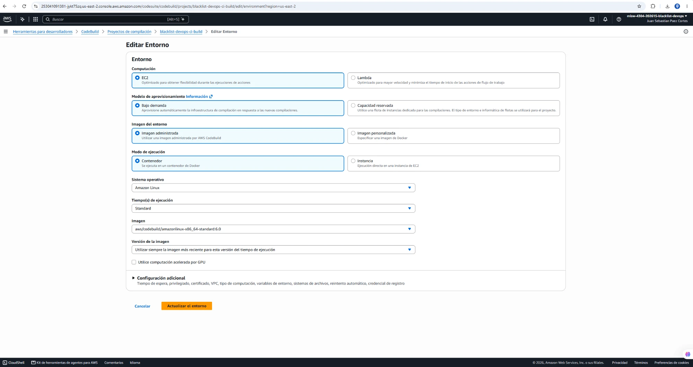
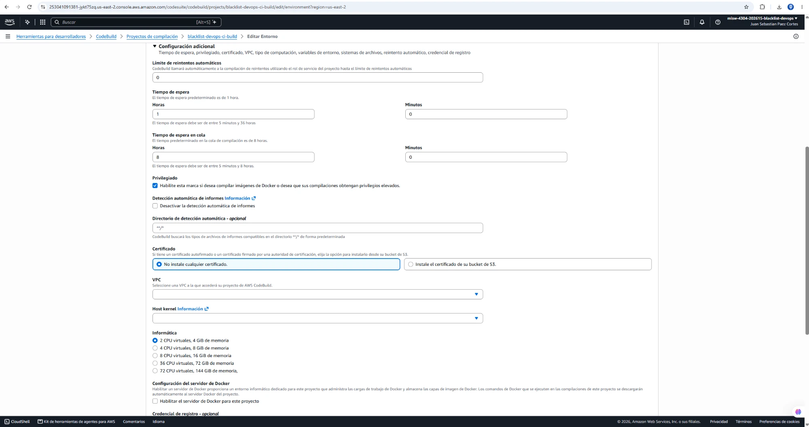
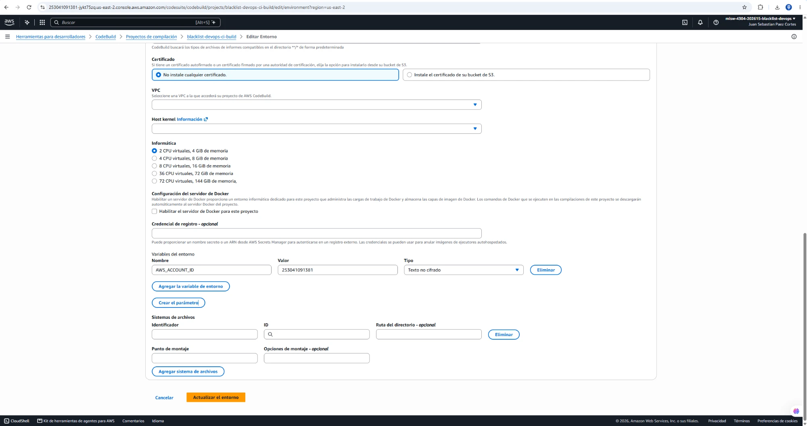
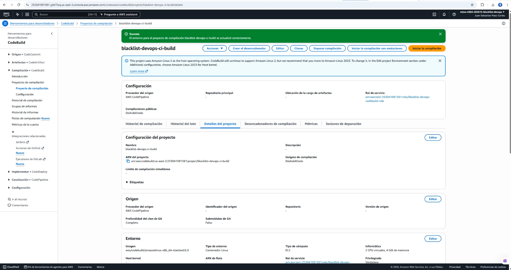
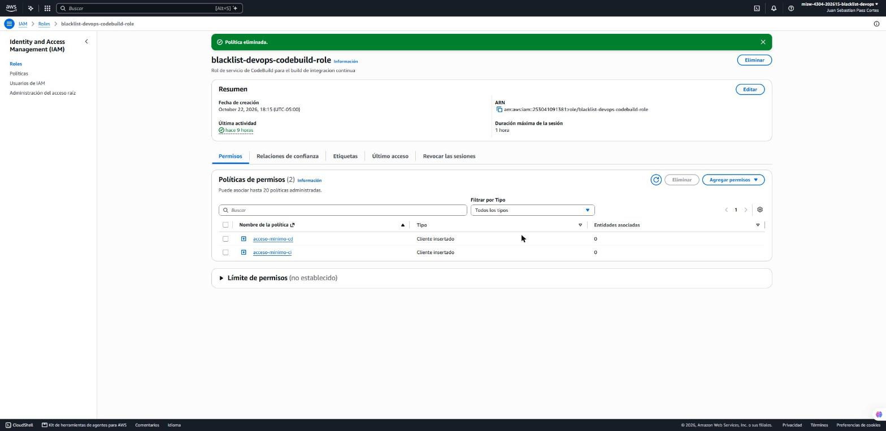
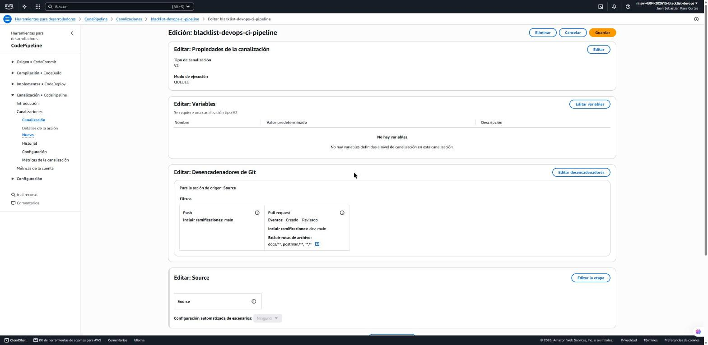
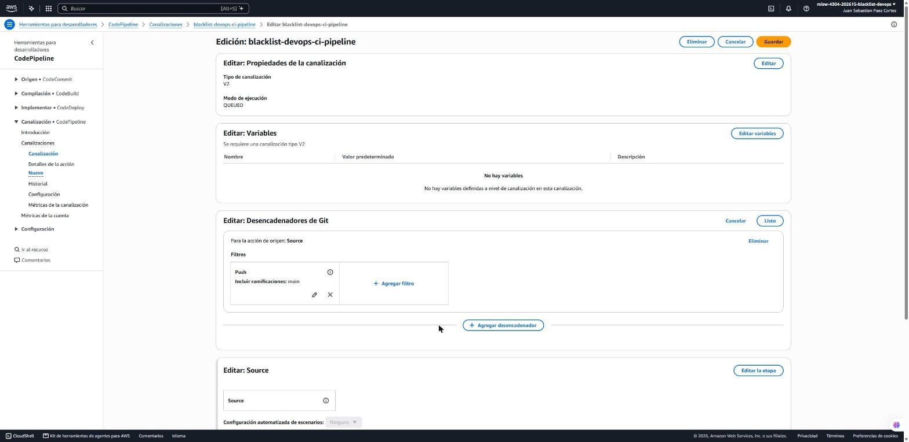
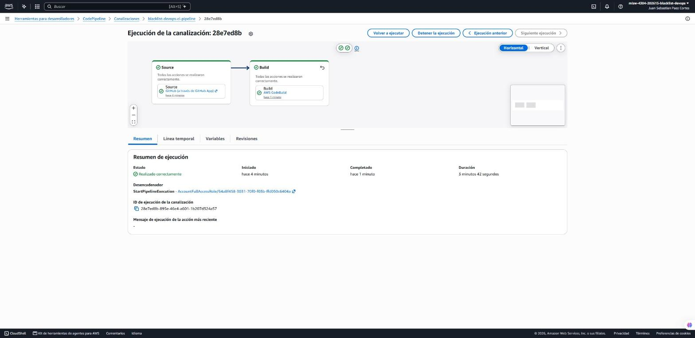
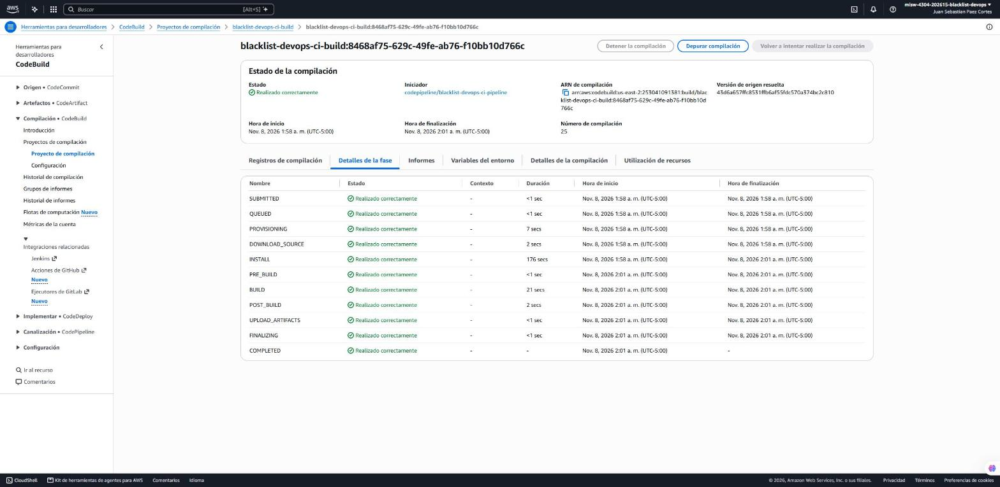
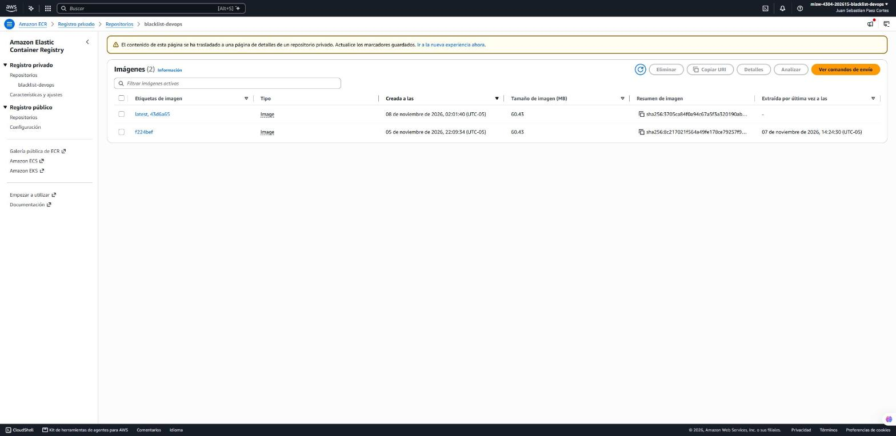

# Entrega 3 · Proyecto de CodeBuild con Docker

Tarea 1.14 (#201) · Épica E3 · Implementación

Este documento registra el cambio del proyecto `blacklist-devops-ci-build` para que construya la imagen del
contenedor y la envíe a ECR con el `buildspec.yml` de la 1.12 (#170). Aplica las secciones 5.3 y 6.9 del diseño de la
1.3 (#191, `docs/ci/entrega-3/1.3-diseno-pipeline.md`) y los permisos del rol de CodeBuild de la 1.6 (#194,
`docs/ci/entrega-3/1.6-roles-iam.md`); no reemplaza el enunciado oficial de `docs/entrega-3-entrega-continua.md`.

El cambio se hizo desde la consola de AWS el **8 de noviembre de 2026** a las 01:54 (UTC-05:00), en la cuenta del
proyecto y la región **us-east-2**. La ejecución de prueba del pipeline corrió a las 01:58. A las 11:56 se quitó el
disparador de *pull request* del pipeline (decisión 4 de la 1.1, #189) y se eliminó una política que la consola había
agregado al rol de CodeBuild (sección 3.5).

## 1. Resultado

| Campo del proyecto | Antes (Entrega 2) | Ahora |
|---|---|---|
| Modo privilegiado | `false` | **`true`** |
| Variables de entorno del proyecto | Ninguna | **`AWS_ACCOUNT_ID` = `253041091381`** (texto plano) |
| Imagen | `aws/codebuild/amazonlinux-x86_64-standard:6.0` | Sin cambios |
| Cómputo | `BUILD_GENERAL1_SMALL` (2 vCPU, 4 GiB) | Sin cambios |
| Rol de servicio | `blacklist-devops-codebuild-role` con `acceso-minimo-ci` y `acceso-minimo-cd` | Sin cambios (la política que agregó la consola se eliminó, sección 3.5) |
| Origen y artefactos | `CODEPIPELINE` | Sin cambios |
| Tiempo de espera | 60 minutos | Sin cambios |

| Disparadores del pipeline `blacklist-devops-ci-pipeline` | Antes (Entrega 2) | Ahora |
|---|---|---|
| *Push* | Rama `main`, sin filtro de rutas | Sin cambios |
| *Pull request* | Abierto y actualizado hacia `dev` y `main`, sin `docs/**`, `postman/**` ni `**/*.md` | **Eliminado** |

Ejecución que cumple el DoD:

| Dato | Valor |
|---|---|
| Ejecución del pipeline | `28e7ed8b-895e-46e4-a601-1b207d324a57`, *Succeeded*, 3 min 42 s |
| Construcción | `blacklist-devops-ci-build:8468af75-629c-49fe-ab76-f10bb10d766c` (número 25), *SUCCEEDED* |
| Commit | `43d6a657ffc8531ffb6af55fdc570a374bc2c810` (`dev`, merge de la 1.9) |
| Pruebas | Python 3.13.16; `156 passed`, cobertura total 100 % |
| Imagen en ECR | `blacklist-devops:43d6a65` y `latest`, `sha256:3705ca84f0a94c67a5f3a320190ab12d3f6d38ef5f745078e106900499e8d039`, 60.433.382 bytes, enviada el 8 de noviembre de 2026 a las 02:01:40 |
| Artefacto `BuildArtifact` | `imageDetail.json` con `{"ImageURI":"253041091381.dkr.ecr.us-east-2.amazonaws.com/blacklist-devops:43d6a65"}` |

## 2. Decisiones

| Tema | Decisión | Por qué |
|---|---|---|
| Modo privilegiado | Activado | CodeBuild solo permite `docker build` y `docker push` dentro del contenedor del build con el modo privilegiado (sección 6.9 del diseño) |
| `AWS_ACCOUNT_ID` | Variable del proyecto, en texto plano | El `buildspec.yml` la exige y arma con ella la dirección del registro. El ID de la cuenta no es un secreto y así no queda escrito en el repositorio |
| `AWS_DEFAULT_REGION` | No se define | CodeBuild la define en cada construcción con la región del proyecto (`us-east-2`) |
| `COMMIT_ID` | Sigue llegando desde la acción de construcción del pipeline (`#{SourceVariables.CommitId}`) | Es la misma variable de la Entrega 2. El proyecto no la repite |
| `ECR_REPOSITORY` | Queda en el `buildspec.yml` (`blacklist-devops`) | La fijó la 1.12; no es un dato de la cuenta |
| Rol | El mismo `blacklist-devops-codebuild-role` | La 1.6 ya le dio el inicio de sesión en ECR y el envío al repositorio `blacklist-devops` (política `acceso-minimo-cd`) |
| Artefactos | `imageDetail.json` desde el `buildspec.yml`; `taskdef.json` y `appspec.yaml` no salen del build | Según la sección 4 del diseño, la etapa de despliegue los toma de `SourceArtifact` y `imageDetail.json` de `BuildArtifact`. El proyecto sigue con artefactos `CODEPIPELINE` y no necesita otro cambio. Los dos archivos los agrega la 1.13 (#200) |
| Servidor de Docker del proyecto | No se activa | Cobra aparte; el modo privilegiado basta |
| Disparador de *pull request* | Se quita; queda solo el *push* a `main` | Decisión 4 de la 1.1: abrir o actualizar un PR no ejecuta nada en AWS. Con `AWS_ACCOUNT_ID` en el proyecto, un PR de código hacia `dev` habría enviado a ECR la imagen de una rama sin fusionar y movido `latest` |

## 3. Procedimiento

*CodeBuild* → *Proyectos de compilación* → `blacklist-devops-ci-build` → sección *Entorno* → *Editar*.

La parte de arriba se dejó como estaba: EC2, bajo demanda, imagen administrada, contenedor, Amazon Linux, *Standard*,
`aws/codebuild/amazonlinux-x86_64-standard:6.0` y la versión más reciente de la imagen.



En *Configuración adicional* se marcó **Privilegiado**. El tiempo de espera, la VPC, el certificado y el cómputo no
cambiaron, y no se activó el servidor de Docker.



En *Variables del entorno* se agregó `AWS_ACCOUNT_ID` con el valor `253041091381` y tipo *Texto no cifrado*.



Con *Actualizar el entorno* el proyecto queda con *Privilegiado: Verdadero*.



### 3.5 Política del rol y disparador de *pull request*

Al guardar el entorno, la consola creó y adjuntó al rol la política `CodeBuildBasePolicy-blacklist-devops-codebuild-role-us-east-2`
(sección 7). A las 11:54 se quitó del rol (*IAM* → *Roles* → `blacklist-devops-codebuild-role` → *Permisos*, solo esa
política → *Eliminar*) y después se eliminó (*IAM* → *Políticas*, con 0 entidades asociadas → *Eliminar*). El rol queda
con sus dos políticas en línea, como lo documenta la 1.6.



*CodePipeline* → `blacklist-devops-ci-pipeline` → *Editar* → *Editar desencadenadores*: se quitó el filtro *Pull
request* con su ✕ y quedó solo el filtro *Push* de la rama `main`. *Listo* y *Guardar*. Guardar no inició ninguna
ejecución.





En ninguna pantalla apareció el aviso de **características avanzadas**.

## 4. Ejecución de prueba

El pipeline toma `main`, que en este momento tiene todavía el `buildspec.yml` de la Entrega 2, y en el momento de la
prueba su disparador de *pull request* no se activaba con cambios que solo tocan documentación. Por eso la prueba se
lanzó a mano sobre el último commit de `dev`, que ya tiene el `buildspec.yml` de la 1.12:

```bash
aws codepipeline start-pipeline-execution --name blacklist-devops-ci-pipeline --region us-east-2 \
  --source-revisions actionName=Source,revisionType=COMMIT_ID,revisionValue=43d6a657ffc8531ffb6af55fdc570a374bc2c810
```

Las etapas *Source* y *Build* terminaron correctamente. El pipeline todavía no tiene etapa de despliegue: la agrega la
1.16 (#203).



Fases de la construcción: `INSTALL` 176 s (Python 3.13.16 y dependencias), `BUILD` 21 s (pruebas y `docker build`),
`POST_BUILD` 2 s (envío de las dos etiquetas y `imageDetail.json`) y `UPLOAD_ARTIFACTS` correcto.



Del registro de la construcción (`/aws/codebuild/blacklist-devops-ci-build`):

```text
Python 3.13.16
TOTAL                                                                 290      0   100%
156 passed in 1.04s
Login Succeeded
#13 naming to 253041091381.dkr.ecr.us-east-2.amazonaws.com/blacklist-devops:43d6a65 done
#13 naming to 253041091381.dkr.ecr.us-east-2.amazonaws.com/blacklist-devops:latest done
43d6a65: digest: sha256:3705ca84f0a94c67a5f3a320190ab12d3f6d38ef5f745078e106900499e8d039 size: 2617
latest: digest: sha256:3705ca84f0a94c67a5f3a320190ab12d3f6d38ef5f745078e106900499e8d039 size: 2617
{"ImageURI":"253041091381.dkr.ecr.us-east-2.amazonaws.com/blacklist-devops:43d6a65"}
```

ECR queda con dos imágenes: la nueva con `latest` y `43d6a65`, y la de la 1.7 (#195), que conserva `f224bef`.



## 5. Verificación con la CLI

```bash
aws codebuild batch-get-projects --names blacklist-devops-ci-build --region us-east-2 \
  --query 'projects[0].environment.{privilegiado:privilegedMode,variables:environmentVariables[].[name,type]}'
aws codepipeline get-pipeline-execution --pipeline-name blacklist-devops-ci-pipeline \
  --pipeline-execution-id 28e7ed8b-895e-46e4-a601-1b207d324a57 --region us-east-2
aws codebuild batch-get-builds --ids blacklist-devops-ci-build:8468af75-629c-49fe-ab76-f10bb10d766c --region us-east-2
aws ecr describe-images --repository-name blacklist-devops --region us-east-2
aws iam list-attached-role-policies --role-name blacklist-devops-codebuild-role
aws iam list-role-policies --role-name blacklist-devops-codebuild-role
aws codepipeline get-pipeline --name blacklist-devops-ci-pipeline --region us-east-2 --query pipeline.triggers
```

| Comprobación | Resultado |
|---|---|
| Modo privilegiado y variables | `true`; una sola variable, `AWS_ACCOUNT_ID`, `PLAINTEXT` |
| Ejecución del pipeline | `Succeeded`; *Source* con el commit `43d6a65…` y *Build* correcto |
| Construcción | `SUCCEEDED`, versión resuelta `43d6a657ffc8531ffb6af55fdc570a374bc2c810` |
| ECR | `latest,43d6a65` con `sha256:3705ca84…` y `f224bef` con `sha256:8c217021…` |
| Artefacto | El `BuildArtifact` de la ejecución contiene solo `imageDetail.json`, con la dirección de la imagen `43d6a65` |
| Permisos de ECR del rol | `iam simulate-principal-policy`: `allowed` para `ecr:GetAuthorizationToken` y las acciones de envío sobre `blacklist-devops` |
| Políticas del rol | Ninguna adjunta; en línea, `acceso-minimo-cd` y `acceso-minimo-ci`. `CodeBuildBasePolicy-…` ya no existe en la cuenta |
| Disparadores del pipeline | Uno solo: `push` a `main`, sin `pullRequest` (versión 3 del pipeline, 8 de noviembre a las 11:56) |

## 6. Costo

Las construcciones usan los minutos de CodeBuild (`BUILD_GENERAL1_SMALL`, unos 4 minutos por ejecución). Cada imagen
ocupa unos 60 MB en ECR, y la política de ciclo de vida de la 1.7 conserva solo las últimas 10.

## 7. Notas

- **Política que agregó la consola:** al guardar el entorno, la consola creó y adjuntó al rol
  `blacklist-devops-codebuild-role` la política administrada por el cliente
  `CodeBuildBasePolicy-blacklist-devops-codebuild-role-us-east-2` (8 de noviembre, 01:54). La página de edición del
  entorno no muestra la casilla *Permitir que AWS CodeBuild modifique este rol de servicio*. La política permite los
  registros del proyecto (ya los da `acceso-minimo-ci`), lectura y escritura en los buckets `codepipeline-us-east-2-*`
  (el pipeline usa `blacklist-devops-ci-artifacts-253041091381`) y los grupos de informes de pruebas del proyecto (el
  `buildspec.yml` no define `reports`). La construcción no usa nada de eso: le basta con `acceso-minimo-ci` y
  `acceso-minimo-cd`. Se quitó del rol y se eliminó a las 11:54 (sección 3.5). Si se vuelve a editar el entorno del
  proyecto desde la consola, hay que revisar que no la cree otra vez.
- **`latest` se movió:** ahora apunta a la imagen `43d6a65`. Nada del diseño depende de `latest`: la 1.10 (#198) pide
  la imagen con la etiqueta del commit, y el `taskdef.json` de la sección 5.5 del diseño usa `<IMAGE1_NAME>`, que la
  etapa de despliegue reemplaza con la dirección de `imageDetail.json`. Al 8 de noviembre todavía no hay clúster ni
  definición de la tarea en ECS; la 1.10 puede usar `f224bef` o `43d6a65`.
- **Aviso de Amazon Linux 2:** la consola avisa que el proyecto usa Amazon Linux 2 como sistema del *host* y recomienda
  Amazon Linux 2023 en *Host kernel*. No se cambió: AWS sigue soportando Amazon Linux 2 y el build funciona con él.
- **Disparo desde `main`:** sin el disparador de *pull request*, los PR hacia `dev` ya no ejecutan el pipeline. Desde
  la promoción de `dev` a `main` (2.2, #206), el pipeline correrá solo con cada *push* a `main`. Las ejecuciones
  manuales, como la de la sección 4, siguen disponibles con `start-pipeline-execution`. La 1.16 (#203) agrega la
  etapa de despliegue sobre este mismo disparador.
- **Registro de Docker:** `docker login` advierte que guarda la credencial sin cifrar en el contenedor del build. Ese
  contenedor se descarta al terminar y la credencial de ECR caduca a las 12 horas.

## 8. Cumplimiento de la tarea

| Criterio de la tarea 1.14 (#201) | Evidencia |
|---|---|
| Modo privilegiado activado | Secciones 1, 3 y 5; capturas `1.14-codebuild-privilegiado.png` y `1.14-codebuild-actualizado.png` |
| Variables sin secretos: `AWS_ACCOUNT_ID`, `AWS_DEFAULT_REGION` y el repositorio de ECR | Sección 2: `AWS_ACCOUNT_ID` en el proyecto, `AWS_DEFAULT_REGION` de CodeBuild y `ECR_REPOSITORY` en el `buildspec.yml`; captura `1.14-codebuild-variable.png` |
| Rol con los permisos de ECR de la 1.6 | Secciones 2, 3.5 y 5; captura `1.14-rol-codebuild.png` (solo `acceso-minimo-ci` y `acceso-minimo-cd`) |
| Artefactos de salida para la etapa de despliegue | Sección 2: `imageDetail.json` en `BuildArtifact`; `taskdef.json` y `appspec.yaml` desde `SourceArtifact` (sección 4 del diseño, 1.13) |
| Sin características avanzadas | Secciones 3 y 3.5 |
| Sin disparador de *pull request* (decisión 4 de la 1.1, pedido en el estado del equipo del 8 de noviembre) | Secciones 1, 3.5 y 5; capturas `1.14-pipeline-disparadores-*.png` |
| DoD: una ejecución del proyecto desde el pipeline construye la imagen y la envía a ECR | Sección 4; capturas `1.14-pipeline-ejecucion.png`, `1.14-build-fases.png` y `1.14-ecr-imagen.png`. También cierra la casilla del DoD de la 1.12 (#170) que el equipo dejó para esta tarea |
