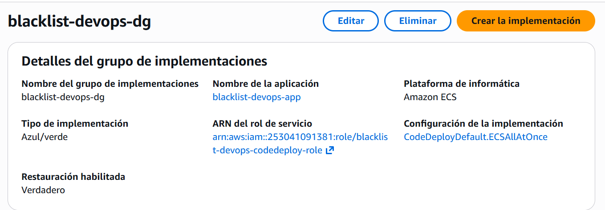
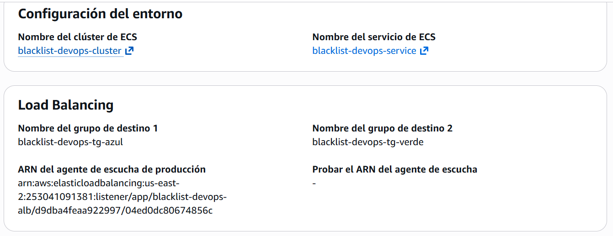

# Entrega 3 · CodeDeploy: aplicación y grupo de despliegue

Tarea 1.15 (#202) · Épica E3 · Implementación

Este documento registra la aplicación y el grupo de despliegue de CodeDeploy que despliegan el servicio de Fargate de la
1.11 (#199) con la estrategia azul/verde. Parte de las decisiones 1, 2 y 3 de la 1.2 (#190) y aplica los nombres del
diseño de la 1.3 (#191, `docs/ci/entrega-3/1.3-diseno-pipeline.md`, secciones 6.4 y 6.6), el rol de la 1.6 y el
balanceador y los grupos de destino de la 1.9; no reemplaza el enunciado oficial de
`docs/entrega-3-entrega-continua.md`.

Todo se creó con la AWS CLI en AWS CloudShell, en la cuenta del proyecto y la región **us-east-2**, el **8 de noviembre
de 2026**. Cada comando de creación se ejecutó una sola vez, con confirmación previa. El grupo todavía no ha desplegado
nada: la primera ejecución la hace el pipeline con la 1.16 (#203).

## 1. Resultado

| Recurso | Nombre | Identificador |
|---|---|---|
| Aplicación de CodeDeploy | `blacklist-devops-app` | `75671b65-17b2-4979-917f-1029d0321a69`, plataforma `ECS` |
| Grupo de despliegue | `blacklist-devops-dg` | `a801a2b6-ea7f-41a2-86fd-72204261825a` |

| Configuración del grupo | Valor |
|---|---|
| Rol de servicio | `arn:aws:iam::253041091381:role/blacklist-devops-codedeploy-role` (1.6) |
| Servicio y clúster | `blacklist-devops-service` en `blacklist-devops-cluster` (1.11) |
| Tipo de despliegue | `BLUE_GREEN`, con control de tráfico (`WITH_TRAFFIC_CONTROL`) |
| Grupos de destino | `blacklist-devops-tg-azul` y `blacklist-devops-tg-verde` (1.9) |
| *Listener* de producción | `arn:aws:elasticloadbalancing:us-east-2:253041091381:listener/app/blacklist-devops-alb/d9dba4feaa922997/04ed0dc80674856c` (HTTP:80, 1.9). Sin *listener* de prueba |
| Paso del tráfico | `CodeDeployDefault.ECSAllAtOnce`: todo el tráfico pasa de una vez a la versión nueva |
| Aprobación para pasar el tráfico | Ninguna: `CONTINUE_DEPLOYMENT` con espera de 0 minutos |
| Espera antes de terminar la versión anterior | 2 minutos |
| Reversión automática | Activa, ante el evento `DEPLOYMENT_FAILURE`. Sin alarmas de CloudWatch |

**Actualización (10 de noviembre de 2026):** el paso del tráfico es ahora `CodeDeployDefault.ECSCanary10Percent5Minutes`. Con
`ECSAllAtOnce` y sin *listener* de prueba, CodeDeploy no verifica la salud de la versión nueva antes de pasarle el
tráfico (2.3, #207, hallazgo 4). El grupo se cambió el 9 de noviembre para la 2.5 (#209) y el equipo votó dejarlo así;
la decisión está en [1.3-diseno-pipeline.md](1.3-diseno-pipeline.md), sección 2.2. Este documento conserva la
configuración con la que se creó el grupo.

## 2. Decisiones

| Aspecto | Decisión | Motivo |
|---|---|---|
| Tipo de despliegue | Azul/verde con control de tráfico, dos grupos de destino y el *listener* de producción. Sin *listener* de prueba | Decisión 1 de la 1.2: es el tipo que CodeDeploy usa con ECS, y el *listener* de prueba es opcional, suma configuración y la rúbrica no lo pide |
| Paso del tráfico | `CodeDeployDefault.ECSAllAtOnce` | Decisión 2 de la 1.2: es la configuración más rápida y la más fácil de explicar en el video |
| Espera antes de terminar la versión anterior | 2 minutos | La decisión 2 de la 1.2 dejó el valor a esta tarea: "pocos minutos". El despliegue solo se da por terminado cuando esa espera acaba, así que el paso de despliegue del pipeline dura eso más. La anulación de registro de los grupos de destino es de 30 s (1.9), por lo que no hace falta esperar más. Mientras conviven las dos versiones se pagan dos tareas de Fargate: unos 0,0123 USD/h cada una |
| Aprobación manual | Ninguna | El pipeline despliega solo tras un CI exitoso, que es lo que pide el punto 3 del enunciado (40 %). Una pausa para aprobar impediría el despliegue automático |
| Reversión | Automática ante el fallo del despliegue. Sin reversión por alarmas | Decisión 3 de la 1.2: el CD fallido vuelve solo a la versión anterior. Las alarmas son de monitoreo (Entrega 4) |
| Rol | `blacklist-devops-codedeploy-role` | Es el rol de la 1.6, con la política administrada `AWSCodeDeployRoleForECS` |

## 3. Procedimiento

Región `us-east-2`. En CloudShell no se usa `--profile`; con la CLI local se agrega `--profile blacklist`.

### 3.1 Comprobar el servicio

El grupo de despliegue necesita que el servicio exista y use el controlador `CODE_DEPLOY` (solo lectura):

```bash
aws ecs describe-services --cluster blacklist-devops-cluster --services blacklist-devops-service --region us-east-2 \
  --query "services[0].{estado:status,controlador:deploymentController.type,tareas:runningCount}"
```

Resultado: `ACTIVE`, `CODE_DEPLOY` y 1 tarea en ejecución.

### 3.2 Aplicación

```bash
aws deploy create-application --application-name blacklist-devops-app --compute-platform ECS --region us-east-2
```

La respuesta devuelve el identificador de la aplicación, `75671b65-17b2-4979-917f-1029d0321a69`.

### 3.3 Grupo de despliegue

```bash
aws deploy create-deployment-group \
  --application-name blacklist-devops-app \
  --deployment-group-name blacklist-devops-dg \
  --service-role-arn arn:aws:iam::253041091381:role/blacklist-devops-codedeploy-role \
  --deployment-config-name CodeDeployDefault.ECSAllAtOnce \
  --deployment-style deploymentType=BLUE_GREEN,deploymentOption=WITH_TRAFFIC_CONTROL \
  --ecs-services serviceName=blacklist-devops-service,clusterName=blacklist-devops-cluster \
  --load-balancer-info '{"targetGroupPairInfoList":[{"targetGroups":[{"name":"blacklist-devops-tg-azul"},{"name":"blacklist-devops-tg-verde"}],"prodTrafficRoute":{"listenerArns":["arn:aws:elasticloadbalancing:us-east-2:253041091381:listener/app/blacklist-devops-alb/d9dba4feaa922997/04ed0dc80674856c"]}}]}' \
  --blue-green-deployment-configuration '{"terminateBlueInstancesOnDeploymentSuccess":{"action":"TERMINATE","terminationWaitTimeInMinutes":2},"deploymentReadyOption":{"actionOnTimeout":"CONTINUE_DEPLOYMENT","waitTimeInMinutes":0}}' \
  --auto-rollback-configuration enabled=true,events=DEPLOYMENT_FAILURE \
  --region us-east-2
```

La respuesta devuelve el identificador del grupo, `a801a2b6-ea7f-41a2-86fd-72204261825a`.

En la consola de CodeDeploy, el grupo aparece con la plataforma Amazon ECS, el tipo de implementación azul/verde, el rol
de la 1.6 y la configuración `CodeDeployDefault.ECSAllAtOnce`. La consola llama *Restauración habilitada* a la
reversión automática:



La misma pantalla, más abajo, muestra el servicio y el balanceador: el clúster y el servicio de la 1.11, los grupos de
destino azul y verde, el *listener* de producción y, vacío, el *listener* de prueba, que no se usa:



## 4. Verificación con la CLI

El grupo quedó creado con la reversión automática activa:

```bash
aws deploy get-deployment-group --application-name blacklist-devops-app --deployment-group-name blacklist-devops-dg \
  --region us-east-2 \
  --query "deploymentGroupInfo.{configuracion:deploymentConfigName,estilo:deploymentStyle,reversion:autoRollbackConfiguration,azulVerde:blueGreenDeploymentConfiguration,servicio:ecsServices,rol:serviceRoleArn}"
```

```json
{
    "configuracion": "CodeDeployDefault.ECSAllAtOnce",
    "estilo": {
        "deploymentType": "BLUE_GREEN",
        "deploymentOption": "WITH_TRAFFIC_CONTROL"
    },
    "reversion": {
        "enabled": true,
        "events": [
            "DEPLOYMENT_FAILURE"
        ]
    },
    "azulVerde": {
        "terminateBlueInstancesOnDeploymentSuccess": {
            "action": "TERMINATE",
            "terminationWaitTimeInMinutes": 2
        },
        "deploymentReadyOption": {
            "actionOnTimeout": "CONTINUE_DEPLOYMENT",
            "waitTimeInMinutes": 0
        }
    },
    "servicio": [
        {
            "serviceName": "blacklist-devops-service",
            "clusterName": "blacklist-devops-cluster"
        }
    ],
    "rol": "arn:aws:iam::253041091381:role/blacklist-devops-codedeploy-role"
}
```

La plataforma de la aplicación:

```bash
aws deploy get-application --application-name blacklist-devops-app --region us-east-2 --query "application.computePlatform"
```

Resultado: `"ECS"`.

## 5. Costo

| Recurso | Costo |
|---|---|
| Aplicación y grupo de despliegue de CodeDeploy | Sin costo: CodeDeploy no cobra por los despliegues en ECS |
| Segunda tarea de Fargate durante un despliegue | Unos 0,0123 USD/h mientras conviven las dos versiones, es decir, el arranque de la tarea nueva y los 2 minutos de espera: centavos de dólar por despliegue |

## 6. Notas

- **Qué falta para que despliegue:** la etapa de despliegue del pipeline (1.16, #203), que usa este grupo con
  `taskdef.json` y `appspec.yaml` (1.13) y la imagen de `imageDetail.json`.
- **Si cambian los nombres:** el pipeline de la 1.16 referencia la aplicación `blacklist-devops-app` y el grupo
  `blacklist-devops-dg` por nombre.
- **Si se recrea el balanceador:** cambia el ARN de su *listener* y hay que actualizar el grupo de despliegue con el
  nuevo, como dice la sección 8.2 del diseño de la 1.3.
- **Reversión:** solo se activa ante el fallo del despliegue. El CD fallido y su reversión se comprueban en la 2.5 (#209).
- **Características avanzadas:** ninguna de las pantallas de las capturas mostró el aviso de características avanzadas ni
  de actualizar el plan. La pantalla de creación de la aplicación de CodeDeploy ya se había revisado en la decisión 7 de
  la 1.1.
- **Sin secretos:** ningún comando ni salida de este documento contiene valores de secretos.

## 7. Cumplimiento de la tarea

| Criterio de la tarea 1.15 (#202) | Evidencia |
|---|---|
| Aplicación de CodeDeploy con plataforma Amazon ECS | Secciones 1, 3.2 y 4; captura `1.15-grupo-despliegue.png` |
| Grupo de despliegue: clúster y servicio de la 1.11, balanceador y los dos grupos de destino de la 1.9, rol de la 1.6 | Secciones 1 y 3.3; capturas `1.15-grupo-despliegue.png` y `1.15-grupo-balanceador.png` |
| Configuración del tráfico, tiempo de espera y reversión automática de la 1.2 | Secciones 1, 2 y 4 |
| DoD: grupo de despliegue creado (`aws deploy get-deployment-group`) | Sección 4 |
| DoD: reversión automática activa | Sección 4: `enabled: true`, evento `DEPLOYMENT_FAILURE`; captura `1.15-grupo-despliegue.png` (restauración habilitada) |
