# Entrega 3 · Roles de IAM para ECS, CodeDeploy, CodeBuild y CodePipeline

Tarea 1.6 (#194) · Épica E3 · Implementación

Este documento registra los roles de IAM con los que funcionan Fargate y el pipeline de entrega continua: dos
roles nuevos (ejecución de las tareas de ECS y servicio de CodeDeploy) y la ampliación de los dos roles de la
Entrega 2 (CodeBuild y CodePipeline). Parte de los nombres del diseño de la 1.3 (#191,
`docs/ci/entrega-3/1.3-diseno-pipeline.md`, secciones 6.6 y 6.7) y de la votación del grupo registrada en la #194;
no reemplaza el enunciado oficial de `docs/entrega-3-entrega-continua.md`.

Los roles se crearon el **5 de noviembre de 2026** desde la consola de AWS, en la cuenta del proyecto, con el
mismo procedimiento de la Entrega 2 (`docs/ci/1.5-roles-iam.md`). Los recursos a los que apuntan las políticas
(repositorio de ECR, grupo de registros, parámetros, aplicación y grupo de despliegue de CodeDeploy) se crean en
las tareas 1.7 a 1.15: las políticas los referencian por ARN, que se resuelve al usarlos.

## 1. Resultado

| Rol | Estado | Servicio de confianza | Políticas | Creación o cambio |
|---|---|---|---|---|
| `blacklist-devops-ecs-execution-role` | Nuevo | `ecs-tasks.amazonaws.com` | En línea `acceso-minimo-ecs` | 5 de noviembre de 2026, 17:42 (UTC-05:00) |
| `blacklist-devops-codedeploy-role` | Nuevo | `codedeploy.amazonaws.com` | Administrada `AWSCodeDeployRoleForECS` | 5 de noviembre de 2026, 18:09 (UTC-05:00) |
| `blacklist-devops-codebuild-role` | Ampliado | `codebuild.amazonaws.com` | En línea `acceso-minimo-ci` (Entrega 2) y `acceso-minimo-cd` (nueva) | Creado el 22 de octubre; `acceso-minimo-cd` agregada el 5 de noviembre |
| `blacklist-devops-codepipeline-role` | Ampliado | `codepipeline.amazonaws.com` | En línea `acceso-minimo-ci` (Entrega 2) y `acceso-minimo-cd` (nueva) | Creado el 22 de octubre; `acceso-minimo-cd` agregada el 5 de noviembre |

ARN (no son secretos):

- `arn:aws:iam::253041091381:role/blacklist-devops-ecs-execution-role`: lo usa la definición de la tarea
  (`executionRoleArn`, 1.10 y 1.13).
- `arn:aws:iam::253041091381:role/blacklist-devops-codedeploy-role`: lo usa el grupo de despliegue (1.15).
- `arn:aws:iam::253041091381:role/blacklist-devops-codebuild-role` y
  `arn:aws:iam::253041091381:role/blacklist-devops-codepipeline-role`: los usan el proyecto de CodeBuild (1.14) y
  el pipeline (1.16), como en la Entrega 2.

No hay rol de tarea (`taskRoleArn`): la aplicación no llama a ningún servicio de AWS.

## 2. Decisiones del grupo

Votación en el grupo de WhatsApp del 5 de noviembre de 2026 (comentario de la #194): la opción A ganó en las cuatro
preguntas, 3 votos a 0.

| N.º | Pregunta | Resultado |
|---|---|---|
| 1 | Política del rol de CodeDeploy | La administrada de AWS, `AWSCodeDeployRoleForECS`. Su equivalente en línea es largo (ECS, balanceador, CloudWatch, SNS, S3 e `iam:PassRole`) y lo mantiene AWS. Es la única excepción a las políticas en línea mínimas |
| 2 | Rol de ejecución de ECS | Política en línea mínima, limitada al repositorio de ECR, al grupo de registros y a los dos parámetros, en lugar de la administrada `AmazonECSTaskExecutionRolePolicy`, que da acceso a todos los repositorios y grupos de registros |
| 3 | Permiso de CodeBuild para subir imágenes | Política en línea limitada al repositorio `blacklist-devops`, en lugar de `AmazonEC2ContainerRegistryPowerUser` |
| 4 | Nombres de los roles nuevos | Los del diseño de la 1.3: `blacklist-devops-ecs-execution-role` y `blacklist-devops-codedeploy-role` |

Con esto queda resuelta la fila "Política del rol de CodeDeploy" de la sección 10 del diseño de la 1.3.

## 3. Qué hace cada rol

| Rol | Para qué | Qué puede hacer |
|---|---|---|
| Ejecución de ECS | ECS lo asume al arrancar cada tarea de Fargate | Obtener el token de ECR y descargar la imagen del repositorio `blacklist-devops`; escribir en el grupo `/ecs/blacklist-devops`; leer los parámetros `/blacklist-devops/DATABASE_URL` y `/blacklist-devops/JWT_SECRET_KEY` para inyectarlos como `secrets` |
| CodeDeploy | CodeDeploy lo asume en cada despliegue azul/verde | Lo que define `AWSCodeDeployRoleForECS`: crear y borrar los conjuntos de tareas del servicio, cambiar las reglas del *listener* del balanceador y pasar los roles de la tarea a ECS |
| CodeBuild (se agrega) | Además del build de la Entrega 2, construye y envía la imagen | Obtener el token de ECR y subir capas e imagen al repositorio `blacklist-devops` |
| CodePipeline (se agrega) | Además de la Entrega 2, lanza la etapa de despliegue | Crear y consultar despliegues del grupo `blacklist-devops-dg`, consultar la aplicación y su configuración, registrar la definición de la tarea y pasar el rol de ejecución a ECS |

Ningún rol tiene permisos de administrador ni usa llaves de acceso estáticas. Los permisos de la Entrega 2
(`acceso-minimo-ci`: registros de CodeBuild, bucket de artefactos, conexión de GitHub y lanzar el proyecto) no
cambian.

## 4. Relación de confianza

Las dos relaciones nuevas siguen el criterio de la Entrega 2: limitan el uso del rol a la cuenta del proyecto
con `aws:SourceAccount`. La del rol de ejecución, además, exige que la solicitud venga de un recurso de ECS de la
cuenta en `us-east-2` (`aws:SourceArn`).

Rol de ejecución de ECS:

```json
{
  "Version": "2012-10-17",
  "Statement": [
    {
      "Effect": "Allow",
      "Principal": { "Service": "ecs-tasks.amazonaws.com" },
      "Action": "sts:AssumeRole",
      "Condition": {
        "StringEquals": { "aws:SourceAccount": "253041091381" },
        "ArnLike": { "aws:SourceArn": "arn:aws:ecs:us-east-2:253041091381:*" }
      }
    }
  ]
}
```

Rol de CodeDeploy:

```json
{
  "Version": "2012-10-17",
  "Statement": [
    {
      "Effect": "Allow",
      "Principal": { "Service": "codedeploy.amazonaws.com" },
      "Action": "sts:AssumeRole",
      "Condition": { "StringEquals": { "aws:SourceAccount": "253041091381" } }
    }
  ]
}
```

Las relaciones de confianza de CodeBuild y CodePipeline no cambian (`docs/ci/1.5-roles-iam.md`, sección 3).

## 5. Políticas de permisos

Las acciones se listan una por una y los recursos son los ARN exactos del proyecto. Solo llevan `*` las acciones
que AWS no permite limitar a un recurso: `ecr:GetAuthorizationToken`, `ecs:RegisterTaskDefinition` y
`ecs:DescribeTaskDefinition`. No hace falta `kms:Decrypt`: los parámetros usan la clave administrada `aws/ssm`.

### 5.1 Rol de ejecución de ECS: `acceso-minimo-ecs`

| Sentencia | Acciones | Recurso |
|---|---|---|
| `TokenECR` | `ecr:GetAuthorizationToken` | `*` |
| `DescargarImagen` | `ecr:BatchCheckLayerAvailability`, `ecr:GetDownloadUrlForLayer`, `ecr:BatchGetImage` | Repositorio `blacklist-devops` |
| `Registros` | `logs:CreateLogStream`, `logs:PutLogEvents` | Grupo `/ecs/blacklist-devops` y sus flujos |
| `LeerParametros` | `ssm:GetParameters` | Los dos parámetros `/blacklist-devops/*` |

```json
{
  "Version": "2012-10-17",
  "Statement": [
    {
      "Sid": "TokenECR",
      "Effect": "Allow",
      "Action": "ecr:GetAuthorizationToken",
      "Resource": "*"
    },
    {
      "Sid": "DescargarImagen",
      "Effect": "Allow",
      "Action": ["ecr:BatchCheckLayerAvailability", "ecr:GetDownloadUrlForLayer", "ecr:BatchGetImage"],
      "Resource": "arn:aws:ecr:us-east-2:253041091381:repository/blacklist-devops"
    },
    {
      "Sid": "Registros",
      "Effect": "Allow",
      "Action": ["logs:CreateLogStream", "logs:PutLogEvents"],
      "Resource": [
        "arn:aws:logs:us-east-2:253041091381:log-group:/ecs/blacklist-devops",
        "arn:aws:logs:us-east-2:253041091381:log-group:/ecs/blacklist-devops:*"
      ]
    },
    {
      "Sid": "LeerParametros",
      "Effect": "Allow",
      "Action": "ssm:GetParameters",
      "Resource": [
        "arn:aws:ssm:us-east-2:253041091381:parameter/blacklist-devops/DATABASE_URL",
        "arn:aws:ssm:us-east-2:253041091381:parameter/blacklist-devops/JWT_SECRET_KEY"
      ]
    }
  ]
}
```

El rol no crea el grupo de registros (`logs:CreateLogGroup`): el grupo `/ecs/blacklist-devops` se crea en la
1.10 (#198), con retención de 7 días.

### 5.2 Rol de CodeDeploy: `AWSCodeDeployRoleForECS`

Política administrada por AWS, sin política en línea (decisión 1 de la sección 2). Es la que AWS documenta para el
rol de servicio de CodeDeploy en despliegues azul/verde de Amazon ECS.

### 5.3 Rol de CodeBuild: `acceso-minimo-cd`

| Sentencia | Acciones | Recurso |
|---|---|---|
| `TokenECR` | `ecr:GetAuthorizationToken` | `*` |
| `EnviarImagen` | `ecr:BatchCheckLayerAvailability`, `ecr:InitiateLayerUpload`, `ecr:UploadLayerPart`, `ecr:CompleteLayerUpload`, `ecr:PutImage`, `ecr:BatchGetImage`, `ecr:GetDownloadUrlForLayer` | Repositorio `blacklist-devops` |

```json
{
  "Version": "2012-10-17",
  "Statement": [
    {
      "Sid": "TokenECR",
      "Effect": "Allow",
      "Action": "ecr:GetAuthorizationToken",
      "Resource": "*"
    },
    {
      "Sid": "EnviarImagen",
      "Effect": "Allow",
      "Action": [
        "ecr:BatchCheckLayerAvailability",
        "ecr:InitiateLayerUpload",
        "ecr:UploadLayerPart",
        "ecr:CompleteLayerUpload",
        "ecr:PutImage",
        "ecr:BatchGetImage",
        "ecr:GetDownloadUrlForLayer"
      ],
      "Resource": "arn:aws:ecr:us-east-2:253041091381:repository/blacklist-devops"
    }
  ]
}
```

La imagen base se descarga del espejo público de ECR (`public.ecr.aws`), que no necesita permisos de IAM.

### 5.4 Rol de CodePipeline: `acceso-minimo-cd`

| Sentencia | Acciones | Recurso |
|---|---|---|
| `Desplegar` | `codedeploy:CreateDeployment`, `codedeploy:GetDeployment` | Grupo de despliegue `blacklist-devops-app/blacklist-devops-dg` |
| `Aplicacion` | `codedeploy:GetApplication`, `codedeploy:GetApplicationRevision`, `codedeploy:RegisterApplicationRevision` | Aplicación `blacklist-devops-app` |
| `ConfiguracionDespliegue` | `codedeploy:GetDeploymentConfig` | `CodeDeployDefault.ECSAllAtOnce` y, desde el 10 de noviembre, `CodeDeployDefault.ECSCanary10Percent5Minutes` |
| `DefinicionTarea` | `ecs:RegisterTaskDefinition`, `ecs:DescribeTaskDefinition` | `*` |
| `PasarRolEjecucion` | `iam:PassRole`, solo hacia `ecs-tasks.amazonaws.com` | Rol `blacklist-devops-ecs-execution-role` |

```json
{
  "Version": "2012-10-17",
  "Statement": [
    {
      "Sid": "Desplegar",
      "Effect": "Allow",
      "Action": ["codedeploy:CreateDeployment", "codedeploy:GetDeployment"],
      "Resource": "arn:aws:codedeploy:us-east-2:253041091381:deploymentgroup:blacklist-devops-app/blacklist-devops-dg"
    },
    {
      "Sid": "Aplicacion",
      "Effect": "Allow",
      "Action": [
        "codedeploy:GetApplication",
        "codedeploy:GetApplicationRevision",
        "codedeploy:RegisterApplicationRevision"
      ],
      "Resource": "arn:aws:codedeploy:us-east-2:253041091381:application:blacklist-devops-app"
    },
    {
      "Sid": "ConfiguracionDespliegue",
      "Effect": "Allow",
      "Action": "codedeploy:GetDeploymentConfig",
      "Resource": [
        "arn:aws:codedeploy:us-east-2:253041091381:deploymentconfig:CodeDeployDefault.ECSAllAtOnce",
        "arn:aws:codedeploy:us-east-2:253041091381:deploymentconfig:CodeDeployDefault.ECSCanary10Percent5Minutes"
      ]
    },
    {
      "Sid": "DefinicionTarea",
      "Effect": "Allow",
      "Action": ["ecs:RegisterTaskDefinition", "ecs:DescribeTaskDefinition"],
      "Resource": "*"
    },
    {
      "Sid": "PasarRolEjecucion",
      "Effect": "Allow",
      "Action": "iam:PassRole",
      "Resource": "arn:aws:iam::253041091381:role/blacklist-devops-ecs-execution-role",
      "Condition": { "StringEquals": { "iam:PassedToService": "ecs-tasks.amazonaws.com" } }
    }
  ]
}
```

## 6. Procedimiento

Igual que en la Entrega 2. IAM es un servicio global, pero se mantuvo la región **us-east-2** para que quede
visible en las capturas.

### 6.1 Rol de ejecución de ECS

1. *IAM* → *Roles* → *Create role* → **Custom trust policy**, con la relación de confianza de la sección 4.

   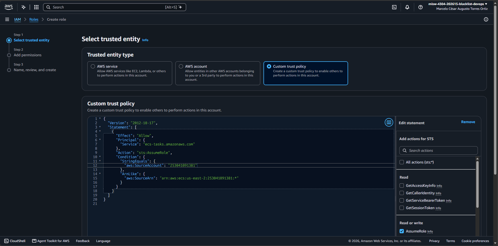

2. En *Add permissions*, ninguna política. Nombre y descripción, y revisión del resumen: la confianza en
   `ecs-tasks.amazonaws.com` y sin permisos.

   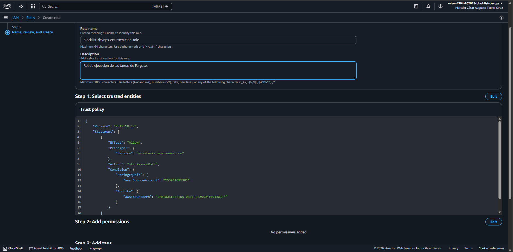

3. En el rol creado, *Add permissions* → *Create inline policy* → **JSON**, con la política de la sección 5.1,
   guardada como `acceso-minimo-ecs`. El editor no marcó errores ni advertencias.

   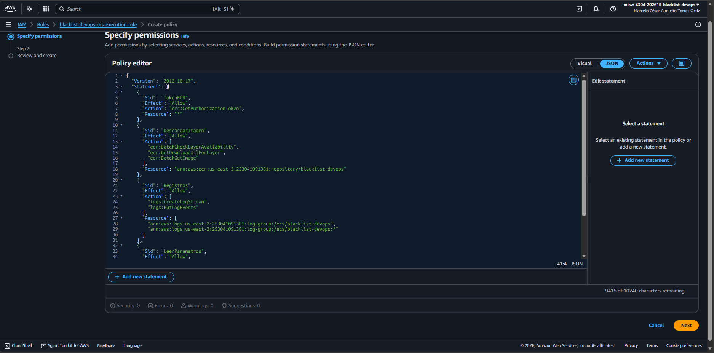

4. El rol queda con una sola política, de tipo *Customer inline*.

   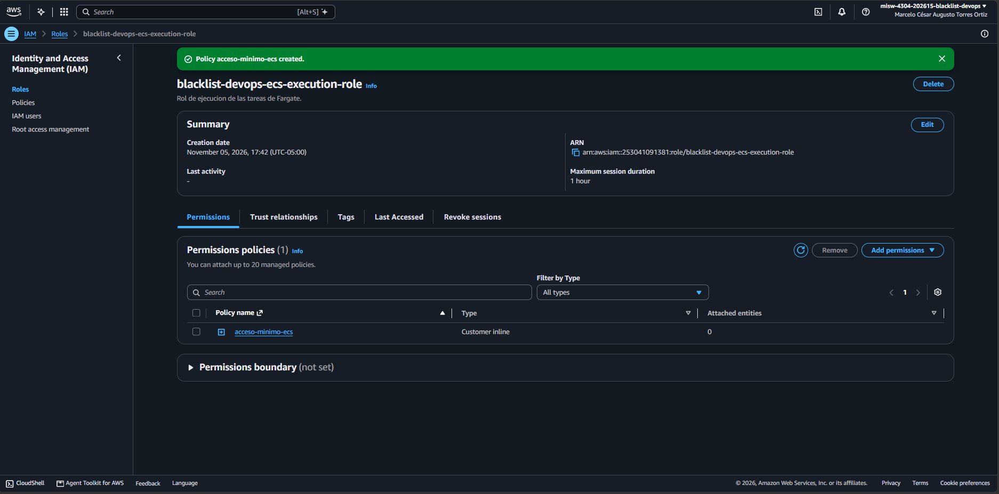

### 6.2 Rol de CodeDeploy

1. *Create role* → **Custom trust policy**, con la relación de confianza de la sección 4.

   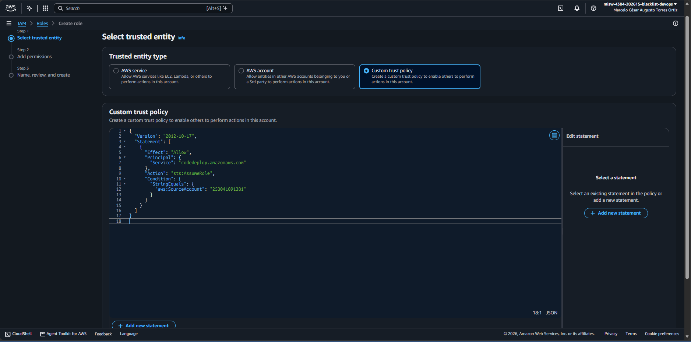

2. En *Add permissions*, la política administrada **AWSCodeDeployRoleForECS** (no la variante `Limited`).

   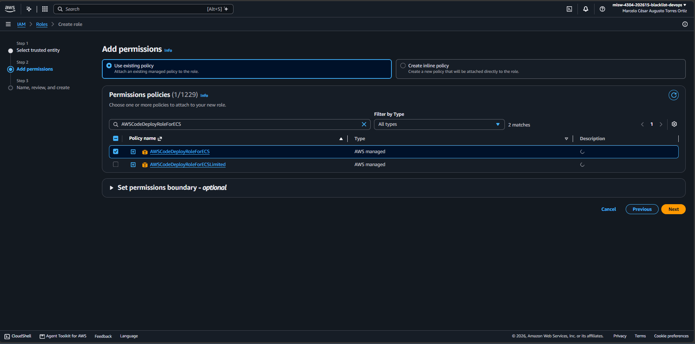

3. Nombre, descripción y revisión: la confianza en `codedeploy.amazonaws.com` y la política administrada.

   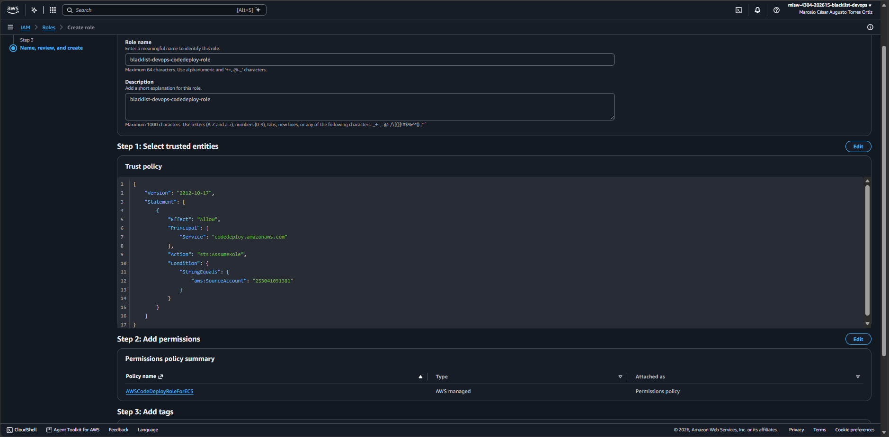

4. El rol queda con una sola política, de tipo *AWS managed*.

   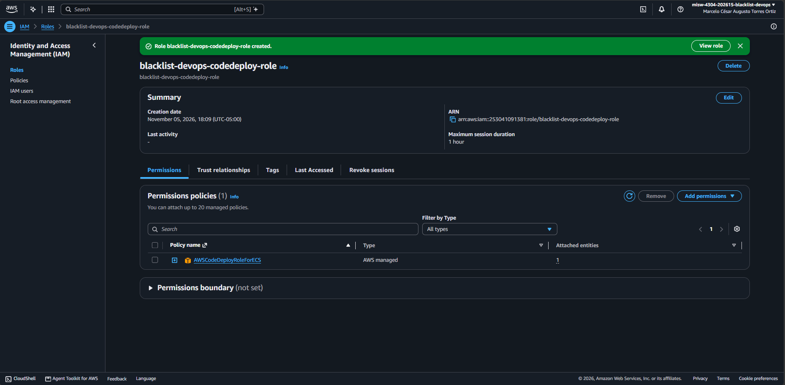

### 6.3 Rol de CodeBuild

1. Estado inicial: solo `acceso-minimo-ci`, de la Entrega 2.

   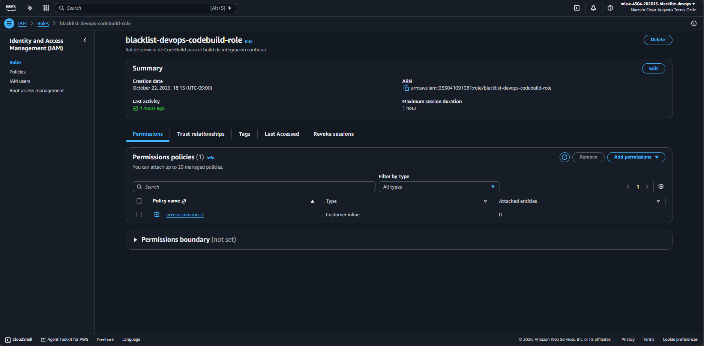

2. *Add permissions* → *Create inline policy* → **JSON**, con la política de la sección 5.3, guardada como
   `acceso-minimo-cd`.

   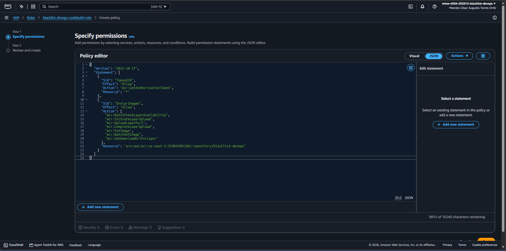

3. El rol queda con las dos políticas en línea.

   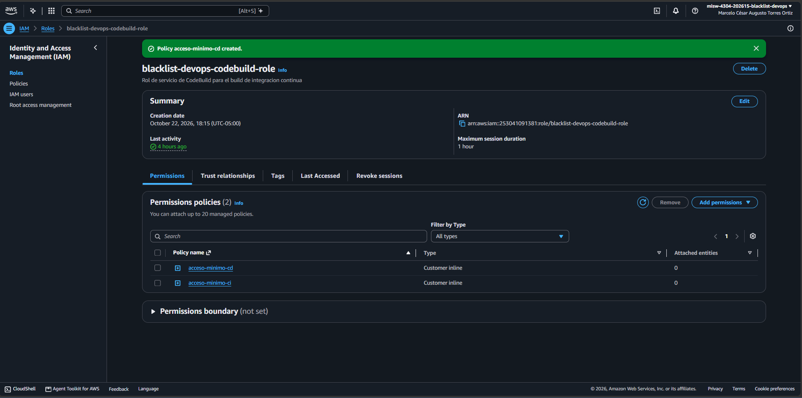

### 6.4 Rol de CodePipeline

1. *Add permissions* → *Create inline policy* → **JSON**, con la política de la sección 5.4, guardada como
   `acceso-minimo-cd`. El estado inicial era el mismo que el de CodeBuild (solo `acceso-minimo-ci`), verificado
   con la CLI antes del cambio (sección 7).

   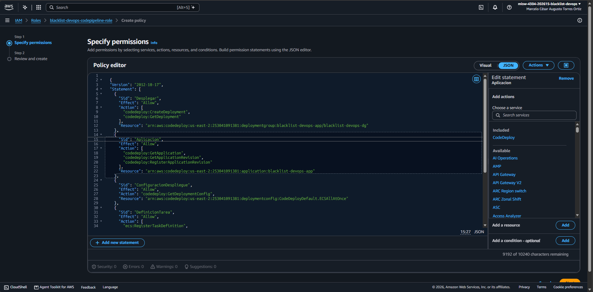

2. El rol queda con las dos políticas en línea.

   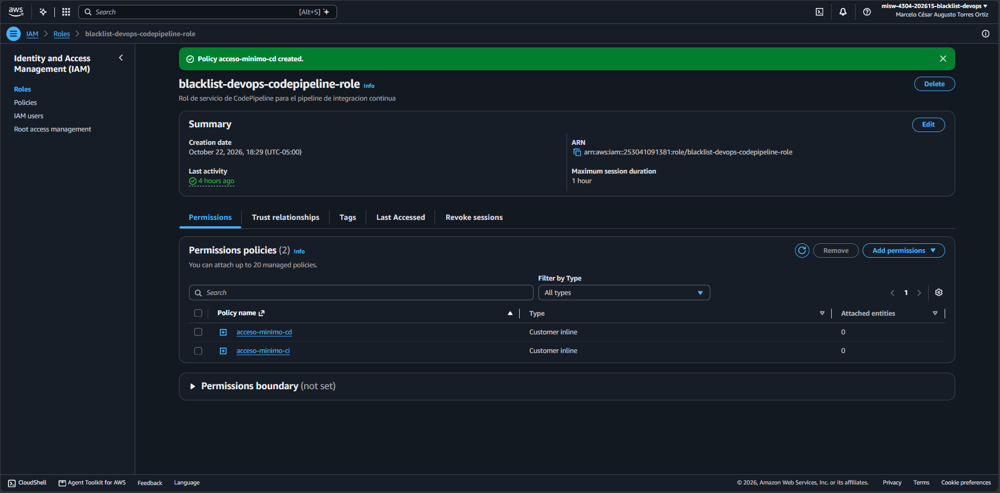

### 6.5 Lista de roles

Los cuatro roles del proyecto, filtrados por `blacklist-devops`, con su servicio de confianza.

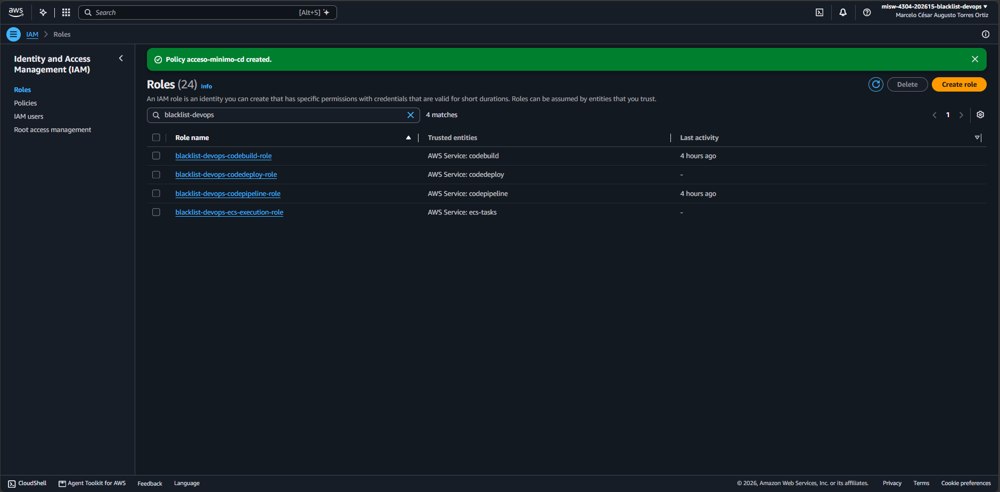

En ningún paso apareció el aviso de **características avanzadas**.

## 7. Verificación con la CLI

Antes del cambio, el 5 de noviembre de 2026, con consultas de solo lectura: `blacklist-devops-codebuild-role` y
`blacklist-devops-codepipeline-role` tenían solo `acceso-minimo-ci` (3 y 4 sentencias) y ninguna política
administrada, y los dos roles nuevos no existían (`NoSuchEntity`). En la cuenta ya existía
`AWSServiceRoleForECS`, el rol vinculado al servicio de ECS, así que no hubo que crearlo.

Después del cambio:

```bash
aws iam get-role --role-name <rol>
aws iam list-role-policies --role-name <rol>
aws iam list-attached-role-policies --role-name <rol>
aws iam get-role-policy --role-name <rol> --policy-name <política>
```

| Rol | Confianza igual a la sección 4 | Políticas en línea | Administradas | Política nueva igual a la sección 5 |
|---|---|---|---|---|
| `blacklist-devops-ecs-execution-role` | Sí | `acceso-minimo-ecs` | Ninguna | Sí |
| `blacklist-devops-codedeploy-role` | Sí | Ninguna | `AWSCodeDeployRoleForECS` | No aplica |
| `blacklist-devops-codebuild-role` | Sin cambios | `acceso-minimo-ci`, `acceso-minimo-cd` | Ninguna | Sí |
| `blacklist-devops-codepipeline-role` | Sin cambios | `acceso-minimo-ci`, `acceso-minimo-cd` | Ninguna | Sí |

## 8. Equivalente con la CLI

La creación se hizo desde la consola. Estos comandos la reproducen y no se ejecutaron: las escrituras de IAM las
hace la persona propietaria de la cuenta. Los archivos `trust-*.json` y `policy-*.json` contienen los JSON de las
secciones 4 y 5.

```bash
aws iam create-role --role-name blacklist-devops-ecs-execution-role \
  --description "Rol de ejecucion de las tareas de Fargate." \
  --assume-role-policy-document file://trust-ecs-execution.json
aws iam put-role-policy --role-name blacklist-devops-ecs-execution-role \
  --policy-name acceso-minimo-ecs --policy-document file://policy-ecs-execution.json

aws iam create-role --role-name blacklist-devops-codedeploy-role \
  --description "blacklist-devops-codedeploy-role" \
  --assume-role-policy-document file://trust-codedeploy.json
aws iam attach-role-policy --role-name blacklist-devops-codedeploy-role \
  --policy-arn arn:aws:iam::aws:policy/AWSCodeDeployRoleForECS

aws iam put-role-policy --role-name blacklist-devops-codebuild-role \
  --policy-name acceso-minimo-cd --policy-document file://policy-codebuild-cd.json
aws iam put-role-policy --role-name blacklist-devops-codepipeline-role \
  --policy-name acceso-minimo-cd --policy-document file://policy-codepipeline-cd.json
```

## 9. Notas

- **Descripciones:** la del rol de ejecución quedó "Rol de ejecucion de las tareas de Fargate." y la del rol de
  CodeDeploy repite su nombre. Es solo texto descriptivo y no afecta a los permisos.
- **Recursos aún inexistentes:** las políticas apuntan al repositorio de ECR (1.7), los parámetros (1.8), el
  grupo de registros (1.10) y la aplicación y el grupo de despliegue de CodeDeploy (1.15). Si alguno se crea con
  otro nombre, hay que actualizar la política que lo nombra.
- **Permisos que falten:** si al crear el proyecto de CodeBuild (1.14), el grupo de despliegue (1.15) o el
  pipeline (1.16) la consola o una ejecución piden un permiso más, se agrega solo ese y se anota aquí.
- **Lectura de los secretos:** solo el rol de ejecución tiene `ssm:GetParameters` sobre los parámetros del
  proyecto. La comprobación de que la tarea los lee se hace en la 1.8 (#196) y la 1.11 (#199).
- **Sin secretos:** las capturas no muestran llaves, tokens ni valores de parámetros. El ID de cuenta, los ARN y
  el nombre de la persona en la barra de la consola no son secretos.

## 10. Cumplimiento de la tarea

| Criterio de la tarea 1.6 (#194) | Evidencia |
|---|---|
| Rol de ejecución de la tarea de ECS: imagen de ECR, registros y lectura de los secretos | Secciones 3, 4 y 5.1; capturas `1.6-ecs-execution-*.png` |
| Rol de servicio de CodeDeploy para ECS | Secciones 4 y 5.2; capturas `1.6-codedeploy-*.png` |
| Rol de CodeBuild: envío de imágenes a ECR | Sección 5.3; capturas `1.6-codebuild-*.png` |
| Rol de CodePipeline: CodeDeploy, ECS e `iam:PassRole` del rol de la tarea (sin CodeCommit, decisión 1 de la 1.1) | Sección 5.4; capturas `1.6-codepipeline-*.png` |
| Mínimo privilegio | Sección 5: recursos exactos del proyecto; `*` solo donde AWS no admite un recurso; la administrada de CodeDeploy por decisión del grupo |
| Roles visibles con `aws iam get-role` | Sección 7 |
| Las políticas cubren las tareas 1.10, 1.14, 1.15 y 1.16 | Sección 3; se confirma al ejecutar esas tareas (sección 9) |
