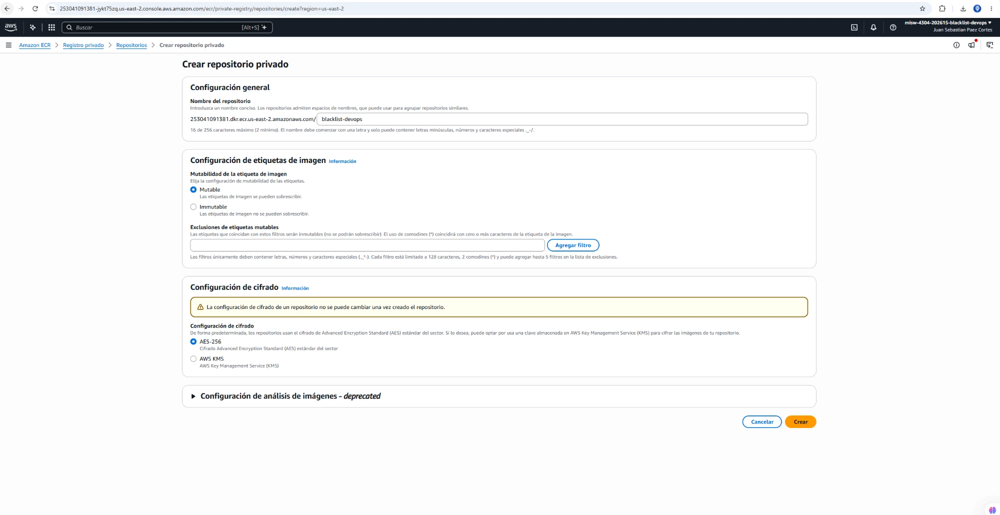
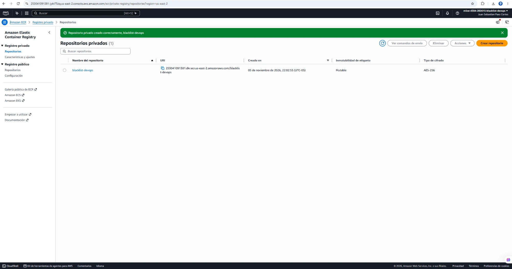
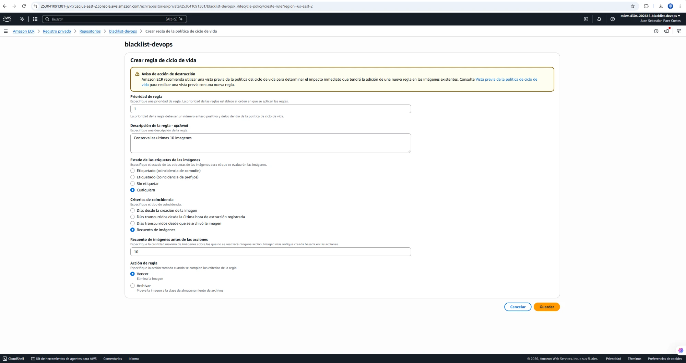
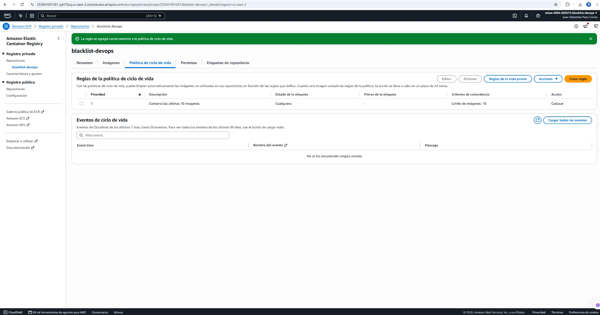
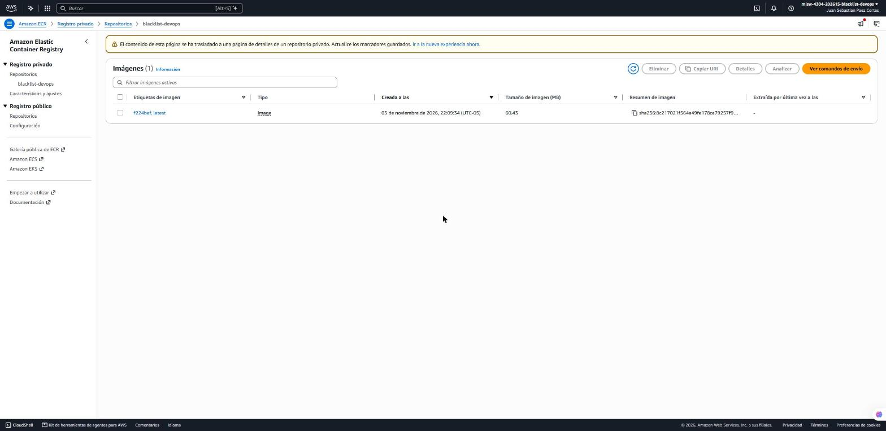

# Entrega 3 · Repositorio de ECR y primera imagen

Tarea 1.7 (#195) · Épica E3 · Implementación

Este documento registra el repositorio privado de Amazon ECR donde se guardan las imágenes del microservicio y la
primera imagen, cargada a mano, que usa el despliegue manual en Fargate de la 1.10 (#198) y la 1.11 (#199). Parte del
nombre y las reglas del diseño de la 1.3 (#191, `docs/ci/entrega-3/1.3-diseno-pipeline.md`, sección 6.1) y de la
imagen de la 1.5 (#193, `Dockerfile`); no reemplaza el enunciado oficial de `docs/entrega-3-entrega-continua.md`.

El repositorio se creó el **5 de noviembre de 2026** desde la consola de AWS, en la cuenta del proyecto y la región
**us-east-2**. Desde la 1.12 (#170) las imágenes las envía el pipeline; esta es la única que se carga a mano.

## 1. Resultado

| Dato | Valor |
|---|---|
| Repositorio | `blacklist-devops` (privado) |
| URI | `253041091381.dkr.ecr.us-east-2.amazonaws.com/blacklist-devops` |
| ARN | `arn:aws:ecr:us-east-2:253041091381:repository/blacklist-devops` |
| Creado | 5 de noviembre de 2026, 22:02:55 (UTC-05:00) |
| Mutabilidad de etiquetas | Mutable, sin exclusiones |
| Cifrado | AES-256 (el predeterminado de ECR) |
| Análisis de imágenes | El básico del registro, sin análisis al enviar ni reglas (sin características avanzadas) |
| Política de ciclo de vida | Una regla: conserva las últimas 10 imágenes |
| Primera imagen | Etiquetas `f224bef` y `latest`, `sha256:8c217021f564a49fe178ce79257f97776bb64c581919b57b1dcd4fb476ddb644`, 60,43 MB, enviada el 5 de noviembre de 2026 a las 22:09:34 (UTC-05:00) |

El ARN es el mismo al que apuntan las políticas de la 1.6 (#194, `docs/ci/entrega-3/1.6-roles-iam.md`): el rol de
ejecución de ECS descarga la imagen de este repositorio y el rol de CodeBuild la envía.

## 2. Decisiones

| Tema | Decisión | Por qué |
|---|---|---|
| Nombre | `blacklist-devops` | El de la sección 6.1 del diseño de la 1.3; las políticas de la 1.6 lo nombran por ARN |
| Mutabilidad | Mutable | La etiqueta `latest` se mueve a la imagen nueva en cada envío; con etiquetas inmutables fallaría el segundo |
| Cifrado | AES-256 | Sin costo y sin clave de KMS que administrar. No se puede cambiar después de crear el repositorio |
| Ciclo de vida | Caducar las imágenes que pasen de 10, con cualquier estado de etiqueta | Evita acumular imágenes y costo de almacenamiento; diez cubren de sobra las ejecuciones de la sección 9 del diseño y una reversión |
| Etiqueta de la imagen | Los siete primeros caracteres del commit (`f224bef`) y `latest` | La misma convención del pipeline (decisión de la 1.2); `/ping` responde la etiqueta del commit |
| Plataforma | `linux/amd64` | La de Fargate por defecto y la de CodeBuild |

## 3. Procedimiento

### 3.1 Repositorio

*Amazon ECR* → *Registro privado* → *Repositorios* → *Crear repositorio*, con el nombre `blacklist-devops`,
etiquetas **Mutable**, cifrado **AES-256** y sin abrir la sección de análisis de imágenes.



El repositorio queda en la lista con su URI, mutable y con AES-256.



### 3.2 Política de ciclo de vida

En el repositorio, *Política de ciclo de vida* → *Crear regla*: prioridad `1`, descripción
`Conserva las ultimas 10 imagenes`, estado de las etiquetas **Cualquiera**, criterio **Recuento de imágenes** con
`10` y acción **Vencer**. El aviso de acción de destrucción no aplica: el repositorio estaba vacío.





Equivalente en JSON (`aws ecr get-lifecycle-policy`):

```json
{"rules":[{"rulePriority":1,"description":"Conserva las ultimas 10 imagenes","selection":{"tagStatus":"any","countType":"imageCountMoreThan","countNumber":10},"action":{"type":"expire"}}]}
```

### 3.3 Construcción y prueba local de la imagen

Desde la raíz del repositorio, en `dev` en el commit `f224bef` (que ya incluye el `Dockerfile` de la 1.5):

```bash
TAG=$(git rev-parse --short=7 HEAD)   # f224bef
REG=253041091381.dkr.ecr.us-east-2.amazonaws.com
docker build --platform linux/amd64 --provenance=false --sbom=false --build-arg VERSION=$TAG \
  -t $REG/blacklist-devops:$TAG -t $REG/blacklist-devops:latest .
```

`--provenance=false` y `--sbom=false` evitan que Docker Desktop agregue un manifiesto de atestación: en ECR aparecería
como un artefacto más sin etiqueta y contaría para el límite de 10 imágenes de la política. Así el repositorio guarda
una sola imagen por envío.

Antes de enviarla se probó en local con SQLite y una clave generada al azar para la prueba (no son los valores del
proyecto; esos los recibe la tarea desde Parameter Store en la 1.8):

| Comprobación | Resultado |
|---|---|
| `GET /ping` en el puerto 8000 | 200 con `{"version": "f224bef"}` |
| `GET /blacklists/<email>` sin token | 401, `Token de autorización ausente` |
| Usuario del contenedor (`id`) | `uid=10001(appuser)`, no root |
| Contenido de `/app` | `VERSION`, `app/`, `application.py` y `requirements.txt`; sin `.env` ni `tests/` |
| Plataforma (`docker image inspect`) | `linux/amd64` |

### 3.4 Envío a ECR

Los mismos pasos que muestra *Ver comandos de envío* en la consola, con la etiqueta del commit:

```bash
aws ecr get-login-password --region us-east-2 | docker login --username AWS --password-stdin $REG
docker push $REG/blacklist-devops:$TAG
docker push $REG/blacklist-devops:latest
```

El segundo envío solo agrega la etiqueta `latest` a la misma imagen (mismo resumen), sin volver a subir capas.



## 4. Verificación con la CLI

```bash
aws ecr describe-repositories --repository-names blacklist-devops --region us-east-2
aws ecr get-lifecycle-policy --repository-name blacklist-devops --region us-east-2
aws ecr describe-images --repository-name blacklist-devops --region us-east-2
```

Resultado de `describe-images` (DoD de la tarea):

```json
{
    "imageDetails": [
        {
            "registryId": "253041091381",
            "repositoryName": "blacklist-devops",
            "imageDigest": "sha256:8c217021f564a49fe178ce79257f97776bb64c581919b57b1dcd4fb476ddb644",
            "imageTags": ["f224bef", "latest"],
            "imageSizeInBytes": 60433879,
            "imagePushedAt": "2026-11-05T22:09:34.450000-05:00",
            "imageManifestMediaType": "application/vnd.oci.image.manifest.v1+json",
            "artifactMediaType": "application/vnd.oci.image.config.v1+json",
            "imageStatus": "ACTIVE"
        }
    ]
}
```

`describe-repositories` confirma `imageTagMutability: MUTABLE`, `encryptionType: AES256` y `scanOnPush: false`, y
`get-registry-scanning-configuration` el análisis `BASIC` sin reglas.

## 5. Equivalente con la CLI

La creación se hizo desde la consola. Estos comandos la reproducen:

```bash
aws ecr create-repository --repository-name blacklist-devops --region us-east-2 \
  --image-tag-mutability MUTABLE --encryption-configuration encryptionType=AES256
aws ecr put-lifecycle-policy --repository-name blacklist-devops --region us-east-2 \
  --lifecycle-policy-text file://lifecycle-ecr.json   # el JSON de la sección 3.2
```

## 6. Costo

ECR cobra 0,10 USD por GB al mes de almacenamiento. La imagen ocupa 60,43 MB comprimida (259 MB descomprimida en
local), unos 0,006 USD al mes; con el límite de 10 imágenes, como máximo unos 0,06 USD al mes. La descarga desde
Fargate en la misma región no tiene costo de transferencia.

## 7. Notas

- **Credenciales de Docker en Windows:** en el equipo donde se hizo el envío, `docker login` falló al guardar el token
  en el almacén de credenciales de Docker Desktop (`The stub received bad data`, el token de ECR es más largo de lo
  que admite el almacén de Windows). Se resolvió con una configuración de Docker temporal sin almacén de credenciales,
  borrada al terminar. No afecta a CodeBuild, que corre en Linux.
- **Imagen de la 1.12:** el pipeline construirá las imágenes siguientes con el `buildspec.yml`. Si el Docker de
  CodeBuild agrega atestaciones, conviene usar las mismas opciones de la sección 3.3 para no llenar el límite de la
  política.
- **Sin secretos:** las capturas no muestran llaves, tokens ni valores de parámetros. El ID de cuenta, el ARN y el
  nombre de la persona en la barra de la consola no son secretos.

## 8. Cumplimiento de la tarea

| Criterio de la tarea 1.7 (#195) | Evidencia |
|---|---|
| Repositorio privado de ECR en `us-east-2` con el nombre de la 1.3, sin características avanzadas | Secciones 1 y 3.1; capturas `1.7-ecr-crear.png` y `1.7-ecr-creado.png` |
| Política de ciclo de vida para no acumular imágenes | Sección 3.2; capturas `1.7-ecr-ciclo-vida-*.png` |
| Construir la imagen de la 1.5, etiquetarla con el commit y enviarla con los comandos de envío de la consola | Secciones 3.3 y 3.4; captura `1.7-ecr-imagen.png` |
| DoD: la imagen aparece en ECR con la etiqueta del commit (`aws ecr describe-images`) | Sección 4 |
