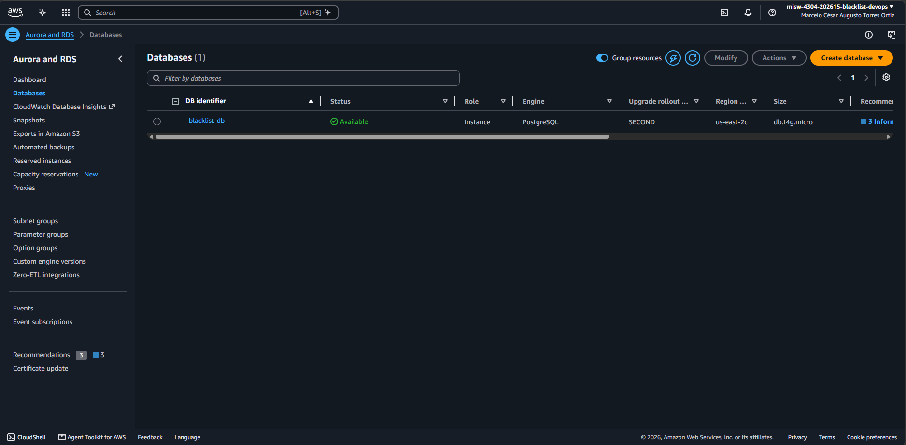
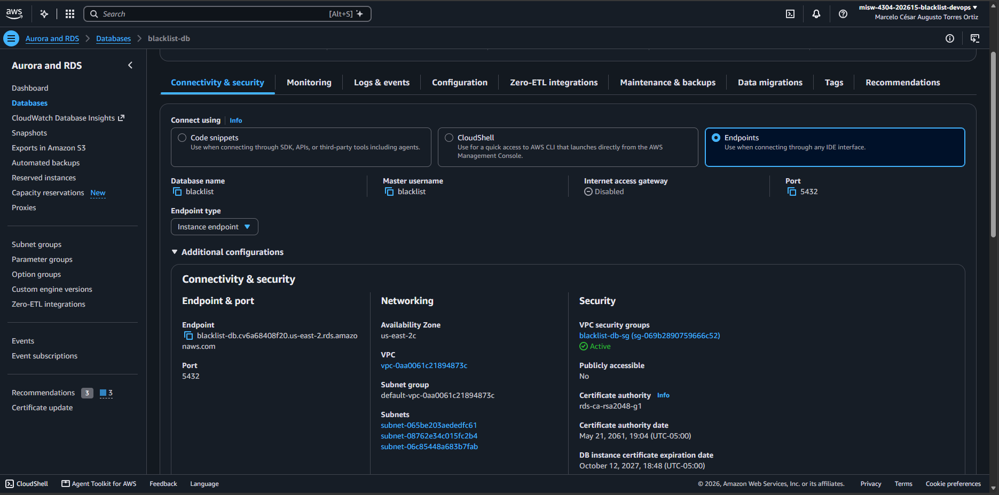
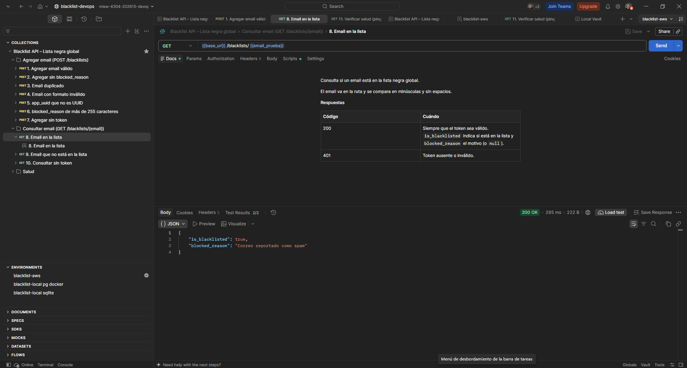
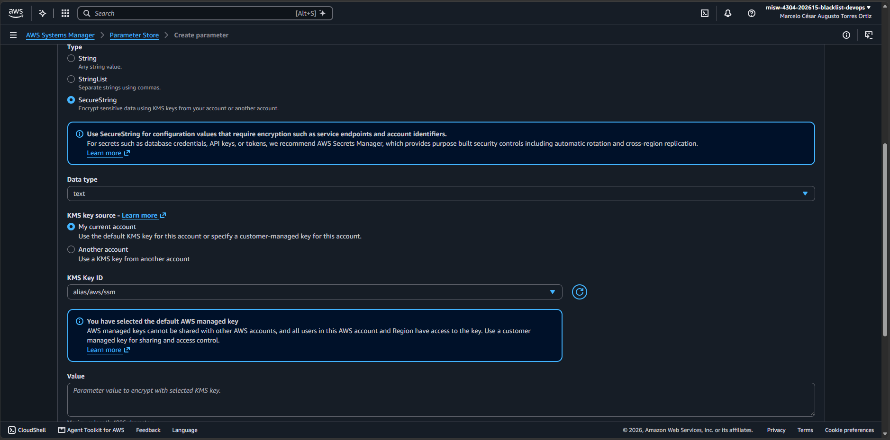
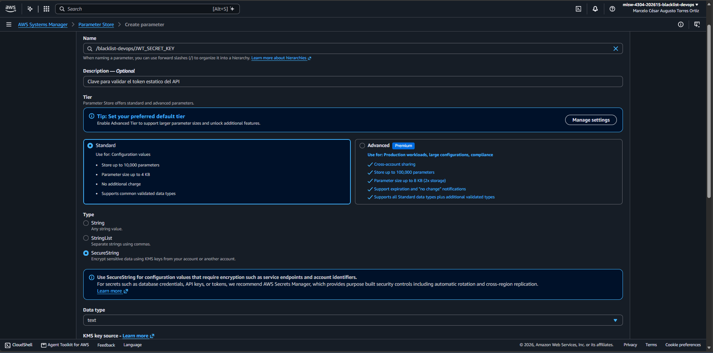
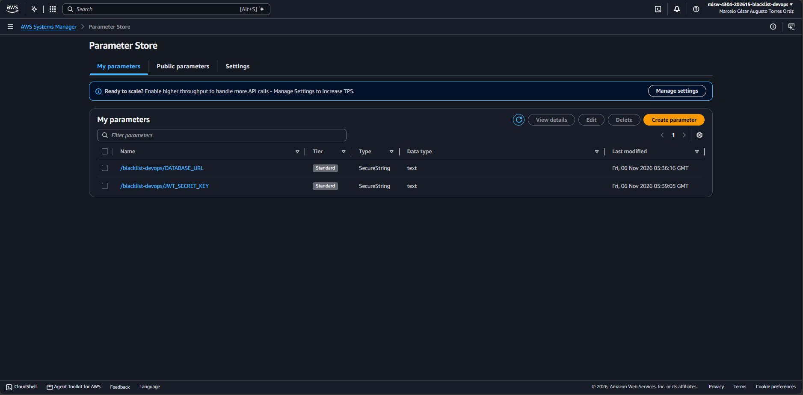
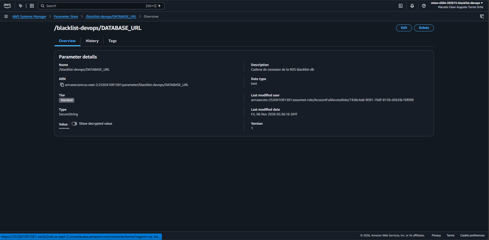

# Entrega 3 · Secretos en Parameter Store y RDS para Fargate

Tarea 1.8 (#196) · Épica E3 · Implementación

Este documento registra los dos secretos del microservicio en AWS Systems Manager Parameter Store y el estado de la
RDS `blacklist-db` que va a usar la tarea de Fargate. Parte de la decisión 3 de la 1.1 (#189), de los nombres del
diseño de la 1.3 (#191, `docs/ci/entrega-3/1.3-diseno-pipeline.md`, secciones 5.5 y 6.5) y del rol de ejecución de
la 1.6 (#194, `docs/ci/entrega-3/1.6-roles-iam.md`); no reemplaza el enunciado oficial de
`docs/entrega-3-entrega-continua.md`.

Los parámetros se crearon el **6 de noviembre de 2026** desde la consola de AWS, en la cuenta del proyecto y la región
**us-east-2**. Ningún valor aparece en este documento, en el repositorio, en la imagen ni en las capturas.

## 1. Resultado

| Parámetro | Tipo | Nivel | Clave de KMS | Versión | Creado (UTC-05:00) |
|---|---|---|---|---|---|
| `/blacklist-devops/DATABASE_URL` | `SecureString` | Standard | `alias/aws/ssm` | 1 | 6 de noviembre de 2026, 00:36:16 |
| `/blacklist-devops/JWT_SECRET_KEY` | `SecureString` | Standard | `alias/aws/ssm` | 1 | 6 de noviembre de 2026, 00:39:05 |

ARN, que referencia la definición de la tarea en `secrets` (1.10, #198, y 1.13, #200):

- `arn:aws:ssm:us-east-2:253041091381:parameter/blacklist-devops/DATABASE_URL`
- `arn:aws:ssm:us-east-2:253041091381:parameter/blacklist-devops/JWT_SECRET_KEY`

Son los mismos nombres del diseño de la 1.3 (secciones 5.5 y 6.5) y los mismos ARN de la política
`acceso-minimo-ecs` del rol de ejecución (1.6, sección 5.1).

| RDS | Valor |
|---|---|
| Instancia | `blacklist-db`, PostgreSQL 16.13, `db.t4g.micro`, 20 GB, `us-east-2c` |
| Estado | *Available* (6 de noviembre de 2026) |
| Endpoint | `blacklist-db.cv6a68408f20.us-east-2.rds.amazonaws.com`, puerto 5432, base `blacklist` |
| Acceso público | No |
| Grupo de seguridad | `blacklist-db-sg` (`sg-069b2890759666c52`) |
| Creación | 12 de octubre de 2026 (la de la Entrega 1: no se restauró ni se recreó) |

## 2. Valores

- **`DATABASE_URL`**: la misma cadena del entorno de Beanstalk de la Entrega 2, con el formato
  `postgresql://<usuario>:<clave>@<endpoint>:5432/blacklist`, sin sufijo de driver (SQLAlchemy 2.1 usa psycopg 3 por
  defecto).
- **`JWT_SECRET_KEY`**: la misma clave de la Entrega 2. Así el token estático de Postman sigue siendo válido contra
  Fargate y no hay que generar uno nuevo.

Los dos valores se tomaron de las propiedades del entorno de Beanstalk de la Entrega 2, restaurado temporalmente desde
la consola el 6 de noviembre de 2026. No se tomaron capturas de esas propiedades.

## 3. Procedimiento

### 3.1 RDS

La RDS estaba detenida desde el 30 de octubre y AWS la volvió a encender el 5 de noviembre, a los siete días. Se deja
encendida para las tareas 1.10 (#198) y 1.11 (#199) (decisión del 5 de noviembre).



*Connectivity & security*: endpoint, puerto 5432, sin acceso público y el grupo `blacklist-db-sg`. La regla de entrada
desde el grupo de seguridad de las tareas de Fargate se agrega en la 1.9 (#197).



### 3.2 Datos conservados

Con el entorno de Beanstalk de la Entrega 2 restaurado, `GET /blacklists/<email>` de un email registrado en la
Entrega 2 respondió `200` con `"is_blacklisted": true` y su motivo (`Correo reportado como spam`). La base conserva los
datos de las entregas anteriores. La captura muestra solo la respuesta, sin el token.



### 3.3 Parámetros

*AWS Systems Manager* → *Parameter Store* → *Create parameter*, una vez por parámetro:

| Campo | Valor |
|---|---|
| *Name* | `/blacklist-devops/DATABASE_URL` o `/blacklist-devops/JWT_SECRET_KEY` |
| *Description* | `Cadena de conexion de la RDS blacklist-db` o `Clave para validar el token estatico del API` |
| *Tier* | **Standard** (sin costo; *Advanced* tiene costo y no se usa) |
| *Type* | **SecureString** |
| *Data type* | `text` |
| *KMS key source* | *My current account*, `alias/aws/ssm` (la clave administrada por AWS) |
| *Value* | El valor de la sección 2 |

Las capturas del formulario se tomaron antes de escribir el valor: la de `DATABASE_URL` muestra el tipo, la clave de
KMS y el valor vacío; la de `JWT_SECRET_KEY`, el nombre, la descripción, el nivel y el tipo.





Los dos parámetros quedan en *My parameters*, de nivel *Standard* y tipo *SecureString*.



El detalle muestra el valor oculto (`********`); no se activó *Show decrypted value*.



En ninguna pantalla apareció el aviso de **características avanzadas**.

## 4. Verificación con la CLI

Sin leer los valores:

```bash
aws ssm describe-parameters --region us-east-2
aws rds describe-db-instances --db-instance-identifier blacklist-db --region us-east-2
```

`describe-parameters` confirma los dos nombres, `SecureString`, `Standard`, `alias/aws/ssm`, versión 1 y las
descripciones. `describe-db-instances` confirma *available*, el mismo endpoint, sin acceso público y la fecha de
creación del 12 de octubre.

Quién puede leerlos (`aws iam simulate-principal-policy` con `ssm:GetParameters` sobre los dos ARN):

```bash
aws iam simulate-principal-policy \
  --policy-source-arn arn:aws:iam::253041091381:role/<rol> \
  --action-names ssm:GetParameters \
  --resource-arns arn:aws:ssm:us-east-2:253041091381:parameter/blacklist-devops/DATABASE_URL \
                  arn:aws:ssm:us-east-2:253041091381:parameter/blacklist-devops/JWT_SECRET_KEY \
  --context-entries ContextKeyName=aws:RequestedRegion,ContextKeyValues=us-east-2,ContextKeyType=string
```

| Rol | `DATABASE_URL` | `JWT_SECRET_KEY` |
|---|---|---|
| `blacklist-devops-ecs-execution-role` | `allowed` | `allowed` |
| `blacklist-devops-codedeploy-role` | `implicitDeny` | `implicitDeny` |
| `blacklist-devops-codebuild-role` | `implicitDeny` | `implicitDeny` |
| `blacklist-devops-codepipeline-role` | `implicitDeny` | `implicitDeny` |

De los roles de servicio del proyecto, solo el rol de ejecución de la tarea puede leer los secretos (DoD). El
contexto `aws:RequestedRegion` es necesario: sin él, el simulador evalúa las políticas de la organización de la cuenta,
que limitan la región, como si la solicitud viniera de otra región, y devuelve `explicitDeny` para todos los roles. El
rol con el que trabaja el equipo en la consola (`AccountFullAccessRole`) también puede leerlos, como administrador de la
cuenta.

## 5. Equivalente con la CLI

La creación se hizo desde la consola para no escribir los valores en la terminal ni en el historial. El equivalente es:

```bash
aws ssm put-parameter --region us-east-2 --name /blacklist-devops/DATABASE_URL \
  --description "Cadena de conexion de la RDS blacklist-db" \
  --type SecureString --key-id alias/aws/ssm --tier Standard --value "<valor>"
aws ssm put-parameter --region us-east-2 --name /blacklist-devops/JWT_SECRET_KEY \
  --description "Clave para validar el token estatico del API" \
  --type SecureString --key-id alias/aws/ssm --tier Standard --value "<valor>"
```

## 6. Costo

Los parámetros de nivel *Standard* no tienen costo, ni su lectura con el rendimiento estándar. La clave administrada
`aws/ssm` tampoco. La RDS cuesta lo mismo que en las entregas anteriores mientras está encendida.

## 7. Notas

- **Entorno de Beanstalk restaurado:** se restauró solo para recuperar los valores y comprobar los datos, y se termina
  desde la consola, sin el script `scripts/ambiente_aws.py apagar`, que además detendría la RDS. Se puede volver a
  restaurar hasta el 10 de diciembre de 2026.
- **Valor del token:** si alguna vez cambia `JWT_SECRET_KEY`, hay que crear una versión nueva del parámetro, generar un
  token nuevo con `scripts/generar_token.py` y actualizar el *current value* del environment de Postman (2.1, #205),
  nunca el *initial value*.
- **Sin secretos:** las capturas no muestran valores, llaves ni tokens. El ID de cuenta, los ARN, el endpoint de la RDS
  y el nombre de la persona en la barra de la consola no son secretos.

## 8. Cumplimiento de la tarea

| Criterio de la tarea 1.8 (#196) | Evidencia |
|---|---|
| `DATABASE_URL` y `JWT_SECRET_KEY` en Parameter Store (decisión 3 de la 1.1, #189), cifrados y en `us-east-2` | Secciones 1 y 3.3; capturas `1.8-*-crear.png`, `1.8-parametros-lista.png` y `1.8-parametro-detalle.png` |
| RDS `blacklist-db` encendida y con sus datos | Secciones 3.1 y 3.2; capturas `1.8-rds-*.png` |
| Regla de entrada del grupo de seguridad de la RDS | Se agrega en la 1.9 (#197) |
| Nombres de los secretos en el documento de diseño | Ya están en la 1.3 (#191), secciones 5.5 y 6.5; coinciden con la sección 1 |
| DoD: los secretos existen y solo el rol de ejecución los puede leer | Sección 4 |
| DoD: ningún valor en el repositorio, la imagen ni las capturas | Secciones 2 y 7; la imagen de la 1.7 (#195) no contiene `.env` |
