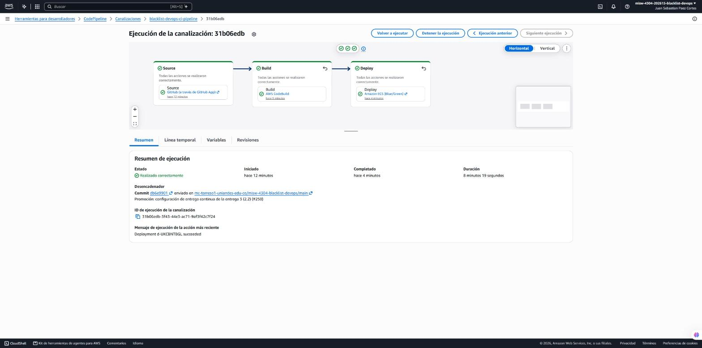
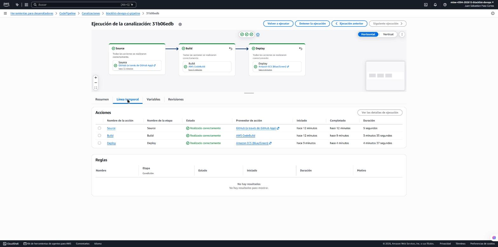
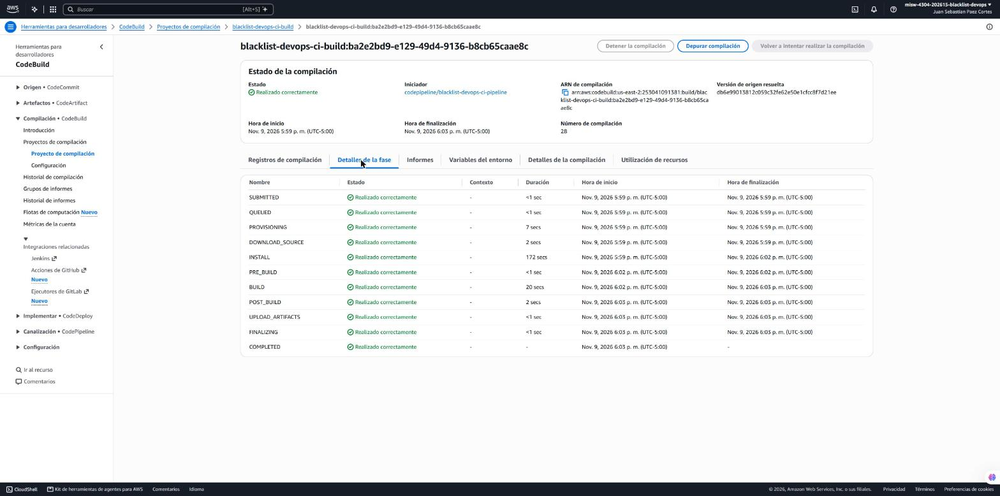
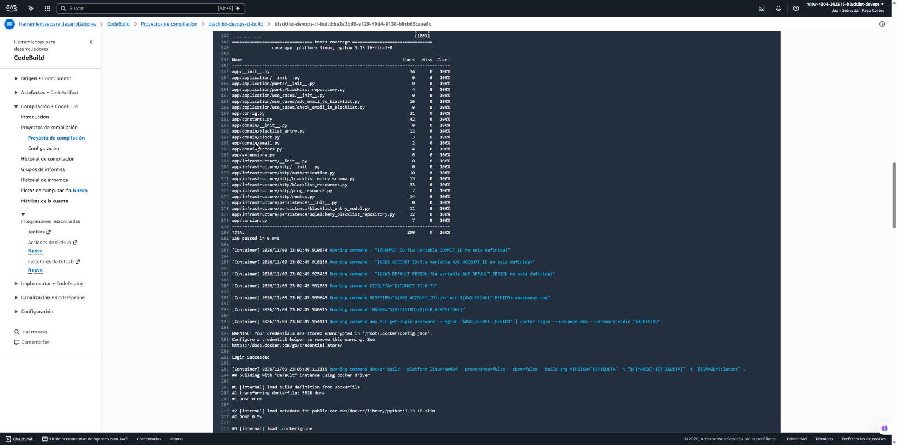
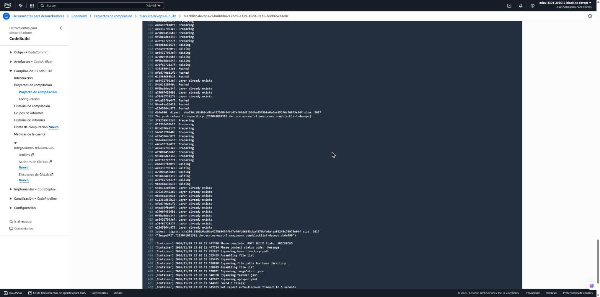
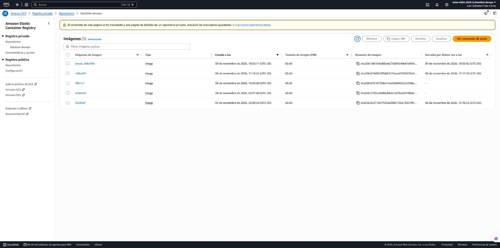
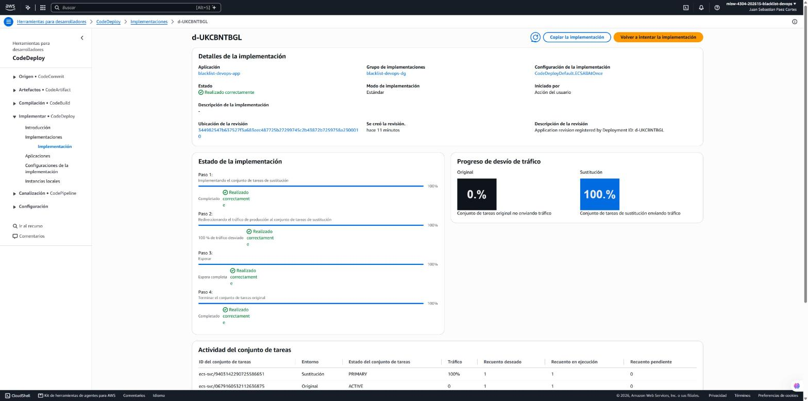
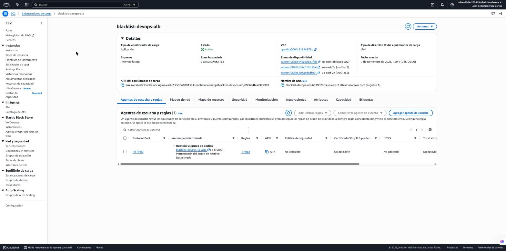

# Entrega 3 · CI y CD exitosos disparados por el commit en main

Tarea 2.3 (#207) · Épica E3 · Pruebas

Este documento registra la primera ejecución del pipeline `blacklist-devops-ci-pipeline` que inició sola con un commit en
`main`: la promoción de la 2.2 (#206, PR #250). Comprueba el flujo completo de la 1.16 (#203,
[1.16-pipeline-cd.md](1.16-pipeline-cd.md)): pruebas, imagen, envío a ECR y despliegue azul/verde en Fargate, sin
intervención manual. Es la evidencia del punto 3 de la configuración del pipeline (40 %) y del punto 2 del documento (8 %)
del enunciado (`docs/entrega-3-entrega-continua.md`).

La ejecución es del **9 de noviembre de 2026**, en la cuenta del proyecto y la región **us-east-2**. Las horas están en
UTC-05:00. La consulta de los datos con la AWS CLI fue de solo lectura.

## 1. Resultado

| Dato | Valor |
|---|---|
| Commit | `db6e99013812c059c32fe62e50e1cfcc8f7d21ee` (`db6e990`), *merge commit* del PR #250 en `main`, 17:59:35 |
| Disparador | `WebhookV2`, tipo `PUSH_BRANCH`, rama `main`, por la conexión de GitHub |
| Ejecución del pipeline | `31b06edb-3f43-44e3-ac71-9af3f42c7f24`, versión 5 del pipeline, **Succeeded** |
| Duración | De 17:59:38 a 18:07:58: 8 min 19 s |
| Build | `blacklist-devops-ci-build:ba2e2bd9-e129-49d4-9136-b8cb65caae8c` (compilación 28), **Succeeded**: 156 pruebas aprobadas, cobertura del 100 % |
| Imagen | `blacklist-devops:db6e990` y `latest`, el mismo *digest* `sha256:18b1b9cd0ba427568434fb47ef6fdd6153dba4579bfe0a4aa852f6c76973e04f`, 60,43 MB |
| Despliegue de CodeDeploy | `d-UKCBNTBGL`, aplicación `blacklist-devops-app`, grupo `blacklist-devops-dg`, `CodeDeployDefault.ECSAllAtOnce`, **Succeeded**, sin reversión |
| Definición de la tarea | `blacklist-devops-task:4`, registrada por la etapa *Deploy* con la imagen `blacklist-devops:db6e990` |
| Tráfico | El *listener* HTTP:80 pasó de `blacklist-devops-tg-verde` (revisión 3, `168dd91`) a `blacklist-devops-tg-azul` (revisión 4, `db6e990`) |
| `GET /ping` | `{"version": "db6e990"}`, la etiqueta del commit de la promoción |

## 2. Línea de tiempo

| Hora | Evento |
|---|---|
| 17:59:35 | Se fusiona el PR #250 en `main` (*merge commit* `db6e990`) |
| 17:59:38 | Inicia la ejecución `31b06edb`, 3 s después del *push* |
| 17:59:38 – 17:59:43 | *Source*: descarga `db6e990` de GitHub |
| 17:59:44 – 18:03:19 | *Build*: instala Python 3.13.16, ejecuta las pruebas, construye la imagen y la envía a ECR |
| 18:03:11 | La imagen `db6e990` llega a ECR |
| 18:03:20 | Inicia *Deploy*; a las 18:03:21 se registra `blacklist-devops-task:4` y se crea `d-UKCBNTBGL` |
| 18:03:23 – 18:05:26 | `Install`: el conjunto de tareas de sustitución arranca, se registra en `blacklist-devops-tg-azul` a las 18:03:56 y ECS lo da por estable a las 18:04:05 |
| 18:05:27 | `AllowTraffic`: el *listener* de producción pasa al grupo azul (100 % del tráfico) |
| 18:05:28 – 18:07:29 | Espera de 2 minutos y terminación del conjunto de tareas original (1.15) |
| 18:07:29 | `d-UKCBNTBGL` termina en *Succeeded* |
| 18:07:58 | La etapa *Deploy* y la ejecución terminan en *Succeeded* |

`GET /ping` por el balanceador, consultado cada 33 s durante la ejecución: respondió `{"version": "168dd91"}` hasta las
18:05:20 y `{"version": "db6e990"}` desde las 18:05:53. Ninguna consulta falló.

## 3. Evidencia

### 3.1 Pipeline

La ejecución con las tres etapas en verde. El resumen muestra el desencadenador: el commit `db6e990` enviado a
`main` con el mensaje de la promoción.



Línea temporal: *Source* 5 s, *Build* 3 min 35 s y *Deploy* 4 min 37 s.



### 3.2 Build: pruebas, imagen y ECR

Fases del build, todas en *Realizado correctamente*. La versión de origen resuelta es `db6e990` y el iniciador es
`codepipeline/blacklist-devops-ci-pipeline`.



Registro del build: cobertura del 100 % y `156 passed`, seguido de las validaciones de `COMMIT_ID`, `AWS_ACCOUNT_ID` y
`AWS_DEFAULT_REGION`, el inicio de sesión en ECR y el `docker build` con la etiqueta del commit.



Envío a ECR: `db6e990` y `latest` con el mismo *digest*, `imageDetail.json` con la dirección de la imagen y el artefacto
con `imageDetail.json`, `taskdef.json` y `appspec.yaml`.



Repositorio `blacklist-devops`: la imagen `latest, db6e990` de las 18:03:11, extraída por Fargate a las 18:03:42.



### 3.3 Despliegue azul/verde

`d-UKCBNTBGL`: los cuatro pasos completados y el 100 % del tráfico en el conjunto de tareas de sustitución.



La tabla de conjuntos de tareas no se había refrescado: todavía muestra el conjunto original como `ACTIVE` con 1 tarea,
aunque el paso 4 (terminación del conjunto original) ya aparece completado a las 18:07:29.

*Listener* HTTP:80 del balanceador, que ahora reenvía a `blacklist-devops-tg-azul`.



## 4. Hallazgos

1. **El commit en `main` dispara el pipeline completo.** La ejecución inició 3 s después de la fusión, con el
   disparador `PUSH_BRANCH` sobre `main`. La 1.16 se había comprobado con una ejecución manual (`6ff261a0`, iniciada con
   `StartPipelineExecution`); esta es la primera que inicia sola un commit.
2. **El despliegue depende del CI.** *Deploy* empezó 1 s después de que terminó *Build*. Las pruebas son el primer
   comando de la fase `build`: si una falla, CodeBuild detiene la fase ahí y no se ejecuta el `docker build`. Además,
   `post_build` solo envía la imagen a ECR si `CODEBUILD_BUILD_SUCCEEDING` es `1`. El build termina en *Failed* y el
   pipeline no pasa a *Deploy*. Ese caso es la 2.4 (#208).
3. **La versión desplegada es trazable al commit.** La etiqueta de la imagen, la definición de la tarea
   `blacklist-devops-task:4` y `/ping` dicen `db6e990`, que es el commit del *push*. `latest` apunta al mismo *digest*.
4. **No hubo corte de servicio, pero la versión nueva no se verificó antes de recibir tráfico.** ECS registró la tarea
   nueva en el grupo azul a las 18:03:56 y la dio por estable 9 s después, antes de que el balanceador pudiera completar
   dos verificaciones de salud de 15 s. Con `CodeDeployDefault.ECSAllAtOnce` y sin *listener* de prueba, el grupo de
   sustitución no está asociado al balanceador y sus destinos no se verifican hasta que reciben el tráfico; AWS lo
   documenta en la guía de solución de problemas de CodeDeploy para ECS. El cambio del *listener* fue a las 18:05:27 y
   ninguna consulta a `/ping` falló porque la versión nueva estaba bien. El conjunto anterior siguió dos minutos más en
   el grupo verde antes de terminarse. Por esta limitación, desde la 2.5 (#209) el grupo de despliegue usa
   `CodeDeployDefault.ECSCanary10Percent5Minutes`, que verifica la salud del grupo de sustitución antes de mover el
   tráfico (votación del equipo del 10 de noviembre).
5. **Los grupos de destino se alternan.** El despliegue de la 1.16 dejó el tráfico en el grupo verde; este lo pasó al
   azul. El siguiente despliegue usará el verde.
6. **La instalación de Python ocupa casi todo el build.** `INSTALL` tardó 172 s de los 3 min 27 s del build, porque
   `pyenv` compila Python 3.13.16 en cada ejecución. Las pruebas tardaron menos de 1 s y el `docker build` y el envío,
   unos 22 s. Es la parte que se puede acortar si hace falta, con una imagen de compilación que ya traiga esa versión.
7. **CodeDeploy muestra el despliegue como «Acción del usuario».** Es el nombre que da a los despliegues creados por
   una llamada a su API, que en este caso hizo la acción *Deploy* del pipeline: `d-UKCBNTBGL` es el identificador
   externo de esa acción en la ejecución `31b06edb`. Nadie lo inició a mano.

## 5. Verificación con la CLI

Solo lectura. Con la CLI local se agrega `--profile blacklist`.

```bash
# Ejecución, disparador y commit
aws codepipeline list-pipeline-executions --pipeline-name blacklist-devops-ci-pipeline --region us-east-2 --max-items 1
# Acciones y sus identificadores (build y despliegue)
aws codepipeline list-action-executions --pipeline-name blacklist-devops-ci-pipeline --region us-east-2 \
  --filter pipelineExecutionId=31b06edb-3f43-44e3-ac71-9af3f42c7f24
# Fases del build
aws codebuild batch-get-builds --region us-east-2 \
  --ids blacklist-devops-ci-build:ba2e2bd9-e129-49d4-9136-b8cb65caae8c --query 'builds[0].phases'
# Imagen en ECR
aws ecr describe-images --repository-name blacklist-devops --image-ids imageTag=db6e990 --region us-east-2
# Despliegue y sus eventos
aws deploy get-deployment --deployment-id d-UKCBNTBGL --region us-east-2
# Servicio y definición de la tarea
aws ecs describe-services --cluster blacklist-devops-cluster --services blacklist-devops-service --region us-east-2 \
  --query 'services[0].taskDefinition'
# Versión servida
curl -s http://blacklist-devops-alb-663902063.us-east-2.elb.amazonaws.com/ping
```

## 6. Cumplimiento de la tarea

| Criterio de la tarea 2.3 (#207) | Evidencia |
|---|---|
| Identificador de la ejecución del pipeline y del despliegue de CodeDeploy | Sección 1: `31b06edb-3f43-44e3-ac71-9af3f42c7f24` y `d-UKCBNTBGL` |
| Registro del build con las pruebas y el envío de la imagen; imagen en ECR con la etiqueta del commit | Sección 3.2 |
| Despliegue azul/verde completado y `GET /ping` respondiendo con la versión del commit | Secciones 2 y 3.3 |
| Capturas en `docs/capturas/entrega-3/2.3-*.png` y hallazgos en este documento | Secciones 3 y 4 |
| DoD: ejecución exitosa sin intervención manual, documentada con capturas y hallazgos | Hallazgos 1 y 7 |
