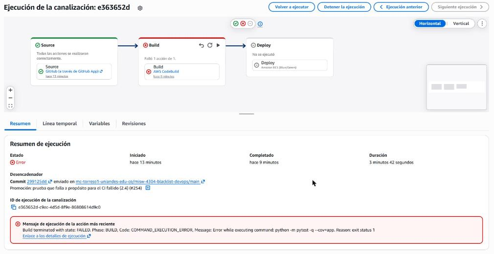
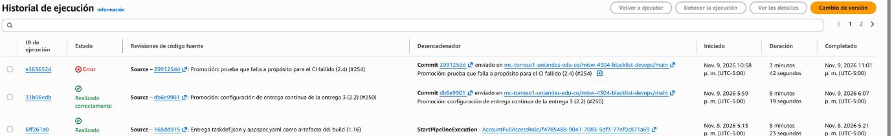
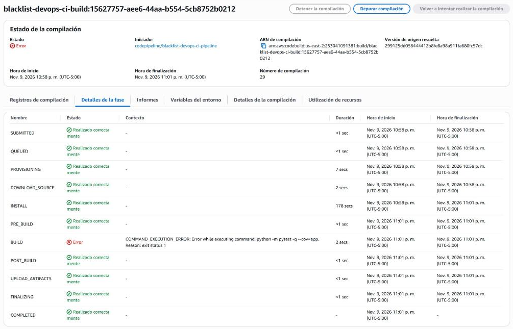
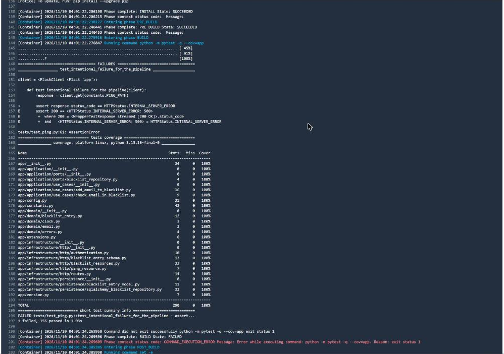
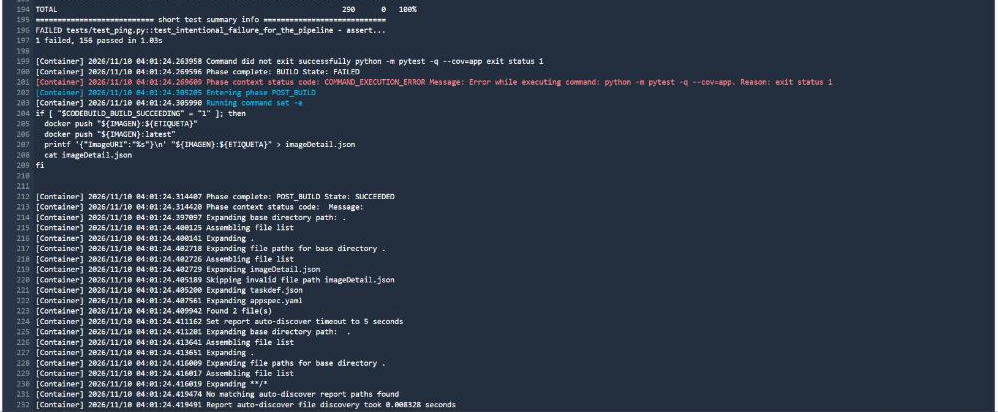
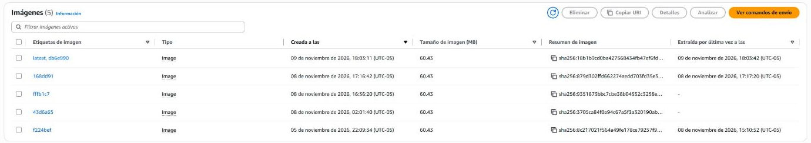
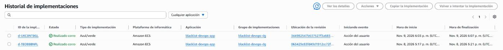
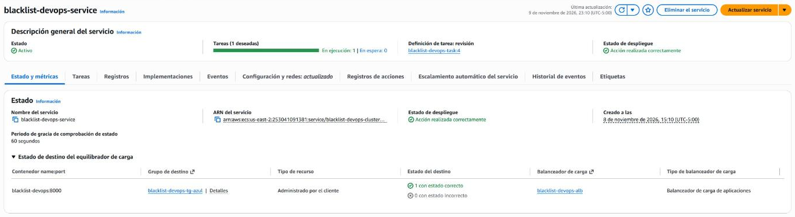

# Entrega 3 · CI fallido: cambio con una prueba que falla

Tarea 2.4 (#208) · Épica E3 · Pruebas

Este documento registra la ejecución del pipeline `blacklist-devops-ci-pipeline` que falló en la integración continua.
Una prueba unitaria que falla a propósito llegó a `main` por el flujo de ramas, el *push* del *merge commit* inició el
pipeline y el build se detuvo en las pruebas: no se construyó ni se envió la imagen y no hubo despliegue. Es la
decisión 4 de la 1.2 ([1.3-diseno-pipeline.md](1.3-diseno-pipeline.md), secciones 2.2 y 9) y la evidencia del punto 1
del documento (4 %) del enunciado (`docs/entrega-3-entrega-continua.md`).

La ejecución es del **9 de noviembre de 2026**, en la cuenta del proyecto y la región **us-east-2**. Las horas están en
UTC-05:00. La consulta de los datos con la AWS CLI fue de solo lectura.

## 1. Resultado

| Dato | Valor |
|---|---|
| Prueba que falla | `tests/test_ping.py::test_intentional_failure_for_the_pipeline`: espera un 500 de `GET /ping` y recibe 200. Llegó a `dev` con el PR #253 (`41306da`) |
| Commit | `299125dd058444412b8fe8a98a911fa680fc57dc` (`299125d`), *merge commit* de la promoción #254 en `main`, 22:58:01 |
| Disparador | `WebhookV2`, tipo `PUSH_BRANCH`, rama `main`, por la conexión de GitHub |
| Ejecución del pipeline | `e363652d-c9ec-4d5d-8f9e-86808614d9c0`, versión 5 del pipeline, **Failed** |
| Duración | De 22:58:06 a 23:01:48: 3 min 42 s |
| Etapa *Source* | **Succeeded**, 6 s |
| Etapa *Build* | **Failed**: `Build terminated with state: FAILED. Phase: BUILD, Code: COMMAND_EXECUTION_ERROR` |
| Build | `blacklist-devops-ci-build:15627757-aee6-44aa-b554-5cb8752b0212` (compilación 29), **FAILED** en la fase `BUILD` |
| Pruebas | `1 failed, 156 passed in 1.03s`, cobertura del 100 % (290 sentencias) |
| Etapa *Deploy* | **No se ejecutó** |
| Imagen | **Ninguna nueva**: no hay `blacklist-devops:299125d` en ECR (`ImageNotFoundException`); la última sigue siendo `latest, db6e990` (2.3) |
| CodeDeploy | **Ningún despliegue nuevo**: el último sigue siendo `d-UKCBNTBGL` (2.3) |
| Servicio de Fargate | Sin cambios: `blacklist-devops-task:4`, 1 tarea en `blacklist-devops-tg-azul`. No se registró otra revisión de la definición de la tarea |
| `GET /ping` | `{"version": "db6e990"}` en las 360 consultas del monitor, de 22:57:39 a 23:09:37 |

## 2. Línea de tiempo

| Hora | Evento |
|---|---|
| 22:11:02 | Se fusiona el PR #253 en `dev` (*squash* `41306da`): agrega la prueba que falla |
| 22:31:19 | Se fusiona el PR #255 (3.5) en `dev` (`b899b0e`). La promoción pierde la aprobación porque `protect-main` exige aprobar el último *push*; se vuelve a aprobar a las 22:46 |
| 22:57:39 | Empieza el monitor de `/ping`, una consulta cada 2 s |
| 22:58:01 | Se fusiona la promoción #254 en `main` (*merge commit* `299125d`) |
| 22:58:06 | Inicia la ejecución `e363652d`, 5 s después del *push* |
| 22:58:06 – 22:58:12 | *Source*: descarga `299125d` de GitHub |
| 22:58:13 | Inicia el build 29 de CodeBuild |
| 22:58:23 – 23:01:22 | `INSTALL`: instala Python 3.13.16 y las dependencias (178 s) |
| 23:01:22 | `BUILD`: inicia `python -m pytest -q --cov=app` |
| 23:01:24 | `pytest` termina con código de salida 1 y la fase `BUILD` queda en `FAILED`. No se ejecutan las validaciones, el inicio de sesión en ECR ni el `docker build` |
| 23:01:24 | `POST_BUILD` termina en *Succeeded* sin enviar nada. `UPLOAD_ARTIFACTS` omite `imageDetail.json` y sube `taskdef.json` y `appspec.yaml` |
| 23:01:24 | Termina el build en `FAILED` |
| 23:01:48 | La etapa *Build* y la ejecución terminan en *Failed*. *Deploy* no inicia |
| 23:09:37 | Termina el monitor: 360 consultas, todas 200 con `db6e990` |

Los datos del monitor están en
[`docs/despliegues/entrega-3/2.4-ci-fallido.csv`](../../despliegues/entrega-3/2.4-ci-fallido.csv) (hora UTC). La latencia
fue de 195 a 611 ms, con un promedio de 235 ms.

## 3. Evidencia

### 3.1 Pipeline

La ejecución: *Source* en verde, *Build* en rojo y *Deploy* con «No se ejecutó». El desencadenador es el commit
`299125d` enviado a `main` con el mensaje de la promoción, y el mensaje de error es el de `pytest`.



Historial: la ejecución `e363652d` en *Error* sobre la `31b06edb` de la 2.3, las dos iniciadas por un commit en `main`.



### 3.2 Build: las pruebas detienen la construcción

Fases del build: `INSTALL` y las anteriores en *Realizado correctamente*, `BUILD` en *Error* con
`COMMAND_EXECUTION_ERROR` sobre `python -m pytest -q --cov=app`. El iniciador es
`codepipeline/blacklist-devops-ci-pipeline` y la versión de origen resuelta es `299125d`.



Registro del build: la prueba `test_intentional_failure_for_the_pipeline` falla con `assert 200 == 500`, la cobertura
sigue en 100 % y el resumen es `1 failed, 156 passed`. La fase `BUILD` termina en `FAILED`.



Después del fallo: `POST_BUILD` ejecuta el bloque del envío, pero `CODEBUILD_BUILD_SUCCEEDING` no es `1` y no hay
`docker push`. `UPLOAD_ARTIFACTS` muestra `Skipping invalid file path imageDetail.json` y `Found 2 file(s)`.



### 3.3 Sin imagen ni despliegue

Repositorio `blacklist-devops`: cinco imágenes y ninguna con la etiqueta `299125d`. La más reciente sigue siendo
`latest, db6e990`, del 9 de noviembre a las 18:03:11.



Historial de CodeDeploy: solo los despliegues de la 1.16 (`d-TEOBBBNFL`) y de la 2.3 (`d-UKCBNTBGL`).



Servicio `blacklist-devops-service` a las 23:10: revisión `blacklist-devops-task:4`, 1 tarea en ejecución y 1 destino
sano en `blacklist-devops-tg-azul`.



## 4. Hallazgos

1. **El fallo de las pruebas detiene todo lo que sigue.** `pytest` es el primer comando de la fase `BUILD`: al salir
   con código 1, CodeBuild marca la fase como fallida y no ejecuta los comandos siguientes (validaciones, inicio de
   sesión en ECR y `docker build`). El pipeline no pasa a *Deploy*, así que CodeDeploy no crea un despliegue y Fargate
   sigue con la versión anterior. Es el comportamiento que fijó la decisión 4 de la 1.2.
2. **`POST_BUILD` se ejecuta aunque el build ya haya fallado.** CodeBuild corre siempre esa fase; lo que impide el
   envío es la condición `CODEBUILD_BUILD_SUCCEEDING = 1` del `buildspec.yml`. La fase termina en *Succeeded* sin
   ejecutar ningún `docker push`.
3. **El artefacto sale incompleto, pero no llega a usarse.** `UPLOAD_ARTIFACTS` terminó en *Succeeded*: omitió
   `imageDetail.json`, que no existe, y subió `taskdef.json` y `appspec.yaml`. En la Entrega 2 esa fase fallaba porque el
   único archivo del artefacto no existía. Aquí no tiene efecto: el pipeline se detiene en *Build* y *Deploy* no recibe
   ese artefacto.
4. **El servicio no se vio afectado.** Las 360 consultas a `/ping` durante y después de la ejecución respondieron 200
   con `db6e990`. No hubo imagen ni revisión de la definición de la tarea nuevas, y el *listener* siguió en
   `blacklist-devops-tg-azul`.
5. **La vista general del pipeline puede confundir.** Después del fallo, el estado de la canalización
   (`get-pipeline-state`) muestra *Deploy* en *Succeeded*, pero ese estado es de la ejecución anterior (`31b06edb`). La
   vista de la ejecución `e363652d` es la que dice «No se ejecutó».
6. **El fallo se conoce en unos 3 minutos.** La ejecución duró 3 min 42 s, y `INSTALL` ocupó 178 s del build porque
   `pyenv` compila Python 3.13.16 en cada ejecución. Las pruebas fallaron en 2 s. El CI fallido de la Entrega 2 (2.9,
   #113) duró 38 s porque su build no instalaba Python ni construía imágenes.
7. **`main` queda con el CI en rojo hasta la 2.5.** Mientras la prueba siga en `main`, cualquier promoción fallaría
   igual. La 2.5 (#209) la retira en la misma promoción que provoca el CD fallido; hasta entonces no se promueve nada
   más a `main`.

## 5. Verificación con la CLI

Solo lectura. Con la CLI local se agrega `--profile blacklist`.

```bash
# Ejecución, disparador y commit
aws codepipeline get-pipeline-execution --pipeline-name blacklist-devops-ci-pipeline --region us-east-2 \
  --pipeline-execution-id e363652d-c9ec-4d5d-8f9e-86808614d9c0
# Acciones de la ejecución: solo Source y Build
aws codepipeline list-action-executions --pipeline-name blacklist-devops-ci-pipeline --region us-east-2 \
  --filter pipelineExecutionId=e363652d-c9ec-4d5d-8f9e-86808614d9c0
# Fases del build
aws codebuild batch-get-builds --region us-east-2 \
  --ids blacklist-devops-ci-build:15627757-aee6-44aa-b554-5cb8752b0212 --query 'builds[0].phases'
# Sin imagen del commit en ECR (responde ImageNotFoundException)
aws ecr describe-images --repository-name blacklist-devops --image-ids imageTag=299125d --region us-east-2
# Sin despliegue nuevo
aws deploy list-deployments --application-name blacklist-devops-app --deployment-group-name blacklist-devops-dg \
  --region us-east-2
# Servicio y definición de la tarea
aws ecs describe-services --cluster blacklist-devops-cluster --services blacklist-devops-service --region us-east-2 \
  --query 'services[0].taskDefinition'
# Versión servida
curl -s http://blacklist-devops-alb-663902063.us-east-2.elb.amazonaws.com/ping
```

## 6. Cumplimiento de la tarea

| Criterio de la tarea 2.4 (#208) | Evidencia |
|---|---|
| Rama con una prueba que falla, por el flujo de ramas hasta `main`; el *merge* a `main` dispara el pipeline | Secciones 1 y 2: PR #253 a `dev`, promoción #254 y ejecución `e363652d` con `PUSH_BRANCH` |
| El build falla en las pruebas, no se construye ni se envía la imagen y no hay despliegue | Secciones 3.2 y 3.3, hallazgos 1 a 3 |
| Capturas en `docs/capturas/entrega-3/2.4-*.png` y hallazgos en este documento | Secciones 3 y 4 |
| No promover nada más a `main` hasta la 2.5 | Hallazgo 7 |
| DoD: ejecución fallida documentada con capturas y hallazgos | Secciones 3 y 4 |
| DoD: el servicio de Fargate queda sin cambios (sigue la versión de la 2.3) | Sección 3.3 y hallazgo 4: `blacklist-devops-task:4` y `/ping` con `db6e990` |
