# Entrega 3 · CI exitoso y CD fallido, con reversión automática

Tarea 2.5 (#209) · Épica E3 · Pruebas

Este documento registra la ejecución del pipeline `blacklist-devops-ci-pipeline` en la que la integración continua
terminó bien y el despliegue continuo falló. El contenedor de la versión nueva escucha en el puerto `8001`, mientras la
definición de la tarea, el `appspec.yaml` y los grupos de destino esperan el `8000` (decisión 5 de la 1.2,
[1.3-diseno-pipeline.md](1.3-diseno-pipeline.md)). Las pruebas pasaron, la imagen llegó a ECR y CodeDeploy declaró
fallido el despliegue y revirtió solo. Es la evidencia del punto 3 del documento (8 %) del enunciado
(`docs/entrega-3-entrega-continua.md`).

La ejecución **no salió como se había previsto**. La configuración canaria no verificó la salud de la versión nueva
antes de pasarle tráfico: el 10 % de las solicitudes recibió errores 502 durante cinco minutos, y al pasar el resto hubo
unos 44 s sin servicio hasta que CodeDeploy detectó la falla y revirtió. El despliegue tampoco tardó los 60 minutos que
se esperaban, sino 7 min 30 s. Las secciones 4 y 5 explican por qué y qué se cambia.

La ejecución es del **10 de noviembre de 2026**, en la cuenta del proyecto y la región **us-east-2**. Las horas están en
UTC-05:00. La consulta de los datos con la AWS CLI fue de solo lectura.

## 1. Resultado

| Dato | Valor |
|---|---|
| Cambio | PR #258 (`a73659d` en `dev`): Gunicorn en `:8001` en el `Dockerfile` y retiro de la prueba que fallaba a propósito en la 2.4 |
| Commit | `69e12b85c0671d077e92f040bcb6234e1c7d343c` (`69e12b8`), *merge commit* de la promoción #261 en `main`, 22:34:51 |
| Disparador | `WebhookV2`, tipo `PUSH_BRANCH`, rama `main`, por la conexión de GitHub |
| Ejecución del pipeline | `035b42d2-3559-499c-8459-ad447b344612`, versión 5 del pipeline, **Failed** |
| Duración | De 22:34:54 a 22:46:53: 11 min 59 s |
| Etapa *Source* | **Succeeded**, 7 s |
| Etapa *Build* | **Succeeded**: `blacklist-devops-ci-build:463203d6-81e2-45d4-9b03-4d950c518784` (compilación 30), 156 pruebas aprobadas, cobertura del 100 % |
| Imagen | `blacklist-devops:69e12b8` y `latest`, el mismo *digest* `sha256:603c0321a20d3b0e814e605970d189a5c9636a7e28809f05a0eb28ad01b81bfa`, 60,43 MB, en ECR a las 22:38:50 |
| Definición de la tarea | `blacklist-devops-task:5`, registrada por la etapa *Deploy* a las 22:39:10 con la imagen `69e12b8` |
| Configuración de CodeDeploy | `CodeDeployDefault.ECSCanary10Percent5Minutes`, desde el 9 de noviembre a las 23:56 |
| Despliegue | `d-SYHBSF3HL`, **Failed** a las 22:46:40: `ECS_UPDATE_ERROR`, «CodeDeploy detected that the replacement task set is unhealthy.» |
| Reversión | `d-2TNRGN3HL`, iniciada por CodeDeploy (`codeDeployRollback`), **Succeeded** de 22:46:41 a 22:46:43 |
| Servicio después | `blacklist-devops-task:4`, con la misma tarea de la 2.3; el *listener* HTTP:80 reenvía de nuevo a `blacklist-devops-tg-azul` |
| `GET /ping` | Siempre `{"version": "db6e990"}` cuando respondió. **40 de 361 consultas con 502** mientras corrió la ejecución, de 22:34:51 a 22:46:53 (monitor principal) |
| Errores 502 en el balanceador | **77** entre las 22:41 y las 22:46 (CloudWatch, `HTTPCode_ELB_502_Count`) |

## 2. Línea de tiempo

| Hora | Evento |
|---|---|
| 22:26:56 | Empieza el monitor principal de `/ping` (una consulta cada 2 s); a las 22:32:40, el de respaldo |
| 22:34:51 | Se fusiona la promoción #261 en `main` (*merge commit* `69e12b8`) |
| 22:34:54 | Inicia la ejecución `035b42d2`, 3 s después del *push* |
| 22:35:03 – 22:38:51 | *Build*: `INSTALL` 191 s, pruebas (`156 passed`), `docker build` y envío de `69e12b8` y `latest` |
| 22:39:10 | Inicia *Deploy*: se registra `blacklist-devops-task:5` y se crea `d-SYHBSF3HL` |
| 22:39:13 – 22:40:55 | `Install`: ECS arranca la tarea nueva (22:39:22), la registra en `blacklist-devops-tg-verde` (22:39:41) y da el conjunto por estable a las 22:39:50, **9 s después del registro** |
| 22:40:56 | `AllowTraffic`: el 10 % del tráfico pasa a `blacklist-devops-tg-verde` |
| 22:41:32 | Primer 502 en el monitor principal |
| 22:41:38, 22:43:54 y 22:46:14 | ECS reemplaza la tarea nueva: «Amazon ECS replaced 1 tasks due to an unhealthy status» |
| 22:42:17 y 22:44:31 | ECS: «port 8000 is unhealthy in target-group blacklist-devops-tg-verde due to (reason Health checks failed)» |
| 22:45:57 | Terminan los 5 minutos del canario: el 100 % del tráfico pasa a `blacklist-devops-tg-verde` |
| 22:46:10 – 22:46:53 | Corte total: todas las consultas a `/ping` responden 502 |
| 22:46:40 | `d-SYHBSF3HL` termina en *Failed*, 43 s después de pasar el 100 % |
| 22:46:41 – 22:46:43 | La reversión `d-2TNRGN3HL` devuelve el tráfico al conjunto original en `blacklist-devops-tg-azul` |
| 22:46:53 | La etapa *Deploy* y la ejecución terminan en *Failed*. Último 502 en el monitor de respaldo |
| 22:48:16 | ECS: el servicio vuelve al estado estable |
| 22:47:40 y 23:05:32 | Se detienen el monitor principal y el de respaldo; ninguno registra errores después de las 22:46:53 |

### 2.1 Disponibilidad

| Fuente | Periodo | Consultas | 200 con `db6e990` | 502 | 502 sueltos (10 %) | 502 seguidos (100 %) |
|---|---|---|---|---|---|---|
| Monitor principal ([`2.5-cd-fallido.csv`](../../despliegues/entrega-3/2.5-cd-fallido.csv)) | 22:26:56 – 22:47:40 | 531 | 491 | 40 | 18, de 22:41:32 a 22:46:02 | 22, de 22:46:10 a 22:46:52 |
| Monitor de respaldo ([`2.5-cd-fallido-respaldo.csv`](../../despliegues/entrega-3/2.5-cd-fallido-respaldo.csv)) | 22:32:40 – 23:05:32 | 986 | 950 | 36 | 14, de 22:41:44 a 22:45:53 | 22, de 22:46:11 a 22:46:53 |
| CloudWatch del balanceador | 22:41 – 22:46 | — | — | 77 | 4, 9, 5, 6 y 8 por minuto | 45 en el minuto de las 22:46 |

Los dos monitores suman 76 errores; CloudWatch cuenta 77, porque registra todas las solicitudes al balanceador. Cuando
`/ping` respondió, siempre lo hizo con `db6e990`: la versión nueva nunca contestó. La latencia de las respuestas buenas
del monitor principal fue de 197 a 383 ms, con un promedio de 228 ms. Ese monitor tiene un hueco de 3 min antes del
*merge* (22:28:54 a 22:32:00), con una consulta que tardó 197 s; desde las 22:32:00 registró sin interrupciones.

## 3. Evidencia

### 3.1 Configuración de CodeDeploy

El grupo de despliegue `blacklist-devops-dg` antes y después del cambio del 9 de noviembre: `ECSAllAtOnce` y
`ECSCanary10Percent5Minutes`, con la restauración habilitada y sin *listener* de prueba.

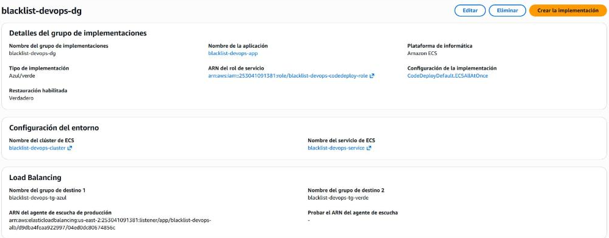

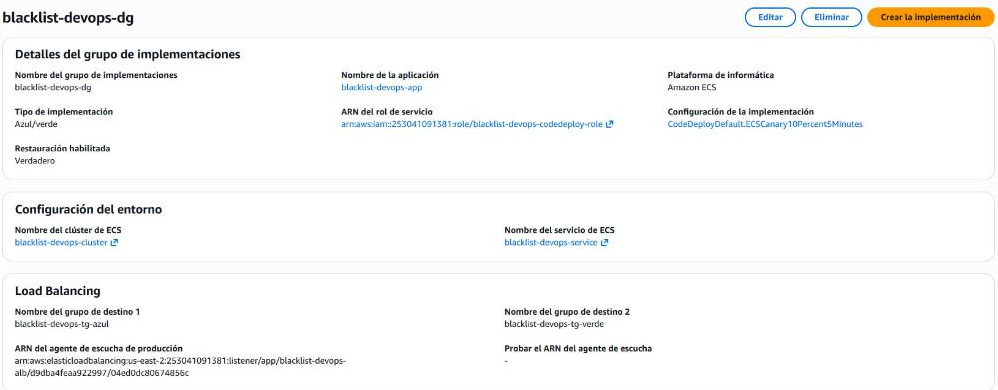

### 3.2 Pipeline y build

La ejecución `035b42d2`: *Source* y *Build* en verde, *Deploy* en rojo, 11 min 59 s. El desencadenador es el commit
`69e12b8` enviado a `main` con el mensaje de la promoción.

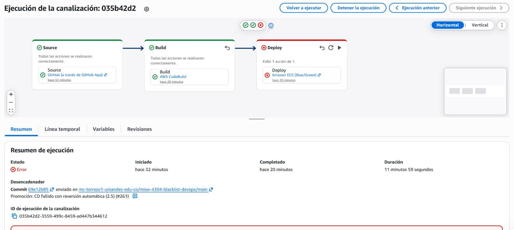

Registro del build: cobertura del 100 % y `156 passed`, seguido de las validaciones y el inicio de sesión en ECR.

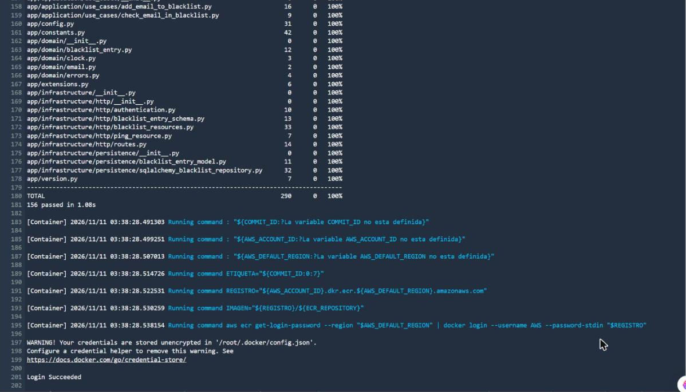

Envío a ECR: `latest` con el mismo *digest* que `69e12b8`, `imageDetail.json` con la dirección de la imagen y el
artefacto con `imageDetail.json`, `taskdef.json` y `appspec.yaml`.

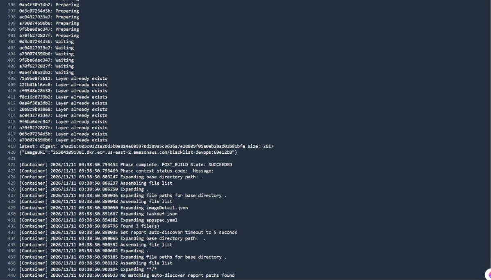

Repositorio `blacklist-devops`: la imagen `69e12b8, latest` de las 22:38:50, extraída por Fargate a las 22:39:32.

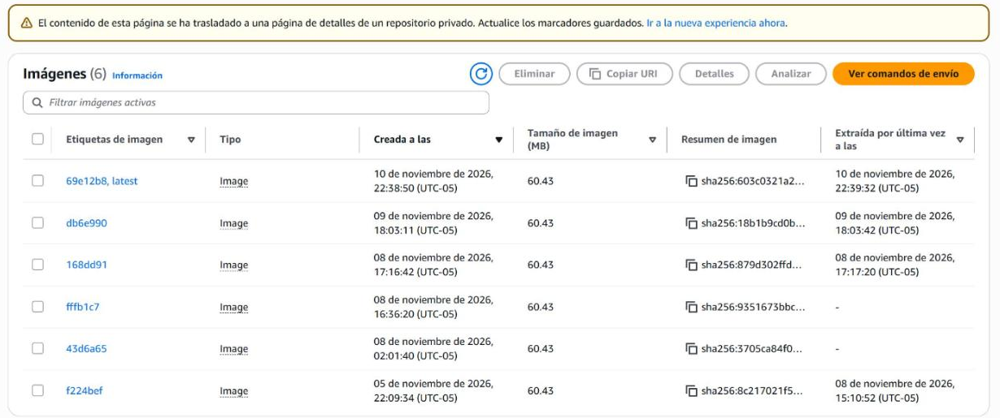

### 3.3 Despliegue fallido y reversión

`d-SYHBSF3HL` en *Error*, con la causa y la reversión `d-2TNRGN3HL` realizada correctamente.

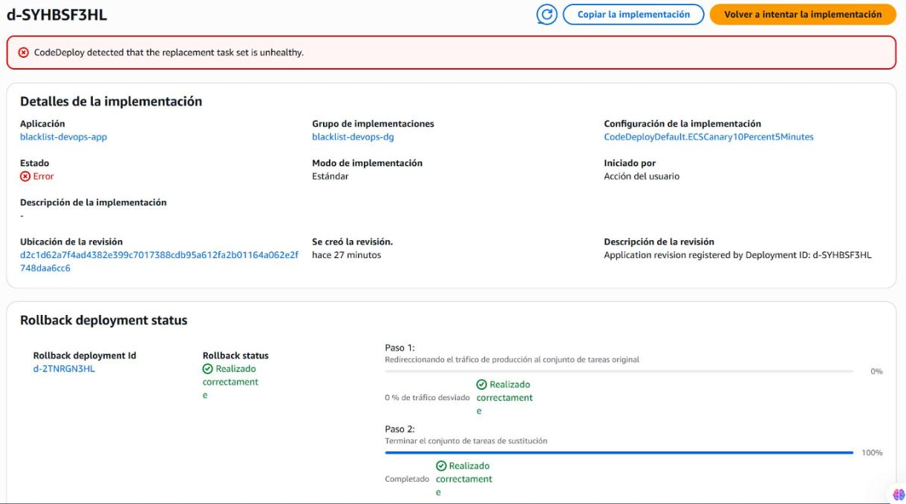

Estado del despliegue: el 100 % del tráfico se desvió al conjunto de sustitución y el paso 3 (espera) terminó en
*Error*. La consola muestra el último estado del despliegue fallido: el paso 4 y el conjunto de sustitución con el 100 %
no corresponden a lo que quedó corriendo, que es el conjunto original (sección 3.4).

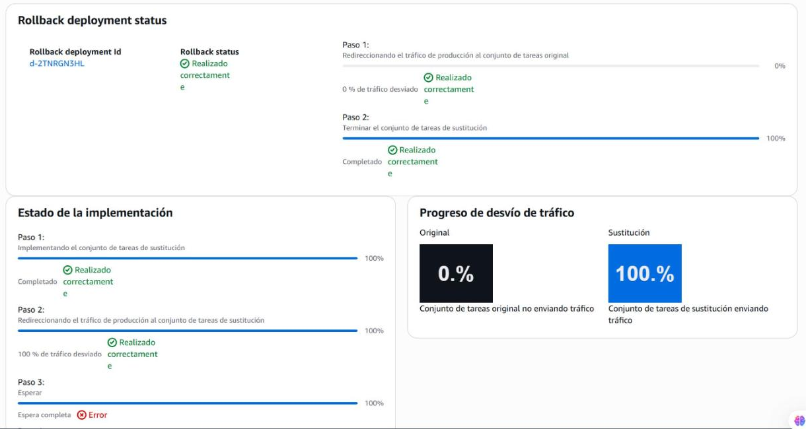

Eventos del ciclo de vida: `Install` duró 1 min 42 s y `AllowTraffic`, exactamente los 5 minutos del canario (22:40 a
22:45). Ninguno falló: el despliegue falló después, en la espera.

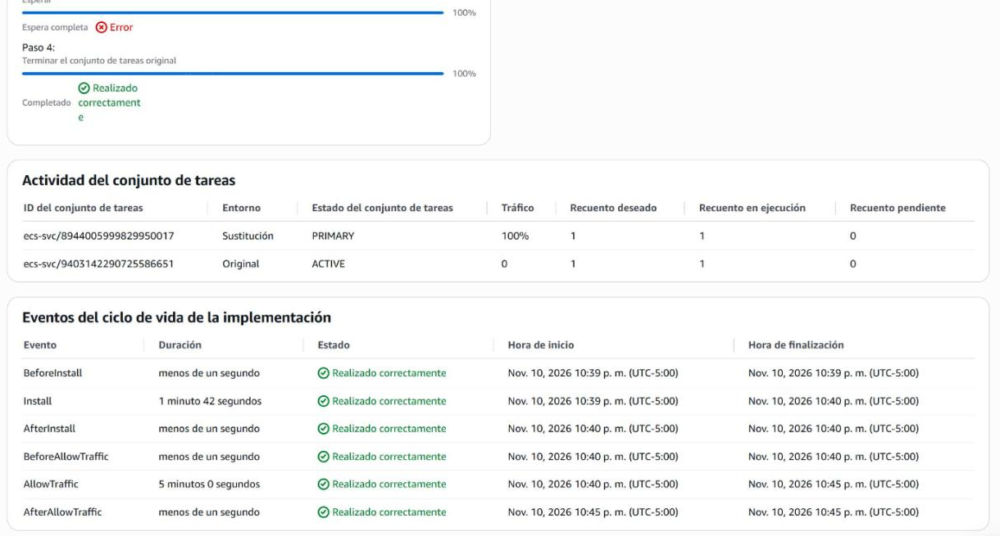

La reversión `d-2TNRGN3HL`, iniciada por *Restauración de CodeDeploy*: el 100 % del tráfico vuelve al conjunto original
y se termina el de sustitución.

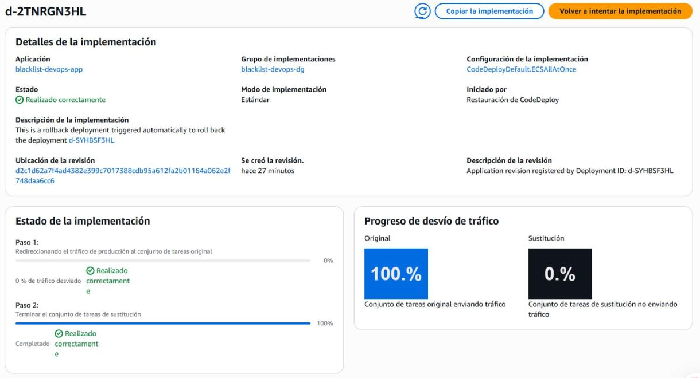

### 3.4 Tareas en mal estado y tráfico

Eventos del servicio filtrados por *unhealthy*: el puerto 8000 de la tarea nueva no pasa la verificación de salud en
`blacklist-devops-tg-verde` y ECS reemplaza la tarea tres veces. El grupo verde en mal estado ya no se podía capturar
cuando terminó la ejecución; estos eventos son la evidencia.

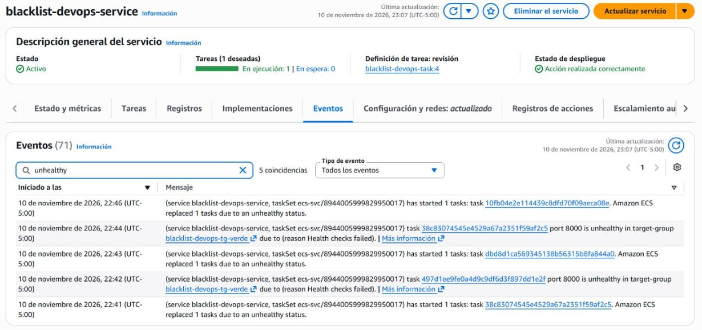

CloudWatch del balanceador, de 22:36 a 22:52 (en la gráfica, 03:36 a 03:52 UTC): `HTTPCode_ELB_502_Count` sube desde
las 22:41 y llega a 45 en el minuto de las 22:46; `RequestCount` se mantiene en unas 60 por minuto, las de los dos
monitores, hasta que el de respaldo queda solo.

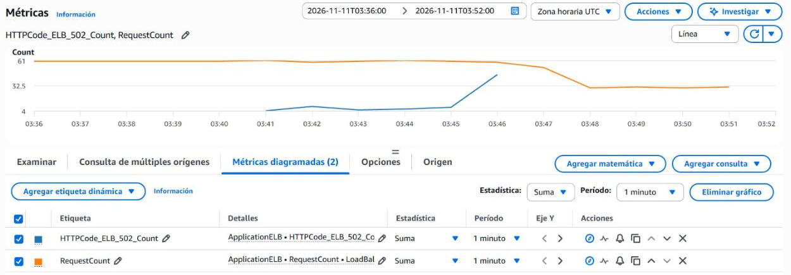

*Listener* HTTP:80 después de la reversión: reenvía el 100 % a `blacklist-devops-tg-azul`.

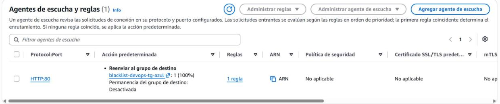

## 4. Hallazgos

1. **El CI terminó bien y el CD falló, como se buscaba.** Las 156 pruebas pasaron, la imagen `69e12b8` llegó a ECR y la
   etapa *Deploy* registró `blacklist-devops-task:5`. El contenedor arrancó, pero no atiende el puerto 8000, así que la
   versión nueva nunca respondió.
2. **El canario no verificó la salud antes de pasar el tráfico.** ECS dio por estable el conjunto de sustitución 9 s
   después de registrar la tarea en `blacklist-devops-tg-verde`, igual que en la 2.3. Mientras ese grupo no está
   asociado al *listener*, sus destinos quedan `unused` (`Target.NotInUse`) y el balanceador no los revisa: lo
   confirmamos con `describe-target-health` a las 22:39:47. `Install` terminó bien y el canario pasó el 10 % a una
   versión que no respondía. La decisión del 10 de noviembre suponía, a partir de la guía de solución de problemas de
   CodeDeploy para ECS, que con canario las verificaciones de salud correrían durante `Install`, antes de mover el
   tráfico. Esta ejecución lo desmintió para nuestra configuración, sin *listener* de prueba.
3. **Con el 10 % del tráfico, parte de las solicitudes falló durante cinco minutos.** Desde las 22:40:56 el balanceador
   envió una de cada diez solicitudes al grupo verde. Al empezar a verificar sus destinos, la tarea nueva quedó en mal
   estado y ECS la reemplazó cada dos minutos (22:41:38, 22:43:54 y 22:46:14), sin que ninguna llegara a sana. Los dos
   monitores registraron 32 errores 502 sueltos entre las 22:41:32 y las 22:46:02.
4. **CodeDeploy no detuvo el canario: pasó el 100 % al terminar los cinco minutos.** `AllowTraffic` terminó en
   *Succeeded* a las 22:45:57 y el tráfico completo fue al grupo verde. Desde las 22:46:10 todas las consultas
   respondieron 502.
5. **CodeDeploy detectó la falla con el tráfico completo y revirtió solo.** A las 22:46:40, 43 s después de pasar el
   100 %, declaró fallido el despliegue con `ECS_UPDATE_ERROR` («the replacement task set is unhealthy») y la reversión
   automática `d-2TNRGN3HL` devolvió el tráfico al grupo azul en 2 s. La reversión fue posible porque la versión
   anterior seguía corriendo: el conjunto original solo se termina dos minutos después de un despliegue exitoso. La tarea
   que atiende desde la 2.3 nunca se detuvo.
6. **Hubo errores y un corte breve.** El monitor principal registró 40 errores en las 361 consultas hechas mientras
   corrió la ejecución (11 %); el de respaldo, 36; CloudWatch, 77 en total. El corte total duró unos 44 s, de las 22:46:10 a las 22:46:53. El
   DoD de la tarea («la aplicación no quedó sin servicio») no se cumplió por completo.
7. **El fallo se declaró en 7 min 30 s, no en 60.** Los 60 minutos son el límite de CodeDeploy para que el conjunto de
   sustitución quede sano antes del cambio de tráfico. Como ECS lo dio por estable sin verificar la salud, ese límite no
   aplicó: lo que detuvo el despliegue fue el estado del conjunto con tráfico real. La ejecución completa duró 11 min 59 s.
8. **La consola del despliegue fallido puede confundir.** Después de la reversión, la página de `d-SYHBSF3HL` muestra el
   conjunto de sustitución como `PRIMARY` con el 100 % y el paso 4 («Terminar el conjunto de tareas original») como
   completado. Es el estado en que quedó ese despliegue; lo que corre se ve en la reversión, en el *listener* y en
   `describe-services`, que muestra solo el conjunto `ecs-svc/9403142290725586651` con `blacklist-devops-task:4`.
9. **Causa y corrección: falta una verificación de salud del contenedor.** ECS solo sabe que la tarea está sana por el
   balanceador, y el balanceador no la revisa hasta que recibe tráfico. Con una verificación de salud en `taskdef.json`
   (`healthCheck` contra `/ping` en `localhost:8000`), ECS no daría por estable la tarea hasta que responda, y el
   canario no le pasaría tráfico. El equipo votó agregarla en la rama de la 2.6 (#210), que devuelve el puerto a `8000`.
   Hay que comprobar en los eventos de ECS de la 2.6 que el estado estable llega después del primer chequeo sano. Otras
   salidas son un *listener* de prueba o la reversión por alarmas de CloudWatch, que la decisión 3 de la 1.2 dejó para la
   Entrega 4.

## 5. Correcciones a otros documentos

Los hallazgos 2 y 7 contradicen lo que dicen la 1.3, la 1.15, el hallazgo 4 de la 2.3, la sección 7 del documento y el
guion (pasos 2.5 y 4.4): que el canario verifica la salud antes de mover el tráfico, que no hubo corte y que el fallo
tarda 60 minutos. Se corrigieron en un PR aparte, después de esta ejecución.

## 6. Verificación con la CLI

Solo lectura. Con la CLI local se agrega `--profile blacklist`.

```bash
# Ejecución, disparador y acciones
aws codepipeline get-pipeline-execution --pipeline-name blacklist-devops-ci-pipeline --region us-east-2 \
  --pipeline-execution-id 035b42d2-3559-499c-8459-ad447b344612
aws codepipeline list-action-executions --pipeline-name blacklist-devops-ci-pipeline --region us-east-2 \
  --filter pipelineExecutionId=035b42d2-3559-499c-8459-ad447b344612
# Build e imagen
aws codebuild batch-get-builds --region us-east-2 \
  --ids blacklist-devops-ci-build:463203d6-81e2-45d4-9b03-4d950c518784 --query 'builds[0].phases'
aws ecr describe-images --repository-name blacklist-devops --image-ids imageTag=69e12b8 --region us-east-2
# Despliegue fallido, ciclo de vida y reversión
aws deploy get-deployment --deployment-id d-SYHBSF3HL --region us-east-2
aws deploy get-deployment-target --deployment-id d-SYHBSF3HL \
  --target-id blacklist-devops-cluster:blacklist-devops-service --region us-east-2
aws deploy get-deployment --deployment-id d-2TNRGN3HL --region us-east-2
# Eventos del servicio durante el despliegue
aws ecs describe-services --cluster blacklist-devops-cluster --services blacklist-devops-service --region us-east-2 \
  --query 'services[0].events[?createdAt>=`2026-11-10T22:39:00-05:00` && createdAt<=`2026-11-10T22:50:00-05:00`].[createdAt,message]'
# Errores 502 en el balanceador
aws cloudwatch get-metric-statistics --namespace AWS/ApplicationELB --metric-name HTTPCode_ELB_502_Count \
  --dimensions Name=LoadBalancer,Value=app/blacklist-devops-alb/d9dba4feaa922997 \
  --start-time 2026-11-11T03:36:00Z --end-time 2026-11-11T03:52:00Z --period 60 --statistics Sum --region us-east-2
# Versión servida
curl -s http://blacklist-devops-alb-663902063.us-east-2.elb.amazonaws.com/ping
```

## 7. Cumplimiento de la tarea

| Criterio de la tarea 2.5 (#209) | Evidencia |
|---|---|
| Cambio que pasa las pruebas pero no la verificación de salud, que retira la prueba de la 2.4, por el flujo de ramas hasta `main` | Sección 1: PR #258 y promoción #261 (`69e12b8`) |
| El build termina bien, la imagen llega a ECR y el despliegue de CodeDeploy falla y se revierte | Secciones 3.2 y 3.3, hallazgos 1 y 5 |
| La versión anterior sigue atendiendo `GET /ping` durante y después del despliegue | Sección 2.1 y hallazgo 6: siempre respondió `db6e990`, **con 40 errores 502** en el monitor principal |
| Capturas en `docs/capturas/entrega-3/2.5-*.png` y hallazgos en este documento | Secciones 3 y 4 |
| DoD: ejecución con CI exitoso y CD fallido documentada con capturas y hallazgos | Secciones 3 y 4 |
| DoD: la aplicación no quedó sin servicio | **Cumplido en parte**: la versión anterior nunca se detuvo y la reversión fue automática, pero hubo errores durante 5 minutos y unos 44 s de corte total (hallazgo 6). La corrección es la verificación de salud del contenedor (hallazgo 9) |
