# Entrega 3 · Versión final en Fargate con verificación de salud del contenedor

Tarea 2.6 (#210) · Épica E3 · Pruebas

Este documento registra la ejecución del pipeline `blacklist-devops-ci-pipeline` que vuelve a la versión buena después
del CD fallido de la 2.5 (#209). El cambio se revirtió por el flujo de ramas (decisión 6 de la 1.2,
[1.3-diseno-pipeline.md](1.3-diseno-pipeline.md)): Gunicorn vuelve al puerto `8000` y `taskdef.json` agrega la
verificación de salud del contenedor (`healthCheck` contra `/ping`) que votó el equipo después del hallazgo 9 de la 2.5
([2.5-cd-fallido.md](2.5-cd-fallido.md)). El CI y el CD terminaron bien, sin reversión y sin errores, y `main` quedó
igual a lo que corre en Fargate. La colección de Postman pasó contra esa versión
([2.6-postman-fargate.md](../../pruebas/entrega-3/2.6-postman-fargate.md)).

La ejecución es del **12 de noviembre de 2026**, en la cuenta del proyecto y la región **us-east-2**. Las horas están en
UTC-05:00. La consulta de los datos con la AWS CLI fue de solo lectura.

## 1. Resultado

| Dato | Valor |
|---|---|
| Cambio | PR #265 (`7ff095a` en `dev`): Gunicorn en `:8000` en el `Dockerfile` y `healthCheck` en `taskdef.json` |
| Commit | `d790bcb6fbfdaa45c9d0c99ff531a85f3e497337` (`d790bcb`), *merge commit* de la promoción #268 en `main`, 18:20:28 |
| Disparador | `WebhookV2`, tipo `PUSH_BRANCH`, rama `main`, por la conexión de GitHub |
| Ejecución del pipeline | `72376863-51af-407a-ac3e-ea7ef2eb7b00`, versión 5 del pipeline, **Succeeded** |
| Duración | De 18:20:31 a 18:34:02: 13 min 31 s |
| Etapa *Source* | **Succeeded**, 7 s |
| Etapa *Build* | **Succeeded**: `blacklist-devops-ci-build:16bdc0ee-f970-441d-8242-e61e04e1a3c8` (compilación 31), 156 pruebas aprobadas, cobertura del 100 %, de 18:20:40 a 18:24:28 |
| Imagen | `blacklist-devops:d790bcb` y `latest`, el mismo *digest* `sha256:059860c2f3198a18ebeac754abc7dc2fe8fdac24755fc4ef7cc3741158ca1ecf`, 60,43 MB, en ECR a las 18:24:27 |
| Definición de la tarea | `blacklist-devops-task:6`, registrada por la etapa *Deploy* a las 18:24:47 con la imagen `d790bcb` y el `healthCheck` |
| Configuración de CodeDeploy | `CodeDeployDefault.ECSCanary10Percent5Minutes` |
| Despliegue | `d-4O07MRAIL`, **Succeeded**, de 18:24:47 a 18:33:55, sin reversión |
| Servicio después | `blacklist-devops-task:6`, una tarea (`6281fc8e…`) con el contenedor *HEALTHY*; el *listener* HTTP:80 reenvía a `blacklist-devops-tg-verde` (100) y no a `blacklist-devops-tg-azul` (0) |
| `GET /ping` | `{"version": "db6e990"}` hasta las 18:32:06 y `{"version": "d790bcb"}` desde las 18:27:14 (con el 10 %) y en todas las consultas desde las 18:32:08. **0 errores en 726 consultas** (monitor) |
| Errores 5XX en el balanceador | Ninguno entre las 18:15 y las 18:40 (CloudWatch, `HTTPCode_ELB_5XX_Count` sin datos) |
| Postman | 22 de 22 pruebas aprobadas a las 18:55:30 ([2.6-postman-fargate.md](../../pruebas/entrega-3/2.6-postman-fargate.md)) |

### Verificación de salud del contenedor

| Parámetro | Valor |
|---|---|
| Comando | `["CMD", "python", "-c", "import urllib.request; urllib.request.urlopen('http://localhost:8000/ping', timeout=3)"]` |
| Intervalo | 15 s |
| Espera por intento | 5 s |
| Intentos antes de marcarlo en mal estado | 3 |
| Periodo de arranque | 20 s |

## 2. Línea de tiempo

| Hora | Evento | Fuente |
|---|---|---|
| 18:20:28 | *Merge* de la promoción #268 en `main` (`d790bcb`) | GitHub |
| 18:20:31 | Inicia la ejecución `72376863`; *Source* termina a las 18:20:39 | CodePipeline |
| 18:20:40 | Inicia la compilación 31: `INSTALL` 191 s, `BUILD` 21 s (pruebas y `docker build`) y `POST_BUILD` 3 s | CodeBuild |
| 18:24:27 | Imagen `d790bcb` y `latest` en ECR | ECR |
| 18:24:47 | Se registra `blacklist-devops-task:6` y se crea el despliegue `d-4O07MRAIL` | ECS y CodeDeploy |
| 18:24:59 | ECS inicia la tarea `6281fc8e…` en el conjunto de sustitución | Eventos de ECS |
| 18:25:29 | La tarea se registra en `blacklist-devops-tg-verde` | Eventos de ECS |
| 18:25:30 | Arranca el contenedor | `describe-tasks` |
| 18:25:47 | El conjunto de sustitución queda en `STEADY_STATE` y el servicio, estable: **18 s** después del registro | Eventos de ECS |
| 18:26:52 | Termina `Install` (2 min 2 s) | CodeDeploy |
| 18:26:53 | `AllowTraffic`: el 10 % del tráfico pasa a la versión nueva | CodeDeploy |
| 18:27:14 | Primera respuesta de `d790bcb` en el monitor | Monitor |
| 18:31:54 | Termina `AllowTraffic`: el 100 % pasa a la versión nueva | CodeDeploy |
| 18:32:06 | Última respuesta de `db6e990` en el monitor | Monitor |
| 18:33:55 | Termina la espera de 2 minutos; el despliegue queda en *Succeeded* | CodeDeploy |
| 18:33:57 | ECS detiene la tarea anterior `a02b929f…` y a las 18:34:06 la quita de `blacklist-devops-tg-azul` | Eventos de ECS |
| 18:34:02 | *Deploy* termina; la ejecución queda en *Succeeded* | CodePipeline |

### 2.1 Disponibilidad

El monitor de `/ping` (`scripts/monitor_disponibilidad.py`, cada 2 s) corrió de 18:10:40 a 18:34:50 contra el
balanceador. El registro está en
[`docs/despliegues/entrega-3/2.6-version-final.csv`](../../despliegues/entrega-3/2.6-version-final.csv).

| Periodo | Consultas | Errores | Versión |
|---|---|---|---|
| Todo el monitor (18:10:40 a 18:34:50) | 726 | 0 | 623 `db6e990` y 103 `d790bcb` |
| Mientras corrió la ejecución (18:20:28 a 18:34:02) | 408 | 0 | — |
| Con el 10 % (18:26:53 a 18:31:54) | 151 | 0 | 20 de `d790bcb` (13 %) |

La latencia promedio fue de 282 ms y la máxima, de 1018 ms.

## 3. Evidencia

### 3.1 Promoción y pipeline

Promoción #268 aprobada, antes del *merge*.

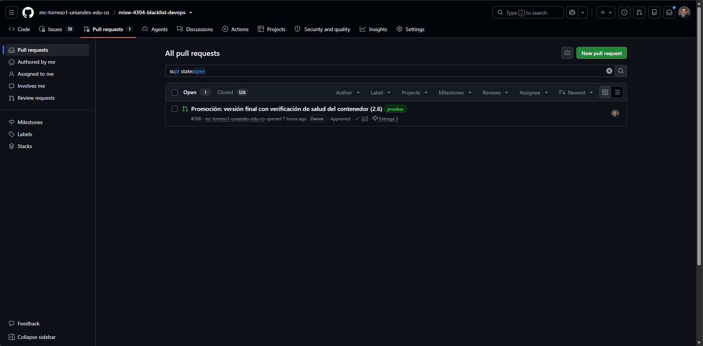

*Source* en *Succeeded* con `d790bcb6` y *Build* en curso. *Deploy* todavía muestra la ejecución fallida de la 2.5.

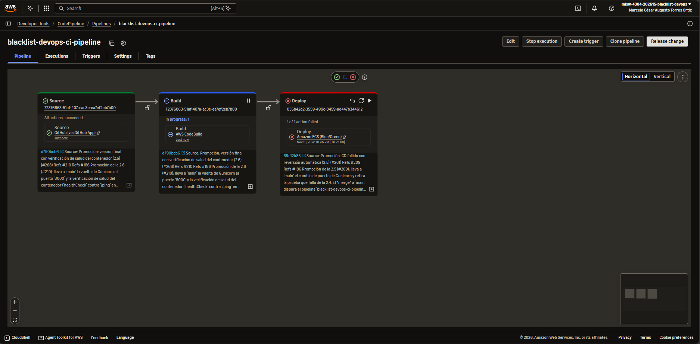

*Build* en *Succeeded* y *Deploy* en curso, con el mismo commit en las tres etapas.

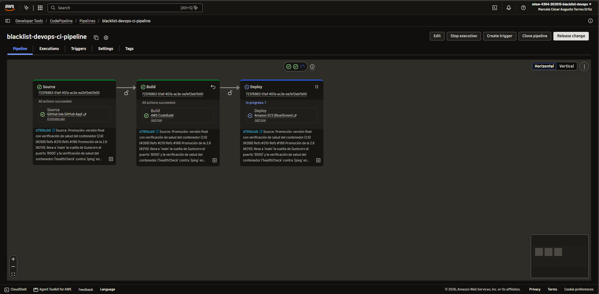

Las tres etapas en *Succeeded*.

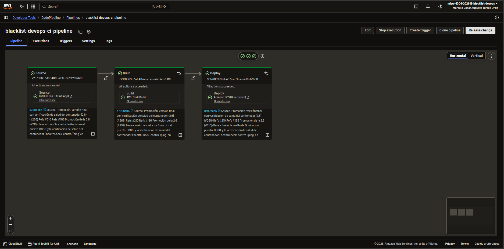

### 3.2 Build e imagen

Registro de la compilación 31: `156 passed in 0.98s` y cobertura del 100 %.

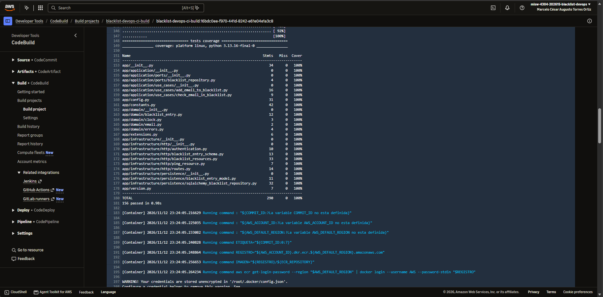

`docker build` con `VERSION` = `d790bcb`, las etiquetas `d790bcb` y `latest`, y el `docker push` a ECR.

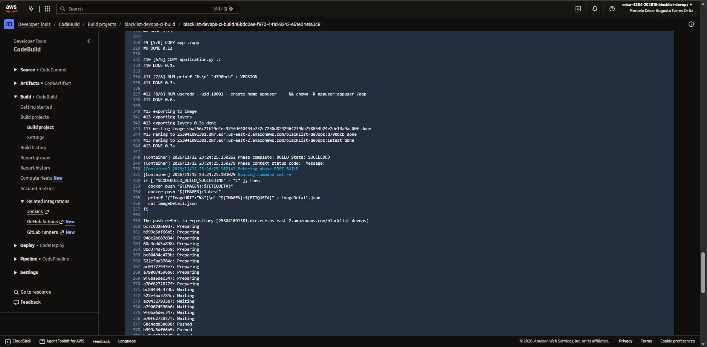

ECR con `latest, d790bcb` a las 18:24:27, el mismo tamaño que las imágenes anteriores.

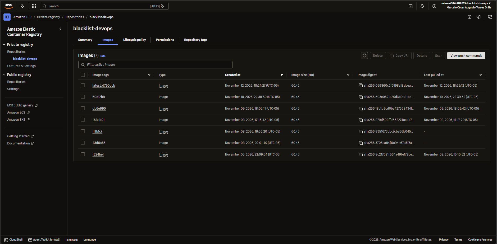

### 3.3 Tarea y verificación de salud

Eventos del servicio: la tarea se inicia a las 18:24, se registra en `blacklist-devops-tg-verde` y el servicio queda
estable a las 18:25.

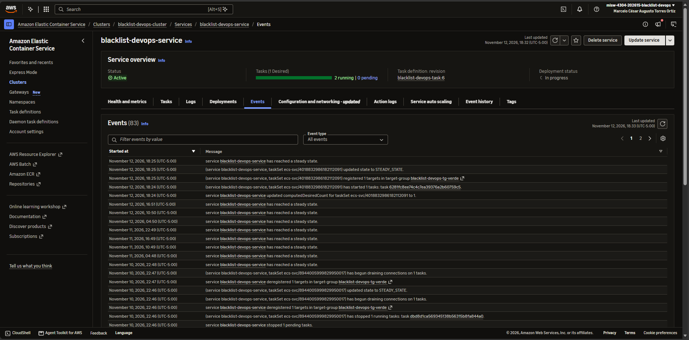

`blacklist-devops-task:6` con la imagen `d790bcb`.

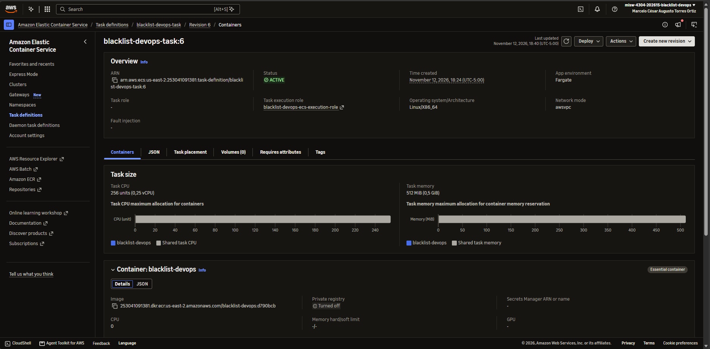

Tarea `6281fc8e…`: contenedor `blacklist-devops` en *Running* y con estado de salud *Healthy*.

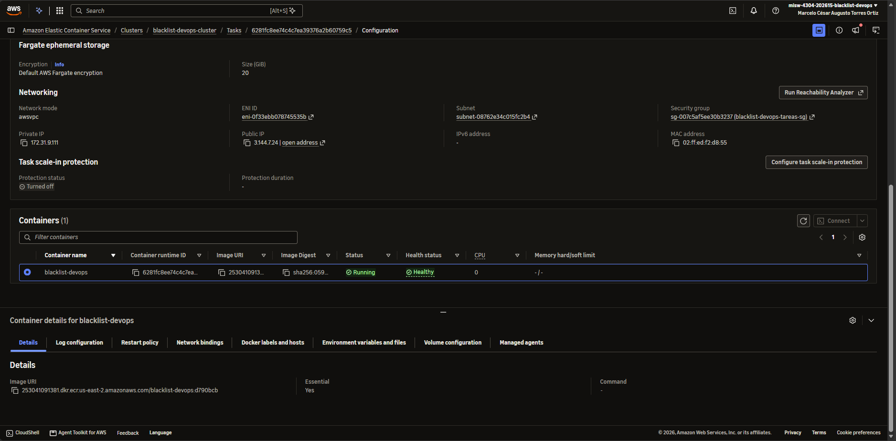

Salud de los destinos a las 18:32: dos tareas corriendo durante el despliegue y `blacklist-devops-tg-verde` con 1
destino *Healthy*.

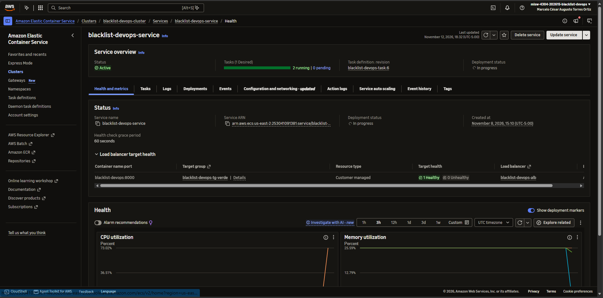

### 3.4 Despliegue

Canario: 90 % del tráfico en el conjunto original y 10 % en el de sustitución.

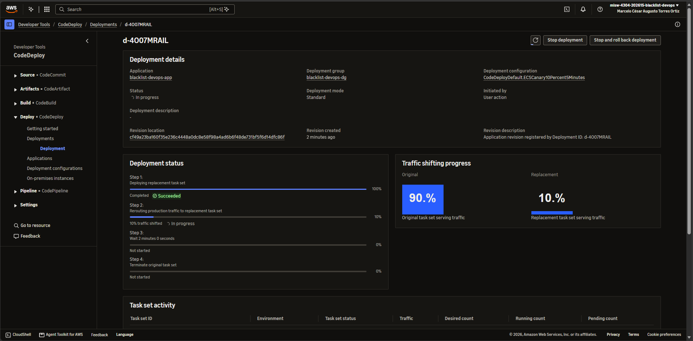

`d-4O07MRAIL` en *Succeeded*: 100 % en el conjunto de sustitución y los cuatro pasos completos.

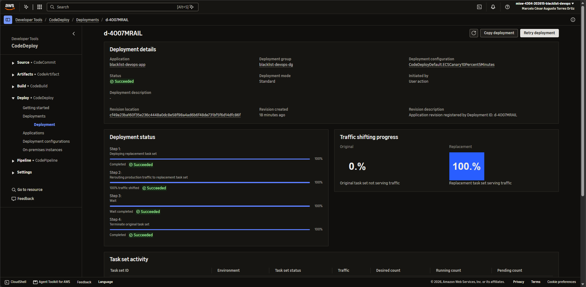

Historial del grupo: los despliegues de la 1.16 y la 2.3, el fallido de la 2.5 con su reversión y el de la 2.6.

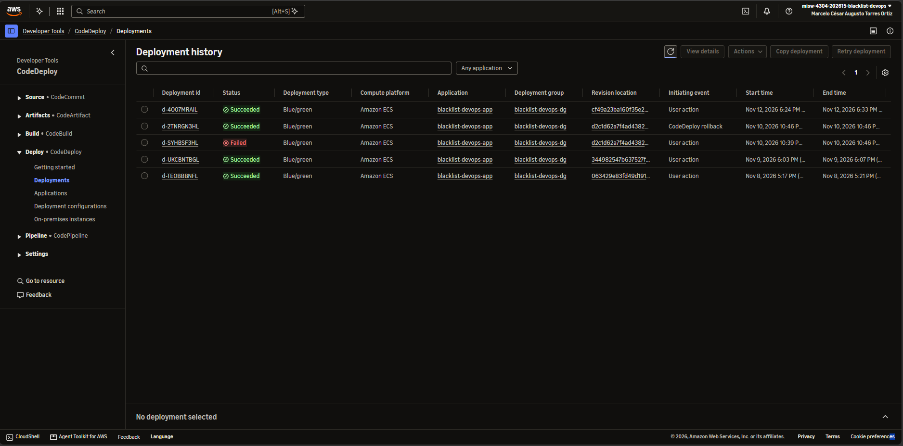

*Listener* HTTP:80 con `blacklist-devops-tg-verde` en 100 y `blacklist-devops-tg-azul` en 0.

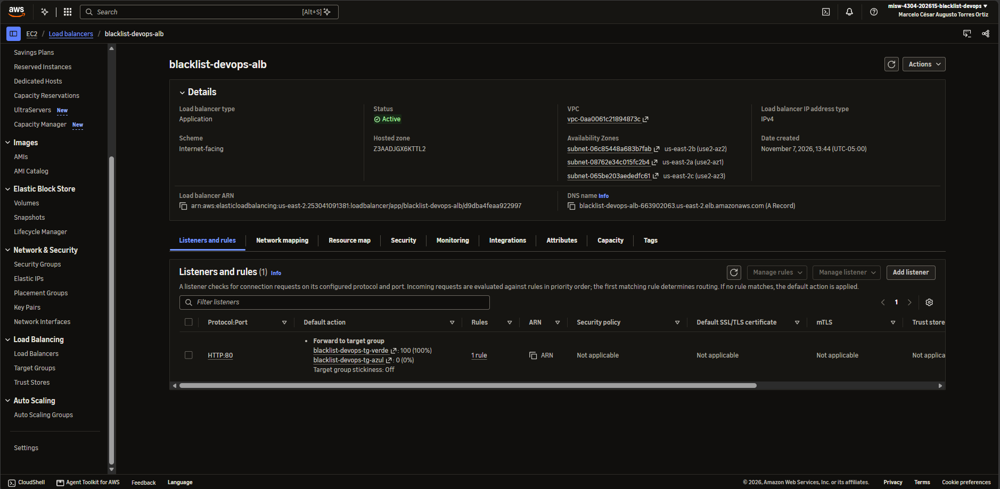

Ninguna captura muestra secretos ni el token: los secretos de la tarea aparecen solo por nombre.

## 4. Hallazgos

1. **El CI y el CD terminaron bien y `main` quedó igual a lo que corre.** Las 156 pruebas pasaron, la imagen `d790bcb`
   llegó a ECR y CodeDeploy desplegó sin reversión. La versión de `/ping`, la etiqueta de la imagen y la definición de
   la tarea dicen `d790bcb`, el *merge commit* de la promoción. Con esto se cierra la secuencia de la sección 9 de la
   1.3: CI y CD exitosos (2.3), CI fallido (2.4), CD fallido (2.5) y vuelta a la versión buena (2.6).
2. **Con el `healthCheck`, ECS esperó a que el contenedor respondiera.** En la 2.3 y la 2.5, ECS dio la tarea por
   estable 9 s después de registrarla en el grupo de destino. En la 2.6 fueron 18 s: el contenedor arrancó a las
   18:25:30 y el servicio quedó estable a las 18:25:47, unos 17 s después, que coincide con el primer chequeo a los 15 s
   del arranque. La consola muestra el contenedor *Healthy*. La AWS CLI no da la hora exacta del primer chequeo sano;
   la coincidencia se infiere del intervalo de 15 s.
3. **El canario no tuvo errores.** Con el 10 %, 20 de 151 consultas (13 %) respondieron la versión nueva y ninguna
   falló; al pasar el 100 %, todas respondieron `d790bcb`. CloudWatch no registra errores 5XX en el balanceador. En la
   2.5 hubo 77 errores 502.
4. **Lo que esta ejecución no prueba.** La 2.6 despliega una versión que responde. No se volvió a desplegar una que no
   responda, así que no queda probado que, con el `healthCheck`, el canario deje de pasarle tráfico a una versión
   rota. Además, el servicio tiene un periodo de gracia de 60 s para los chequeos de salud: queda por comprobar cómo se
   combina con el periodo de arranque de 20 s y los 3 intentos de 15 s del `healthCheck` en ese caso.
5. **El despliegue duró 9 min 8 s.** `Install` tardó 2 min 2 s (arranque de la tarea y chequeo de salud), el canario 5
   min y la espera antes de terminar la tarea anterior 2 min. El pipeline completo duró 13 min 31 s, de los que el build
   ocupó 3 min 48 s; 191 s fueron la instalación de Python (hallazgo 6 de la 2.3).
6. **Los grupos de destino se alternaron.** El tráfico pasó de `blacklist-devops-tg-azul`, donde lo dejó la reversión
   de la 2.5, a `blacklist-devops-tg-verde`. El siguiente despliegue usará el azul.

## 5. Verificación con la CLI

```bash
# Ejecución y acciones
aws codepipeline get-pipeline-execution --pipeline-name blacklist-devops-ci-pipeline --pipeline-execution-id 72376863-51af-407a-ac3e-ea7ef2eb7b00 --region us-east-2
aws codepipeline list-action-executions --pipeline-name blacklist-devops-ci-pipeline --filter pipelineExecutionId=72376863-51af-407a-ac3e-ea7ef2eb7b00 --region us-east-2

# Despliegue y ciclo de vida
aws deploy get-deployment --deployment-id d-4O07MRAIL --region us-east-2
aws deploy get-deployment-target --deployment-id d-4O07MRAIL --target-id blacklist-devops-cluster:blacklist-devops-service --region us-east-2

# Tarea, salud del contenedor y verificación configurada
aws ecs describe-tasks --cluster blacklist-devops-cluster --tasks 6281fc8ee74c4c7ea39376a2b60759c5 --region us-east-2 --query "tasks[0].[taskDefinitionArn,healthStatus,startedAt,containers[0].healthStatus]"
aws ecs describe-task-definition --task-definition blacklist-devops-task:6 --region us-east-2 --query "taskDefinition.containerDefinitions[0].healthCheck"

# Eventos del servicio
aws ecs describe-services --cluster blacklist-devops-cluster --services blacklist-devops-service --region us-east-2 --query "services[0].events[0:12]"

# Imagen y versión servida
aws ecr describe-images --repository-name blacklist-devops --image-ids imageTag=d790bcb --region us-east-2
curl http://blacklist-devops-alb-663902063.us-east-2.elb.amazonaws.com/ping
```

## 6. Cumplimiento de la tarea

| Criterio de la tarea 2.6 (#210) | Evidencia |
|---|---|
| Revertir en `main` el cambio de la 2.5 por el flujo de ramas y verificar que el despliegue termina bien | PR #265 a `dev` y promoción #268 a `main`; secciones 1 y 2: ejecución y despliegue en *Succeeded*, sin reversión |
| Ejecutar la colección con el environment de Fargate de la 2.1 y guardar el resultado en `docs/pruebas/` | [2.6-postman-fargate.md](../../pruebas/entrega-3/2.6-postman-fargate.md): 22 de 22 |
| `GET /ping` con la versión final | Sección 1 y monitor: `{"version": "d790bcb"}` |
| `healthCheck` del contenedor en `taskdef.json` y comprobación en los eventos de ECS de que la tarea queda estable después del primer chequeo sano | Sección 1 (parámetros), sección 3.3 y hallazgo 2. Lo que no se comprobó está en el hallazgo 4 |
| DoD: la colección pasa contra Fargate con la versión final desplegada por el pipeline | 22 de 22 con `d790bcb`, desplegada por la ejecución `72376863` |
