# Proyecto 1 · Entrega 2: Integración continua del microservicio con AWS CodeBuild y CodePipeline

| | |
|---|---|
| Curso | MISW 4304 · DevOps · Universidad de los Andes (periodo 202615) |
| Entrega | Entrega 2: integración continua (CI) del microservicio |
| Grupo | Blacklist DevOps |
| Integrantes | Marcelo César Torres · Héctor José Melgarejo · Juan Sebastián Páez · Jean Pierre Betancourt |
| Fecha | 1 de noviembre de 2026 |

## Contenido

1. Descripción del microservicio y pruebas por endpoint (punto 1 de la configuración, 30 %)
2. Arquitectura de la integración continua
3. Enlaces de la entrega
4. Configuración en AWS (punto 2 de la configuración, 10 %)
5. Archivo de construcción y disparo automático (puntos 3 y 4 de la configuración, 25 % y 15 %)
6. Pipeline exitoso (punto 1 del documento, 10 %)
7. Pipeline fallido (punto 2 del documento, 10 %)
8. Limitaciones y decisiones
9. Conclusiones

## 1. Descripción del microservicio y pruebas por endpoint

El microservicio administra la lista negra global de emails de la organización. Los sistemas internos
lo usan para agregar un email a la lista y para consultar si un email está en ella. Es un único
servicio REST en Python con Flask, protegido con un token Bearer, que persiste la información en
PostgreSQL sobre Amazon RDS y se ejecuta en AWS Elastic Beanstalk.

Es el mismo microservicio de la Entrega 1: su contrato no cambia. Esta entrega agrega las pruebas
unitarias por endpoint y el pipeline que las ejecuta y genera el artefacto desplegable en cada cambio.

| Método | Ruta | Descripción | Respuestas |
|---|---|---|---|
| POST | `/blacklists` | Agrega un email a la lista negra. Cuerpo: `email`, `app_uuid` (UUID obligatorio) y `blocked_reason` (opcional, máximo 255 caracteres). Guarda además la IP de origen y la fecha y hora de la solicitud | 201 con `msg` e `id`; 400 con `msg` y `errors`; 401 sin token o con token inválido; 409 si el email ya está |
| GET | `/blacklists/<string:email>` | Indica si el email está en la lista y el motivo | 200 con `is_blacklisted` y `blocked_reason`; 401 sin token o con token inválido |
| GET | `/ping` | Health check del balanceador. No requiere token ni consulta la base | 200 con `{"version": ...}` |

Stack: Python 3.13, Flask 3.1.3, Flask-SQLAlchemy 3.1.1 (SQLAlchemy 2.1.4), Flask-RESTful 0.3.10,
Flask-Marshmallow 1.5.0 (marshmallow 4.3.1), Flask-JWT-Extended 4.7.4, Werkzeug 3.1.9, PostgreSQL 16
con el driver psycopg 3 y Gunicorn 26.2.0 como servidor WSGI. Las pruebas usan pytest 9.1.1 y
pytest-cov 7.1.0.

El código está organizado por capas: `domain` (entidad, validación del email, errores y reloj),
`application` (casos de uso *agregar* y *consultar*, y el puerto del repositorio) e `infrastructure`
(recursos HTTP, esquema de validación, autenticación y repositorio SQLAlchemy). El email se normaliza a
minúsculas y sin espacios al guardar y al consultar.

### 1.1 Pruebas por endpoint

Cubre el punto 1 de la configuración (30 %): cada endpoint tiene escenarios de prueba unitaria para todas
las respuestas de su contrato. La suite tiene 97 pruebas, con 100 % de cobertura del paquete `app`: 39 son
de la API (23 en `tests/test_blacklist_api.py`, 10 casos de credencial inválida en
`tests/test_authentication.py` y 6 en `tests/test_ping.py`) y las otras 58 cubren la configuración, el
dominio y los scripts de empaquetado y monitoreo.

| Endpoint | Respuesta | Escenario | Prueba representativa |
|---|---|---|---|
| `POST /blacklists` | 201 | Alta correcta, con mensaje e id; la IP y la fecha se prueban aparte | `test_post_adds_email_and_returns_id` |
| | 400 | Email inválido o campos faltantes | `test_post_rejects_invalid_email` |
| | 401 | Cinco variantes de credencial inválida | `test_post_rejects_invalid_credentials_with_unauthorized` |
| | 409 | Email duplicado, también con otras mayúsculas o espacios | `test_post_duplicated_email_returns_conflict` |
| `GET /blacklists/<email>` | 200 | Email en la lista, con su motivo | `test_get_returns_true_and_reason_for_blacklisted_email` |
| | 200 | Email que no está en la lista | `test_get_returns_false_for_unknown_email` |
| | 401 | Cinco variantes de credencial inválida | `test_get_rejects_invalid_credentials_with_unauthorized` |
| `GET /ping` | 200 | Sin token, solo con la versión y sin consultar la base | `test_ping_does_not_query_the_database` |

Las pruebas usan SQLite en memoria, así que no dependen de un servidor de base de datos ni de la red.
Antes de configurar el pipeline, la suite se ejecutó en un entorno limpio con Python 3.13.16, sin red ni
base de datos, como el de CodeBuild: pasaron las 97 pruebas en tres ejecuciones seguidas, archivo por
archivo y en orden inverso. En el pipeline corren en cada build: en la ejecución exitosa pasaron las 97
(sección 6.2 y figura 6.5), y en la fallida el registro identifica la prueba que falló (sección 7.2).

## 2. Arquitectura de la integración continua

El pipeline valida cada cambio y genera el artefacto desplegable. Ejecuta las pruebas unitarias en AWS
CodeBuild y, si todas pasan, deja el paquete de la aplicación en Amazon S3. **No despliega**: la carga
del artefacto en Elastic Beanstalk es un paso manual, porque la entrega excluye el despliegue
automatizado (CD).

```
Desarrollador
     │  push a main · pull request hacia dev o main
     ▼
GitHub · repositorio misw-4304-blacklist-devops
     │  conexión blacklist-devops-github (AWS CodeConnections, sin tokens)
     ▼
AWS CodePipeline V2 · blacklist-devops-ci-pipeline
     │  Etapa Origen: código del commit (ZIP) y su identificador (CommitId)
     ▼
     │  Etapa Construcción
     ▼
AWS CodeBuild · blacklist-devops-ci-build (buildspec.yml)
     │  1. Instala las dependencias (requirements-dev.txt)
     │  2. Ejecuta las pruebas con pytest ──── una falla ──▶ build Failed, sin artefacto
     │  3. Empaqueta la aplicación: app-<commit>.zip
     │  Registros de cada fase en Amazon CloudWatch Logs
     ▼
Amazon S3 · blacklist-devops-ci-artifacts-253041091381
     │  almacén del pipeline: objeto BuildArtif/<id> que contiene app-<commit>.zip
     ┊
     ┊  despliegue manual, fuera del pipeline: se extrae el paquete y se sube a Beanstalk
     ▼
AWS Elastic Beanstalk · Blacklist-devops-env
```

| Pieza | Recurso | Qué hace |
|---|---|---|
| Repositorio | GitHub, `misw-4304-blacklist-devops` | Guarda el código, las pruebas y el `buildspec.yml`. `main` es la rama estable y `dev` la de integración; las dos están protegidas: solo cambian por pull request aprobado |
| Conexión | `blacklist-devops-github` (AWS CodeConnections) | Autoriza a AWS a leer el repositorio mediante una aplicación de GitHub limitada a este repositorio, sin tokens personales ni llaves guardadas |
| Pipeline | AWS CodePipeline V2, `blacklist-devops-ci-pipeline` | Detecta los cambios y orquesta las dos etapas: Origen (obtiene el código) y Construcción (lanza CodeBuild). Modo de ejecución `QUEUED`: si llegan varios cambios, se ejecutan en orden y ninguno reemplaza a otro |
| Construcción | AWS CodeBuild, `blacklist-devops-ci-build` | Ejecuta las fases del `buildspec.yml`: instala las dependencias, corre las pruebas y genera el paquete. Si una prueba falla, el build termina en *Failed* y no se genera artefacto |
| Artefacto | Amazon S3, `blacklist-devops-ci-artifacts-253041091381` | Bucket privado, con el acceso público bloqueado y cifrado SSE-S3, que también es el almacén de artefactos del pipeline. CodePipeline guarda la salida del build como un objeto con nombre generado (`blacklist-devops-ci-/BuildArtif/<id>`) que contiene el paquete `app-<commit>.zip`, identificado con los siete primeros caracteres del commit |
| Permisos | Roles de IAM `blacklist-devops-codebuild-role` y `blacklist-devops-codepipeline-role` | Cada servicio actúa con su propio rol y permisos mínimos sobre los recursos del proyecto. Ninguno tiene permisos de administrador ni usa llaves de acceso |
| Registros | Amazon CloudWatch Logs | Guarda la salida de cada build, con el resultado de las pruebas |
| Despliegue | AWS Elastic Beanstalk, `Blacklist-devops-env` | Fuera del pipeline: una persona descarga el objeto del build, extrae `app-<commit>.zip`, lo sube como versión de la aplicación y la despliega en el entorno de la Entrega 1 |

**Cuándo se ejecuta.** El pipeline se dispara con cada *push* a `main` (el commit en la rama principal
que pide el enunciado) y con cada pull request abierto o actualizado hacia `dev` o `main`, para validar
los cambios antes de fusionarlos. El *push* a `main` no excluye ningún archivo, de modo que todo commit en
la rama principal inicia el build; en los pull requests se omiten los cambios que solo tocan documentación
(`docs/**`, `postman/**` o archivos `.md`).

Los dos disparadores están comprobados, sin intervención manual: el *merge* de la promoción `b0e9d03` en
`main` inició la ejecución exitosa 5 segundos después (sección 6), y el pull request #160 de
`test/build-fallido` hacia `dev` inició la ejecución fallida con el evento `PULL_REQUEST_CREATED`
(sección 7). Al abrir el pull request de promoción #156 hacia `main` no se inició ninguna ejecución, sin
causa identificada; el siguiente pull request hacia `main`, el #164, sí inició la ejecución `901438a7`, y el
*push* de su fusión (`625e8c4`) inició otra, la `8d6a7974`. Las dos terminaron con éxito. Con la versión 2
del pipeline, el *push* del commit `3db0adb`, que solo cambió documentación, inició la ejecución `19089be6`
(sección 5.3).

El pipeline se creó con la exclusión de rutas también en el *push* a `main`. El 27 de octubre de 2026 se
quitó (versión 2 del pipeline), porque con ella un commit de solo documentación en la rama principal no
iniciaba el build, y el enunciado pide que lo haga cada commit.

**Flujo de una ejecución:**

1. Un desarrollador fusiona un cambio en `main` o abre un pull request.
2. CodePipeline recibe el evento por la conexión de GitHub y la etapa Origen obtiene el código de ese
   commit.
3. La etapa Construcción lanza CodeBuild, que instala las dependencias y ejecuta las pruebas.
4. Si todas las pruebas pasan, CodeBuild genera `app-<commit>.zip` y CodePipeline lo guarda en el bucket
   de S3, dentro del objeto de salida del build. Si una falla, el build y la ejecución del pipeline
   terminan en *Failed* y no se genera artefacto.
5. Fuera del pipeline, el equipo extrae el paquete del último build exitoso de `main` y lo despliega
   manualmente en Beanstalk.

**Decisiones de la arquitectura:**

- **CodePipeline con CodeBuild como etapa,** en lugar de un webhook directo de CodeBuild: centraliza en
  un solo lugar el origen de GitHub y la ejecución de CodeBuild, separa la obtención del código de la
  construcción y deja un historial de ejecuciones por etapa. El acceso a GitHub es por la conexión, sin
  tokens personales ni llaves guardadas.
- **Pruebas sin servidor de base de datos.** El enunciado permite usar mocks o levantar un motor de base
  de datos dentro del CI; el equipo eligió SQLite en memoria, que no requiere configurar servicios
  adicionales en CodeBuild. El proyecto de CodeBuild no define la cadena de conexión a la base ni
  secretos.
- **Artefacto en S3,** como paquete `.zip` listo para crear una versión de la aplicación en Beanstalk
  (el enunciado permite un repositorio o una imagen de contenedor; no se usan contenedores). El
  `buildspec.yml` lo declara en su sección `artifacts` y CodePipeline lo publica en su almacén, sin
  llamadas a la CLI de AWS desde el build. El diseño inicial proponía copiar además el paquete con su
  nombre al bucket; no se implementó, y para desplegar se extrae el paquete del objeto del build
  (sección 6).

## 3. Enlaces de la entrega

| Recurso | Enlace |
|---|---|
| Repositorio de GitHub | https://github.com/mc-torreso1-uniandes-edu-co/misw-4304-blacklist-devops |
| URL del entorno | http://blacklist-devops-misw.us-east-2.elasticbeanstalk.com |
| Workspace de Postman | https://www.postman.com/misw-4304-202615-devops/blacklist-devops/overview |
| Documentación publicada del API | https://documenter.getpostman.com/view/58851546/2sBYHRVMSR |
| Video de sustentación (SharePoint de la Universidad) | https://uniandes.sharepoint.com/:v:/s/ProyectoDevOps-MISO/IQBlZXxBdOq4TqZwj9LTdjXpAdfD5Y5HXVS_hBVJWQKQbOA?e=urS1d2 |
| Video de sustentación (YouTube) | https://youtu.be/FreR5w8jJE4 |

Notas aclaratorias:

- **Mismos recursos de la Entrega 1.** El repositorio, el entorno, el workspace de Postman y la
  documentación publicada son los de la Entrega 1; solo el video es nuevo.
- **Repositorio.** Es privado. Si el tutor necesita acceso, debe suministrar su usuario de GitHub para
  agregarlo como colaborador.
- **Entorno.** Según la aclaración del tutor sobre los recursos de AWS, el entorno solo está encendido
  mientras se trabaja y se graba el video: para esta entrega se volvió a provisionar el 23 de octubre de
  2026, con la misma URL, y se apaga después de grabar, así que puede no responder durante la
  calificación. El pipeline de integración continua no depende del entorno. La raíz de la URL responde
  404 porque el API no define esa ruta; `/ping` responde con la versión desplegada.
- **Postman.** El workspace y la documentación publicada son públicos y se abren sin cuenta. Para
  ejecutar las solicitudes hace falta el token, que no se publica en ningún lugar.
- **Video.** Es el mismo video en dos lugares. El primer enlace está en la carpeta del equipo en
  Teams/SharePoint de la Universidad, con acceso para las personas de la Universidad de los Andes
  (solo vista). El segundo está en YouTube, como copia de respaldo para quien no pueda abrir el de
  la Universidad.

## 4. Configuración en AWS

Cubre el punto 2 de la configuración (10 %): el proyecto de AWS CodeBuild creado y configurado, con los
recursos que lo sostienen. Todo está en la cuenta `253041091381` y en la región `us-east-2` (Ohio), bajo
el plan gratuito de AWS: ninguna configuración activó características avanzadas ni cambió de plan. Los
recursos se crearon en octubre de 2026: el bucket y los roles el 22, el proyecto de CodeBuild el 23 y el
pipeline el 24; la conexión ya estaba disponible el 21. El bucket, la conexión y los roles se crearon en
la consola de AWS, y el proyecto de CodeBuild y el pipeline con la CLI de la misma cuenta, verificados
después en la consola. Los bloques de comandos de esta sección son el equivalente en la CLI de lo que se
hizo en la consola, y en el proyecto y el pipeline, los comandos que se usaron: desde una terminal local
llevan `--profile blacklist`, el perfil de la cuenta del proyecto, y en AWS CloudShell no hace falta.

### 4.1 Orden de creación y dependencias

| Paso | Recurso | Nombre | Depende de |
|---|---|---|---|
| 1 | Bucket de Amazon S3 | `blacklist-devops-ci-artifacts-253041091381` | Nada |
| 2 | Conexión de GitHub (AWS CodeConnections) | `blacklist-devops-github` | Nada; la autoriza la persona dueña del repositorio |
| 3 | Roles de IAM | `blacklist-devops-codebuild-role` y `blacklist-devops-codepipeline-role` | El bucket y el ARN de la conexión |
| 4 | Proyecto de AWS CodeBuild | `blacklist-devops-ci-build` | El rol de CodeBuild |
| 5 | Pipeline de AWS CodePipeline | `blacklist-devops-ci-pipeline` | El bucket, el rol de CodePipeline, la conexión y el proyecto |

La conexión se crea antes que los roles porque la política del rol de CodePipeline usa su ARN, que lleva
un identificador que AWS genera en ese momento: si la conexión se reemplaza, el ARN cambia. Los ARN del
proyecto y del pipeline se forman con su nombre, así que sus políticas se pueden escribir de antemano.
En el primer intento la conexión se creó con un espacio al final del nombre; como el nombre no se puede
cambiar, se eliminó y se creó otra con el mismo nombre antes de escribir las políticas de los roles. Las
capturas de esta sección son de la conexión vigente.

### 4.2 Bucket de artefactos

| Propiedad | Valor |
|---|---|
| Nombre | `blacklist-devops-ci-artifacts-253041091381` |
| Región | `us-east-2` (Ohio) |
| Tipo | *General purpose*, en el espacio de nombres global |
| Propiedad de los objetos | `Bucket owner enforced`, con las listas de control de acceso deshabilitadas |
| Bloqueo del acceso público | Activado, con las cuatro opciones en `true` |
| Cifrado predeterminado | `AES256`, cifrado del lado del servidor con claves administradas por Amazon S3 (SSE-S3) |
| Bucket Key | Deshabilitado: con SSE-S3 no cambia el cifrado, solo las llamadas a AWS KMS |
| Versionado | Deshabilitado |
| Política del bucket | Ninguna: el acceso se controla con los roles |
| Uso | Guardar el objeto que CodePipeline produce con el paquete de cada build |

El nombre quedó fijado en el diseño con el identificador de la cuenta. Se eligió el espacio de nombres
global porque el regional agrega un sufijo al nombre. El bucket es privado: el acceso público está
bloqueado en las cuatro opciones, no tiene política y el cifrado con llaves del cliente (SSE-C) está
bloqueado. Los objetos que escribe el pipeline aparecen cifrados con `aws:kms` porque el proyecto de
CodeBuild cifra sus artefactos con la clave administrada `aws/s3` (figura 4.11); eso no contradice el
cifrado por defecto del bucket, que sigue siendo SSE-S3.

Equivalente en la CLI:

```bash
aws s3api create-bucket --region us-east-2 \
  --bucket blacklist-devops-ci-artifacts-253041091381 \
  --create-bucket-configuration LocationConstraint=us-east-2

aws s3api put-public-access-block --region us-east-2 \
  --bucket blacklist-devops-ci-artifacts-253041091381 \
  --public-access-block-configuration \
  BlockPublicAcls=true,IgnorePublicAcls=true,BlockPublicPolicy=true,RestrictPublicBuckets=true

aws s3api put-bucket-encryption --region us-east-2 \
  --bucket blacklist-devops-ci-artifacts-253041091381 \
  --server-side-encryption-configuration \
  '{"Rules":[{"ApplyServerSideEncryptionByDefault":{"SSEAlgorithm":"AES256"},"BucketKeyEnabled":false}]}'
```

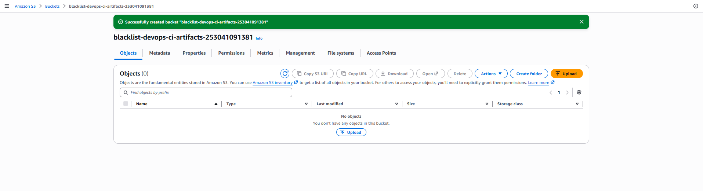

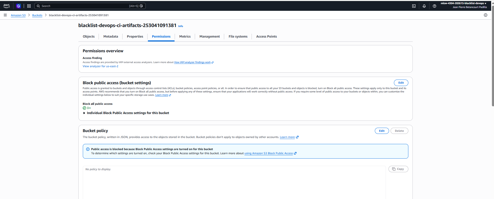

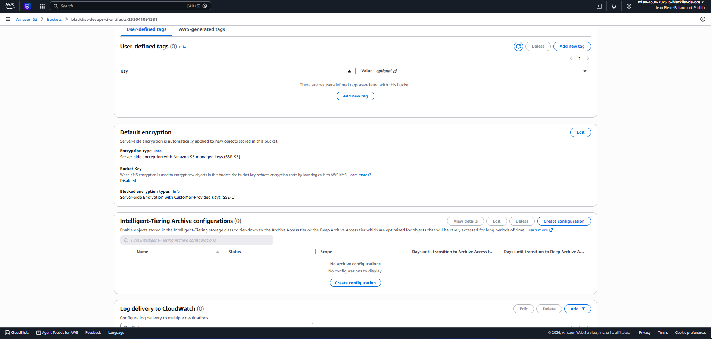

### 4.3 Conexión con GitHub

| Dato | Valor |
|---|---|
| Nombre | `blacklist-devops-github` |
| Proveedor | GitHub, por la aplicación *AWS Connector for GitHub* |
| ARN | `arn:aws:codeconnections:us-east-2:253041091381:connection/78ec2a5d-2f14-4972-bc66-b54a9571b2f9` |
| Estado | `AVAILABLE` |
| Acceso en GitHub | *Only select repositories*: solo `mc-torreso1-uniandes-edu-co/misw-4304-blacklist-devops` |
| Credenciales guardadas | Ninguna: sin token personal y sin llave SSH |

La conexión evita guardar un token personal en el repositorio, en una variable de entorno o en la
configuración del pipeline: AWS lee el código con una aplicación de GitHub que la persona dueña del
repositorio autoriza en el navegador, y esa autorización queda limitada a un repositorio. La CLI crea la
conexión en estado *Pending*; solo la autorización en GitHub la deja *Available*.

Equivalente en la CLI:

```bash
aws codeconnections create-connection --region us-east-2 \
  --provider-type GitHub --connection-name blacklist-devops-github
```

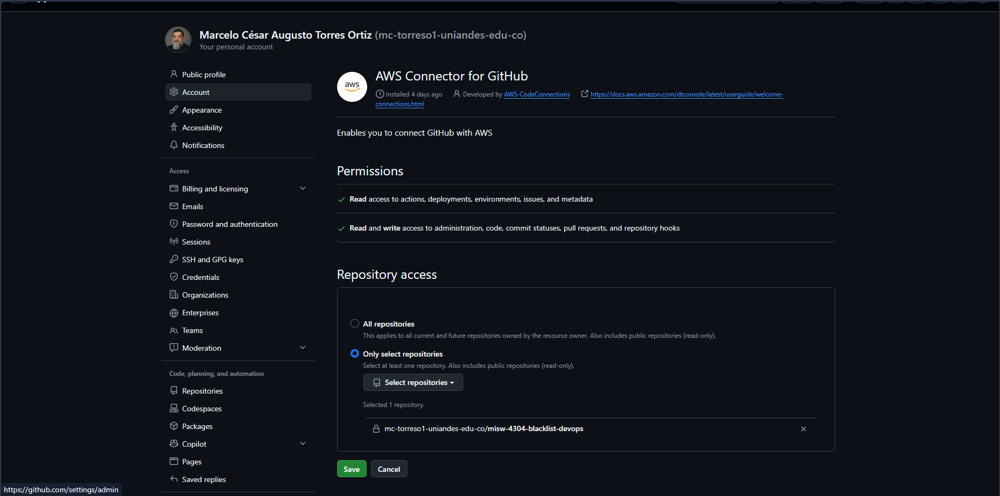

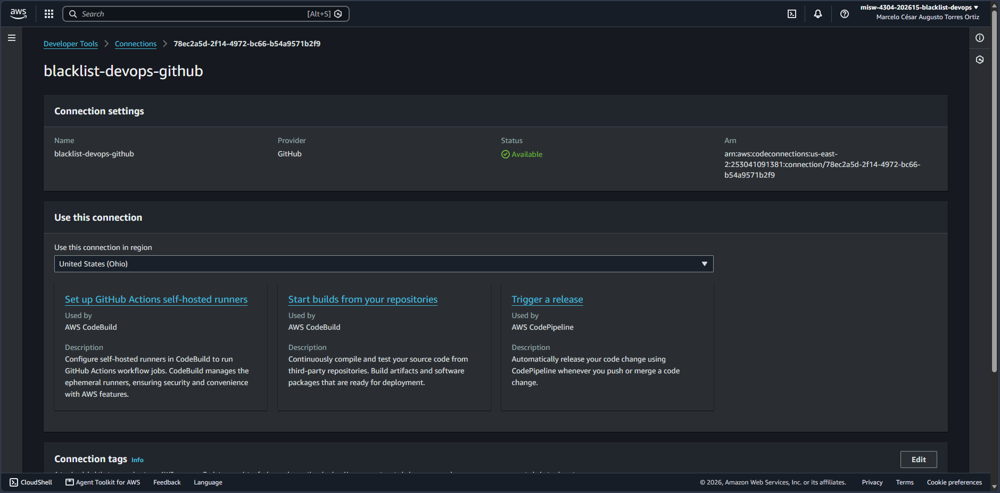

### 4.4 Roles de servicio

| Dato | `blacklist-devops-codebuild-role` | `blacklist-devops-codepipeline-role` |
|---|---|---|
| Servicio que lo asume | `codebuild.amazonaws.com` | `codepipeline.amazonaws.com` |
| Condición de confianza | `aws:SourceAccount = 253041091381` | `aws:SourceAccount = 253041091381` |
| Política | En línea, `acceso-minimo-ci` | En línea, `acceso-minimo-ci` |
| Permisos | Escribir en el grupo de CloudWatch del proyecto; leer y escribir objetos del bucket | Leer y escribir objetos del bucket; usar la conexión de GitHub; lanzar y consultar el proyecto de CodeBuild |
| Políticas administradas | Ninguna | Ninguna |

Ninguno de los dos roles tiene permisos de administrador y ninguna de sus sentencias usa `*` como acción:
los recursos son ARN concretos del bucket, del proyecto y de la conexión, sin comodines de cuenta.
Tampoco hay llaves de acceso, porque los servicios asumen el rol con credenciales temporales de STS. El
rol de CodeBuild no tiene permiso sobre la conexión de GitHub porque el pipeline le entrega el código ya
descargado, como un ZIP.

Antes de ejecutar los comandos, la relación de confianza y la política de cada rol se guardan en un
archivo JSON. Equivalente en la CLI:

```bash
aws iam create-role --role-name blacklist-devops-codebuild-role \
  --assume-role-policy-document file://trust-codebuild.json
aws iam put-role-policy --role-name blacklist-devops-codebuild-role \
  --policy-name acceso-minimo-ci --policy-document file://policy-codebuild.json
aws iam create-role --role-name blacklist-devops-codepipeline-role \
  --assume-role-policy-document file://trust-codepipeline.json
aws iam put-role-policy --role-name blacklist-devops-codepipeline-role \
  --policy-name acceso-minimo-ci --policy-document file://policy-codepipeline.json
```

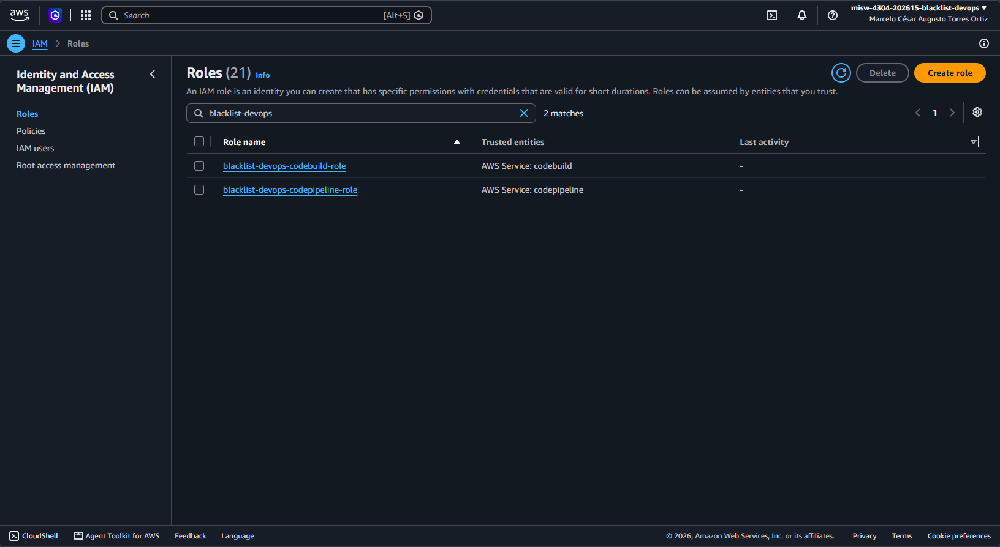

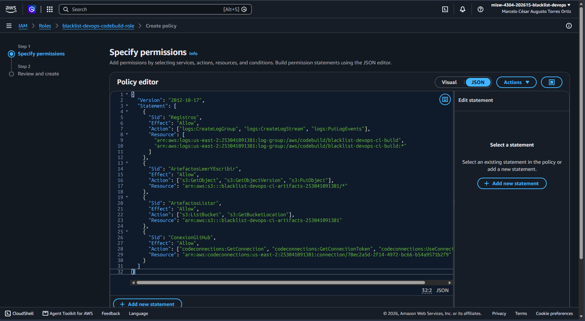

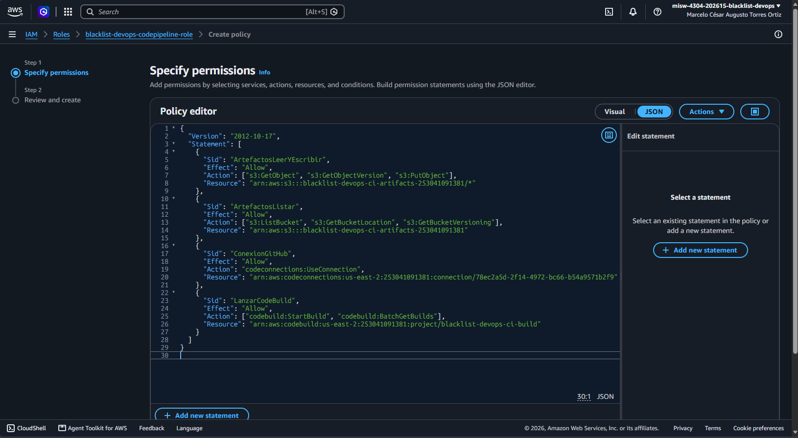

### 4.5 Proyecto de CodeBuild

Es el recurso que ejecuta las pruebas y genera el artefacto: el que sostiene este punto de la
configuración.

| Dato | Valor |
|---|---|
| Nombre | `blacklist-devops-ci-build` |
| ARN | `arn:aws:codebuild:us-east-2:253041091381:project/blacklist-devops-ci-build` |
| Proveedor del origen | AWS CodePipeline: el código llega de la etapa de origen del pipeline |
| Artefactos | AWS CodePipeline: el paquete vuelve al almacén del pipeline, en el bucket de artefactos |
| Archivo de construcción | `buildspec.yml`, en la raíz del repositorio (nombre por defecto) |
| Imagen | `aws/codebuild/amazonlinux-x86_64-standard:6.0`, sobre Amazon Linux 2023 |
| Tipo de entorno y cómputo | Contenedor Linux sobre EC2, `BUILD_GENERAL1_SMALL`: 2 CPU virtuales y 4 GiB de memoria |
| Modo privilegiado | Desactivado: solo se necesita para construir imágenes de contenedor |
| Variables de entorno | Ninguna: `APP_ENV` y las demás viven en el `buildspec.yml`, y `COMMIT_ID` lo entrega el pipeline |
| Rol de servicio | `blacklist-devops-codebuild-role` |
| Registros | CloudWatch Logs activado, grupo `/aws/codebuild/blacklist-devops-ci-build` |
| Caché | Sin caché |
| Tiempo de espera | 60 minutos, el valor por defecto |
| Compilaciones públicas | Deshabilitadas |

El origen es CodePipeline porque el proyecto no necesita acceso propio a GitHub: recibe el código de la
etapa de origen, que es la que usa la conexión. La imagen es la que el equipo eligió por ser la más
reciente de Amazon Linux disponible. El cómputo es el más pequeño, porque las pruebas usan SQLite en
memoria y el paquete es un `.zip` de 11 KB. No se configuraron variables de entorno en el proyecto para
no repartir configuración ni secretos: lo que el build necesita está en el repositorio, y el
identificador del commit lo inyecta el pipeline.

La página del proyecto muestra un aviso azul que indica que el sistema operativo anfitrión es Amazon Linux
2 y recomienda pasar a Amazon Linux 2023. Es informativo y no afecta el build: la imagen del entorno ya es
`standard:6.0`, que trae Python 3.13 (secciones 5.1 y 6). No es el aviso de características avanzadas del
plan gratuito, que no apareció en ninguna pantalla.

Equivalente en la CLI:

```bash
aws codebuild create-project --region us-east-2 \
  --name blacklist-devops-ci-build \
  --source type=CODEPIPELINE --artifacts type=CODEPIPELINE \
  --environment type=LINUX_CONTAINER,computeType=BUILD_GENERAL1_SMALL,image=aws/codebuild/amazonlinux-x86_64-standard:6.0 \
  --service-role arn:aws:iam::253041091381:role/blacklist-devops-codebuild-role \
  --logs-config cloudWatchLogs={status=ENABLED}
```

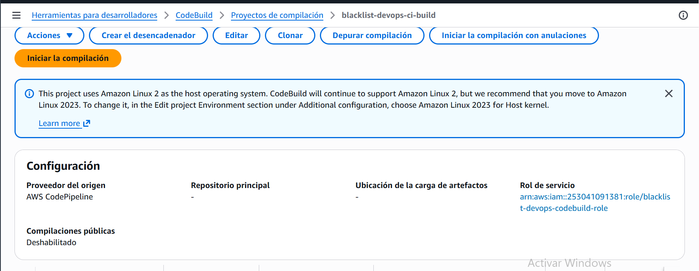

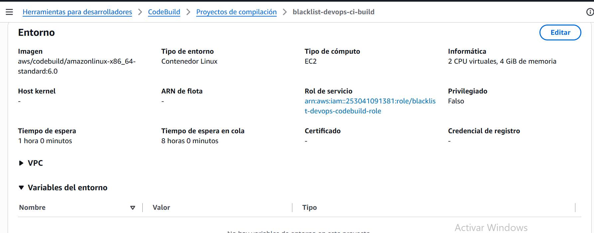

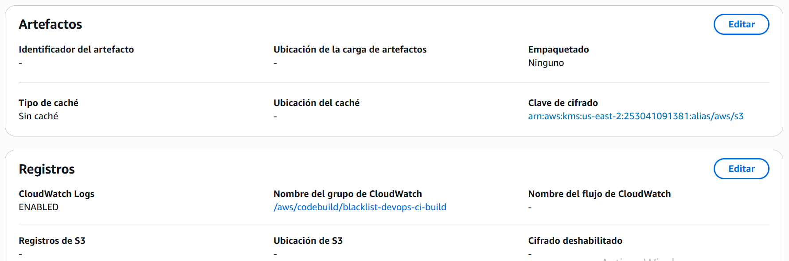

### 4.6 Pipeline y verificación

El último recurso es el pipeline `blacklist-devops-ci-pipeline`, de tipo V2 y modo de ejecución `QUEUED`,
con una etapa de origen en GitHub y una de construcción en CodeBuild. El pipeline entrega a CodeBuild el
identificador del commit en la variable `COMMIT_ID`, y el artefacto de salida vuelve al bucket de la
sección 4.2. No tiene etapa de despliegue, porque la entrega excluye el despliegue automatizado: el
pipeline termina cuando el paquete queda en el bucket. Se crea con un archivo de definición:

```bash
aws codepipeline create-pipeline --region us-east-2 --cli-input-json file://pipeline.json
```

Sus disparadores de *push* y de *pull request* y la evidencia de que se ejecutan están en la sección 5.

Los cinco recursos se comprueban con consultas de solo lectura, que se pueden repetir sin cambiar nada.
Las de S3, CodeConnections, CodeBuild y CodePipeline llevan `--region us-east-2`:

| Consulta | Resultado esperado |
|---|---|
| `aws s3api get-bucket-encryption --bucket blacklist-devops-ci-artifacts-253041091381` | Cifrado `AES256`, con `BucketKeyEnabled` en `false` |
| `aws s3api get-public-access-block --bucket blacklist-devops-ci-artifacts-253041091381` | Las cuatro opciones de bloqueo en `true` |
| `aws iam get-role-policy --role-name blacklist-devops-codebuild-role --policy-name acceso-minimo-ci` | La política en línea `acceso-minimo-ci` del rol de CodeBuild |
| `aws iam get-role-policy --role-name blacklist-devops-codepipeline-role --policy-name acceso-minimo-ci` | La política en línea `acceso-minimo-ci` del rol de CodePipeline |
| `aws codeconnections list-connections` | `blacklist-devops-github` en estado `AVAILABLE` |
| `aws codebuild batch-get-projects --names blacklist-devops-ci-build` | Origen y artefactos `CODEPIPELINE`, el rol del proyecto y los registros activados |
| `aws codepipeline get-pipeline --name blacklist-devops-ci-pipeline` | Tipo `V2`, modo `QUEUED` y los disparadores de Git |

El 27 de octubre de 2026 se ejecutaron por CLI las consultas del bucket, de la conexión, del proyecto y
del pipeline, y todas devolvieron lo esperado. Los dos roles se comprobaron en la consola, con las figuras
4.6 a 4.8, y no por CLI. La revisión de las capturas, del 26 de octubre, confirmó que ninguna muestra
secretos: no hay tokens, contraseñas ni variables de entorno con valores. El número de cuenta y los ARN
aparecen porque no son secretos, y las políticas de IAM solo contienen nombres y ARN de recursos del
proyecto.

## 5. Archivo de construcción y disparo automático

Cubre los puntos 3 (25 %) y 4 (15 %) de la configuración: un archivo de construcción versionado en el
repositorio, que ejecuta las pruebas unitarias y genera el artefacto sin desplegarlo, y el disparo
automático del build con cada commit en la rama principal.

### 5.1 El archivo de construcción

El `buildspec.yml` está en la raíz del repositorio, en `main` y en `dev`. El proyecto de CodeBuild
`blacklist-devops-ci-build` no define comandos propios: ejecuta este archivo, que llega con el código de
cada commit.

```yaml
version: 0.2

env:
  shell: bash
  variables:
    APP_ENV: "testing"

phases:
  install:
    runtime-versions:
      python: "3.13"
    commands:
      - MAKE_OPTS="-j$(nproc)" pyenv install --skip-existing "$(cat .python-version)"
      - python --version
      - pip install -r requirements-dev.txt
  build:
    commands:
      - python -m pytest -q --cov=app
      - ': "${COMMIT_ID:?La variable COMMIT_ID no esta definida}"'
      - ETIQUETA="${COMMIT_ID:0:7}"
      - python scripts/empaquetar.py "$ETIQUETA" --omitir-pruebas
      - python -m zipfile -l "dist/app-${ETIQUETA}.zip"

artifacts:
  files:
    - dist/app-*.zip
  discard-paths: yes
```

| Parte | Qué hace |
|---|---|
| `env` | Ejecuta los comandos con `bash` y fija `APP_ENV=testing`: la aplicación usa la configuración de pruebas, con SQLite en memoria, sin base de datos ni secretos |
| `install` | Selecciona Python 3.13 en la imagen administrada. Si la imagen no trae la versión de `.python-version` (3.13.16), pyenv la compila; `--skip-existing` omite ese paso cuando ya está. Imprime la versión usada e instala las dependencias de `requirements-dev.txt` |
| `build`: pruebas | `pytest -q --cov=app` ejecuta las 97 pruebas con la cobertura del paquete `app`. Si una falla, la fase se detiene: no se genera el paquete ni se sube artefacto |
| `build`: `COMMIT_ID` | Comprueba que el pipeline entregó el identificador del commit, después de las pruebas para que un fallo de prueba se vea como tal y no como una variable ausente. Si falta, el build falla con un mensaje claro |
| `build`: etiqueta | Toma los siete primeros caracteres de `COMMIT_ID`. El origen llega al build sin la carpeta `.git`, por eso el identificador lo pasa la acción de construcción del pipeline (`#{SourceVariables.CommitId}`) |
| `build`: paquete | `scripts/empaquetar.py` genera `dist/app-<commit>.zip`. Lleva `--omitir-pruebas` porque las pruebas ya corrieron en el paso anterior. `python -m zipfile -l` deja el contenido del paquete en los registros |
| `artifacts` | Declara `dist/app-*.zip` como salida del build; el pipeline la guarda como `BuildArtifact` en el bucket de S3 |

El archivo no tiene fase de despliegue ni llama a la CLI de AWS: el pipeline termina al generar el artefacto,
como exige el enunciado.

**Cambio del 29 de octubre de 2026: instalación de Python 3.13.16.** Las ejecuciones de las secciones 6 y 7
usaron el archivo sin las dos primeras líneas de `install`. El 29 de octubre, AWS actualizó la imagen
`standard:6.0` y dejó de traer Python 3.13.16. pyenv toma la versión del archivo `.python-version` del
repositorio antes que la que fija `runtime-versions`, así que la instalación de dependencias empezó a fallar:

```text
pyenv: version `3.13.16' is not installed (set by /codebuild/output/src3930715547/src/.python-version)
Phase: INSTALL, Code: COMMAND_EXECUTION_ERROR, Message: Error while executing command: pip install -r requirements-dev.txt
```

Fallaron así los builds 7, 8 y 9, iniciados por los pull requests #177, #178 y #179. El último build exitoso
con la imagen anterior fue el del 27 de octubre (`1231fae0`), con 3.13.16. El pull request #180 agregó la
compilación de la versión de `.python-version` y su build, el número 10
(`blacklist-devops-ci-build:8f7ad958-ec22-4276-9ee0-297ab8d2e244`), terminó en *Succeeded*: compiló Python
3.13.16, pasaron las 97 pruebas con cobertura del 100 % y generó `dist/app-fb6c346.zip`, con 31 archivos. La
fase `INSTALL` pasó de 19 segundos a 205, y la ejecución del pipeline (`61173fbf`) tardó 4 minutos 13 segundos.

La configuración del proyecto de CodeBuild que ejecuta este archivo está en la figura 4.9, y el registro del
build, con las pruebas, la cobertura y el contenido del paquete, en las figuras 6.5 y 6.6.

### 5.2 El artefacto

`scripts/empaquetar.py` arma el paquete a partir de una lista explícita de entradas: `application.py`, `app/`,
`requirements.txt`, `Procfile` y `.ebextensions/`, y escribe dentro el archivo `VERSION` con la etiqueta. En las
carpetas solo entran archivos `.py` y `.config`. No entran `tests/`, `docs/`, `scripts/`, `postman/`, `.env`,
`.venv` ni bases de datos locales.

En la ejecución exitosa el paquete fue `app-b0e9d03.zip`, con 31 archivos y `VERSION = b0e9d03`; la
verificación completa está en la sección 6.3. En la ejecución fallida no se generó ningún artefacto (sección 7.3).

### 5.3 Disparo automático

El disparo lo hace AWS CodePipeline V2 con dos disparadores de Git sobre la acción de origen, que obtiene el
código por la conexión `blacklist-devops-github`:

| Disparador | Eventos | Ramas de destino | Rutas excluidas |
|---|---|---|---|
| *Push* | Push | `main` | Ninguna |
| *Pull request* | Abierto (`OPEN`) y actualizado (`UPDATED`) | `dev` y `main` | `docs/**`, `postman/**`, `**/*.md` |

El *push* a `main` no excluye ninguna ruta porque el enunciado pide que cada commit en la rama principal
inicie el build; así, una promoción de solo documentación también lo dispara. Esta es la versión 2 del
pipeline: se creó con las rutas excluidas también en el *push* y el 27 de octubre de 2026 se quitó esa
exclusión (sección 2). El *pull request* conserva las exclusiones: un PR que solo cambia
documentación no consume minutos de construcción, y al fusionarlo el *push* a `main` ejecuta el build completo.
La excepción es el README de la raíz del repositorio: el patrón `**/*.md` no lo excluye, y los pull requests #177, #178 y
#179, que solo cambiaban documentación y el README, iniciaron el pipeline.

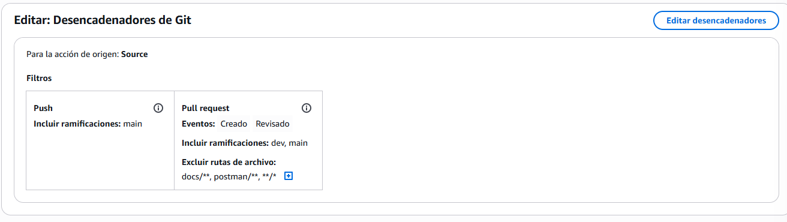

**Evidencia del punto 4.** Un commit en `main` inicia el build sin intervención manual, también cuando solo
cambia documentación:

- **Commit de solo documentación, con la versión 2.** El 27 de octubre de 2026 se fusionó en `main` la promoción
  #172, que creó el commit `3db0adb`. Ese commit solo cambió archivos de `docs/`, rutas que la versión 1 excluía.
  Su *push* inició la ejecución `19089be6` a las 18:50 (UTC-05:00), que terminó correctamente a las 18:51, en
  1 minuto 8 segundos.
- **Commit de código, con la versión 1.** El *merge* de la promoción #156 creó el commit `b0e9d03` y 5 segundos
  después inició la ejecución `ff3146a4-74b7-458f-927e-980fee5eb56d`, que terminó en *Succeeded*. El commit, la
  ejecución y el historial están en las figuras 6.1 a 6.3 de la sección 6.1.

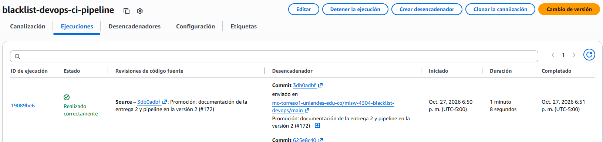

**Pull request.** El pull request #160 hacia `dev` inició la ejecución fallida con el evento
`PULL_REQUEST_CREATED` (sección 7.1), y el #164 hacia `main` inició la ejecución `901438a7`. El #156 hacia `main`
no inició ninguna y su causa no está identificada. El evento `UPDATED` no se verificó. El punto 4 de la
configuración no depende de los pull requests: se cumple con el *push* a `main`.

## 6. Pipeline exitoso

Cubre el punto 1 del documento (10 %) y respalda el punto 4 de la configuración (15 %): un commit en la
rama principal inició el pipeline sin intervención manual, CodeBuild ejecutó las pruebas y generó el
artefacto. Todas las horas están en UTC-05:00 (Colombia).

### 6.1 Qué se ejecutó

El 24 de octubre de 2026 se fusionó en `main` la promoción de `dev` (pull request #156), que llevó por
primera vez el `buildspec.yml` a la rama principal. El *merge* creó el commit `b0e9d03`, y ese *push* a
`main` disparó la ejecución.

| Dato | Valor |
|---|---|
| Commit en `main` | `b0e9d0397c05ba9b66fdd69161efd3619265f97d` (`b0e9d03`), 11:19:44 |
| Ejecución del pipeline | `ff3146a4-74b7-458f-927e-980fee5eb56d`, **Succeeded** |
| Disparo | *Push* a `main`, 5 segundos después del *merge*, sin intervención manual |
| Duración del pipeline | 38 segundos (11:19:49 a 11:20:27) |
| Build de CodeBuild | Build número 2, `blacklist-devops-ci-build:de0d4f11-4626-44a5-b969-3987f6ac0c91`, **SUCCEEDED**, iniciado por `codepipeline/blacklist-devops-ci-pipeline` |
| Duración del build | 30 segundos (11:19:56 a 11:20:26) |
| Entorno del build | Imagen `aws/codebuild/amazonlinux-x86_64-standard:6.0`, Python **3.13.16** |
| Variable `COMMIT_ID` | El hash completo del commit, entregado por el pipeline |
| Pruebas | **97 aprobadas**, 0 fallidas; cobertura de `app/` del **100 %** |
| Paquete | `app-b0e9d03.zip`, 31 archivos, `VERSION = b0e9d03` |

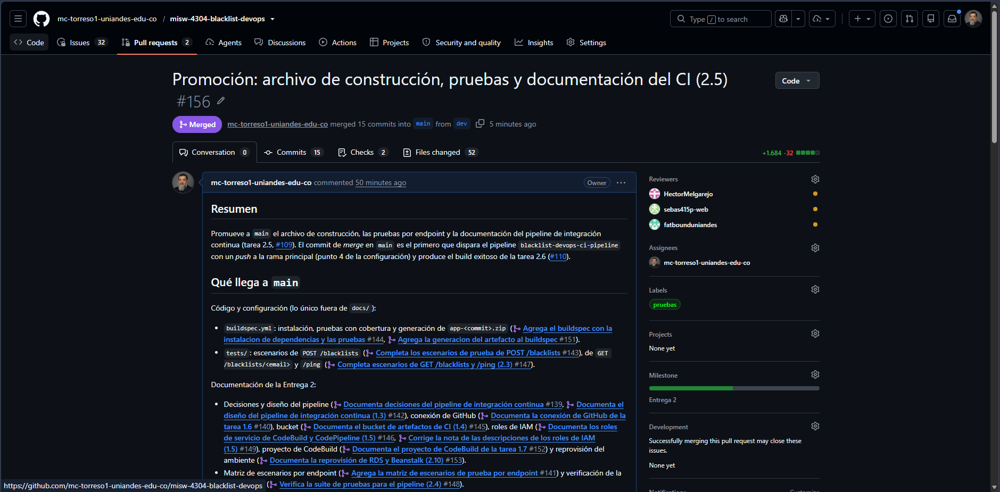

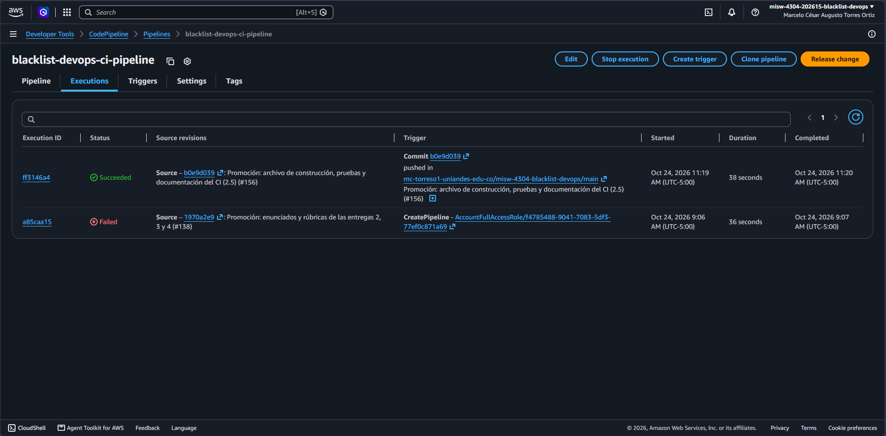

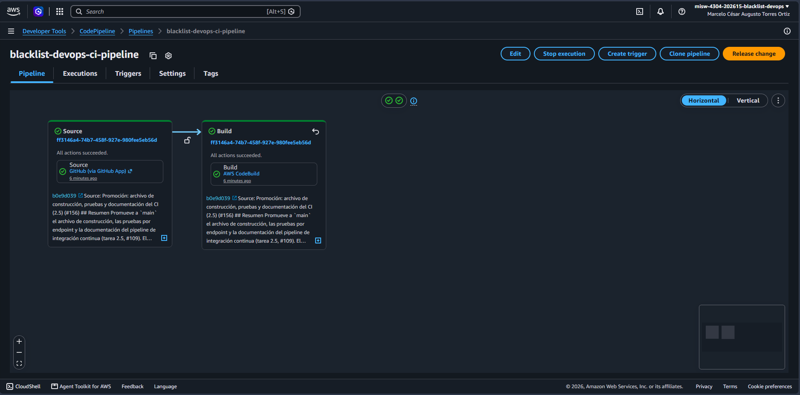

### 6.2 Fases y pruebas

| Fase del build | Estado | Duración |
|---|---|---|
| `PROVISIONING` | Succeeded | 3 s |
| `DOWNLOAD_SOURCE` | Succeeded | 2 s |
| `INSTALL` | Succeeded | 19 s |
| `BUILD` | Succeeded | 3 s |
| `UPLOAD_ARTIFACTS` | Succeeded | < 1 s |

Las fases `SUBMITTED`, `QUEUED`, `PRE_BUILD`, `POST_BUILD` y `FINALIZING` también terminaron en
*Succeeded*, cada una en menos de un segundo.

Extracto del registro en CloudWatch (`/aws/codebuild/blacklist-devops-ci-build`):

```text
Selecting 'python' runtime version '3.13' based on manual selections...
Running command pip install -r requirements-dev.txt
Phase complete: INSTALL State: SUCCEEDED
Running command python -m pytest -q --cov=app
coverage: platform linux, python 3.13.16-final-0
TOTAL                                                                 290      0   100%
97 passed in 0.77s
Running command python scripts/empaquetar.py "$ETIQUETA" --omitir-pruebas
Generado dist/app-b0e9d03.zip con 31 archivos.
Phase complete: BUILD State: SUCCEEDED
Phase complete: UPLOAD_ARTIFACTS State: SUCCEEDED
```

En esta ejecución el `buildspec.yml` todavía verificaba `COMMIT_ID` antes de las pruebas; el ajuste del
pull request #154 movió esa verificación a después de `pytest`, sin cambiar el resultado. Tampoco tenía la
compilación de Python 3.13.16 en `install`, que agregó el pull request #180 (sección 5.1).

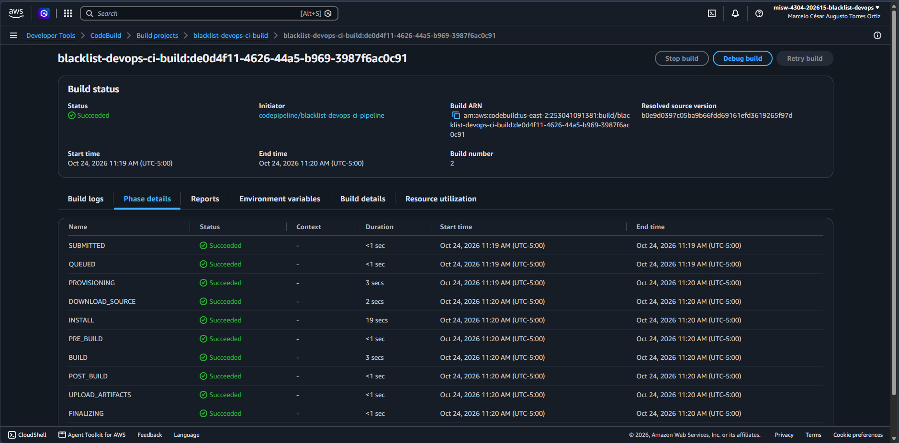

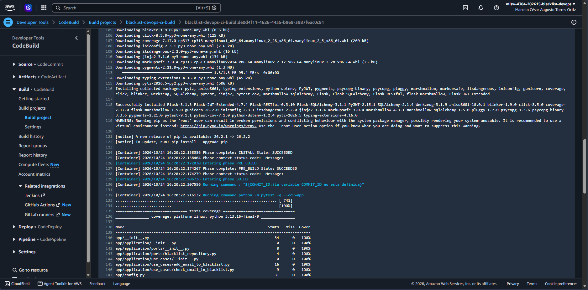

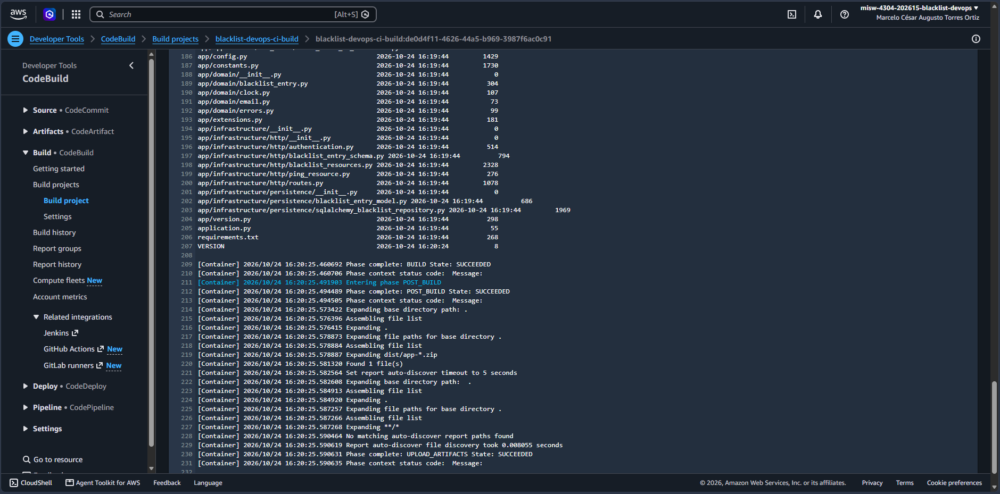

### 6.3 Artefacto

CodePipeline guardó la salida del build en el bucket del proyecto como
`blacklist-devops-ci-/BuildArtif/QZJkTHW` (8 191 bytes). Ese objeto contiene el paquete
`app-b0e9d03.zip`; se descargó con la CLI y se revisó:

| Verificación | Resultado |
|---|---|
| Paquete | `app-b0e9d03.zip`, 11 040 bytes, 31 archivos |
| `VERSION` | `b0e9d03`, igual a la etiqueta del commit |
| Contenido en la raíz | `.ebextensions/`, `Procfile`, `VERSION`, `app/`, `application.py` y `requirements.txt` |
| Archivos que no deben ir | Ninguno: sin `tests/`, `docs/`, `scripts/`, `postman/`, `.env` ni bases de datos locales |

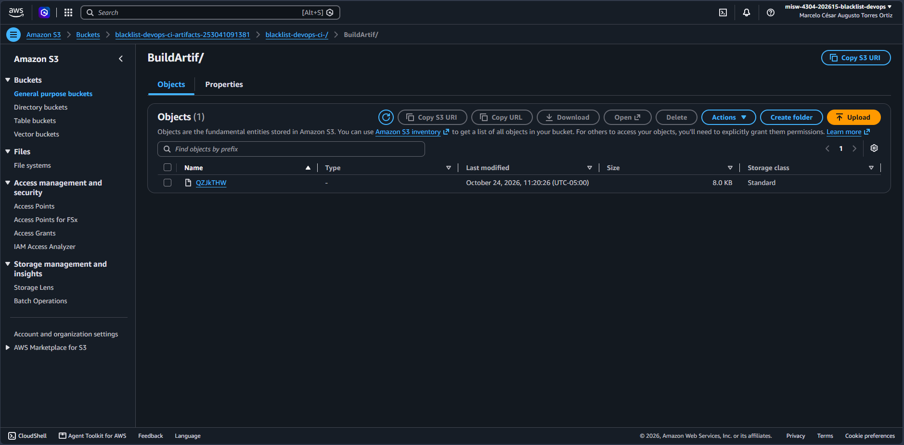

Fuera del pipeline, el paquete se extrajo de ese objeto, se subió como versión `b0e9d03` de la
aplicación y se desplegó en `Blacklist-devops-env`: el despliegue tardó 54 segundos, las tres instancias
quedaron con salud *Ok* y `/ping` responde `{"version": "b0e9d03"}`. Contra ese entorno, la colección de
Postman pasó 22 de 22 pruebas (figura 6.9).

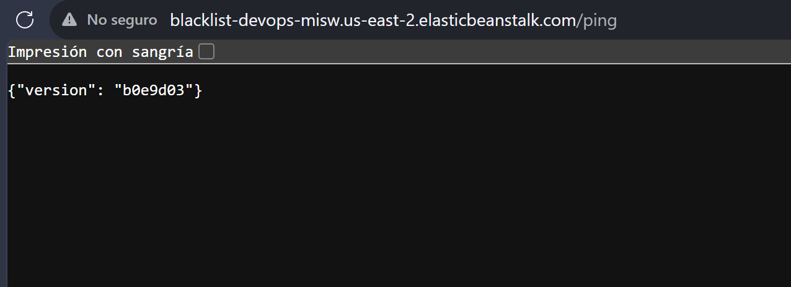

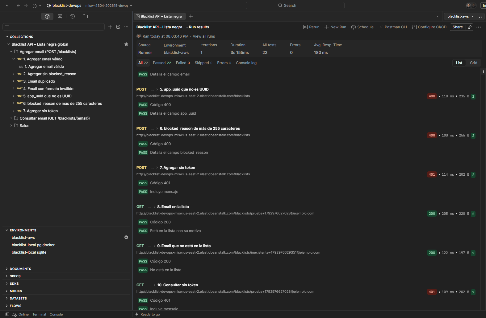

### 6.4 Hallazgos

1. **El disparo por *push* funciona.** El pipeline inició 5 segundos después del *merge* en `main`, sin
   intervención manual.
2. **El build es corto y casi todo su tiempo es la instalación.** De 30 segundos, 19 son la fase
   `INSTALL` (`pip install` sin caché); las pruebas y el empaquetado tardan menos de un segundo cada uno.
   Para el tamaño de este proyecto no hace falta caché.
3. **Python 3.13 está disponible en la imagen administrada.** `runtime-versions` resolvió Python
   3.13.16, la misma versión que usa el equipo en local y la plataforma de Beanstalk. El 29 de octubre la
   imagen dejó de traerla y hubo que compilarla en el build (sección 5.1).
4. **Las pruebas corren sin servicios externos.** El proyecto de CodeBuild no define la cadena de
   conexión a la base ni secretos: la suite usó SQLite en memoria.
5. **El paquete queda dentro del objeto del pipeline.** CodePipeline guarda la salida con un nombre
   generado (`BuildArtif/QZJkTHW`) y la cifra con la clave administrada de S3 (`aws:kms`), aunque el
   cifrado por defecto del bucket es SSE-S3. Para desplegarlo hay que extraer `app-b0e9d03.zip` primero.
6. **La versión en ejecución se puede rastrear hasta el commit.** `/ping` devuelve `b0e9d03`: del
   entorno se llega al build, a la ejecución del pipeline y al pull request que la originó.
7. **Hubo una ejecución fallida previa, esperada.** La ejecución de arranque del pipeline (24 de octubre,
   9:06) falló al descargar el origen porque `main` todavía no tenía `buildspec.yml`. No es la ejecución
   fallida de la sección 7.

## 7. Pipeline fallido

Cubre el punto 2 del documento (10 %): una ejecución del pipeline que falla en la fase de pruebas y no
genera artefacto. Todas las horas están en UTC-05:00 (Colombia).

### 7.1 Qué se provocó

Se creó la rama temporal `test/build-fallido` desde `dev` con una prueba que falla a propósito:
`test_intentional_failure_for_the_pipeline`, en `tests/test_ping.py`, espera un error 500 de `GET /ping`,
que responde 200. El 25 de octubre de 2026 a las 11:47:18 se abrió el pull request #160 hacia `dev`,
titulado *NO FUSIONAR*, solo para disparar el pipeline. A las 12:08:15 se cerró sin fusionar y se
eliminó la rama: la prueba rota nunca llegó a `dev` ni a `main`.

Se usó un pull request y no un build lanzado a mano por dos razones. El proyecto de CodeBuild recibe el
código solo desde el pipeline y su rol no tiene acceso a la conexión de GitHub, así que no puede
construir una rama por sí solo. Además, el punto 2 del documento pide una ejecución fallida del
pipeline, no un build suelto.

| Dato | Valor |
|---|---|
| Commit construido | `c423bff171a52fb5017bbf7fb532c631b954c242` (`c423bff`), en `test/build-fallido` |
| Ejecución del pipeline | `69f3a6bb-3509-4e5d-8a91-38a667a90e64`, **Failed** |
| Disparo | Pull request #160 hacia `dev`, evento `PULL_REQUEST_CREATED`, 5 segundos después de abrirlo |
| Duración del pipeline | 38 segundos (11:47:22 a 11:48:01) |
| Etapas | Source **Succeeded** en 6 segundos; Build **Failed** |
| Build de CodeBuild | Build número 3, `blacklist-devops-ci-build:fc926738-0b5c-4713-ad5b-5dc17ffdf417`, **FAILED**, iniciado por el pipeline |
| Duración del build | 25 segundos (11:47:29 a 11:47:55) |
| Pruebas | 98 recopiladas: **1 fallida y 97 aprobadas**; cobertura de `app/` del 100 % |
| Artefacto | **Ninguno** |

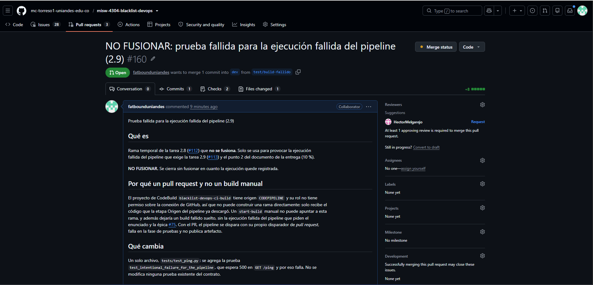

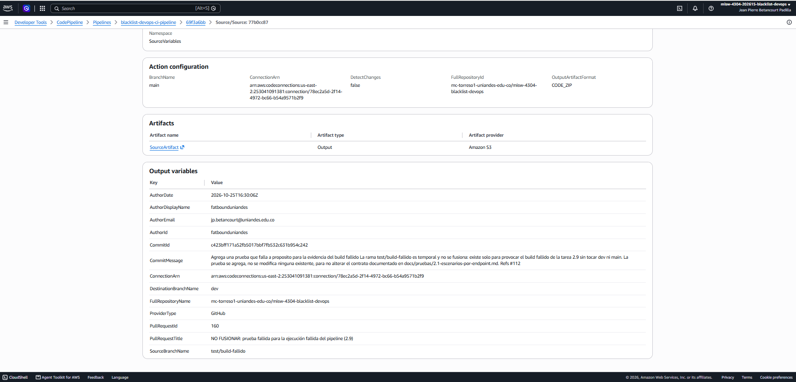

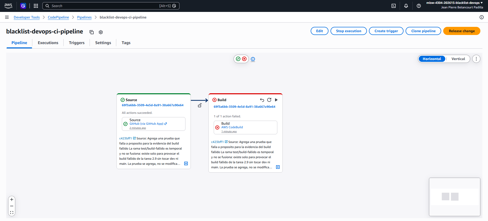

### 7.2 Dónde falló y por qué

| Fase del build | Estado | Duración |
|---|---|---|
| `PROVISIONING` | Succeeded | 3 s |
| `DOWNLOAD_SOURCE` | Succeeded | 2 s |
| `INSTALL` | Succeeded | 16 s |
| `BUILD` | **Failed** | 2 s |
| `POST_BUILD` | Succeeded | < 1 s |
| `UPLOAD_ARTIFACTS` | **Failed** | < 1 s |

La etapa Build del pipeline informa el motivo:

```text
Build terminated with state: FAILED. Phase: BUILD, Code: COMMAND_EXECUTION_ERROR,
Message: Error while executing command: python -m pytest -q --cov=app. Reason: exit status 1
```

Extracto del registro en CloudWatch:

```text
Running command python -m pytest -q --cov=app
    def test_intentional_failure_for_the_pipeline(client):
        response = client.get(constants.PING_PATH)
>       assert response.status_code == HTTPStatus.INTERNAL_SERVER_ERROR
E       assert 200 == <HTTPStatus.INTERNAL_SERVER_ERROR: 500>
tests/test_ping.py:62: AssertionError
FAILED tests/test_ping.py::test_intentional_failure_for_the_pipeline - assert...
1 failed, 97 passed in 0.77s
Phase complete: BUILD State: FAILED
Expanding dist/app-*.zip
Phase complete: UPLOAD_ARTIFACTS State: FAILED
Phase context status code: CLIENT_ERROR Message: no matching artifact paths found
```

Como `pytest` termina con código de salida 1, CodeBuild cancela los comandos restantes de la fase
`build`: el script de empaquetado nunca se ejecuta y `dist/app-*.zip` no existe. Por eso la fase
`UPLOAD_ARTIFACTS` falla: no encuentra el paquete declarado en el `buildspec.yml`.

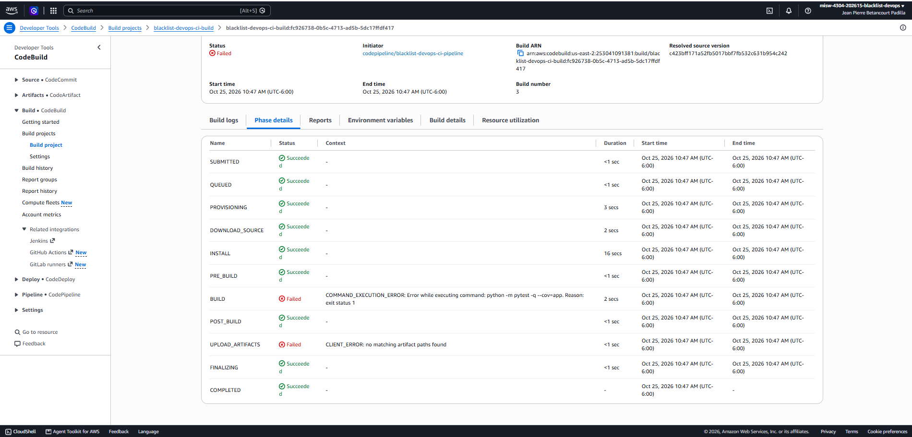

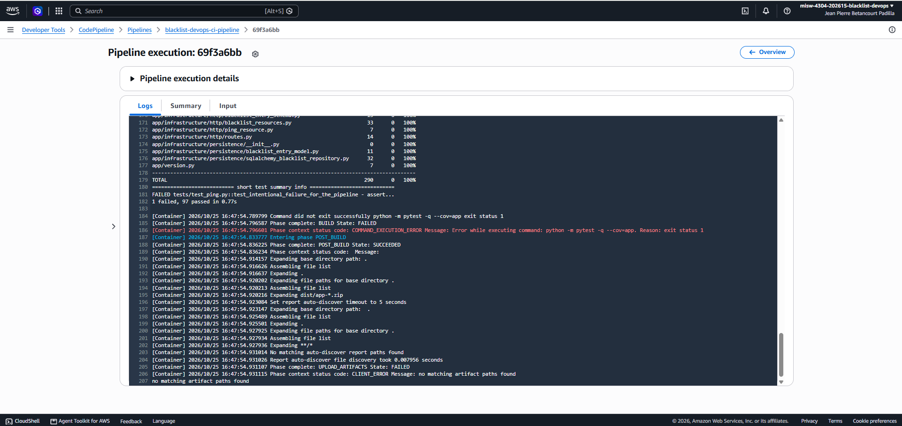

### 7.3 Sin artefacto y sin cambios en las ramas

Después de la ejecución, `blacklist-devops-ci-/BuildArtif/` seguía teniendo un solo objeto: el del build
exitoso del 24 de octubre (`QZJkTHW`). La ubicación de salida que informa el build
(`BuildArtif/krWSeNK`) es solo el destino que reservó el pipeline: el objeto no existe. El único objeto
nuevo en el bucket es el código de origen que la etapa Source deja como entrada del build
(`SourceArti/JdFZGO1`), que no es un paquete de la aplicación.

`dev` y `main` quedaron intactos (`241a309` y `b0e9d03`), porque el pull request se cerró sin fusionar.

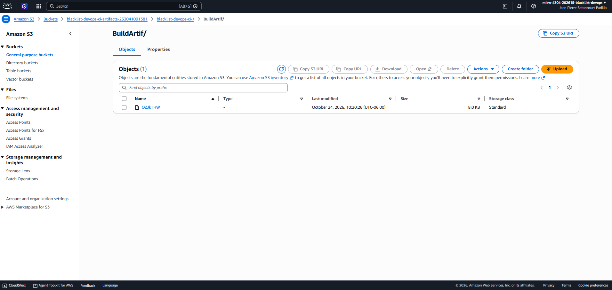

### 7.4 Comparación con la ejecución exitosa

| | Exitosa (sección 6) | Fallida |
|---|---|---|
| Disparo | *Push* a `main` (`b0e9d03`) | Pull request #160 hacia `dev` (`c423bff`) |
| Pipeline | *Succeeded*, 38 s | *Failed*, 38 s |
| Build | Número 2, 30 s | Número 3, 25 s |
| Pruebas | 97 aprobadas | 1 fallida y 97 aprobadas |
| Fase `BUILD` | *Succeeded* | *Failed* |
| Artefacto | `app-b0e9d03.zip` en el bucket | Ninguno |

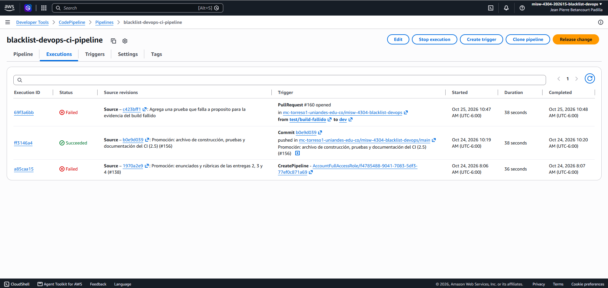

### 7.5 Hallazgos

1. **El fallo ocurrió en la fase correcta.** El `buildspec.yml` verifica `COMMIT_ID` después de
   `pytest`, así que la causa del fallo es la prueba y no una variable ausente.
2. **El registro identifica la prueba, el archivo y la línea.** El nombre de la prueba deja claro que el
   fallo es deliberado y no una prueba real del contrato rota.
3. **Un cambio con pruebas rotas no produce un paquete desplegable.** El empaquetado nunca se ejecutó y
   no quedó ningún artefacto nuevo, que es el objetivo de la integración continua.
4. **El mismo pipeline da los dos resultados.** Sin cambiar configuración ni lanzar nada a mano, el
   disparador de *push* produjo el build exitoso y el de pull request, el fallido.
5. **El disparador de pull request se comportó distinto en dos intentos.** Con el #160 hacia `dev` se
   inició la ejecución; con el #156 hacia `main`, abierto cuando el pipeline ya existía, no se inició.
   El siguiente pull request hacia `main`, el #164, sí la inició (`901438a7`). La causa del caso del #156
   no está identificada.
6. **La ubicación de salida del build no es un artefacto.** El build informa `BuildArtif/krWSeNK`, pero
   ese objeto no existe porque la subida falló; conviene no confundirlo con un paquete generado.

## 8. Limitaciones y decisiones

Esta sección reúne las decisiones de la entrega que no son de arquitectura (esas están en la sección 2) y
las limitaciones conocidas de la solución, con su efecto y cómo se manejan.

### 8.1 Decisiones

| Decisión | Alternativa descartada | Motivo |
|---|---|---|
| Disparar con cada *push* a `main`, sin rutas excluidas (versión 2 del pipeline) | Mantener la exclusión de `docs/**`, `postman/**` y `**/*.md` también en el *push* | El enunciado pide que cada commit en la rama principal inicie el build; con la exclusión, una promoción de solo documentación no lo iniciaba (secciones 2 y 5.3) |
| Validar también los pull requests hacia `dev` y `main`, sin los cambios de solo documentación | Validar solo después de fusionar | Una prueba rota se detecta antes de llegar a las ramas protegidas, sin gastar minutos de construcción en cambios de documentación |
| Modo de ejecución `QUEUED` | `SUPERSEDED`, el modo por defecto | Cada commit queda con su propia ejecución y su propio resultado; ninguno reemplaza a otro |
| Verificar `COMMIT_ID` después de `pytest` (pull request #154) | Verificarlo al inicio de la fase `build` | Si fallan las pruebas, el registro muestra la prueba y no una variable ausente (sección 7.5) |
| Etiquetar el paquete con los siete primeros caracteres del commit, en el nombre y en `VERSION` | Una numeración propia o la fecha | Del entorno se llega al commit sin consultar otra fuente: `/ping` responde la misma etiqueta |
| Cómputo `BUILD_GENERAL1_SMALL`, sin caché | Un cómputo mayor o caché de dependencias | El build duraba 30 segundos y la suite no necesita más recursos; la caché agregaba configuración para ahorrar parte de los 19 segundos de instalación. Desde que compila Python (sección 5.1) dura unos 3 minutos y medio; una caché del intérprete ahorraría ese tiempo, pero no se agregó a pocos días de la entrega |
| Compilar en el build la versión de `.python-version` (pull request #180) | Usar el parche de Python 3.13 que trae la imagen | El build usa la misma versión que el equipo en local y que este documento; el costo son unos 3 minutos por build, y si la imagen vuelve a traer 3.13.16 no compila |
| Provocar el fallo con un pull request cerrado sin fusionar | Un commit con la prueba rota en `dev` o en `main`, o un build lanzado a mano | La prueba rota no toca las ramas protegidas y se obtiene una ejecución del pipeline, que es lo que pide el punto 2 del documento (sección 7.1) |
| Encender el entorno de Beanstalk solo para trabajar y grabar | Dejarlo encendido durante toda la entrega | Sigue la aclaración del tutor sobre los recursos de AWS y el plan gratuito; el pipeline no depende del entorno (sección 3) |

### 8.2 Limitaciones

1. **El despliegue es manual.** La entrega excluye el despliegue continuo, así que el pipeline termina en el
   bucket. Para desplegar, una persona descarga el objeto con nombre generado, extrae `app-<commit>.zip` y lo
   sube a Beanstalk. Es el paso más propenso a errores, porque hay que identificar qué objeto corresponde a
   qué build. Se mitiga con la etiqueta del commit dentro del paquete: después del despliegue, `/ping`
   confirma qué versión quedó en el entorno.
2. **Las pruebas unitarias no usan PostgreSQL.** Con SQLite en memoria el build es rápido y no necesita
   secretos, pero no detecta diferencias entre los dos motores, como tipos de datos o restricciones. La
   integración con PostgreSQL se comprueba fuera del pipeline, con la colección de Postman contra el entorno
   (22 de 22, sección 6.3).
3. **La colección de Postman no corre en el pipeline.** Las pruebas del API contra el entorno se ejecutan a
   mano: como el pipeline no despliega, no tiene un entorno con la versión recién construida al que apuntar.
4. **El build solo prueba y empaqueta.** No exige un mínimo de cobertura (`pytest` corre con `--cov=app` y
   sin `--cov-fail-under`) ni ejecuta análisis estático o revisión de vulnerabilidades de las dependencias.
   Hoy la cobertura es del 100 %, pero si bajara, el build no fallaría.
5. **El disparador de pull request no está explicado del todo.** El #156 hacia `main` no inició ninguna
   ejecución y no se identificó la causa, y el evento `UPDATED` no se verificó (sección 5.3). Además, `**/*.md`
   no excluye el README de la raíz. El punto 4 de la configuración no depende de este disparador.
6. **El bucket acumula objetos.** No tiene versionado ni reglas de ciclo de vida: cada ejecución deja el
   código de origen (`SourceArti/`) y, si el build pasa, el paquete (`BuildArtif/`). Con el volumen de esta
   entrega el espacio es despreciable; con un uso continuo haría falta una regla de expiración.
7. **El entorno puede no responder durante la calificación.** Se apaga después de grabar. El pipeline, el
   bucket y los registros del build siguen disponibles.
8. **La imagen administrada cambia sin aviso.** `standard:6.0` fija la versión menor de Python, no el parche,
   y AWS la actualiza sin cambiar el nombre. El 29 de octubre dejó de traer 3.13.16 y tres builds fallaron
   sin ningún cambio de código (sección 5.1). Compilar una versión fija protege el build, a costa de unos 3 minutos
   por build; las alternativas son una imagen propia o una caché del intérprete.

## 9. Conclusiones

1. **La integración continua cumple lo que pide la entrega.** Cada commit en `main` inicia el pipeline sin
   intervención manual; CodeBuild ejecuta las 97 pruebas y, si pasan, deja `app-<commit>.zip` en S3. Una
   ejecución completa tardaba entre 38 segundos y poco más de un minuto; desde que el build compila Python
   3.13.16 (sección 5.1), poco más de 4 minutos.
2. **Lo que se despliega es lo que se probó.** El paquete solo se genera después de que pasan las pruebas,
   en el mismo build y con el mismo código. La ejecución fallida lo confirmó: con una prueba rota no hubo
   paquete ni cambios en las ramas.
3. **La trazabilidad sale de nombrar bien el artefacto.** Poner el commit en el nombre del paquete y en
   `VERSION` permite seguir una versión desde `/ping` hasta el build, la ejecución y el pull request que la
   originó, sin registros adicionales.
4. **Los disparadores se comprueban contra el requisito, no solo se configuran.** Excluir rutas parecía una
   optimización razonable, pero dejaba commits de la rama principal sin build; se detectó al revisar el
   enunciado y se corrigió con la versión 2. El caso del #156 mostró además que un disparador configurado no
   garantiza una ejecución: la evidencia tiene que ser una ejecución real.
5. **La seguridad no exigió más complejidad.** La conexión con GitHub sin tokens, los roles con permisos
   mínimos y un build sin secretos ni variables de entorno dejan al pipeline sin credenciales que proteger.
   Las pruebas sin base de datos ayudaron: el build no necesita conocer la cadena de conexión.
6. **El siguiente paso es el despliegue continuo.** El paso manual a Beanstalk es la parte más lenta y
   propensa a errores del ciclo. Con el artefacto ya etiquetado, una etapa de despliegue, pruebas de
   integración con PostgreSQL y un umbral de cobertura resolverían las limitaciones de la sección 8.
