# Proyecto 1 · Entrega 3: Entrega continua del microservicio con AWS Fargate, CodeDeploy y CodePipeline

| | |
|---|---|
| Curso | MISW 4304 · DevOps · Universidad de los Andes (periodo 202615) |
| Entrega | Entrega 3: despliegue continuo (CD) sobre AWS Fargate |
| Grupo | Blacklist DevOps |
| Integrantes | Marcelo César Torres · Héctor José Melgarejo · Juan Sebastián Páez · Jean Pierre Betancourt |
| Fecha | 15 de noviembre de 2026 |

## Contenido

1. Microservicio heredado y pruebas
2. Arquitectura del CI/CD
3. Enlaces de la entrega
4. Configuración del despliegue en Fargate (20 %)
5. Archivos de configuración y pipeline (60 %)
6. Pipeline de CI fallido (punto 1 del documento, 4 %)
7. Pipeline de CI y CD exitosos (punto 2 del documento, 8 %)
8. CI exitoso y CD fallido, con reversión (punto 3 del documento, 8 %)
9. Decisiones y conclusiones

## 1. Microservicio heredado y pruebas

El microservicio administra la lista negra global de emails de la organización. Los sistemas internos
lo usan para agregar un email a la lista y para consultar si un email está en ella. Es un único
servicio REST en Python con Flask, protegido con un token Bearer, que persiste la información en
PostgreSQL sobre Amazon RDS y, en esta entrega, pasa a ejecutarse en AWS ECS con Fargate en lugar de
Elastic Beanstalk.

Es el mismo microservicio de las entregas 1 y 2: su contrato no cambia. Lo que cambia es cómo se
empaqueta y cómo se despliega: el artefacto deja de ser el `.zip` de la aplicación y pasa a ser una
imagen de contenedor en Amazon ECR, referenciada por el `imageDetail.json` que produce el build, y el
despliegue deja de ser manual y pasa a ser automático con AWS CodeDeploy. Se conservan la base de
datos RDS `blacklist-db`, el repositorio en GitHub, la suite de pruebas y la colección de Postman. De
Elastic Beanstalk se conservan la aplicación `blacklist-devops`, sus versiones y la configuración
guardada `blacklist-base`; el entorno se termina al cerrar cada entrega y se recrea con
`scripts/ambiente_aws.py`, para una posible sustentación síncrona de las entregas 1 y 2.

| Método | Ruta | Descripción | Respuestas |
|---|---|---|---|
| POST | `/blacklists` | Agrega un email a la lista negra. Cuerpo: `email`, `app_uuid` (UUID obligatorio) y `blocked_reason` (opcional, máximo 255 caracteres). Guarda además la IP de origen y la fecha y hora de la solicitud | 201 con `msg` e `id`; 400 con `msg` y `errors`; 401 sin token o con token inválido; 409 si el email ya está |
| GET | `/blacklists/<string:email>` | Indica si el email está en la lista y el motivo | 200 con `is_blacklisted` y `blocked_reason`; 401 sin token o con token inválido |
| GET | `/ping` | Health check del balanceador. No requiere token ni consulta la base | 200 con `{"version": ...}` |

Stack: Python 3.13.16 (imagen `python:3.13.16-slim` desde el espejo público de ECR,
`public.ecr.aws/docker/library/python`), Flask 3.1.3, Flask-SQLAlchemy 3.1.1
(SQLAlchemy 2.1.4), Flask-RESTful 0.3.10, Flask-Marshmallow 1.5.0 (marshmallow 4.3.1),
Flask-JWT-Extended 4.7.4, Werkzeug 3.1.9, PostgreSQL 16 con el driver psycopg 3 (3.3.6, variante
binary) y Gunicorn 26.2.0 como servidor WSGI. Las pruebas usan pytest 9.1.1 y pytest-cov 7.1.0.

El código está organizado por capas: `domain` (entidad, validación del email, errores y reloj),
`application` (casos de uso *agregar* y *consultar*, y el puerto del repositorio) e `infrastructure`
(recursos HTTP, esquema de validación, autenticación y repositorio SQLAlchemy). El email se normaliza a
minúsculas y sin espacios al guardar y al consultar. La imagen copia primero `requirements.txt` y
después el código (`application.py` y `app/`), arranca con `gunicorn --bind :8000 --workers 2` como un
usuario sin privilegios (`appuser`, UID 10001) y recibe la etiqueta de la versión por el argumento
`VERSION`, que escribe el archivo que lee `/ping`.

| Tema | Entrega 2 | Entrega 3 |
|---|---|---|
| Empaquetado | Paquete `.zip` de la aplicación | Imagen de contenedor `python:3.13.16-slim` desde el espejo público de ECR |
| Registro de imágenes | No había: el artefacto era el `.zip` | Amazon ECR privado `blacklist-devops` (etiquetas `<commit>` y `latest`) |
| Cómputo | AWS Elastic Beanstalk | AWS ECS con Fargate |
| Despliegue | Manual: una persona sube la versión al entorno | Automático con CodeDeploy, azul/verde con reversión |
| Artefacto del pipeline | `dist/app-<commit>.zip` | `imageDetail.json`, `taskdef.json` y `appspec.yaml` en el mismo bucket de S3 |
| Se conserva | RDS `blacklist-db`, repositorio, pruebas, Postman, aplicación y configuración guardada de Beanstalk | igual |

### 1.1 Pruebas por endpoint

Son las mismas pruebas que ejecuta el CI antes de construir la imagen: validan el contrato y, en el
pipeline, deciden si se construye y se despliega. La suite tiene 171 pruebas. Por archivo
(`pytest --collect-only -q` en `dev`): `test_ambiente_aws` 34, `test_app_creation` 1,
`test_authentication` 10, `test_blacklist_api` 23, `test_configuration` 16, `test_domain` 1,
`test_empaquetar` 15, `test_generar_pdf` 40, `test_monitor_disponibilidad` 25 y `test_ping` 6. Las
de la API son 39 (23 en `tests/test_blacklist_api.py`, 10 casos de credencial inválida en
`tests/test_authentication.py` y 6 en `tests/test_ping.py`); las otras 132 cubren la configuración,
el dominio y los scripts del equipo. Las ejecuciones de las secciones 6 a 8 corrieron con 156: las
15 restantes son del generador del PDF de este documento y se agregaron el 13 de noviembre, después
de esas ejecuciones; no cambian la aplicación.

| Endpoint | Respuesta | Escenario | Prueba representativa |
|---|---|---|---|
| `POST /blacklists` | 201 | Alta correcta, con mensaje e id; la IP y la fecha se prueban aparte | `test_post_adds_email_and_returns_id` |
| | 400 | Email inválido, UUID inválido, motivo demasiado largo o campos faltantes | `test_post_rejects_invalid_email` |
| | 401 | Cinco variantes de credencial inválida | `test_post_rejects_invalid_credentials_with_unauthorized` |
| | 409 | Email duplicado, también con otras mayúsculas o espacios, y carrera concurrente | `test_post_duplicated_email_returns_conflict` |
| `GET /blacklists/<email>` | 200 | Email en la lista, con su motivo; insensible a mayúsculas y espacios | `test_get_returns_true_and_reason_for_blacklisted_email` |
| | 200 | Email que no está en la lista | `test_get_returns_false_for_unknown_email` |
| | 401 | Cinco variantes de credencial inválida | `test_get_rejects_invalid_credentials_with_unauthorized` |
| `GET /ping` | 200 | Sin token, solo con la versión y sin consultar la base | `test_ping_does_not_query_the_database` |

Las pruebas usan SQLite en memoria por defecto (sin `DATABASE_URL`, como en el CI), así que no
dependen de un servidor de base de datos ni de la red. La prueba local del contenedor se
hizo con SQLite por ese mismo motivo y porque la RDS es privada; la validación contra PostgreSQL se
hizo con el servicio de Fargate creado a mano (sección 4.5).

## 2. Arquitectura del CI/CD

El pipeline valida cada cambio, construye la imagen y la despliega sin intervención manual. Ejecuta
las pruebas unitarias en AWS CodeBuild y, si todas pasan, publica la imagen en Amazon ECR y despliega
la versión nueva en AWS ECS con Fargate mediante AWS CodeDeploy. Si la versión nueva no supera la
verificación de salud, CodeDeploy revierte solo a la versión anterior. A diferencia de la Entrega 2,
nada es manual: el *merge* a `main` termina con la versión nueva atendiendo el tráfico.

**Estado de esta sección.** Es el diseño del pipeline que el equipo aprobó el 4 de noviembre de
2026, ya implementado: los recursos se crearon entre el 5 y el 8 de noviembre con los nombres de
esta sección, y la sección 4 muestra su configuración real. Dos cosas cambiaron después,
por lo que mostraron las ejecuciones: el paso del tráfico, de `CodeDeployDefault.ECSAllAtOnce` al
canario, el 9 de noviembre (sección 8.1), y la verificación de salud del contenedor, agregada en la
versión final del 12 de noviembre (sección 8, hallazgo 9).

```
Desarrollador
     │  push a main (en la práctica, el merge del PR dev → main, porque main está protegida)
     ▼
GitHub · repositorio misw-4304-blacklist-devops
     │  conexión blacklist-devops-github (AWS CodeConnections, sin tokens)
     ▼
AWS CodePipeline V2 · blacklist-devops-ci-pipeline
     │  Etapa Origen: código del commit y su identificador (CommitId)
     ▼
     │  Etapa Construcción
     ▼
AWS CodeBuild · blacklist-devops-ci-build (buildspec.yml, con modo privilegiado)
     │  1. Instala las dependencias (requirements-dev.txt)
     │  2. Ejecuta las pruebas con pytest ──── una falla ──▶ build Failed: sin imagen y sin despliegue
     │  3. Construye la imagen con la etiqueta del commit (<commit> y latest)
     │  4. La envía a ECR y escribe imageDetail.json; entrega también taskdef.json y appspec.yaml
     │  Registros de cada fase en Amazon CloudWatch Logs
     ▼
Amazon ECR · blacklist-devops (etiquetas <commit> y latest)
     │  imageDetail.json, taskdef.json y appspec.yaml como artefacto del pipeline
     ▼
     │  Etapa Despliegue
     ▼
AWS CodeDeploy · blacklist-devops-app / blacklist-devops-dg
     │  Azul/verde sobre el servicio de ECS (controlador CODE_DEPLOY)
     │  La acción Deploy registra la revisión con la imagen nueva
     │  Traslada el tráfico del grupo de destino azul al verde
     │  ── salud fallida ──▶ reversión automática a la versión anterior
     ▼
Amazon ECS · Fargate · blacklist-devops-cluster / blacklist-devops-service
     │  1 tarea de 0,25 vCPU y 0,5 GB · contenedor blacklist-devops en el puerto 8000
     │  Verificación de salud del contenedor contra /ping (desde la revisión 6)
     │  DATABASE_URL y JWT_SECRET_KEY leídos de Parameter Store (referencias, sin valores)
     │  Registros en CloudWatch Logs (/ecs/blacklist-devops)
     ▼
ALB blacklist-devops-alb (puerto 80) ──▶ tareas ──▶ RDS PostgreSQL blacklist-db
```

| Pieza | Recurso | Qué hace |
|---|---|---|
| Repositorio | GitHub, `misw-4304-blacklist-devops` | Guarda el código, las pruebas y los archivos de configuración (`Dockerfile`, `buildspec.yml`, `appspec.yaml` y `taskdef.json`). `main` es la rama estable y `dev` la de integración; las dos están protegidas: solo cambian por pull request aprobado. El repositorio es el privado de GitHub, conectado a CodePipeline y CodeBuild como en la Entrega 2 (decisión del equipo del 3 de noviembre de 2026, con 3 de 4 votos, confirmada por el curso ese mismo día: «lo deben entregar en GitHub»). No se usa AWS CodeCommit |
| Conexión | `blacklist-devops-github` (AWS CodeConnections) | Autoriza a AWS a leer el repositorio mediante una aplicación de GitHub limitada a este repositorio, sin tokens personales ni llaves guardadas |
| Pipeline | AWS CodePipeline V2, `blacklist-devops-ci-pipeline` (el de la Entrega 2, con la etapa *Deploy* agregada) | Orquesta las tres etapas: *Source*, *Build* y *Deploy*. Con cada commit en `main` corren las pruebas, la imagen, el envío a ECR y el despliegue. Abrir o actualizar un pull request no ejecuta nada en AWS (decisión del equipo del 3 de noviembre) |
| Construcción | AWS CodeBuild, `blacklist-devops-ci-build` (el de la Entrega 2, ahora con modo privilegiado) | Ejecuta el `buildspec.yml`: instala las dependencias, corre las pruebas y, si pasan, construye la imagen y la envía a ECR. Si una prueba falla, el build termina en *Failed* y no hay imagen ni despliegue (sección 6) |
| Imagen | Amazon ECR privado, `blacklist-devops` | Guarda cada imagen con dos etiquetas: los siete primeros caracteres del commit y `latest`. Una política de ciclo de vida conserva las últimas 10 imágenes |
| Despliegue | AWS CodeDeploy, `blacklist-devops-app` / `blacklist-devops-dg` | Despliegue azul/verde sobre el servicio de ECS, con los grupos de destino azul y verde, el *listener* de producción del balanceador y el rol `blacklist-devops-codedeploy-role`. Configuración vigente `CodeDeployDefault.ECSCanary10Percent5Minutes` (hasta el 9 de noviembre fue `CodeDeployDefault.ECSAllAtOnce`): pasa el 10 % del tráfico durante 5 minutos y después el resto; si la versión nueva queda en mal estado, CodeDeploy marca el despliegue como fallido y revierte solo ante `DEPLOYMENT_FAILURE`. En la sección 8 lo declaró fallido 7 min 30 s después de crearlo. Sin alarmas de CloudWatch |
| Cómputo | Amazon ECS con Fargate, `blacklist-devops-cluster` / `blacklist-devops-service` | Servicio con controlador de despliegue `CODE_DEPLOY`, una tarea con IP pública asignada y periodo de gracia de salud de 60 s. Definición `blacklist-devops-task` (0,25 vCPU y 0,5 GB) y contenedor `blacklist-devops` en el puerto 8000; desde la revisión 6, con una verificación de salud del contenedor contra `/ping` cada 15 s |
| Red | VPC por defecto con tres subredes públicas; ALB `blacklist-devops-alb` con los grupos de destino tipo IP `blacklist-devops-tg-azul` y `blacklist-devops-tg-verde` | El balanceador atiende el puerto 80 y comprueba la salud en `/ping` con código 200, cada 15 s. El grupo de las tareas solo acepta el 8000 desde el grupo del balanceador; el de la base solo acepta el 5432 desde el grupo de las tareas. Sin NAT gateway ni *endpoints* de VPC |
| Secretos | Parameter Store, `/blacklist-devops/DATABASE_URL` y `/blacklist-devops/JWT_SECRET_KEY` | Parámetros `SecureString` de nivel estándar. La definición de la tarea los referencia en `secrets`; el archivo no contiene ningún valor |
| Permisos | Cuatro roles de IAM: `blacklist-devops-ecs-execution-role` y `blacklist-devops-codedeploy-role` (nuevos); `blacklist-devops-codebuild-role` y `blacklist-devops-codepipeline-role` (ampliados) | Ejecución de ECS (descargar la imagen, escribir registros y leer los dos parámetros), servicio de CodeDeploy para ECS, CodeBuild ampliado con envío a ECR y CodePipeline ampliado con CodeDeploy, ECS y `iam:PassRole` |
| Registros | Amazon CloudWatch Logs | Guarda la salida de cada build y los registros del contenedor (`/ecs/blacklist-devops`, retención de 7 días) |
| Base de datos | RDS PostgreSQL `blacklist-db` (se conserva de la Entrega 1) | Sigue sin acceso público; acepta el 5432 desde el grupo de las tareas de Fargate. Si cambia `JWT_SECRET_KEY`, hay que generar un token nuevo para Postman, como hasta ahora |

Los nombres de esta tabla son los del documento de diseño del pipeline y coinciden con los recursos creados;
la sección 4 muestra su configuración.

**Cuándo se ejecuta.** Con cada *push* a `main`, sin filtro de rutas: todo commit en la rama
principal inicia el pipeline y, si el CI pasa, despliega. Es una decisión del equipo del 3 de noviembre: el pipeline
pierde el disparador de pull requests de la Entrega 2, así que abrir o actualizar un PR no ejecuta
nada en AWS. Por eso el CI fallido no sale de un PR sin fusionar, sino de una promoción `dev` →
`main` que lleva una prueba que falla (decisión del equipo del 4 de noviembre, que se desprende de la anterior).

**Flujo de una ejecución:**

1. Un desarrollador fusiona un cambio en `main` (el *merge* del PR `dev` → `main`).
2. CodePipeline recibe el evento por la conexión de GitHub y la etapa Origen obtiene el código de ese
   commit.
3. La etapa Construcción lanza CodeBuild, que instala las dependencias y ejecuta todas las pruebas.
4. Si todas pasan, CodeBuild construye la imagen con la etiqueta del commit, la envía a ECR con las
   etiquetas `<commit>` y `latest`, y escribe `imageDetail.json`. Si una falla, el build y la ejecución
   terminan en *Failed*: no hay imagen nueva y CodeDeploy no se ejecuta.
5. La etapa Despliegue entrega `imageDetail.json`, `appspec.yaml` y `taskdef.json` a CodeDeploy.
6. La acción *Deploy* del pipeline registra una revisión de `blacklist-devops-task` con la imagen
   nueva; CodeDeploy levanta la versión nueva en el otro grupo de destino y traslada el tráfico con
   `CodeDeployDefault.ECSCanary10Percent5Minutes`: primero el 10 % durante 5 minutos y después el resto. Si la
   versión nueva queda en mal estado, CodeDeploy marca el despliegue como fallido y revierte a la versión anterior.
   En la sección 8, sin verificación de salud del contenedor, lo declaró fallido 7 min 30 s después de
   crearlo y 43 s después de pasar el 100 % del tráfico; desde la versión final (sección 8, hallazgo 9), ECS solo da por estable una tarea
   cuyo contenedor responde en `/ping`.
7. `/ping` responde la etiqueta del commit desplegado, así que la versión que atiende se comprueba
   con una solicitud sin token.

**Decisiones de la arquitectura:**

- **Fargate en lugar de Beanstalk,** porque la entrega lo pide y no hay servidores que administrar.
- **Controlador de despliegue `CODE_DEPLOY`** en el servicio de ECS, que es lo que habilita el
  azul/verde con los dos grupos de destino.
- **Secretos en Parameter Store (`SecureString`)** y no en la definición de la tarea ni en la imagen.
- **Subredes públicas con IP pública,** sin NAT gateway ni *endpoints* de VPC, que cobran por hora en
  el plan gratuito.
- **Reversión automática sin alarmas de CloudWatch,** porque el criterio es la verificación de salud
  en `/ping`: la del grupo de destino y, desde la versión final, la del contenedor.
- **La etiqueta de la imagen es el commit** (igual que el `.zip` de la Entrega 2), así `/ping`
  demuestra qué versión atiende.
- **Un solo *listener* de producción en el puerto 80,** sin *listener* de prueba: HTTP como en
  Beanstalk, sin dominio ni certificado.

**Costo y encendido.** Unos 0,06 USD/h con todo encendido (Fargate 0,25 vCPU + 0,5 GB, balanceador y
direcciones IPv4; cerca de 1,5 USD por día sin la RDS, precios de `us-east-2` consultados el 4 de
noviembre). El balanceador cobra aunque el servicio esté en cero tareas. En las entregas anteriores los
recursos solo se encendían mientras se trabajaba y se grababa; en esta, el ambiente queda encendido hasta
que termine la calificación (capítulo 3), porque el costo, cerca de 1,9 USD por día con la RDS, cabe en
los créditos de la cuenta.

## 3. Enlaces de la entrega

| Recurso | Enlace |
|---|---|
| Repositorio de GitHub | https://github.com/mc-torreso1-uniandes-edu-co/misw-4304-blacklist-devops |
| URL del servicio (balanceador de AWS Fargate) | http://blacklist-devops-alb-663902063.us-east-2.elb.amazonaws.com |
| Workspace de Postman | https://www.postman.com/misw-4304-202615-devops/blacklist-devops/overview |
| Documentación publicada del API | https://documenter.getpostman.com/view/58851546/2sBYHRVMSR |
| Video de sustentación (SharePoint de la Universidad) | [PENDIENTE: enlace del video publicado.] |
| Video de sustentación (YouTube) | [PENDIENTE: enlace del video publicado.] |

Notas aclaratorias:

- **Recursos de las entregas anteriores.** El repositorio, el workspace de Postman y la documentación
  publicada son los de las entregas 1 y 2; el contrato del API no cambió. Lo nuevo es la URL del
  servicio, que ahora es la del balanceador de AWS Fargate en lugar del entorno de Elastic Beanstalk, el
  environment `blacklist-fargate` del workspace y el video.
- **Repositorio.** Es privado. Si el tutor necesita acceso, debe suministrar su usuario de GitHub para
  agregarlo como colaborador. El pipeline toma el código de GitHub, sin AWS CodeCommit (sección 2).
- **Servicio.** A diferencia de las entregas anteriores, el ambiente queda encendido hasta que termine
  la calificación, así que la URL responde durante la revisión. La raíz de la URL responde 404 porque el
  API no define esa ruta; `/ping` responde con la versión desplegada, sin token. El funcionamiento del pipeline y del API se ve en el video y en las
  secciones 6 a 8. En la grabación, el servicio estaba en la revisión 6 de
  `blacklist-devops-task` (imagen `d790bcb`, la versión final del 12 de noviembre), con una tarea sana
  en `blacklist-devops-tg-verde` —el *listener* HTTP:80 le envía el 100 % del tráfico— y `/ping`
  respondiendo `{"version": "d790bcb"}`. La promoción a `main` de este documento vuelve a desplegar la
  misma aplicación con la etiqueta de su commit, así que desde entonces `/ping` responde esa versión.
  Después de la calificación el servicio se baja a cero tareas, se elimina el balanceador y se detiene la
  RDS; el historial de ejecuciones, las imágenes y los registros siguen disponibles en AWS.
- **Postman.** El workspace y la documentación publicada son públicos y se abren sin cuenta. Para
  ejecutar las solicitudes hace falta el token, que no se publica en ningún lugar.
- **Video.** Es el mismo video en dos lugares. El primer enlace está en la carpeta del equipo en
  Teams/SharePoint de la Universidad, con acceso para las personas de la Universidad de los Andes
  (solo vista). El segundo está en YouTube, como copia de respaldo para quien no pueda abrir el de
  la Universidad.

## 4. Configuración del despliegue en Fargate

Cubre el 20 % del enunciado: la configuración manual del ambiente en AWS Fargate, el despliegue
manual y la validación del microservicio. Todo está en la cuenta `253041091381` y en la región
`us-east-2` (Ohio), bajo el plan gratuito de AWS: ninguna configuración activó características
avanzadas ni cambió de plan. Los recursos se crearon a mano entre el 5 y el 8 de noviembre de 2026:
el repositorio de ECR el 5 a las 22:02:55, los parámetros el 6 a las 00:36:16 y 00:39:05, los grupos
de seguridad y de destino el 5, el balanceador el 7 a las 13:44, el grupo de registros y el clúster
el 8, la definición de la tarea el 8 a las 14:52:21 y el servicio el 8 a las 15:10:36 (UTC-05:00).
La configuración se hizo desde la consola de AWS y con la AWS CLI en AWS CloudShell: la consola para
el repositorio, los parámetros, la red y el balanceador; la CLI para el clúster, la definición, el
servicio y la validación. Los nombres de ECR, ECS, el balanceador y los parámetros de la sección 2 son
los de esta configuración; los de CodeDeploy aparecen en las secciones 7 y 8.

El clúster, el servicio, el balanceador, los grupos de seguridad, el repositorio y los parámetros son
los mismos que usa el pipeline. Lo que cambia en cada despliegue es la revisión de la definición de
la tarea y el grupo de destino que atiende el tráfico: el despliegue manual de esta sección usó la
revisión 1 y el grupo azul; las secciones 7 y 8 documentan las revisiones posteriores y el despliegue
azul/verde, y la 6 es un CI fallido, sin despliegue.

### 4.1 Orden de creación y dependencias

| Paso | Recurso | Nombre | Depende de |
|---|---|---|---|
| 1 | Repositorio de Amazon ECR | `blacklist-devops` | Nada |
| 2 | Parámetros de Parameter Store | `/blacklist-devops/DATABASE_URL` y `/blacklist-devops/JWT_SECRET_KEY` | La RDS de la Entrega 1 |
| 3 | Roles de IAM | `blacklist-devops-ecs-execution-role` y los de CodeDeploy, CodeBuild y CodePipeline | El bucket de artefactos y la conexión con GitHub de la Entrega 2 |
| 4 | Grupos de seguridad y de destino | `blacklist-devops-alb-sg`, `blacklist-devops-tareas-sg`, `blacklist-devops-tg-azul` y `blacklist-devops-tg-verde` | La VPC por defecto y la RDS |
| 5 | Balanceador de aplicaciones | `blacklist-devops-alb` | Los grupos de seguridad y de destino |
| 6 | Grupo de registros | `/ecs/blacklist-devops` | Nada |
| 7 | Clúster de ECS | `blacklist-devops-cluster` | Nada |
| 8 | Definición de la tarea | `blacklist-devops-task:1` | ECR, el rol de ejecución, los parámetros y el grupo de registros |
| 9 | Servicio de ECS | `blacklist-devops-service` | El clúster, la definición, el balanceador y el grupo azul |

El orden lo imponen las referencias. La definición de la tarea nombra la imagen, el rol de ejecución,
los dos parámetros y el grupo de registros; el servicio nombra la definición y el grupo de destino
azul, y el balanceador necesita antes sus grupos de seguridad y de destino. El grupo de registros se
creó antes de la definición porque el rol de ejecución no tiene `logs:CreateLogGroup`: sin el grupo,
la tarea no arranca.

### 4.2 Repositorio de Amazon ECR

| Propiedad | Valor |
|---|---|
| Nombre | `blacklist-devops` (privado) |
| URI | `253041091381.dkr.ecr.us-east-2.amazonaws.com/blacklist-devops` |
| ARN | `arn:aws:ecr:us-east-2:253041091381:repository/blacklist-devops` |
| Etiquetas | Mutables |
| Cifrado | AES-256 |
| Análisis de imágenes | El básico del registro, sin análisis al enviar (`scanOnPush: false`) ni reglas |
| Política de ciclo de vida | Conserva las últimas 10 imágenes |
| Imagen usada en el despliegue manual | `f224bef`, `sha256:8c217021f564a49fe178ce79257f97776bb64c581919b57b1dcd4fb476ddb644`, 60,43 MB, enviada el 5 de noviembre de 2026 a las 22:09:34 |
| Imagen de `latest` al cierre de la sección 4 | `168dd91`, enviada por el pipeline el 8 de noviembre |

El repositorio es privado y usa etiquetas mutables porque `latest` se mueve en cada envío; con
etiquetas inmutables el segundo envío fallaría. La política de ciclo de vida conserva las últimas 10
imágenes, suficientes para las ejecuciones de la entrega y una reversión. La imagen del despliegue
manual se etiquetó con los siete primeros caracteres del commit, `f224bef`, y con `latest`; la
definición de la tarea usa la etiqueta del commit y no `latest`, que ya apunta a una imagen posterior.


### 4.3 Clúster y definición de la tarea

| Dato | Valor |
|---|---|
| Nombre | `blacklist-devops-cluster` |
| ARN | `arn:aws:ecs:us-east-2:253041091381:cluster/blacklist-devops-cluster` |
| Capacidad | Solo `FARGATE`, con la estrategia por defecto de peso 1 |
| Container Insights | Desactivado |
| Estado | `ACTIVE` |

El clúster solo admite el proveedor `FARGATE`; no se habilitó `FARGATE_SPOT` porque AWS puede
interrumpir esas tareas. Container Insights quedó desactivado, que es el valor por defecto y no suma
costo de métricas.


| Dato | Valor |
|---|---|
| Familia y revisión | `blacklist-devops-task:1` |
| ARN | `arn:aws:ecs:us-east-2:253041091381:task-definition/blacklist-devops-task:1` |
| Estado y fecha | `ACTIVE`, 8 de noviembre de 2026, 14:52:21 (UTC-05:00) |
| Compatibilidad | Fargate, modo de red `awsvpc`, Linux `X86_64` |
| CPU y memoria | 256 (0,25 vCPU) y 512 MB |
| Rol de ejecución | `arn:aws:iam::253041091381:role/blacklist-devops-ecs-execution-role` |
| Contenedor | `blacklist-devops`, esencial, puerto 8000 |
| Imagen | `253041091381.dkr.ecr.us-east-2.amazonaws.com/blacklist-devops:f224bef` |
| Variable sin secreto | `APP_ENV=production` |
| Secretos | `DATABASE_URL` y `JWT_SECRET_KEY`, por referencia a Parameter Store |
| Registros | `awslogs`, grupo `/ecs/blacklist-devops`, región `us-east-2`, prefijo `ecs` |

La definición usa el mínimo de Fargate, 256 (0,25 vCPU) y 512 MB, y alcanzó: la tarea arrancó a la
primera y se mantuvo estable durante la validación. El contenedor escucha en el 8000, el mismo puerto
del `Dockerfile` y de los grupos de destino. La imagen es la del repositorio de ECR (sección 4.2) con la etiqueta del commit.
`APP_ENV=production` va en `environment` porque no es un secreto; `PROXY_FIX_X_FOR` no se define
porque su valor por defecto, `1`, corresponde a un solo intermediario delante de la aplicación, el
balanceador.


`DATABASE_URL` y `JWT_SECRET_KEY` no están en la definición: aparecen en `secrets` como referencias a
los parámetros `SecureString` de Parameter Store, y solo el rol de ejecución puede leerlos. La definición no
contiene ningún valor.


El grupo `/ecs/blacklist-devops` se creó antes de la definición, con retención de 7 días. El
contenedor escribe allí con el controlador `awslogs` y el prefijo `ecs`.


### 4.4 Red y balanceador

| Recurso | Nombre | Identificador |
|---|---|---|
| Balanceador | `blacklist-devops-alb` | `arn:aws:elasticloadbalancing:us-east-2:253041091381:loadbalancer/app/blacklist-devops-alb/d9dba4feaa922997` |
| Listener | HTTP:80 | `arn:aws:elasticloadbalancing:us-east-2:253041091381:listener/app/blacklist-devops-alb/d9dba4feaa922997/04ed0dc80674856c` |
| Grupo de destino azul | `blacklist-devops-tg-azul` | `arn:aws:elasticloadbalancing:us-east-2:253041091381:targetgroup/blacklist-devops-tg-azul/a1b8d09bac2aeac7` |
| Grupo de destino verde | `blacklist-devops-tg-verde` | `arn:aws:elasticloadbalancing:us-east-2:253041091381:targetgroup/blacklist-devops-tg-verde/4e13b6b7d966bc95` |
| Grupo de seguridad del balanceador | `blacklist-devops-alb-sg` | `sg-0b172a6837b065ba8` |
| Grupo de seguridad de las tareas | `blacklist-devops-tareas-sg` | `sg-007c5af5ee30b3237` |
| Grupo de seguridad de la RDS | `blacklist-db-sg` | `sg-069b2890759666c52` |
| Subredes | Tres públicas de la VPC por defecto | `subnet-08762e34c015fc2b4`, `subnet-06c85448a683b7fab` y `subnet-065be203aededfc61` |
| Nombre DNS | `blacklist-devops-alb` | `blacklist-devops-alb-663902063.us-east-2.elb.amazonaws.com` |

El balanceador es el único punto de entrada público: atiende HTTP en el puerto 80 desde `0.0.0.0/0`,
sin dominio ni certificado, como el entorno de Beanstalk. Las tareas solo aceptan el 8000 desde el
grupo de seguridad del balanceador. La RDS acepta el 5432 desde el grupo de las tareas y, mientras se
conserve el entorno de Beanstalk de la Entrega 2, desde `blacklist-app-sg` (`sg-042dcb7316bd23a0c`);
esa regla sigue en `blacklist-db-sg` aunque hoy ninguna instancia la use. Las tres subredes son
públicas y la tarea tiene IP pública, porque no hay NAT gateway ni *endpoints* de VPC, que cobran por
hora en el plan gratuito. En el despliegue manual, el *listener* de producción reenvía al grupo azul;
el verde queda libre para que la acción *Deploy* registre la versión nueva y CodeDeploy cambie el
tráfico. La salud se comprueba en `/ping` con código 200, cada 15 s, con 5 s de espera y dos
comprobaciones para sano y dos para no sano; la anulación de registro es de 30 s. Ninguna de las
pantallas de las capturas mostró el
aviso de características avanzadas.


### 4.5 Servicio y validación

Datos del servicio en el despliegue manual:

| Dato | Valor |
|---|---|
| Nombre | `blacklist-devops-service` |
| ARN | `arn:aws:ecs:us-east-2:253041091381:service/blacklist-devops-cluster/blacklist-devops-service` |
| Clúster | `blacklist-devops-cluster` |
| Definición | `blacklist-devops-task:1` |
| Tipo de lanzamiento | Fargate, versión de plataforma 1.4.0 |
| Controlador de despliegue | `CODE_DEPLOY` |
| Tareas | 1 deseada, 1 en ejecución y 0 pendientes |
| Red | Tres subredes públicas, `blacklist-devops-tareas-sg` e IP pública |
| Balanceador | `blacklist-devops-tg-azul`, contenedor `blacklist-devops`, puerto 8000 |
| Periodo de gracia de salud | 60 s |
| Estado | Estable, con el destino azul `healthy` |
| URL del API | `http://blacklist-devops-alb-663902063.us-east-2.elb.amazonaws.com` |

El servicio se creó con una tarea, tipo de lanzamiento Fargate y controlador de despliegue
`CODE_DEPLOY`, que es el que habilita el azul/verde con los dos grupos de destino. La tarea quedó
registrada en el grupo azul, con un periodo de gracia de salud de 60 s: la salud necesita dos
comprobaciones de 15 s y así ECS no reemplaza la tarea mientras Gunicorn arranca. El servicio alcanzó
el estado estable con 1 tarea en ejecución, 0 pendientes y el destino azul `healthy`.


La validación se hizo contra la URL del balanceador, desde CloudShell:

```bash
URL=http://blacklist-devops-alb-663902063.us-east-2.elb.amazonaws.com
curl -i $URL/ping
```

`GET /ping`, sin token, respondió 200 con `{"version": "f224bef"}`, la etiqueta de la imagen del
despliegue manual.

Para los otros dos endpoints se generó un token estático con la clave del parámetro
`/blacklist-devops/JWT_SECRET_KEY`, con las mismas reclamaciones que `scripts/generar_token.py`. La
clave se leyó a una variable sin mostrarla y se borró al terminar; el token quedó en una variable de
la sesión y no se imprimió ni se guardó.

```bash
curl -i -X POST $URL/blacklists -H "Authorization: Bearer $TOKEN" -H "Content-Type: application/json" \
  -d '{"email":"fargate-1-11@example.com","app_uuid":"3f2c7a52-6b1e-4d7a-9d57-1a5a0f4b2c11","blocked_reason":"prueba manual del despliegue"}'

curl -i $URL/blacklists/fargate-1-11@example.com -H "Authorization: Bearer $TOKEN"
```

El `POST` respondió 201 con `{"msg": "Email agregado a la lista negra", "id": 19}` y el `GET` 200 con
`is_blacklisted: true` y `blocked_reason: "prueba manual del despliegue"`. El `POST` dejó la fila `id` 19
en `blacklist-db`, la base compartida con las entregas anteriores, así que la validación usó
PostgreSQL real y no SQLite. El balanceador atiende HTTP sin TLS, así que el token viaja sin cifrar
entre el cliente y el balanceador; es una limitación conocida y queda anotada.


**Estado al cierre de esta sección.** Después de la validación manual, el pipeline desplegó la
revisión 3 de `blacklist-devops-task` con la imagen `168dd91` y movió el *listener* de producción al
grupo verde, que tiene 1 destino sano; el servicio quedó apuntando a ese grupo y sigue con 1 tarea en
ejecución. La revisión 1, la del despliegue manual, sigue `ACTIVE` y es la base de la familia. Las
capturas de esta sección son del despliegue manual, anteriores a ese despliegue; las ejecuciones
automáticas se documentan en las secciones 6 a 8.

### 4.6 Versiones y costo

| Componente | Versión |
|---|---|
| Python | 3.13.16 (`python:3.13.16-slim` del espejo público de ECR) |
| Gunicorn | 26.2.0, 2 workers |
| Usuario del contenedor | `appuser`, UID 10001 |
| Imagen | `f224bef`, `linux/amd64`, 60,43 MB |
| Digest | `sha256:8c217021f564a49fe178ce79257f97776bb64c581919b57b1dcd4fb476ddb644` |

El resto del stack —Flask 3.1.3, SQLAlchemy 2.1.4, marshmallow 4.3.1, Flask-JWT-Extended 4.7.4,
Werkzeug 3.1.9 y psycopg 3.3.6— es el de la sección 1. La imagen parte de `python:3.13.16-slim` y
corre con Gunicorn, dos workers y el usuario `appuser` (UID 10001), sin privilegios. `/ping` responde
la etiqueta del commit, así que la versión que atiende se rastrea hasta el commit que la produjo; en
el despliegue manual respondió `f224bef`.

| Recurso | Costo |
|---|---|
| Tarea de Fargate | 0,0123 USD/h (0,25 vCPU + 0,5 GB) |
| Balanceador y sus IPv4 | 0,0375 USD/h |
| Servicio de ECS | Sin costo |
| Grupo de registros | Ingesta y almacenamiento mínimos, retención de 7 días |
| Total con el servicio encendido | Unos 0,05 USD/h |

Con el servicio encendido, la tarea y el balanceador cuestan unos 0,05 USD/h; el diseño redondea a
0,06 USD/h y estima cerca de 1,5 USD por día sin la RDS. Para dejar de pagar la tarea se baja el
servicio a cero con `aws ecs update-service ... --desired-count 0`; el balanceador sigue cobrando
aunque no haya tareas, así que los recursos solo se encienden mientras se trabaja y se graba.

El despliegue manual es la base que el pipeline reproduce: la misma familia de definición y el mismo
servicio, con la diferencia de que la acción *Deploy* registra una revisión nueva con la imagen del
commit y CodeDeploy mueve el tráfico sin intervención. Las secciones 6 a 8 documentan esas ejecuciones.

## 5. Archivos de configuración y pipeline

Cubre el 60 % del enunciado, los tres puntos de la configuración del pipeline: los archivos de
configuración con las pruebas unitarias en la construcción (punto 1, 10 %), el build automático con la
imagen del contenedor en cada commit en `main` (punto 2, 10 %) y el despliegue continuo automático en
Fargate después de un CI exitoso (punto 3, 40 %). Esta sección muestra la configuración; las secciones
6 a 8 muestran las ejecuciones que la ponen a prueba.

El pipeline es el de la Entrega 2, `blacklist-devops-ci-pipeline`, ampliado: el proyecto de CodeBuild
ahora construye y envía la imagen, y una etapa nueva, *Deploy*, despliega con CodeDeploy. CodeBuild,
CodeDeploy y CodePipeline quedaron configurados el 8 de noviembre de 2026, en la cuenta `253041091381`
y la región `us-east-2`: el proyecto de CodeBuild y el pipeline de la Entrega 2 se modificaron, y la
aplicación y el grupo de CodeDeploy se crearon ese día.

### 5.1 Archivos de configuración en el repositorio

Los cuatro archivos están en la raíz del repositorio, en `main`, y cambian por pull request como el
resto del código:

| Archivo | Lo usa | Qué hace |
|---|---|---|
| `Dockerfile` | CodeBuild (`docker build`) | Construye la imagen sobre `python:3.13.16-slim`: instala `requirements.txt`, copia la aplicación, escribe la etiqueta de la versión en `VERSION` y arranca Gunicorn en el puerto 8000 con un usuario sin privilegios |
| `buildspec.yml` | CodeBuild | Ejecuta las pruebas unitarias, construye la imagen, la envía a ECR y entrega a la etapa *Deploy* los tres archivos que necesita |
| `taskdef.json` | Acción *Deploy* del pipeline | Plantilla de la definición de la tarea de Fargate, con el marcador `<IMAGE1_NAME>` en lugar de la imagen |
| `appspec.yaml` | CodeDeploy | Indica qué servicio se despliega y qué contenedor y puerto reciben el tráfico, con el marcador `<TASK_DEFINITION>` |

Ningún archivo contiene secretos: la definición de la tarea referencia los parámetros de Parameter
Store por su ARN, y el ID de la cuenta, que no es un secreto, llega a CodeBuild como variable de
entorno del proyecto.

### 5.2 `buildspec.yml`: pruebas, imagen y artefactos

```yaml
version: 0.2

env:
  shell: bash
  variables:
    APP_ENV: "testing"
    ECR_REPOSITORY: "blacklist-devops"

phases:
  install:
    runtime-versions:
      python: "3.13"
    commands:
      - MAKE_OPTS="-j$(nproc)" pyenv install --skip-existing "$(cat .python-version)"
      - python --version
      - pip install -r requirements-dev.txt
  build:
    commands:
      - python -m pytest -q --cov=app
      - ': "${COMMIT_ID:?La variable COMMIT_ID no esta definida}"'
      - ': "${AWS_ACCOUNT_ID:?La variable AWS_ACCOUNT_ID no esta definida}"'
      - ': "${AWS_DEFAULT_REGION:?La variable AWS_DEFAULT_REGION no esta definida}"'
      - ETIQUETA="${COMMIT_ID:0:7}"
      - REGISTRO="${AWS_ACCOUNT_ID}.dkr.ecr.${AWS_DEFAULT_REGION}.amazonaws.com"
      - IMAGEN="${REGISTRO}/${ECR_REPOSITORY}"
      - aws ecr get-login-password --region "$AWS_DEFAULT_REGION" | docker login --username AWS --password-stdin "$REGISTRO"
      - docker build --platform linux/amd64 --provenance=false --sbom=false --build-arg VERSION="$ETIQUETA" -t "${IMAGEN}:${ETIQUETA}" -t "${IMAGEN}:latest" .
  post_build:
    commands:
      - |
        set -e
        if [ "$CODEBUILD_BUILD_SUCCEEDING" = "1" ]; then
          docker push "${IMAGEN}:${ETIQUETA}"
          docker push "${IMAGEN}:latest"
          printf '{"ImageURI":"%s"}\n' "${IMAGEN}:${ETIQUETA}" > imageDetail.json
          cat imageDetail.json
        fi

artifacts:
  files:
    - imageDetail.json
    - taskdef.json
    - appspec.yaml
  discard-paths: yes
```

Qué hace cada fase:

| Fase | Comandos | Por qué |
|---|---|---|
| `install` | Instala Python 3.13.16 (la versión de `.python-version`) y las dependencias de desarrollo | Las pruebas corren con la misma versión de Python que la imagen |
| `build`, pruebas | `python -m pytest -q --cov=app` es el **primer** comando | Con `APP_ENV=testing` las pruebas usan SQLite en memoria y no necesitan la RDS ni secretos. Si una falla, CodeBuild marca la fase en error y no ejecuta los comandos siguientes: no hay imagen ni despliegue (sección 6) |
| `build`, validaciones | Comprueban que existan `COMMIT_ID`, `AWS_ACCOUNT_ID` y `AWS_DEFAULT_REGION` | Si falta una, el build falla con un mensaje claro en lugar de construir una imagen con una etiqueta vacía. `COMMIT_ID` lo entrega el pipeline, `AWS_ACCOUNT_ID` el proyecto y `AWS_DEFAULT_REGION` CodeBuild |
| `build`, imagen | Inicio de sesión en ECR y `docker build` con dos etiquetas: los siete primeros caracteres del commit y `latest` | `--build-arg VERSION` escribe la etiqueta del commit en la imagen, así `/ping` responde qué versión atiende. `--provenance=false` y `--sbom=false` dejan una sola imagen, sin manifiestos adicionales |
| `post_build` | Envía las dos etiquetas a ECR y escribe `imageDetail.json` con la dirección de la imagen | CodeBuild ejecuta `post_build` aunque `build` haya fallado; la condición `CODEBUILD_BUILD_SUCCEEDING = 1` impide enviar una imagen sin pruebas aprobadas |
| `artifacts` | `imageDetail.json`, `taskdef.json` y `appspec.yaml` en la raíz del artefacto `BuildArtifact` | Son las tres entradas de la etapa *Deploy* (sección 5.6) |

### 5.3 `taskdef.json` y `appspec.yaml`

`taskdef.json` es la definición de la sección 4.3 convertida en plantilla. En cada despliegue, la
acción *Deploy* del pipeline reemplaza `<IMAGE1_NAME>` por la dirección de `imageDetail.json` y
registra una revisión nueva de `blacklist-devops-task`. Lo esencial del archivo:

```json
{
  "family": "blacklist-devops-task",
  "executionRoleArn": "arn:aws:iam::253041091381:role/blacklist-devops-ecs-execution-role",
  "networkMode": "awsvpc",
  "requiresCompatibilities": ["FARGATE"],
  "cpu": "256",
  "memory": "512",
  "containerDefinitions": [
    {
      "name": "blacklist-devops",
      "image": "<IMAGE1_NAME>",
      "portMappings": [{ "containerPort": 8000, "hostPort": 8000, "protocol": "tcp" }],
      "essential": true,
      "healthCheck": {
        "command": ["CMD", "python", "-c",
          "import urllib.request; urllib.request.urlopen('http://localhost:8000/ping', timeout=3)"],
        "interval": 15, "timeout": 5, "retries": 3, "startPeriod": 20
      },
      "environment": [{ "name": "APP_ENV", "value": "production" }],
      "secrets": [
        { "name": "DATABASE_URL",
          "valueFrom": "arn:aws:ssm:us-east-2:253041091381:parameter/blacklist-devops/DATABASE_URL" },
        { "name": "JWT_SECRET_KEY",
          "valueFrom": "arn:aws:ssm:us-east-2:253041091381:parameter/blacklist-devops/JWT_SECRET_KEY" }
      ],
      "logConfiguration": { "logDriver": "awslogs", "options": {
        "awslogs-group": "/ecs/blacklist-devops", "awslogs-region": "us-east-2", "awslogs-stream-prefix": "ecs" } }
    }
  ]
}
```

- **Secretos por referencia.** `secrets` lleva el ARN de cada parámetro, no su valor. ECS los lee con el
  rol de ejecución al arrancar la tarea y los entrega al contenedor como variables de entorno.
- **Verificación de salud del contenedor (`healthCheck`).** Se agregó en la versión final del 12 de
  noviembre, después del CD fallido (sección 8, hallazgo 9). Cada 15 s el contenedor consulta su propio
  `/ping`; tras 3 intentos fallidos ECS lo da por no sano. Con ella, ECS solo da por estable una tarea
  cuyo contenedor responde.
- **El resto** (CPU, memoria, red, registros y rol de ejecución) es igual a la definición creada a mano
  en la sección 4, así que el pipeline despliega lo mismo que se validó manualmente.

`appspec.yaml` le dice a CodeDeploy qué desplegar:

```yaml
version: 0.0
Resources:
  - TargetService:
      Type: AWS::ECS::Service
      Properties:
        TaskDefinition: <TASK_DEFINITION>
        LoadBalancerInfo:
          ContainerName: "blacklist-devops"
          ContainerPort: 8000
```

La acción *Deploy* reemplaza `<TASK_DEFINITION>` por el ARN de la revisión que acaba de registrar.
`ContainerName` y `ContainerPort` deben coincidir con `taskdef.json` y con los grupos de destino: son el
contenedor y el puerto que el balanceador registra en el grupo de destino de la versión nueva.

### 5.4 Proyecto de CodeBuild

| Campo | Valor |
|---|---|
| Proyecto | `blacklist-devops-ci-build`, el de la Entrega 2 |
| Origen y artefactos | AWS CodePipeline: el código llega de la etapa *Source* y el artefacto vuelve al pipeline |
| Entorno | `aws/codebuild/amazonlinux-x86_64-standard:6.0`, contenedor Linux, 2 vCPU y 4 GiB |
| Modo privilegiado | **Activado** (8 de noviembre, 01:54). Sin él, el contenedor de CodeBuild no puede ejecutar Docker y `docker build` falla |
| Variable de entorno | `AWS_ACCOUNT_ID`, en texto plano: el ID de la cuenta no es un secreto |
| Rol de servicio | `blacklist-devops-codebuild-role`, ampliado con permisos para iniciar sesión en ECR y enviar imágenes al repositorio `blacklist-devops` |
| Archivo de construcción | `buildspec.yml` del repositorio (sección 5.2) |
| Registros | Amazon CloudWatch Logs: el registro de cada build muestra las pruebas, la construcción y el envío de la imagen |

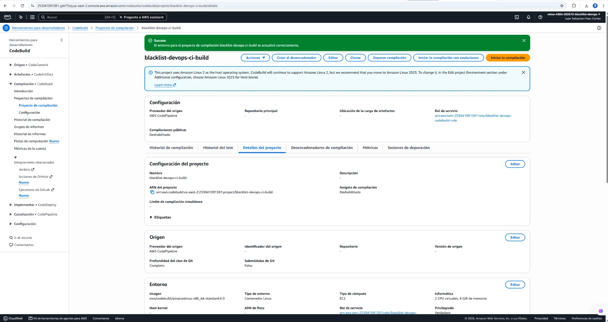

### 5.5 Aplicación y grupo de despliegue de CodeDeploy

| Campo | Valor |
|---|---|
| Aplicación | `blacklist-devops-app`, plataforma Amazon ECS |
| Grupo de despliegue | `blacklist-devops-dg`, con el rol `blacklist-devops-codedeploy-role` |
| Destino | Clúster `blacklist-devops-cluster` y servicio `blacklist-devops-service`, que usa el controlador de despliegue `CODE_DEPLOY` (sección 4.5) |
| Tipo de despliegue | Azul/verde con control de tráfico |
| Balanceador | Grupos de destino `blacklist-devops-tg-azul` y `blacklist-devops-tg-verde`, y el *listener* de producción HTTP:80 de `blacklist-devops-alb`. Sin *listener* de prueba |
| Paso del tráfico | `CodeDeployDefault.ECSCanary10Percent5Minutes`: el 10 % durante 5 minutos y después el resto. El grupo se creó con `CodeDeployDefault.ECSAllAtOnce` y se cambió el 9 de noviembre (sección 8.1, figuras 8.1 y 8.2) |
| Paso del tráfico a la versión nueva | Sin aprobación manual: continúa en cuanto la versión nueva está lista (espera de 0 minutos) |
| Versión anterior | Se termina 2 minutos después de un despliegue exitoso |
| Reversión | Automática cuando el despliegue falla (`DEPLOYMENT_FAILURE`). Sin alarmas de CloudWatch |

Azul y verde son papeles, no versiones: en cada despliegue CodeDeploy levanta la versión nueva en el
grupo que no atiende el tráfico y, cuando termina, ese grupo pasa a ser el de producción. Por eso la
sección 4 terminó con el tráfico en el grupo verde y la sección 7 lo devolvió al azul.

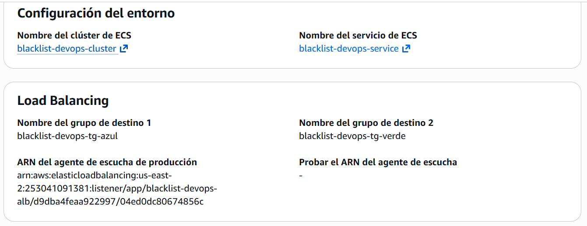

### 5.6 Pipeline de CodePipeline

| Etapa | Acción | Configuración |
|---|---|---|
| *Source* | GitHub (por la conexión `blacklist-devops-github`) | Repositorio `misw-4304-blacklist-devops`, rama `main`, formato `CODE_ZIP`. Entrega `SourceArtifact` y el identificador del commit |
| *Build* | AWS CodeBuild | Proyecto `blacklist-devops-ci-build`, con la variable `COMMIT_ID` tomada del origen. Entrega `BuildArtifact` |
| *Deploy* | Amazon ECS (azul/verde), `CodeDeployToECS` | Aplicación `blacklist-devops-app` y grupo `blacklist-devops-dg`. Toma `taskdef.json`, `appspec.yaml` e `imageDetail.json` de `BuildArtifact` |

El pipeline es de tipo V2, en modo `QUEUED`: si llegan dos commits seguidos, el segundo espera a que
termine el primero en lugar de cancelarlo. La configuración de la etapa *Deploy* es:

```json
{
  "ApplicationName": "blacklist-devops-app",
  "DeploymentGroupName": "blacklist-devops-dg",
  "TaskDefinitionTemplateArtifact": "BuildArtifact",
  "TaskDefinitionTemplatePath": "taskdef.json",
  "AppSpecTemplateArtifact": "BuildArtifact",
  "AppSpecTemplatePath": "appspec.yaml",
  "Image1ArtifactName": "BuildArtifact",
  "Image1ContainerName": "IMAGE1_NAME"
}
```

`Image1ContainerName: IMAGE1_NAME` es lo que une las piezas: la acción lee la dirección de la imagen en
`imageDetail.json` y la escribe donde `taskdef.json` dice `<IMAGE1_NAME>`.

**Disparador.** Uno solo: el *push* a `main`, sin filtro de rutas. Todo commit en `main` inicia el
pipeline; en la práctica es el *merge* de la promoción `dev` → `main`, porque `main` solo cambia por
pull request. El disparador de pull requests de la Entrega 2 se quitó el 8 de noviembre: abrir o
actualizar un PR no ejecuta nada en AWS.

**Despliegue solo con un CI exitoso.** CodePipeline no inicia una etapa si la anterior falló. Si una
prueba falla, *Build* termina en error, *Deploy* no se ejecuta y Fargate sigue con la versión anterior.
Así se cumple el punto 3: el despliegue ocurre solo, pero solo después de un CI exitoso.

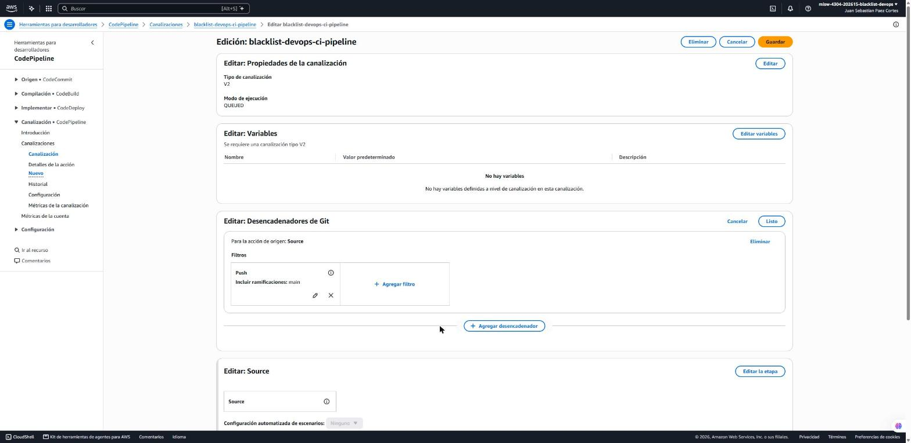

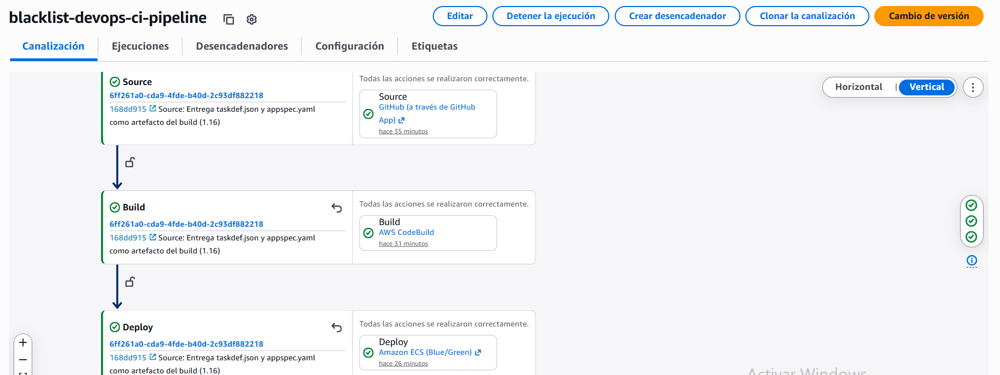

**Hallazgo: los archivos de despliegue salen del build y no del origen.** La primera versión de la
etapa *Deploy* tomaba `taskdef.json` y `appspec.yaml` de `SourceArtifact`, como en el ejemplo de la
documentación de AWS. La ejecución `db778775`, del 8 de noviembre, terminó con *Deploy* en error
(`ConfigurationError: Exception while trying to read the task definition artifact file from:
SourceArtifact`) antes de crear el despliegue, y la aplicación siguió con la versión anterior. La causa
es una cuota de CodePipeline: la acción `CodeDeployToECS` acepta artefactos de entrada de hasta 3 MB, y
el de origen es el commit completo, de unos 43 MB, casi todos de capturas del documento. La solución
fue que el `buildspec.yml` entregue los dos archivos junto con `imageDetail.json`: el artefacto del
build pesa unos 2 KB.

### 5.7 Primera ejecución completa

El 8 de noviembre, `main` todavía no tenía la versión de `buildspec.yml` que entrega `taskdef.json` y
`appspec.yaml` dentro del artefacto del build; llegó esa misma noche. Por eso la primera ejecución
completa se lanzó a mano, con el commit de la rama de trabajo:

| Dato | Valor |
|---|---|
| Ejecución | `6ff261a0-cda9-4fde-b40d-2c93df882218`, con *Source*, *Build* y *Deploy* en *Succeeded*, en 8 min 23 s |
| Commit | `168dd91` |
| Despliegue de CodeDeploy | `d-TEOBBBNFL`, *Succeeded*, de 17:17:00 a 17:21:07 (UTC-05:00): 4 min 7 s |
| Servicio | `blacklist-devops-task:3`, 1 tarea en ejecución, tráfico en el grupo de destino verde |
| `GET /ping` | `{"version": "168dd91"}`, la etiqueta de la imagen que construyó el pipeline |

Esa ejecución comprobó que la configuración funciona de punta a punta. El disparo automático por un
commit en `main` se comprobó después con las tres ejecuciones de las secciones 6 a 8, todas iniciadas
por el *merge* de una promoción y sin intervención manual.

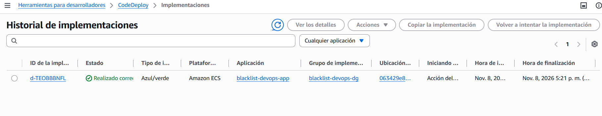

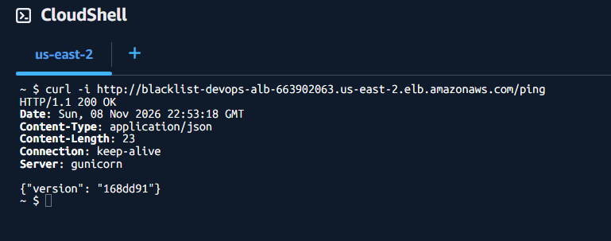

### 5.8 Cumplimiento de los puntos del pipeline

| Punto de la configuración del pipeline | Evidencia |
|---|---|
| Punto 1 (10 %): archivos de configuración en el repositorio para el despliegue continuo con CodeDeploy, con las pruebas unitarias en la construcción | Secciones 5.1 a 5.3: `buildspec.yml`, `taskdef.json`, `appspec.yaml` y `Dockerfile`; las pruebas son el primer comando del build. Ejecuciones: figura 7.4 (pruebas aprobadas) y figura 6.4 (una prueba falla y el build se detiene) |
| Punto 2 (10 %): cada commit en `main` ejecuta el build y crea la imagen del contenedor | Secciones 5.4 y 5.6; figuras 5.1 y 5.3. Ejecuciones: figuras 7.1, 7.5 y 7.6 (commit, envío a ECR e imagen con la etiqueta del commit) |
| Punto 3 (40 %): despliegue continuo automático en Fargate después de un CI exitoso | Secciones 5.5 a 5.7; figuras 5.2, 5.4, 5.5 y 5.6. Ejecuciones: figuras 7.7 y 7.8 (despliegue sin intervención y tráfico en la versión nueva) y sección 8 (reversión automática cuando el despliegue falla) |

Con esta configuración, el pipeline cubre los tres puntos: los archivos están versionados en el
repositorio, cada commit en `main` ejecuta las pruebas y construye la imagen, y un CI exitoso termina
con la versión nueva desplegada en Fargate por CodeDeploy, sin intervención manual.

## 6. Pipeline de CI fallido

La sección 5 documenta los archivos de configuración y el pipeline; esta sección documenta la
ejecución que falló en la integración continua, el punto 1 del documento del enunciado (4 %). Es la
ejecución `e363652d`, disparada por el *merge* de la promoción #254 en `main` con una prueba que
falla a propósito. El *build* se detuvo en las pruebas: no se construyó ni se envió la imagen y no
hubo despliegue. El servicio de Fargate siguió con la versión que dejó el CI y CD exitosos de la sección 7, `db6e990`.

La ejecución es del **9 de noviembre de 2026**, en la cuenta del proyecto y la región `us-east-2`.
Las horas están en UTC-05:00. No se creó infraestructura nueva: se usaron el clúster, el servicio, el
balanceador y los grupos de destino de la sección 4. La prueba que falla llegó a `dev` con el PR #253
y a `main` con la promoción #254; el *push* del *merge commit* inició el pipeline sin intervención
manual.

### 6.1 Resultado de la ejecución

| Dato | Valor |
|---|---|
| Prueba que falla | `tests/test_ping.py::test_intentional_failure_for_the_pipeline`: espera un 500 de `GET /ping` y recibe 200 |
| Commit | `299125dd058444412b8fe8a98a911fa680fc57dc` (`299125d`), *merge commit* de la promoción #254 en `main`, 22:58:01 |
| Disparador | `WebhookV2`, tipo `PUSH_BRANCH`, rama `main`, 5 s después del *merge* |
| Ejecución | `e363652d-c9ec-4d5d-8f9e-86808614d9c0`, versión 5 del pipeline, **Failed** |
| Duración | 3 min 42 s; inicio 22:58:06 y fin 23:01:48 |
| Etapa *Source* | *Succeeded*, 6 s |
| Etapa *Build* | *Failed*: `Build terminated with state: FAILED. Phase: BUILD, Code: COMMAND_EXECUTION_ERROR` |
| Build | `blacklist-devops-ci-build:15627757-aee6-44aa-b554-5cb8752b0212` (compilación 29), **FAILED** en la fase `BUILD` |
| Pruebas | 157 en total: `1 failed, 156 passed in 1.03s`; cobertura del 100 % (290 sentencias) |
| Etapa *Deploy* | **No se ejecutó** |
| Imagen | **Ninguna nueva**: no hay `blacklist-devops:299125d` en ECR (`ImageNotFoundException`); la última sigue siendo `latest, db6e990` |
| CodeDeploy | **Ningún despliegue nuevo**: el último sigue siendo `d-UKCBNTBGL` |
| Servicio | Sin cambios: `blacklist-devops-task:4`, 1 tarea en `blacklist-devops-tg-azul` y 1 destino sano; no se registró otra revisión |
| `GET /ping` | `{"version": "db6e990"}` en las 360 consultas del monitor, de 22:57:39 a 23:09:37 |

La suite base tiene 156 pruebas; esta ejecución corre 157 porque suma la prueba que falla a
propósito. De las 157, 156 pasan y una falla, que es el resultado esperado de esta prueba.

### 6.2 Línea de tiempo

| Hora | Evento |
|---|---|
| 22:11:02 | Se fusiona el PR #253 en `dev` (*squash* `41306da`): agrega la prueba que falla |
| 22:31:19 | Se fusiona en `dev` el PR #255 (`b899b0e`), con la documentación del CI y CD exitosos; la promoción pierde la aprobación porque `protect-main` exige aprobar el último *push*, y se vuelve a aprobar a las 22:46 |
| 22:57:39 | Empieza el monitor de `/ping`, una consulta cada 2 s |
| 22:58:01 | Se fusiona la promoción #254 en `main` (*merge commit* `299125d`) |
| 22:58:06 | Inicia la ejecución `e363652d`, 5 s después del *push* |
| 22:58:06 – 22:58:12 | *Source*: descarga `299125d` de GitHub |
| 22:58:13 | Inicia el build 29 de CodeBuild |
| 22:58:23 – 23:01:22 | `INSTALL`: instala Python 3.13.16 y las dependencias (178 s) |
| 23:01:22 | `BUILD`: inicia `python -m pytest -q --cov=app` |
| 23:01:24 | `pytest` termina con código de salida 1 y la fase `BUILD` queda en `FAILED`; no se ejecutan las validaciones, el inicio de sesión en ECR ni el `docker build` |
| 23:01:24 | `POST_BUILD` termina en *Succeeded* sin enviar nada; `UPLOAD_ARTIFACTS` omite `imageDetail.json` y sube `taskdef.json` y `appspec.yaml` |
| 23:01:24 | Termina el build en `FAILED` |
| 23:01:48 | La etapa *Build* y la ejecución terminan en *Failed*; *Deploy* no inicia |
| 23:09:37 | Termina el monitor: 360 consultas, todas 200 con `db6e990` |

`GET /ping` por el balanceador, consultado cada 2 s desde las 22:57:39: las 360 consultas respondieron
200 con `{"version": "db6e990"}`. La latencia fue de 195 a 611 ms, con un promedio de 235 ms.

### 6.3 Pipeline y build

La ejecución con *Source* en verde, *Build* en rojo y *Deploy* con «No se ejecutó». El resumen muestra
el desencadenador: el commit `299125d` enviado a `main` con el mensaje de la promoción, y el mensaje
de error de `pytest`.

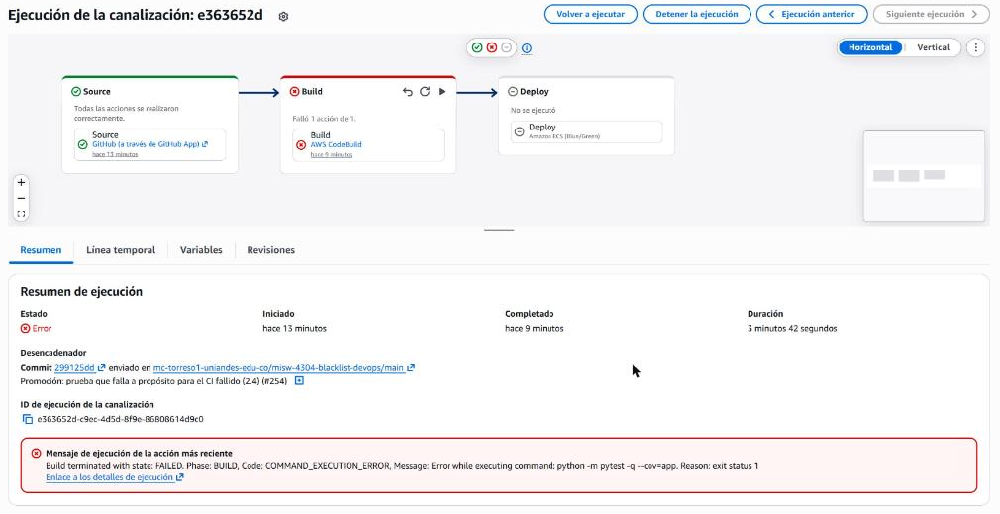

Historial: la ejecución `e363652d` en *Error* sobre la `31b06edb` del CI y CD exitosos (sección 7); las dos se iniciaron con
un commit en `main`.

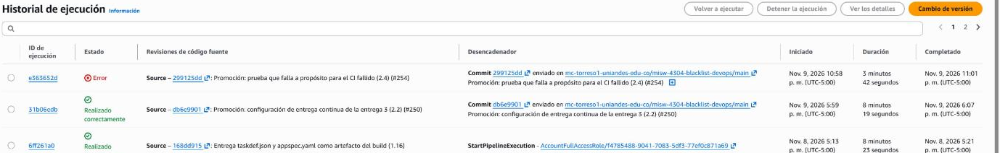

Fases del build 29: `INSTALL` y las anteriores en *Realizado correctamente*, `BUILD` en *Error* con
`COMMAND_EXECUTION_ERROR` sobre `python -m pytest -q --cov=app`. El iniciador es
`codepipeline/blacklist-devops-ci-pipeline` y la versión de origen resuelta es `299125d`.

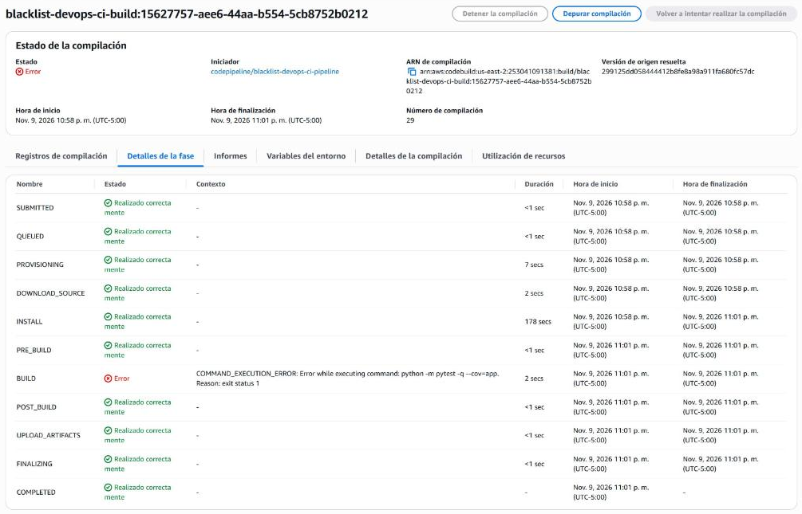

Registro del build: la prueba `test_intentional_failure_for_the_pipeline` falla con
`assert 200 == 500`, la cobertura sigue en 100 % y el resumen es `1 failed, 156 passed`. La fase
`BUILD` termina en `FAILED`.

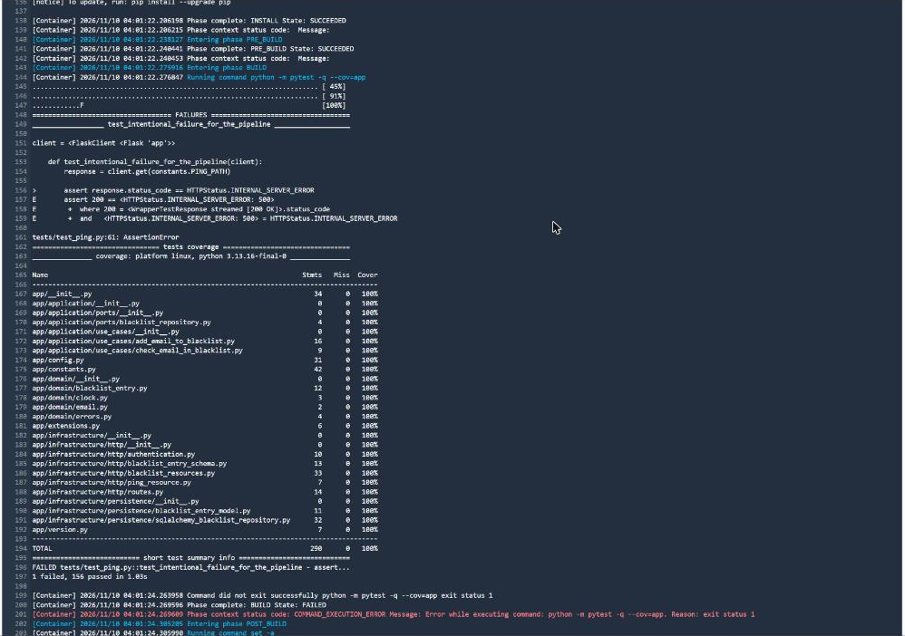

Después del fallo: `POST_BUILD` ejecuta el bloque del envío, pero `CODEBUILD_BUILD_SUCCEEDING` no es
`1` y no hay `docker push`. `UPLOAD_ARTIFACTS` muestra `Skipping invalid file path imageDetail.json` y
`Found 2 file(s)`.

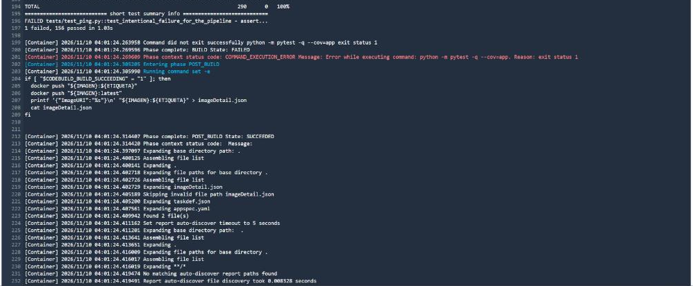

### 6.4 Sin imagen ni despliegue

Repositorio `blacklist-devops`: cinco imágenes y ninguna con la etiqueta `299125d`. La más reciente
sigue siendo `latest, db6e990`, del 9 de noviembre a las 18:03:11.

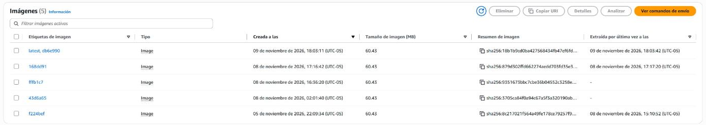

Historial de CodeDeploy: solo el de la ejecución manual que comprobó la etapa *Deploy* el 8 de noviembre (`d-TEOBBBNFL`) y el del CI y CD exitosos (`d-UKCBNTBGL`).
La etapa *Deploy* no se ejecutó, así que la acción *Deploy* no registró ninguna revisión nueva y
CodeDeploy no creó ningún despliegue. El historial muestra las dos entradas como «Acción del usuario»,
el nombre que da CodeDeploy a los despliegues creados por una llamada a su API, incluidos los de la
acción *Deploy* del pipeline; no implica intervención manual (sección 7.5, hallazgo 7).

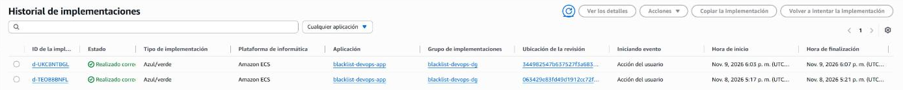

Servicio `blacklist-devops-service` a las 23:10: revisión `blacklist-devops-task:4`, 1 tarea en
ejecución y 1 destino sano en `blacklist-devops-tg-azul`.

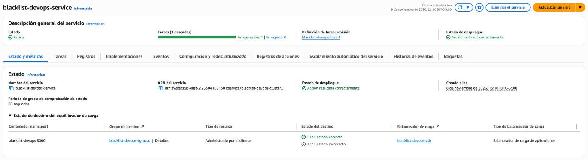

### 6.5 Hallazgos

1. **El fallo de las pruebas detiene todo lo que sigue.** `pytest` es el primer comando de la fase
   `BUILD`: al salir con código 1, CodeBuild marca la fase como fallida y no ejecuta los comandos
   siguientes (validaciones, inicio de sesión en ECR y `docker build`). El pipeline no pasa a
   *Deploy*, así que la acción *Deploy* no registra una revisión nueva, CodeDeploy no crea un
   despliegue y Fargate sigue con la versión anterior. Es el comportamiento que fijó la decisión del
   equipo del 4 de noviembre.
2. **`POST_BUILD` se ejecuta aunque el build ya haya fallado.** CodeBuild corre siempre esa fase; lo
   que impide el envío es la condición `CODEBUILD_BUILD_SUCCEEDING = 1` del `buildspec.yml`, no el
   `set -e`. La fase termina en *Succeeded* sin ejecutar ningún `docker push`. El `set -e` solo hace
   fallar el build si falla el envío.
3. **El artefacto sale incompleto, pero no llega a usarse.** `UPLOAD_ARTIFACTS` terminó en
   *Succeeded*: omitió `imageDetail.json`, que no existe, y subió `taskdef.json` y `appspec.yaml`. En
   la Entrega 2 esa fase fallaba porque el único archivo del artefacto no existía. Aquí no tiene
   efecto: el pipeline se detiene en *Build* y *Deploy* no recibe ese artefacto.
4. **El servicio no se vio afectado.** Las 360 consultas a `/ping` durante y después de la ejecución
   respondieron 200 con `db6e990`. No hubo imagen ni revisión de la definición de la tarea nuevas, y
   el *listener* siguió en `blacklist-devops-tg-azul`.
5. **La vista general del pipeline puede confundir.** Después del fallo, el estado de la canalización
   (`get-pipeline-state`) muestra *Deploy* en *Succeeded*, pero ese estado es de la ejecución anterior
   (`31b06edb`). La vista de la ejecución `e363652d` es la que dice «No se ejecutó».
6. **El fallo se conoce en unos 3 minutos.** La ejecución duró 3 min 42 s, y `INSTALL` ocupó 178 s del
   build porque `pyenv` compila Python 3.13.16 en cada ejecución. Las pruebas fallaron en 2 s. El CI
   fallido de la Entrega 2 duró 38 s porque su build no instalaba Python ni construía
   imágenes.
7. **`main` queda con el CI en rojo hasta el CD fallido.** Mientras la prueba siga en `main`, cualquier
   promoción fallaría igual. La promoción que provoca el CD fallido (sección 8) la retira;
   hasta entonces no se promueve nada más a `main`.

### 6.6 Cumplimiento del punto 1 del documento

| Requisito del punto 1 (4 %) | Evidencia |
|---|---|
| Ejecución de CI fallida documentada: commit, disparador y etapa que falla | 6.1 y 6.2 (datos); figuras 6.1 y 6.2 en 6.3 |
| Causa y mensaje del fallo | 6.3; figuras 6.3 y 6.4 |
| Qué no se ejecuta: imagen y despliegue | 6.3 y 6.4; figuras 6.5 a 6.8 |
| Hallazgos y capturas de los servicios de AWS | 6.3 a 6.5; siete hallazgos y ocho figuras |
| Servicio sin cambios | 6.4; figura 6.8 y `/ping` con `db6e990` |

Con esta ejecución, el punto 1 del documento queda cubierto: el commit disparó el CI, el build falló
en la prueba que falla a propósito y no se construyó ni se envió la imagen; la acción *Deploy* no se
ejecutó y el servicio siguió con `db6e990`. El CI y el CD exitosos se documentan en la sección 7, y
el CD fallido en la sección 8.

## 7. Pipeline de CI y CD exitosos

La sección 4 cerró con la revisión 3 de `blacklist-devops-task` (`168dd91`) y el tráfico en el grupo
de destino verde. Esta sección documenta la ejecución que desplegó la revisión 4 (`db6e990`) y
devolvió el tráfico al grupo azul. Es el punto 2 del documento del enunciado (8 %): un CI exitoso
seguido de un CD exitoso, con hallazgos y capturas de los servicios de AWS.

La ejecución es del **9 de noviembre de 2026**, en la cuenta del proyecto y la región `us-east-2`.
Las horas están en UTC-05:00. No se creó infraestructura nueva: se usaron el clúster, el servicio, el
balanceador y los grupos de destino de la sección 4. La configuración de los archivos y del pipeline
se documenta en la sección 5; esta sección se centra en la ejecución.

### 7.1 Resultado de la ejecución

| Dato | Valor |
|---|---|
| Commit | `db6e99013812c059c32fe62e50e1cfcc8f7d21ee` (`db6e990`), *merge commit* del PR #250 en `main`, 17:59:35 |
| Disparador | `WebhookV2`, tipo `PUSH_BRANCH`, rama `main`, 3 s después del *merge* |
| Ejecución | `31b06edb-3f43-44e3-ac71-9af3f42c7f24`, versión 5 del pipeline, *Succeeded* |
| Duración | 8 min 19 s; inicio 17:59:38 y fin 18:07:58, según el resumen de la ejecución |
| Build | `blacklist-devops-ci-build:ba2e2bd9-e129-49d4-9136-b8cb65caae8c` (compilación 28), *Succeeded*: 156 pruebas aprobadas, cobertura del 100 % |
| Imagen | `blacklist-devops:db6e990` y `latest`, el mismo *digest* `sha256:18b1b9cd0ba427568434fb47ef6fdd6153dba4579bfe0a4aa852f6c76973e04f`, 60,43 MB |
| Despliegue | `d-UKCBNTBGL`, aplicación `blacklist-devops-app`, grupo `blacklist-devops-dg`, `CodeDeployDefault.ECSAllAtOnce`, *Succeeded*, sin reversión |
| Definición | `blacklist-devops-task:4`, registrada por la acción *Deploy* (`CodeDeployToECS`) del pipeline con `taskdef.json`; conserva 256/512 y los secretos por referencia |
| Tráfico | El *listener* HTTP:80 pasó de `blacklist-devops-tg-verde` (revisión 3, `168dd91`) a `blacklist-devops-tg-azul` (revisión 4, `db6e990`) |
| Servicio | `blacklist-devops-task:4`, 1 tarea en ejecución |
| `GET /ping` | `{"version": "db6e990"}`, la etiqueta del commit de la promoción |

La ejecución la inició el *push* a `main`, no una persona. La acción *Deploy* del pipeline
registra la revisión 4 de la definición a partir de `taskdef.json` y de `imageDetail.json`, y
CodeDeploy crea el conjunto de tareas de sustitución y mueve el tráfico. La definición conserva los
secretos por referencia a Parameter Store: `DATABASE_URL` y `JWT_SECRET_KEY` no tienen valores en el
archivo ni en las capturas.

### 7.2 Línea de tiempo

| Hora | Evento |
|---|---|
| 17:59:35 | Se fusiona el PR #250 en `main` (*merge commit* `db6e990`) |
| 17:59:38 | Inicia la ejecución `31b06edb`, 3 s después del *push* |
| 17:59:38 – 17:59:43 | *Source*: descarga `db6e990` de GitHub |
| 17:59:44 – 18:03:19 | *Build*: instala Python 3.13.16, ejecuta las pruebas, construye la imagen y la envía a ECR |
| 18:03:11 | La imagen `db6e990` llega a ECR |
| 18:03:20 | Inicia *Deploy*; a las 18:03:21 se registra `blacklist-devops-task:4` y se crea `d-UKCBNTBGL` |
| 18:03:23 – 18:05:26 | `Install`: el conjunto de tareas de sustitución arranca, se registra en `blacklist-devops-tg-azul` a las 18:03:56 y ECS lo da por estable a las 18:04:05 |
| 18:05:27 | `AllowTraffic`: el *listener* de producción pasa al grupo azul (100 % del tráfico) |
| 18:05:28 – 18:07:29 | Espera de 2 minutos y terminación del conjunto de tareas original |
| 18:07:29 | `d-UKCBNTBGL` termina en *Succeeded* |
| 18:07:58 | La etapa *Deploy* y la ejecución terminan en *Succeeded* |

`GET /ping` por el balanceador, consultado cada 33 s durante la ejecución: respondió
`{"version": "168dd91"}` hasta las 18:05:20 y `{"version": "db6e990"}` desde las 18:05:53. Ninguna
consulta falló.

### 7.3 Pipeline y build

La ejecución con las tres etapas en verde. El resumen muestra el desencadenador: el commit `db6e990`
enviado a `main` con el mensaje de la promoción.

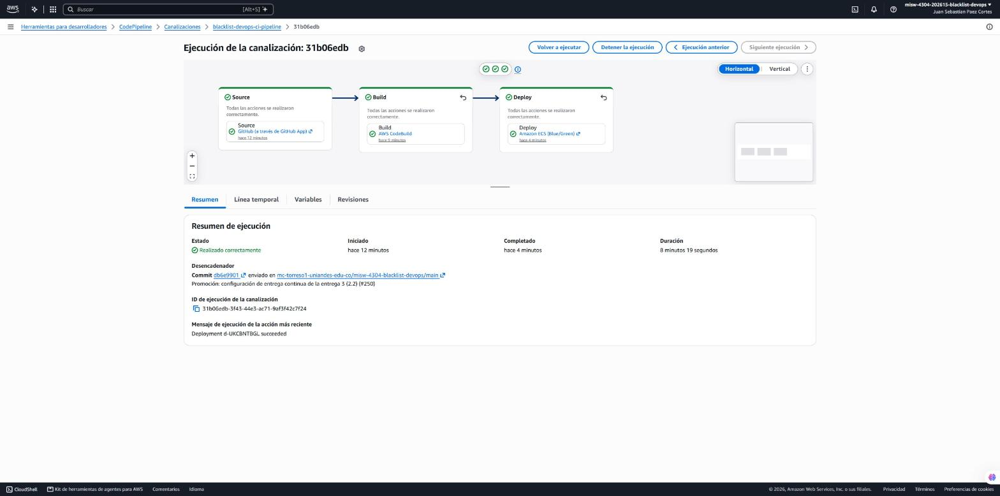

Línea temporal: *Source* 5 s, etapa *Build* 3 min 35 s y *Deploy* 4 min 37 s.

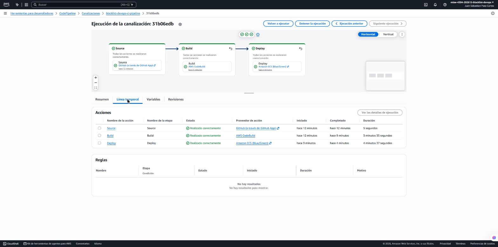

Fases del build, todas en *Realizado correctamente*. La versión de origen resuelta es `db6e990` y el
iniciador es `codepipeline/blacklist-devops-ci-pipeline`.

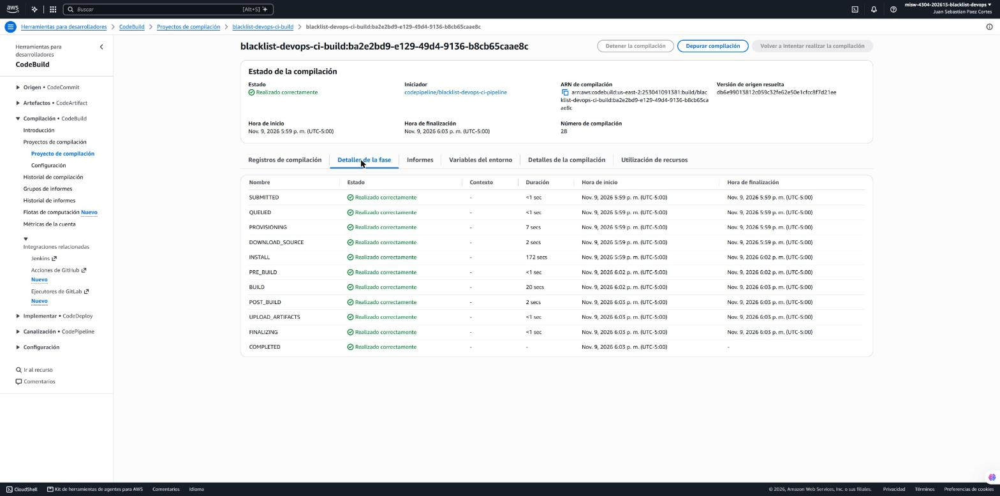

Registro del build: cobertura del 100 % y `156 passed`, seguido de las validaciones de `COMMIT_ID`,
`AWS_ACCOUNT_ID` y `AWS_DEFAULT_REGION`, el inicio de sesión en ECR y el `docker build` con la
etiqueta del commit.

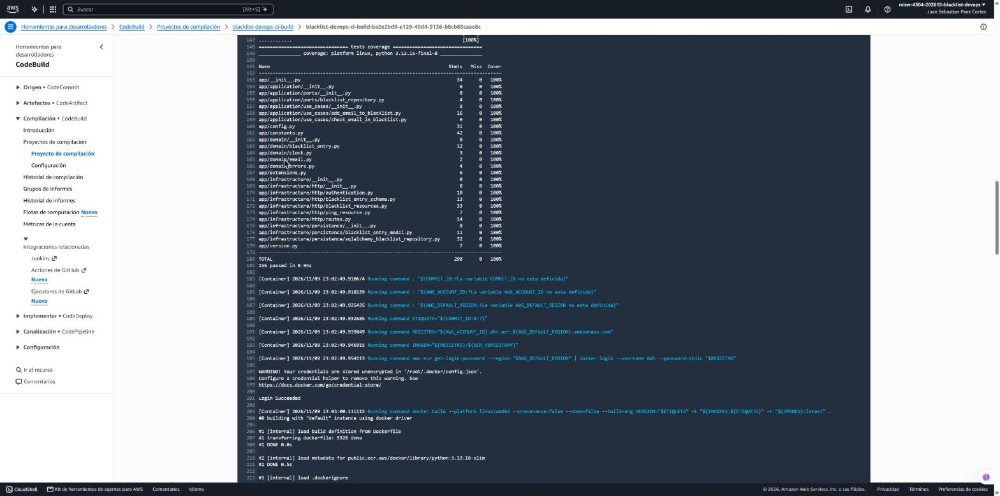

Envío a ECR: `db6e990` y `latest` con el mismo *digest*, `imageDetail.json` con la dirección de la
imagen y el artefacto con `imageDetail.json`, `taskdef.json` y `appspec.yaml`.

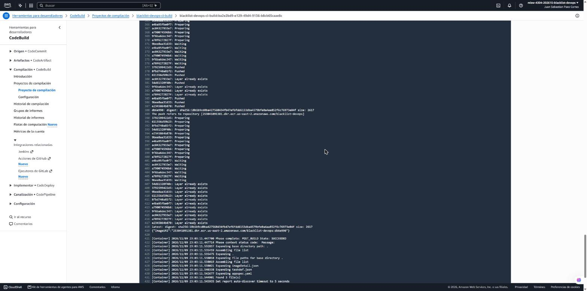

### 7.4 Imagen en ECR y despliegue azul/verde

Repositorio `blacklist-devops`: la imagen `latest, db6e990` de las 18:03:11, extraída por Fargate a
las 18:03:42.

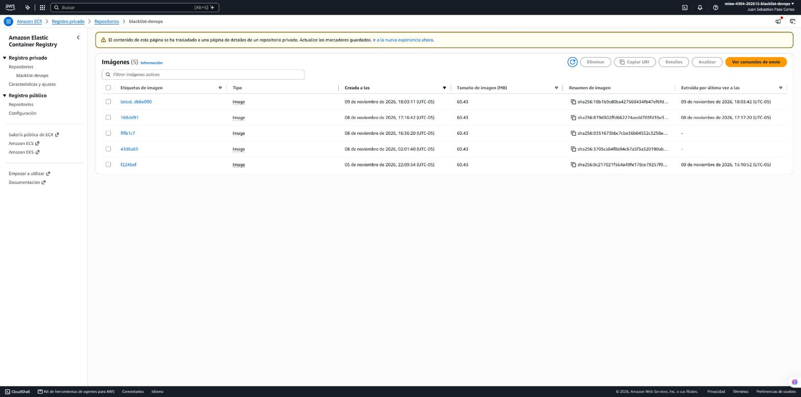

`d-UKCBNTBGL`: los cuatro pasos completados y el 100 % del tráfico en el conjunto de tareas de
sustitución.

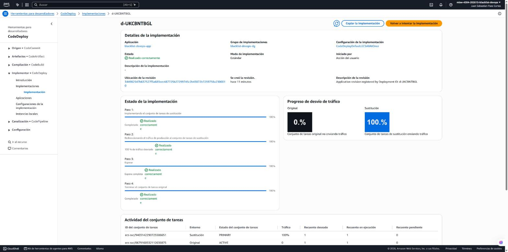

La tabla de conjuntos de tareas no se había refrescado: todavía muestra el conjunto original como
`ACTIVE` con 1 tarea, aunque el paso 4 (terminación del conjunto original) ya aparece completado a
las 18:07:29. La terminación se comprueba por el paso 4 y por el estado del servicio, no por esa
tabla.

*Listener* HTTP:80 del balanceador, que ahora reenvía a `blacklist-devops-tg-azul`.

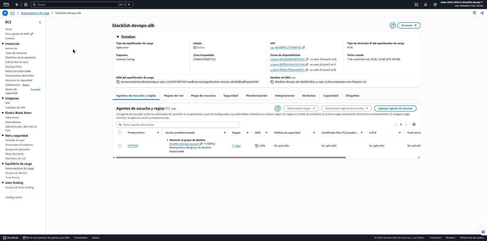

La verificación de salud del grupo de destino consulta `/ping` cada 15 s, con 5 s de espera, dos
comprobaciones para sano y dos para no sano. Con `ECSAllAtOnce` y sin *listener* de prueba, el grupo
de sustitución no recibe esas verificaciones hasta el cambio de tráfico (hallazgo 4).
`GET /ping` no requiere
token y no consulta la base, así que la versión se comprueba sin depender de la RDS:

```bash
URL=http://blacklist-devops-alb-663902063.us-east-2.elb.amazonaws.com
curl -s $URL/ping
# {"version": "db6e990"}
```

El grupo de despliegue tiene la reversión automática activa ante `DEPLOYMENT_FAILURE`; en esta
ejecución no se activó porque el despliegue terminó en *Succeeded*. El CD fallido y la reversión se
documentan en la sección 8.

### 7.5 Hallazgos

1. **El commit en `main` dispara el pipeline completo.** La ejecución inició 3 s después del *merge*,
   con el disparador `WebhookV2` y `PUSH_BRANCH` sobre `main`. La etapa *Deploy* se había comprobado el 8 de noviembre con una
   ejecución manual (`6ff261a0`, iniciada con `StartPipelineExecution`); esta es la primera que inicia
   sola un commit.
2. **El despliegue depende del CI.** *Deploy* empezó 1 s después de que terminó *Build*. Las pruebas
   son el primer comando de la fase `build`: si una falla, CodeBuild detiene la fase ahí y no se
   ejecuta el `docker build`. Además, `post_build` solo envía la imagen a ECR si
   `CODEBUILD_BUILD_SUCCEEDING` es `1`. El `set -e` no es lo que impide el envío; solo hace fallar el
   build si falla el envío. Ese caso es la sección 6.
3. **La versión desplegada es trazable al commit.** La etiqueta de la imagen, la definición
   `blacklist-devops-task:4` y `/ping` dicen `db6e990`, que es el commit del *push*. `latest` apunta
   al mismo *digest*.
4. **No hubo corte de servicio, pero la versión nueva no se verificó antes de recibir tráfico.** ECS
   registró la tarea nueva en el grupo azul a las 18:03:56 y la dio por estable 9 s después, antes de
   que el balanceador pudiera completar dos verificaciones de salud de 15 s. Con
   `CodeDeployDefault.ECSAllAtOnce` y sin *listener* de prueba, el grupo de sustitución no está
   asociado al balanceador y sus destinos no se verifican hasta que reciben el tráfico; AWS lo
   documenta en la guía de solución de problemas de CodeDeploy para ECS. El cambio del *listener* fue
   a las 18:05:27 y ninguna consulta a `/ping` falló porque la versión nueva estaba bien. El conjunto
   anterior siguió dos minutos más en el grupo verde antes de terminarse. Por esta limitación, desde
   la prueba del CD fallido (sección 8) el grupo de despliegue usa
   `CodeDeployDefault.ECSCanary10Percent5Minutes` (votación del equipo del 9 de noviembre). Esa
   prueba mostró que el canario tampoco verifica la salud antes del primer 10 % del tráfico; la
   corrección es la verificación de salud del contenedor de la versión final (sección 8, hallazgo 9).
5. **Los grupos de destino se alternan.** El despliegue de la ejecución manual del 8 de noviembre dejó el tráfico en el grupo verde;
   este lo pasó al azul. El siguiente despliegue usará el verde.
6. **La instalación de Python ocupa casi todo el build.** `INSTALL` tardó 172 s, porque `pyenv`
   compila Python 3.13.16 en cada ejecución. Las pruebas tardaron menos de 1 s y el `docker build` y
   el envío, unos 22 s. Es la parte que se puede acortar si hace falta, con una imagen de compilación
   que ya traiga esa versión.
7. **CodeDeploy muestra el despliegue como «Acción del usuario».** Es el nombre que da a los
   despliegues creados por una llamada a su API, que en este caso hizo la acción *Deploy* del
   pipeline: `d-UKCBNTBGL` es el identificador externo de esa acción en la ejecución `31b06edb`.
   Nadie lo inició a mano.

### 7.6 Cumplimiento del punto 2 del documento

| Requisito del punto 2 (8 %) | Evidencia |
|---|---|
| Ejecución de CI exitosa: commit, build y pruebas | Secciones 7.1 y 7.2; figuras 7.1 a 7.4 |
| Imagen del contenedor en ECR con la etiqueta del commit | Sección 7.3; figuras 7.5 y 7.6 |
| CD exitoso en Fargate sin intervención manual | Sección 7.4; figuras 7.7 y 7.8; hallazgos 1 y 7 |
| Aplicación respondiendo con la versión nueva | Secciones 7.2 y 7.4; `/ping` con `db6e990` |
| Hallazgos y capturas de los servicios de AWS | Secciones 7.3 a 7.5; ocho figuras y siete hallazgos |

Con esta ejecución, el punto 2 del documento queda cubierto: el commit disparó el CI, el build
ejecutó las 156 pruebas y publicó la imagen, y CodeDeploy desplegó la revisión 4 en Fargate sin
intervención manual; `/ping` confirmó la versión nueva. El CI fallido y el CD fallido se documentan
en las secciones 6 y 8.

## 8. CI exitoso y CD fallido, con reversión

La sección 7 cerró con la revisión 4 de `blacklist-devops-task` (`db6e990`) atendiendo en el grupo de
destino azul. Esta sección documenta la ejecución en la que la integración continua terminó bien y el
despliegue continuo falló: el contenedor de la versión nueva escucha en el puerto `8001`, mientras la
definición de la tarea, el `appspec.yaml` y los grupos de destino esperan el `8000` (decisión del equipo
del 3 de noviembre). Es el punto 3 del documento del enunciado (8 %): un CI exitoso seguido de un CD fallido, con
hallazgos y capturas de los servicios de AWS.

La ejecución es del **10 de noviembre de 2026**, en la cuenta del proyecto y la región `us-east-2`.
Las horas están en UTC-05:00. No se creó infraestructura nueva. El cambio llegó a `dev` con el PR
#258 y a `main` con la promoción #261, que además retiró la prueba que fallaba a propósito en la
sección 6. El detalle completo, con los dos CSV del monitor de `/ping`, está en la carpeta
`docs/ci/entrega-3/` del repositorio.

La ejecución **no salió como se había previsto**. CodeDeploy falló y revirtió solo, como se buscaba,
pero la configuración canaria no verificó la salud de la versión nueva antes de pasarle tráfico: el
10 % de las solicitudes recibió errores 502 durante cinco minutos y, al pasar el resto, hubo unos 44 s
sin servicio hasta la reversión. Los hallazgos 2 a 9 explican por qué y qué se corrigió.

### 8.1 Configuración de CodeDeploy antes de la ejecución

El grupo `blacklist-devops-dg` se creó con `CodeDeployDefault.ECSAllAtOnce` (decisión del equipo del 4 de noviembre).
El hallazgo 4 de la sección 7 mostró que, sin *listener* de prueba, esa configuración no verifica la
salud de la versión nueva antes de pasarle el tráfico. Por eso, el 9 de noviembre a las 23:56, el
equipo cambió el grupo a `CodeDeployDefault.ECSCanary10Percent5Minutes`, que pasa el 10 % del tráfico
durante 5 minutos y después el resto, con el supuesto de que la salud se verificaría antes de mover el
tráfico. El rol de CodePipeline recibió el permiso de leer esa configuración. La reversión automática
ante `DEPLOYMENT_FAILURE` no cambió.

| Aspecto | Antes (configuración inicial) | Desde el 9 de noviembre |
|---|---|---|
| Paso del tráfico | `CodeDeployDefault.ECSAllAtOnce`: el 100 % de una vez | `CodeDeployDefault.ECSCanary10Percent5Minutes`: 10 % durante 5 minutos y después el resto |
| Reversión | Automática ante `DEPLOYMENT_FAILURE` | Sin cambios |
| *Listener* de prueba | No | No |
| Permiso del rol de CodePipeline (`acceso-minimo-cd`) | `GetDeploymentConfig` sobre `ECSAllAtOnce` | Sobre las dos configuraciones |

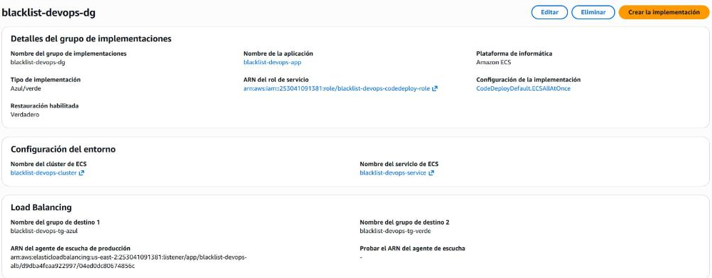

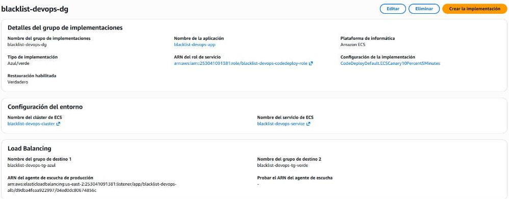

### 8.2 Resultado de la ejecución

| Dato | Valor |
|---|---|
| Cambio | PR #258: Gunicorn en `:8001` en el `Dockerfile` y retiro de la prueba de la sección 6 |
| Commit | `69e12b85c0671d077e92f040bcb6234e1c7d343c` (`69e12b8`), *merge commit* de la promoción #261 en `main`, 22:34:51 |
| Disparador | `WebhookV2`, tipo `PUSH_BRANCH`, rama `main`, 3 s después del *merge* |
| Ejecución | `035b42d2-3559-499c-8459-ad447b344612`, versión 5 del pipeline, **Failed** |
| Duración | 11 min 59 s; inicio 22:34:54 y fin 22:46:53 |
| Etapas *Source* y *Build* | *Succeeded*. Build `blacklist-devops-ci-build:463203d6-81e2-45d4-9b03-4d950c518784` (compilación 30): 156 pruebas aprobadas, cobertura del 100 % |
| Imagen | `blacklist-devops:69e12b8` y `latest`, el mismo *digest* `sha256:603c0321a20d3b0e814e605970d189a5c9636a7e28809f05a0eb28ad01b81bfa`, 60,43 MB, en ECR a las 22:38:50 |
| Definición | `blacklist-devops-task:5`, registrada por la acción *Deploy* a las 22:39:10 con la imagen `69e12b8` |
| Despliegue | `d-SYHBSF3HL`, `CodeDeployDefault.ECSCanary10Percent5Minutes`, **Failed** a las 22:46:40: `ECS_UPDATE_ERROR`, «CodeDeploy detected that the replacement task set is unhealthy.» |
| Reversión | `d-2TNRGN3HL`, iniciada por CodeDeploy, **Succeeded** de 22:46:41 a 22:46:43 |
| Servicio después | `blacklist-devops-task:4`, la misma tarea de la sección 7; el *listener* HTTP:80 reenvía de nuevo a `blacklist-devops-tg-azul` |
| `GET /ping` | Cuando respondió, siempre `{"version": "db6e990"}`. **40 de 361 consultas con 502** mientras corrió la ejecución (monitor principal) |
| Errores 502 en el balanceador | **77** entre las 22:41 y las 22:46 (CloudWatch, `HTTPCode_ELB_502_Count`) |

### 8.3 Línea de tiempo y disponibilidad

| Hora | Evento |
|---|---|
| 22:26:56 | Empieza el monitor principal de `/ping`, una consulta cada 2 s; a las 22:32:40, el de respaldo |
| 22:34:51 | Se fusiona la promoción #261 en `main` (*merge commit* `69e12b8`) |
| 22:34:54 | Inicia la ejecución `035b42d2`, 3 s después del *push* |
| 22:35:03 – 22:38:51 | *Build*: `INSTALL` 191 s, pruebas (`156 passed`), `docker build` y envío de `69e12b8` y `latest` |
| 22:39:10 | Inicia *Deploy*: se registra `blacklist-devops-task:5` y se crea `d-SYHBSF3HL` |
| 22:39:13 – 22:40:55 | `Install`: ECS arranca la tarea nueva (22:39:22), la registra en `blacklist-devops-tg-verde` (22:39:41) y da el conjunto por estable a las 22:39:50, **9 s después del registro** |
| 22:40:56 | `AllowTraffic`: el 10 % del tráfico pasa a `blacklist-devops-tg-verde` |
| 22:41:32 | Primer 502 en el monitor principal |
| 22:41:38, 22:43:54 y 22:46:14 | ECS reemplaza la tarea nueva: «Amazon ECS replaced 1 tasks due to an unhealthy status» |
| 22:42:17 y 22:44:31 | ECS: «port 8000 is unhealthy in target-group blacklist-devops-tg-verde due to (reason Health checks failed)» |
| 22:45:57 | Terminan los 5 minutos del canario: el 100 % del tráfico pasa a `blacklist-devops-tg-verde` |
| 22:46:10 – 22:46:53 | Corte total: todas las consultas a `/ping` responden 502 |
| 22:46:40 | `d-SYHBSF3HL` termina en *Failed*, 43 s después de pasar el 100 % |
| 22:46:41 – 22:46:43 | La reversión `d-2TNRGN3HL` devuelve el tráfico al conjunto original en `blacklist-devops-tg-azul` |
| 22:46:53 | La etapa *Deploy* y la ejecución terminan en *Failed* |
| 22:48:16 | ECS: el servicio vuelve al estado estable |

| Fuente | Consultas | 200 con `db6e990` | 502 sueltos (10 %) | 502 seguidos (100 %) |
|---|---|---|---|---|
| Monitor principal, 22:26:56 – 22:47:40 | 531 | 491 | 18, de 22:41:32 a 22:46:02 | 22, de 22:46:10 a 22:46:52 |
| Monitor de respaldo, 22:32:40 – 23:05:32 | 986 | 950 | 14, de 22:41:44 a 22:45:53 | 22, de 22:46:11 a 22:46:53 |
| CloudWatch del balanceador, 22:41 – 22:46 | — | — | 4, 9, 5, 6 y 8 por minuto | 45 en el minuto de las 22:46 |

Cuando `/ping` respondió, siempre lo hizo con `db6e990`: la versión nueva nunca contestó. Ningún
monitor registró errores después de las 22:46:53.

### 8.4 Pipeline y build

La ejecución con *Source* y *Build* en verde y *Deploy* en rojo. El desencadenador es el commit
`69e12b8` enviado a `main` con el mensaje de la promoción.

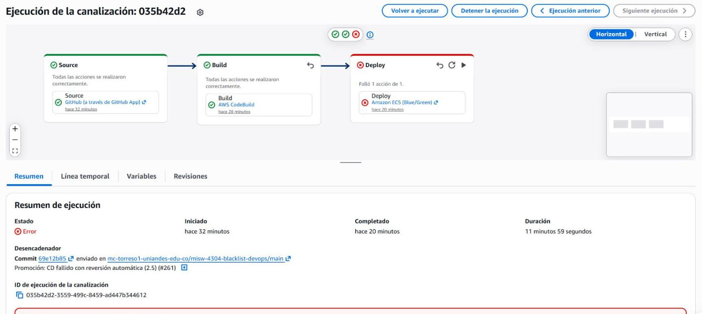

Registro del build 30: cobertura del 100 % y `156 passed`, seguido de las validaciones y el inicio de
sesión en ECR.

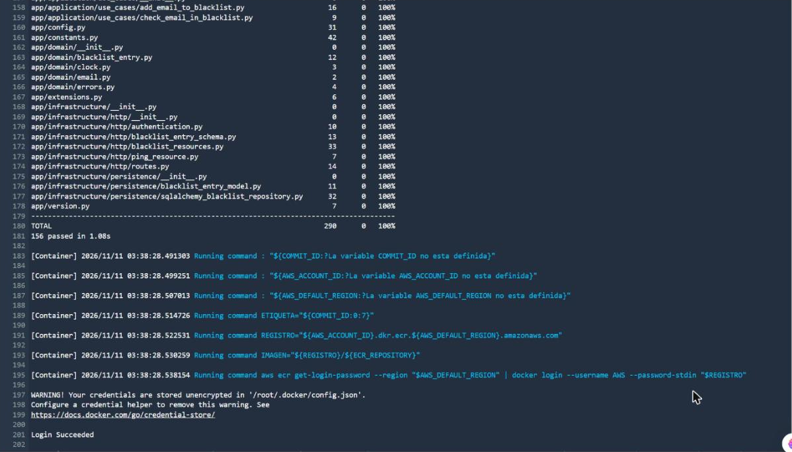

Envío a ECR: `latest` con el mismo *digest* que `69e12b8` y el artefacto con `imageDetail.json`,
`taskdef.json` y `appspec.yaml`.

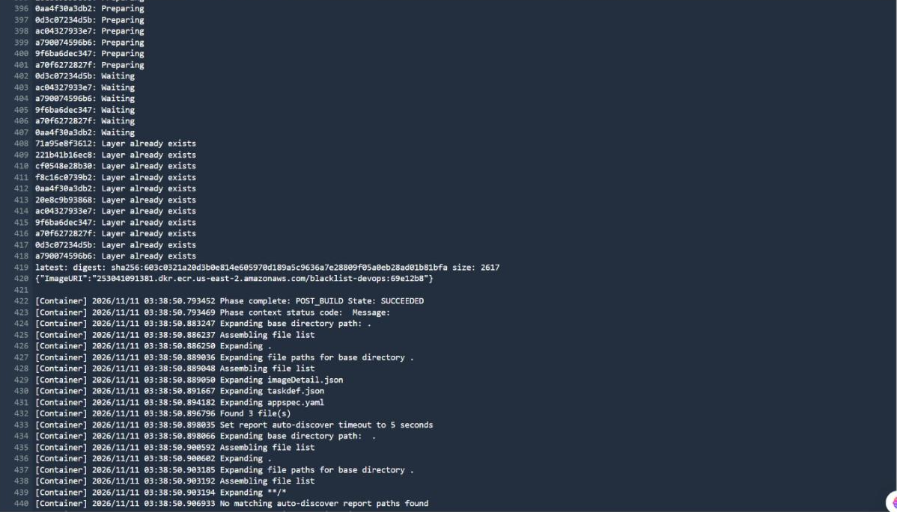

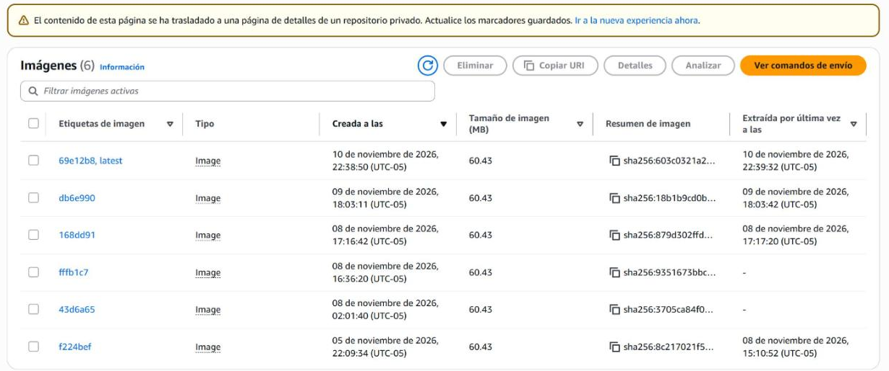

### 8.5 Despliegue fallido y reversión

`d-SYHBSF3HL` en *Error*, con la causa y la reversión `d-2TNRGN3HL` realizada correctamente.

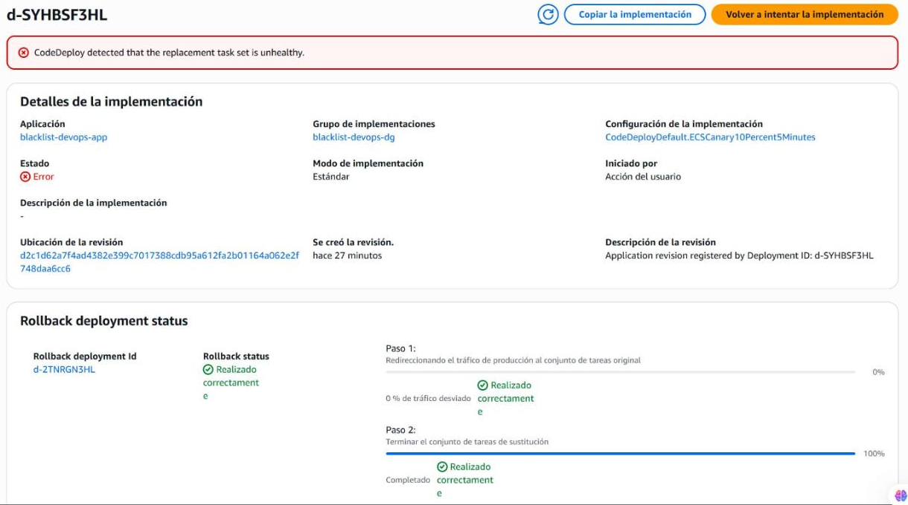

Estado del despliegue: el 100 % del tráfico se desvió al conjunto de sustitución y el paso de espera
terminó en *Error*. La consola muestra el último estado del despliegue fallido, no lo que quedó
corriendo, que es el conjunto original (hallazgo 8).

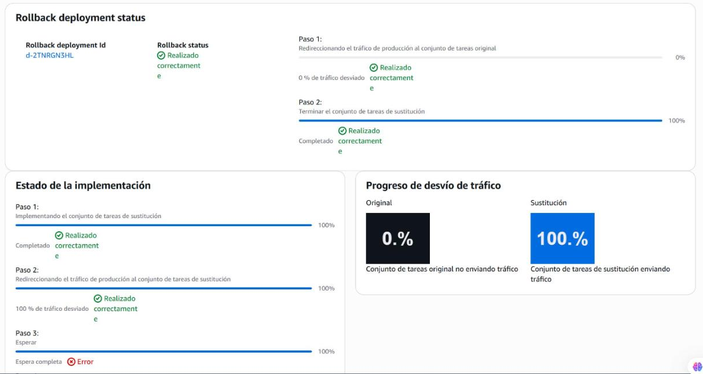

Eventos del ciclo de vida: `Install` duró 1 min 42 s y `AllowTraffic`, exactamente los 5 minutos del
canario. Ninguno falló: el despliegue falló después, en la espera.

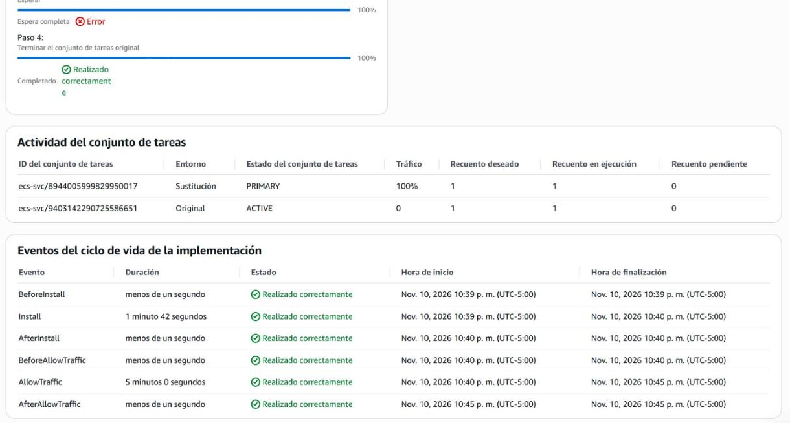

La reversión `d-2TNRGN3HL`, iniciada por CodeDeploy: el 100 % del tráfico vuelve al conjunto
original y se termina el de sustitución.

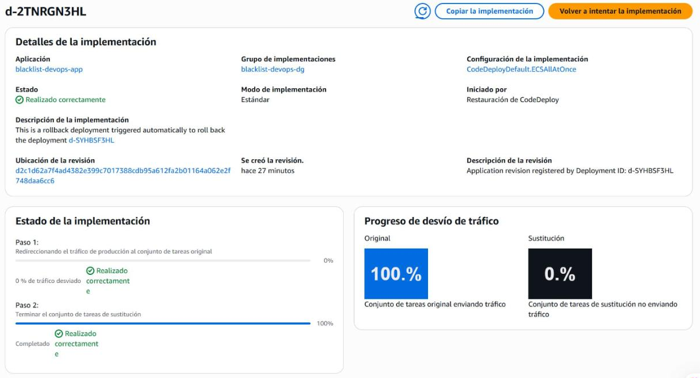

### 8.6 Tareas en mal estado y tráfico

Eventos del servicio filtrados por *unhealthy*: el puerto 8000 de la tarea nueva no pasa la
verificación de salud en `blacklist-devops-tg-verde` y ECS reemplaza la tarea tres veces. El grupo
verde en mal estado ya no se podía capturar cuando terminó la ejecución; estos eventos son la
evidencia.

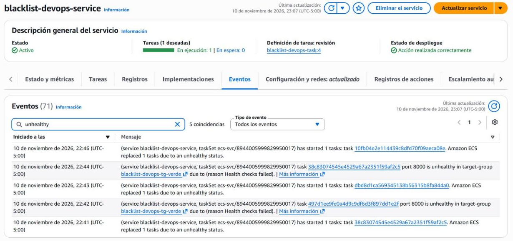

CloudWatch del balanceador, de 22:36 a 22:52 (en la gráfica, 03:36 a 03:52 UTC):
`HTTPCode_ELB_502_Count` sube desde las 22:41 y llega a 45 en el minuto de las 22:46;
`RequestCount` se mantiene en unas 60 por minuto, las de los dos monitores.

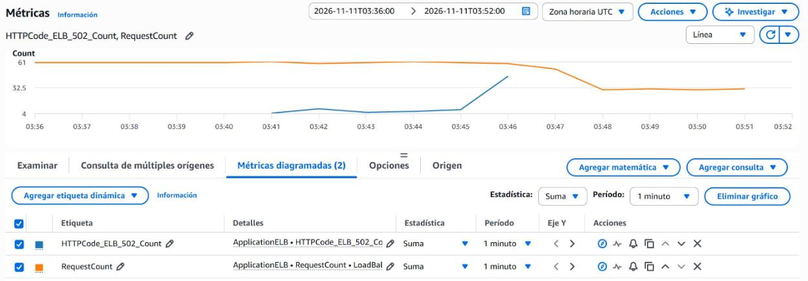

*Listener* HTTP:80 después de la reversión: reenvía el 100 % a `blacklist-devops-tg-azul`.

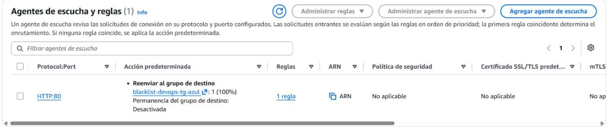

### 8.7 Hallazgos

1. **El CI terminó bien y el CD falló, como se buscaba.** Las 156 pruebas pasaron, la imagen
   `69e12b8` llegó a ECR y la etapa *Deploy* registró `blacklist-devops-task:5`. El contenedor
   arrancó, pero no atiende el puerto 8000, así que la versión nueva nunca respondió.
2. **El canario no verificó la salud antes de pasar el tráfico.** ECS dio por estable el conjunto de
   sustitución 9 s después de registrar la tarea en `blacklist-devops-tg-verde`, igual que en la
   sección 7. Mientras ese grupo no recibe tráfico, sus destinos quedan sin usar (`Target.NotInUse`)
   y el balanceador no los revisa. `Install` terminó bien y el canario pasó el 10 % a una versión que
   no respondía. El cambio de configuración (8.1) suponía que las verificaciones correrían durante
   `Install`; esta ejecución lo desmintió para nuestra configuración, sin *listener* de prueba.
3. **Con el 10 % del tráfico, parte de las solicitudes falló durante cinco minutos.** Desde las
   22:40:56 el balanceador envió una de cada diez solicitudes al grupo verde. La tarea nueva quedó en
   mal estado y ECS la reemplazó cada dos minutos, sin que ninguna llegara a sana. Los dos monitores
   registraron 32 errores 502 sueltos entre las 22:41:32 y las 22:46:02.
4. **CodeDeploy no detuvo el canario: pasó el 100 % al terminar los cinco minutos.** `AllowTraffic`
   terminó en *Succeeded* a las 22:45:57 y el tráfico completo fue al grupo verde. Desde las 22:46:10
   todas las consultas respondieron 502.
5. **CodeDeploy detectó la falla con el tráfico completo y revirtió solo.** A las 22:46:40, 43 s
   después de pasar el 100 %, declaró fallido el despliegue con `ECS_UPDATE_ERROR` y la reversión
   automática `d-2TNRGN3HL` devolvió el tráfico al grupo azul en 2 s. La reversión fue posible porque
   la versión anterior seguía corriendo: el conjunto original solo se termina dos minutos después de
   un despliegue exitoso. La tarea que atiende desde la sección 7 nunca se detuvo.
6. **Hubo errores y un corte breve.** El monitor principal registró 40 errores en las 361 consultas
   hechas mientras corrió la ejecución (11 %); el de respaldo, 36; CloudWatch, 77 en total. El corte
   total duró unos 44 s, de las 22:46:10 a las 22:46:53.
7. **El fallo se declaró en 7 min 30 s, no en 60.** CodeDeploy espera hasta 60 minutos a que el
   conjunto de sustitución quede sano antes de mover el tráfico. Como ECS lo dio por estable sin
   verificar la salud, ese límite no aplicó: lo que detuvo el despliegue fue el estado del conjunto
   con tráfico real. La ejecución completa duró 11 min 59 s.
8. **La consola del despliegue fallido puede confundir.** Después de la reversión, la página de
   `d-SYHBSF3HL` muestra el conjunto de sustitución como `PRIMARY` con el 100 %. Es el estado en que
   quedó ese despliegue; lo que corre se ve en la reversión, en el *listener* y en el servicio, que
   solo tiene el conjunto original con `blacklist-devops-task:4`.
9. **Causa y corrección: faltaba una verificación de salud del contenedor.** ECS solo sabía que la
   tarea estaba sana por el balanceador, y el balanceador no la revisa hasta que recibe tráfico. El
   equipo votó agregar una verificación de salud del contenedor en `taskdef.json` (`healthCheck`
   contra `/ping` en `localhost:8000`) en la ejecución que devuelve el puerto a `8000`, la versión final del 12 de noviembre,
   para que ECS no dé por estable una tarea que no responde.
   En esa ejecución, con la verificación, ECS dio la tarea por estable 18 s después de registrarla, con el
   contenedor *Healthy*, y el despliegue terminó sin errores: las 726 consultas del monitor
   respondieron 200 y el balanceador no registró errores 5XX. No se volvió a desplegar una versión que no responda, así que no queda probado que
   el canario deje de pasarle tráfico. Otras salidas son un *listener* de prueba o la reversión por alarmas de
   CloudWatch, que el equipo dejó para la Entrega 4 (decisión del 4 de noviembre).

### 8.8 Cumplimiento del punto 3 del documento

| Requisito del punto 3 (8 %) | Evidencia |
|---|---|
| Ejecución con CI exitoso: commit, build, pruebas e imagen en ECR | Secciones 8.2 a 8.4; figuras 8.3 a 8.6 |
| CD fallido: causa y mensaje del fallo | Secciones 8.2, 8.5 y 8.6; figuras 8.7 a 8.11; hallazgos 1, 2 y 9 |
| Reversión automática a la versión anterior | Sección 8.5; figuras 8.10 y 8.13; hallazgo 5 |
| Disponibilidad durante el despliegue | Sección 8.3 y figura 8.12; hallazgos 3, 4 y 6 |
| Hallazgos y capturas de los servicios de AWS | Secciones 8.1 a 8.7; trece figuras y nueve hallazgos |

Con esta ejecución, el punto 3 del documento queda cubierto: el commit disparó el CI, el build
ejecutó las 156 pruebas y publicó la imagen, y el despliegue de CodeDeploy falló y se revirtió solo a
la versión anterior. La ejecución también mostró que la configuración canaria, sin una verificación
de salud del contenedor, no evita que la versión nueva reciba tráfico: hubo errores durante cinco
minutos y unos 44 s sin servicio, y la corrección se aplicó en la versión final del 12 de noviembre.

## 9. Decisiones y conclusiones

Las decisiones de diseño se tomaron antes de crear los recursos, el 3 y el 4 de noviembre; una se
reemplazó y otra se agregó a partir de lo que mostraron las ejecuciones: el paso del tráfico y la
verificación de salud del contenedor. Las limitaciones son las que siguen vigentes al cierre y las
conclusiones resumen lo que dejó la entrega.

### 9.1 Decisiones

| Decisión | Alternativa descartada | Motivo |
|---|---|---|
| Mantener el repositorio en GitHub, conectado a CodePipeline con AWS CodeConnections | Replicar el código en AWS CodeCommit o usar tokens personales | CodeCommit no está disponible en el plan gratuito sin activar características avanzadas, y el profesor y los tutores respondieron el 3 de noviembre que la entrega se hace en GitHub. La conexión autoriza solo este repositorio y no guarda credenciales |
| Un solo pipeline disparado por el *push* a `main`, sin filtro de rutas y sin disparador de *pull request* | Conservar el disparador de pull request de la Entrega 2 o excluir rutas de documentación | El pipeline construye la imagen, la publica en ECR y despliega: un pull request hacia `dev` habría movido `latest` y habría llevado a Fargate código sin promocionar. Con el disparo solo en `main`, todo lo que se despliega salió de la rama estable |
| Imágenes en ECR privado con dos etiquetas (los siete primeros caracteres del commit y `latest`) y una política de ciclo de vida de 10 imágenes | Registro público, una sola etiqueta o una numeración propia | La etiqueta del commit identifica el commit que produjo la imagen y, con el historial del pipeline, el build; `latest` identifica la última construcción y la política de 10 imágenes acota el almacenamiento del plan gratuito |
| `DATABASE_URL` y `JWT_SECRET_KEY` como `SecureString` de Parameter Store, referenciados en `secrets` | Valores en texto plano en la definición de la tarea o en la imagen, o Secrets Manager | Parameter Store estándar no cobra por parámetro y permite versionar `taskdef.json` con los ARN, nunca con los valores; Secrets Manager cobra por secreto y por consulta |
| Tareas de Fargate en subredes públicas con IP pública y el grupo de seguridad restringido al balanceador | Subredes privadas con NAT gateway o *endpoints* de VPC | Las tareas necesitan salir a ECR, Parameter Store y CloudWatch Logs, pero el NAT gateway y los *endpoints* de interfaz cobran por hora; el grupo de seguridad de las tareas solo acepta el 8000 desde el balanceador |
| No volver a desplegar en Elastic Beanstalk; el build deja de generar el paquete `.zip` | Mantener los dos ambientes o seguir desplegando el `.zip` a Beanstalk | La entrega pide Fargate y dos ambientes encendidos no caben en el plan gratuito. Se conservan la aplicación, la plantilla y las versiones de Beanstalk para sustentar las entregas anteriores |
| `taskdef.json` y `appspec.yaml` viajan en `BuildArtifact` junto con `imageDetail.json` | Leerlos de `SourceArtifact`, como en el ejemplo de AWS | La acción de despliegue acepta artefactos de entrada de hasta 3 MB y el zip del repositorio supera los 43 MB por las capturas; el del build pesa unos 2 KB. El primer intento con `SourceArtifact` falló con un error de configuración antes de crear el despliegue |
| Azul/verde con canario (10 % durante 5 minutos) desde el 9 de noviembre, sin *listener* de prueba y con 2 minutos antes de terminar la versión anterior | Mantener `CodeDeployDefault.ECSAllAtOnce` o agregar un *listener* de prueba | Con `ECSAllAtOnce` y sin *listener* de prueba, el 100 % del tráfico pasó antes de que el balanceador revisara la salud de la versión nueva. El canario reduce el impacto de una versión defectuosa y el *listener* de prueba suma configuración que la rúbrica no pide |
| Reversión automática solo ante `DEPLOYMENT_FAILURE`, sin alarmas de CloudWatch ni aprobación manual | Revertir con alarmas de CloudWatch o con una pausa de aprobación | El criterio es la salud del servicio y el despliegue debe ser automático; una pausa rompería el despliegue continuo y las alarmas son de monitoreo, que corresponde a la Entrega 4 |
| Provocar el CI y el CD fallidos con promociones reales a `main` y revertir por el flujo de ramas | Lanzar ejecuciones manuales, probar solo en ramas sueltas o confiar en la reversión de CodeDeploy | El pipeline solo se dispara con commits en `main`, así que las fallas debían entrar por el flujo real. En el CD fallido, CodeDeploy devolvió el tráfico en 2 s, pero el commit defectuoso seguía en `main` y en `latest`: hubo que revertirlo también en el repositorio para que `main` volviera a coincidir con lo que corre |
| Provocar el CD fallido cambiando el puerto de Gunicorn a 8001 en el `Dockerfile` | Un secreto inexistente en la definición de la tarea o una función Lambda de validación en los *hooks* de CodeDeploy | Es un cambio de una línea: las pruebas pasan, la verificación de salud de la versión nueva falla y CodeDeploy revierte a la anterior. Es el fallo más simple de explicar en el video y de revertir, y no toca el código ni el contrato del API |
| Verificación de salud del contenedor (`healthCheck` contra `/ping`) en `taskdef.json` | Confiar solo en la verificación del grupo de destino del balanceador | El balanceador no evalúa un grupo de destino con peso 0: ECS dio la tarea por estable en 9 s y el canario envió el 10 % del tráfico a un contenedor que no respondía durante 5 minutos. Con el `healthCheck`, ECS espera el primer chequeo sano (18 s después del registro) antes de declarar estable el conjunto de sustitución |

### 9.2 Limitaciones

1. **No se volvió a desplegar una versión defectuosa después de agregar la verificación de salud del
   contenedor.** La versión final comprobó que, con una tarea sana, ECS espera el primer chequeo antes de
   darla por estable y el canario transcurre sin errores, pero no se provocó un segundo fallo para medir
   en qué momento se detiene `Install` cuando el contenedor nunca llega a sano ni cómo se combina el
   periodo de gracia de 60 s del servicio con el arranque de 20 s y los tres intentos de 15 s del
   `healthCheck`.
2. **Sin reversión por alarmas de CloudWatch ni *listener* de prueba.** CodeDeploy solo revierte ante
   `DEPLOYMENT_FAILURE`. Si una versión arrancara respondiendo `/ping` pero fallara en los endpoints de
   negocio bajo tráfico real, no habría un corte temprano: las verificaciones de salud seguirían pasando
   mientras `/ping` respondiera, y solo una alarma sobre las métricas del balanceador o una prueba de
   negocio ejecutada fuera del pipeline lo detectaría. Las alarmas y los indicadores son de la Entrega 4.
3. **HTTP sin TLS en el balanceador.** Igual que en las entregas anteriores, el balanceador escucha en el
   puerto 80 sin certificado ni dominio propio, así que el token viaja sin cifrar entre el cliente y el
   balanceador.
4. **Las pruebas del build usan SQLite en memoria y la colección de Postman corre fuera del pipeline.**
   Así el build no necesita red hacia la RDS ni secretos, pero las pruebas contra PostgreSQL real y contra
   el balanceador se ejecutan como validación posterior al despliegue; las 22 pruebas de la colección
   no bloquean una promoción.
5. **Cada build compila Python 3.13.16.** Como la imagen administrada cambió su parche de Python 3.13,
   `pyenv` compila el intérprete en unos 3 minutos por ejecución, cerca de tres cuartas partes del tiempo
   del build. Una caché del intérprete o una imagen base propia lo reducirían.
6. **El ambiente encendido cuesta por hora.** Para que la URL responda durante la calificación, el
   servicio, el balanceador y la RDS quedan encendidos hasta que termine, cerca de 1,9 USD por día sobre
   los créditos de la cuenta. Después se apagan los recursos que cobran por hora y se conservan las
   imágenes, la definición de la tarea, CodeDeploy y el pipeline para volver a levantar el ambiente.

### 9.3 Conclusiones y lecciones aprendidas

1. **Del commit en `main` a la tarea en Fargate, sin pasos manuales.** El pipeline completa el ciclo que
   en la Entrega 2 terminaba en un paquete en S3: cada promoción ejecuta las pruebas, construye la imagen
   con la etiqueta del commit, la publica en ECR, registra una revisión de la tarea y la despliega con
   CodeDeploy.
2. **Las tres ejecuciones exigidas probaron los mecanismos de protección en cada etapa.** En el CI
   fallido, una prueba rota detuvo la construcción en 3 min 42 s sin generar imagen ni invocar el
   despliegue; en el CI y CD exitosos, la versión nueva quedó atendiendo sin fallas; y en el CD fallido,
   CodeDeploy detectó el conjunto de sustitución en mal estado y devolvió el tráfico a la versión anterior
   en 2 s, aunque hubo 44 s sin servicio con el tráfico completo.
3. **Las suposiciones sobre el despliegue azul/verde hubo que contrastarlas con mediciones.** Se suponía
   que el canario verificaría la salud antes de mover el tráfico; el monitoreo de `/ping` y los eventos de
   ECS mostraron que un grupo de destino sin tráfico no es revisado por el balanceador, y eso llevó a la
   verificación de salud del contenedor en la definición de la tarea.
4. **La reversión de la infraestructura no reemplaza la reversión en el repositorio.** CodeDeploy devolvió
   el tráfico en 2 s, pero `main` y `latest` seguían apuntando al commit defectuoso; solo al revertir el
   cambio por el flujo de ramas y completar la ejecución final volvieron a coincidir `main`, `latest` y
   la tarea en ejecución.
5. **Trazabilidad y secretos, de extremo a extremo.** La etiqueta del commit viaja de GitHub a la imagen,
   a la revisión de la tarea y a la respuesta de `/ping`, mientras los secretos permanecen cifrados en
   Parameter Store y los archivos de configuración no contienen valores.
6. **La base para el monitoreo continuo queda lista.** Con los registros del contenedor y de los builds en
   CloudWatch Logs, las métricas del balanceador y del servicio, y el despliegue canario activo, el
   siguiente paso es agregar pruebas de desempeño, tableros y alarmas que permitan revertir antes de que
   el usuario lo note.
