# Proyecto 1 · Entrega 3: Entrega continua del microservicio con AWS Fargate, CodeDeploy y CodePipeline

| | |
|---|---|
| Curso | MISW 4304 · DevOps · Universidad de los Andes (periodo 202615) |
| Entrega | Entrega 3: despliegue continuo (CD) sobre AWS Fargate |
| Grupo | Blacklist DevOps |
| Integrantes | Marcelo César Torres · Héctor José Melgarejo · Juan Sebastián Páez · Jean Pierre Betancourt |
| Fecha | 15 de noviembre de 2026 |

## Contenido

1. Microservicio heredado y pruebas
2. Arquitectura del CI/CD
3. Configuración del despliegue en Fargate (20 %)
4. Archivos de configuración y pipeline (60 %)
5. Pipeline de CI fallido (punto 1 del documento, 4 %)
6. Pipeline de CI y CD exitosos (punto 2 del documento, 8 %)
7. CI exitoso y CD fallido, con reversión (punto 3 del documento, 8 %)
8. Enlaces, decisiones y conclusiones

## 1. Microservicio heredado y pruebas

El microservicio administra la lista negra global de emails de la organización. Los sistemas internos
lo usan para agregar un email a la lista y para consultar si un email está en ella. Es un único
servicio REST en Python con Flask, protegido con un token Bearer, que persiste la información en
PostgreSQL sobre Amazon RDS y, en esta entrega, pasa a ejecutarse en AWS ECS con Fargate en lugar de
Elastic Beanstalk.

Es el mismo microservicio de las entregas 1 y 2: su contrato no cambia. Lo que cambia es cómo se
empaqueta y cómo se despliega: el artefacto deja de ser el `.zip` de la aplicación y pasa a ser una
imagen de contenedor en Amazon ECR, referenciada por el `imageDetail.json` que produce el build, y el
despliegue deja de ser manual y pasa a ser automático con AWS CodeDeploy. Se conservan la base de
datos RDS `blacklist-db`, el repositorio en GitHub, la suite de pruebas y la colección de Postman. De
Elastic Beanstalk se conservan la aplicación `blacklist-devops`, sus versiones y la configuración
guardada `blacklist-base`; el entorno se termina al cerrar cada entrega y se recrea con
`scripts/ambiente_aws.py`, para una posible sustentación síncrona de las entregas 1 y 2.

| Método | Ruta | Descripción | Respuestas |
|---|---|---|---|
| POST | `/blacklists` | Agrega un email a la lista negra. Cuerpo: `email`, `app_uuid` (UUID obligatorio) y `blocked_reason` (opcional, máximo 255 caracteres). Guarda además la IP de origen y la fecha y hora de la solicitud | 201 con `msg` e `id`; 400 con `msg` y `errors`; 401 sin token o con token inválido; 409 si el email ya está |
| GET | `/blacklists/<string:email>` | Indica si el email está en la lista y el motivo | 200 con `is_blacklisted` y `blocked_reason`; 401 sin token o con token inválido |
| GET | `/ping` | Health check del balanceador. No requiere token ni consulta la base | 200 con `{"version": ...}` |

Stack: Python 3.13.16 (imagen `python:3.13.16-slim` desde el espejo público de ECR,
`public.ecr.aws/docker/library/python`), Flask 3.1.3, Flask-SQLAlchemy 3.1.1
(SQLAlchemy 2.1.4), Flask-RESTful 0.3.10, Flask-Marshmallow 1.5.0 (marshmallow 4.3.1),
Flask-JWT-Extended 4.7.4, Werkzeug 3.1.9, PostgreSQL 16 con el driver psycopg 3 (3.3.6, variante
binary) y Gunicorn 26.2.0 como servidor WSGI. Las pruebas usan pytest 9.1.1 y pytest-cov 7.1.0.

El código está organizado por capas: `domain` (entidad, validación del email, errores y reloj),
`application` (casos de uso *agregar* y *consultar*, y el puerto del repositorio) e `infrastructure`
(recursos HTTP, esquema de validación, autenticación y repositorio SQLAlchemy). El email se normaliza a
minúsculas y sin espacios al guardar y al consultar. La imagen copia primero `requirements.txt` y
después el código (`application.py` y `app/`), arranca con `gunicorn --bind :8000 --workers 2` como un
usuario sin privilegios (`appuser`, UID 10001) y recibe la etiqueta de la versión por el argumento
`VERSION`, que escribe el archivo que lee `/ping`.

| Tema | Entrega 2 | Entrega 3 |
|---|---|---|
| Empaquetado | Paquete `.zip` de la aplicación | Imagen de contenedor `python:3.13.16-slim` desde el espejo público de ECR |
| Registro de imágenes | No había: el artefacto era el `.zip` | Amazon ECR privado `blacklist-devops` (etiquetas `<commit>` y `latest`) |
| Cómputo | AWS Elastic Beanstalk | AWS ECS con Fargate |
| Despliegue | Manual: una persona sube la versión al entorno | Automático con CodeDeploy, azul/verde con reversión |
| Artefacto del pipeline | `dist/app-<commit>.zip` | `imageDetail.json`, `taskdef.json` y `appspec.yaml` en el mismo bucket de S3 |
| Se conserva | RDS `blacklist-db`, repositorio, pruebas, Postman, aplicación y configuración guardada de Beanstalk | igual |

### 1.1 Pruebas por endpoint

Son las mismas pruebas que ejecuta el CI antes de construir la imagen: validan el contrato y, en el
pipeline, deciden si se construye y se despliega. La suite tiene 156 pruebas. Por archivo
(`pytest --collect-only -q` en `dev`): `test_ambiente_aws` 34, `test_app_creation` 1,
`test_authentication` 10, `test_blacklist_api` 23, `test_configuration` 16, `test_domain` 1,
`test_empaquetar` 15, `test_generar_pdf` 25, `test_monitor_disponibilidad` 25 y `test_ping` 6. Las
de la API son 39 (23 en `tests/test_blacklist_api.py`, 10 casos de credencial inválida en
`tests/test_authentication.py` y 6 en `tests/test_ping.py`); las otras 117 cubren la configuración,
el dominio y los scripts del equipo.

| Endpoint | Respuesta | Escenario | Prueba representativa |
|---|---|---|---|
| `POST /blacklists` | 201 | Alta correcta, con mensaje e id; la IP y la fecha se prueban aparte | `test_post_adds_email_and_returns_id` |
| | 400 | Email inválido, UUID inválido, motivo demasiado largo o campos faltantes | `test_post_rejects_invalid_email` |
| | 401 | Cinco variantes de credencial inválida | `test_post_rejects_invalid_credentials_with_unauthorized` |
| | 409 | Email duplicado, también con otras mayúsculas o espacios, y carrera concurrente | `test_post_duplicated_email_returns_conflict` |
| `GET /blacklists/<email>` | 200 | Email en la lista, con su motivo; insensible a mayúsculas y espacios | `test_get_returns_true_and_reason_for_blacklisted_email` |
| | 200 | Email que no está en la lista | `test_get_returns_false_for_unknown_email` |
| | 401 | Cinco variantes de credencial inválida | `test_get_rejects_invalid_credentials_with_unauthorized` |
| `GET /ping` | 200 | Sin token, solo con la versión y sin consultar la base | `test_ping_does_not_query_the_database` |

Las pruebas usan SQLite en memoria por defecto (sin `DATABASE_URL`, como en el CI), así que no
dependen de un servidor de base de datos ni de la red. La prueba local del contenedor de la 1.5 se
hizo con SQLite por ese mismo motivo y porque la RDS es privada; la validación contra PostgreSQL
corresponde a la 1.11 (#199).

## 2. Arquitectura del CI/CD

El pipeline valida cada cambio, construye la imagen y la despliega sin intervención manual. Ejecuta
las pruebas unitarias en AWS CodeBuild y, si todas pasan, publica la imagen en Amazon ECR y despliega
la versión nueva en AWS ECS con Fargate mediante AWS CodeDeploy. Si la versión nueva no supera la
verificación de salud, CodeDeploy revierte solo a la versión anterior. A diferencia de la Entrega 2,
nada es manual: el *merge* a `main` termina con la versión nueva atendiendo el tráfico.

**Estado de esta sección.** Es el diseño aprobado en la 1.3 el 4 de noviembre de 2026. Al 5 de
noviembre la infraestructura todavía no está creada: en `us-east-2` hay 0 repositorios en ECR, 0
clústeres y 0 servicios de ECS, 0 definiciones de tarea, 0 grupos de destino, 0 aplicaciones de
CodeDeploy, 0 balanceadores y 0 parámetros, y el pipeline es aún el de la Entrega 2 (dos etapas, con
disparador de *pull requests* y sin modo privilegiado). Las tareas 1.6 a 1.16 lo implementan y la
sección 3 lo confirma con la configuración real.

```
Desarrollador
     │  push a main (en la práctica, el merge del PR dev → main, porque main está protegida)
     ▼
GitHub · repositorio misw-4304-blacklist-devops
     │  conexión blacklist-devops-github (AWS CodeConnections, sin tokens)
     ▼
AWS CodePipeline V2 · blacklist-devops-ci-pipeline
     │  Etapa Origen: código del commit y su identificador (CommitId)
     ▼
     │  Etapa Construcción
     ▼
AWS CodeBuild · blacklist-devops-ci-build (buildspec.yml, con modo privilegiado desde la 1.14)
     │  1. Instala las dependencias (requirements-dev.txt)
     │  2. Ejecuta las pruebas con pytest ──── una falla ──▶ build Failed: sin imagen y sin despliegue
     │  3. Construye la imagen con la etiqueta del commit (<commit> y latest)
     │  4. La envía a ECR y escribe imageDetail.json; entrega también taskdef.json y appspec.yaml
     │  Registros de cada fase en Amazon CloudWatch Logs
     ▼
Amazon ECR · blacklist-devops (etiquetas <commit> y latest)
     │  imageDetail.json, taskdef.json y appspec.yaml como artefacto del pipeline
     ▼
     │  Etapa Despliegue
     ▼
AWS CodeDeploy · blacklist-devops-app / blacklist-devops-dg
     │  Azul/verde sobre el servicio de ECS (controlador CODE_DEPLOY)
     │  Registra blacklist-devops-task con la imagen nueva
     │  Traslada el tráfico del grupo de destino azul al verde
     │  ── salud fallida ──▶ reversión automática a la versión anterior
     ▼
Amazon ECS · Fargate · blacklist-devops-cluster / blacklist-devops-service
     │  1 tarea de 0,25 vCPU y 0,5 GB · contenedor blacklist-devops en el puerto 8000
     │  DATABASE_URL y JWT_SECRET_KEY leídos de Parameter Store (referencias, sin valores)
     │  Registros en CloudWatch Logs (/ecs/blacklist-devops)
     ▼
ALB blacklist-devops-alb (puerto 80) ──▶ tareas ──▶ RDS PostgreSQL blacklist-db
```

| Pieza | Recurso | Qué hace |
|---|---|---|
| Repositorio | GitHub, `misw-4304-blacklist-devops` | Guarda el código, las pruebas y los archivos de configuración (`Dockerfile` y `buildspec.yml`; `appspec.yaml` y `taskdef.json` llegan en la 1.13). `main` es la rama estable y `dev` la de integración; las dos están protegidas: solo cambian por pull request aprobado. El repositorio es el privado de GitHub, conectado a CodePipeline y CodeBuild como en la Entrega 2 (decisión 1 de la 1.1, 3 de 4 votos; confirmada por el curso el 3 de noviembre de 2026: «lo deben entregar en GitHub»). La tarea 1.4 (#192) se cerró como no planeada |
| Conexión | `blacklist-devops-github` (AWS CodeConnections) | Autoriza a AWS a leer el repositorio mediante una aplicación de GitHub limitada a este repositorio, sin tokens personales ni llaves guardadas |
| Pipeline | AWS CodePipeline V2, `blacklist-devops-ci-pipeline` (existe, cambia en la 1.16) | Orquestará las tres etapas: Origen, Construcción y Despliegue. Con cada commit en `main` correrán las pruebas, la imagen, el envío a ECR y el despliegue. Abrir o actualizar un pull request no ejecutará nada en AWS (decisión 4 de la 1.1) |
| Construcción | AWS CodeBuild, `blacklist-devops-ci-build` (existe, cambia en la 1.14) | Ejecutará el `buildspec.yml` con modo privilegiado: instalará las dependencias, correrá las pruebas y, si pasan, construirá la imagen y la enviará a ECR. Si una prueba falla, el build terminará en *Failed* y no habrá imagen ni despliegue |
| Imagen | Amazon ECR privado, `blacklist-devops` (propuesta, 1.7) | Guarda cada imagen con dos etiquetas: los siete primeros caracteres del commit y `latest`. Una política de ciclo de vida conserva las últimas 10 imágenes |
| Despliegue | AWS CodeDeploy, `blacklist-devops-app` / `blacklist-devops-dg` (propuesta, 1.15) | Despliegue azul/verde sobre el servicio de ECS, con los grupos de destino azul y verde y el *listener* de producción del balanceador. Configuración `CodeDeployDefault.ECSAllAtOnce`; reversión automática si el despliegue falla, sin alarmas de CloudWatch |
| Cómputo | Amazon ECS con Fargate, `blacklist-devops-cluster` / `blacklist-devops-service` (propuesta, 1.10 y 1.11) | Servicio con controlador de despliegue `CODE_DEPLOY`, una tarea con IP pública asignada. Definición `blacklist-devops-task` (0,25 vCPU y 0,5 GB) y contenedor `blacklist-devops` en el puerto 8000 |
| Red | VPC por defecto con subredes públicas; ALB `blacklist-devops-alb` con dos grupos de destino tipo IP (propuesta, 1.9) | El balanceador atiende el puerto 80 y comprueba la salud en `/ping` con código 200. El grupo de las tareas solo acepta el 8000 desde el grupo del balanceador; el de la base solo acepta el 5432 desde el grupo de las tareas. Sin NAT gateway ni *endpoints* de VPC |
| Secretos | Parameter Store, `/blacklist-devops/DATABASE_URL` y `/blacklist-devops/JWT_SECRET_KEY` (propuesta, 1.8) | Parámetros `SecureString` de nivel estándar. La definición de la tarea los referencia en `secrets`; el archivo no contiene ningún valor |
| Permisos | Cuatro roles de IAM (dos nuevos y dos ampliados, 1.6) | Ejecución de ECS (descargar la imagen, escribir registros y leer los dos parámetros), servicio de CodeDeploy para ECS, CodeBuild ampliado con envío a ECR y CodePipeline ampliado con CodeDeploy, ECS y `iam:PassRole` |
| Registros | Amazon CloudWatch Logs | Guarda la salida de cada build y los registros del contenedor (`/ecs/blacklist-devops`, retención de 7 días) |
| Base de datos | RDS PostgreSQL `blacklist-db` (se conserva de la Entrega 1) | Sigue sin acceso público; recibirá conexiones solo desde las tareas de Fargate (1.9). Si cambia `JWT_SECRET_KEY`, hay que generar un token nuevo para Postman, como hasta ahora |

Todos los nombres de esta tabla son propuesta del diseño (1.3, sección 6), salvo los que ya existen
y se indican como tal; la sección 3 los confirma al crearse.

**Cuándo se ejecuta.** Con cada *push* a `main`, sin filtro de rutas: todo commit en la rama
principal inicia el pipeline y, si el CI pasa, despliega. Es la decisión 4 de la 1.1: el pipeline
pierde el disparador de pull requests de la Entrega 2, así que abrir o actualizar un PR no ejecutará
nada en AWS. Por eso el CI fallido no sale de un PR sin fusionar, sino de una promoción `dev` →
`main` que lleva una prueba que falla (decisión 4 de la 1.2).

**Flujo de una ejecución:**

1. Un desarrollador fusiona un cambio en `main` (el *merge* del PR `dev` → `main`).
2. CodePipeline recibe el evento por la conexión de GitHub y la etapa Origen obtiene el código de ese
   commit.
3. La etapa Construcción lanza CodeBuild, que instala las dependencias y ejecuta las 156 pruebas.
4. Si todas pasan, CodeBuild construye la imagen con la etiqueta del commit, la envía a ECR con las
   etiquetas `<commit>` y `latest`, y escribe `imageDetail.json`. Si una falla, el build y la ejecución
   terminan en *Failed*: no hay imagen nueva y CodeDeploy no se ejecuta.
5. La etapa Despliegue entrega `imageDetail.json`, `appspec.yaml` y `taskdef.json` a CodeDeploy.
6. CodeDeploy registra una revisión de `blacklist-devops-task` con la imagen nueva, levanta la
   versión verde y traslada el tráfico del grupo azul al verde cuando la verificación de salud en
   `/ping` responde 200. Si la versión nueva no pasa la salud, revierte a la versión anterior.
7. `/ping` responde la etiqueta del commit desplegado, así que la versión que atiende se comprueba
   con una solicitud sin token.

**Decisiones de la arquitectura:**

- **Fargate en lugar de Beanstalk,** porque la entrega lo pide y no hay servidores que administrar.
- **Controlador de despliegue `CODE_DEPLOY`** en el servicio de ECS, que es lo que habilita el
  azul/verde con los dos grupos de destino.
- **Secretos en Parameter Store (`SecureString`)** y no en la definición de la tarea ni en la imagen.
- **Subredes públicas con IP pública,** sin NAT gateway ni *endpoints* de VPC, que cobran por hora en
  el plan gratuito.
- **Reversión automática sin alarmas de CloudWatch,** porque el criterio es la verificación de salud
  en `/ping`.
- **La etiqueta de la imagen es el commit** (igual que el `.zip` de la Entrega 2), así `/ping`
  demuestra qué versión atiende.
- **Un solo *listener* de producción en el puerto 80,** sin *listener* de prueba: HTTP como en
  Beanstalk, sin dominio ni certificado.

**Costo y encendido.** Unos 0,06 USD/h con todo encendido (Fargate 0,25 vCPU + 0,5 GB, balanceador y
direcciones IPv4; cerca de 1,5 USD por día sin la RDS, precios de `us-east-2` consultados el 4 de
noviembre). El balanceador cobra aunque el servicio esté en cero tareas, así que los recursos solo se
encienden mientras se trabaja y se graba, como en las entregas anteriores.

[PENDIENTE: confirmar esta sección con la configuración real de la 1.6 a la 1.16 (#194–#204), en
particular los nombres de ECR, ECS, CodeDeploy, el balanceador y los parámetros, y el tiempo que
CodeDeploy tarda en declarar fallido el despliegue.]

## 3. Configuración del despliegue en Fargate

Cubre el 20 % del enunciado: la configuración manual del ambiente en AWS Fargate, el despliegue
manual y la validación del microservicio. Todo está en la cuenta `253041091381` y en la región
`us-east-2` (Ohio), bajo el plan gratuito de AWS: ninguna configuración activó características
avanzadas ni cambió de plan. Los recursos se crearon a mano entre el 5 y el 8 de noviembre de 2026:
el repositorio de ECR el 5 a las 22:02:55, los parámetros el 6 a las 00:36:16 y 00:39:05, los grupos
de seguridad y de destino el 5, el balanceador el 7 a las 13:44, el grupo de registros y el clúster
el 8, la definición de la tarea el 8 a las 14:52:21 y el servicio el 8 a las 15:10:36 (UTC-05:00).
La configuración se hizo desde la consola de AWS y con la AWS CLI en AWS CloudShell: la consola para
el repositorio, los parámetros, la red y el balanceador; la CLI para el clúster, la definición, el
servicio y la validación. Los nombres de ECR, ECS, el balanceador y los parámetros que la sección 2
anunciaba como propuesta quedan confirmados aquí; los de CodeDeploy quedan para la sección 4.

El clúster, el servicio, el balanceador, los grupos de seguridad, el repositorio y los parámetros son
los mismos que usa el pipeline. Lo que cambia en cada despliegue es la revisión de la definición de
la tarea y el grupo de destino que atiende el tráfico: el despliegue manual de esta sección usó la
revisión 1 y el grupo azul; las secciones 6 y 7 documentan las revisiones posteriores y el despliegue
azul/verde, y la 5 es un CI fallido, sin despliegue.

### 3.1 Orden de creación y dependencias

| Paso | Recurso | Nombre | Depende de |
|---|---|---|---|
| 1 | Repositorio de Amazon ECR | `blacklist-devops` | Nada |
| 2 | Parámetros de Parameter Store | `/blacklist-devops/DATABASE_URL` y `/blacklist-devops/JWT_SECRET_KEY` | La RDS de la Entrega 1 |
| 3 | Roles de IAM | `blacklist-devops-ecs-execution-role` y los de CodeDeploy, CodeBuild y CodePipeline | La 1.6 |
| 4 | Grupos de seguridad y de destino | `blacklist-devops-alb-sg`, `blacklist-devops-tareas-sg`, `blacklist-devops-tg-azul` y `blacklist-devops-tg-verde` | La VPC por defecto y la RDS |
| 5 | Balanceador de aplicaciones | `blacklist-devops-alb` | Los grupos de seguridad y de destino |
| 6 | Grupo de registros | `/ecs/blacklist-devops` | Nada |
| 7 | Clúster de ECS | `blacklist-devops-cluster` | Nada |
| 8 | Definición de la tarea | `blacklist-devops-task:1` | ECR, el rol de ejecución, los parámetros y el grupo de registros |
| 9 | Servicio de ECS | `blacklist-devops-service` | El clúster, la definición, el balanceador y el grupo azul |

El orden lo imponen las referencias. La definición de la tarea nombra la imagen, el rol de ejecución,
los dos parámetros y el grupo de registros; el servicio nombra la definición y el grupo de destino
azul, y el balanceador necesita antes sus grupos de seguridad y de destino. El grupo de registros se
creó antes de la definición porque el rol de ejecución no tiene `logs:CreateLogGroup`: sin el grupo,
la tarea no arranca.

### 3.2 Repositorio de Amazon ECR

| Propiedad | Valor |
|---|---|
| Nombre | `blacklist-devops` (privado) |
| URI | `253041091381.dkr.ecr.us-east-2.amazonaws.com/blacklist-devops` |
| ARN | `arn:aws:ecr:us-east-2:253041091381:repository/blacklist-devops` |
| Etiquetas | Mutables |
| Cifrado | AES-256 |
| Análisis de imágenes | El básico del registro, sin análisis al enviar (`scanOnPush: false`) ni reglas |
| Política de ciclo de vida | Conserva las últimas 10 imágenes |
| Imagen usada en el despliegue manual | `f224bef`, `sha256:8c217021f564a49fe178ce79257f97776bb64c581919b57b1dcd4fb476ddb644`, 60,43 MB, enviada el 5 de noviembre de 2026 a las 22:09:34 |
| Imagen vigente de `latest` | `168dd91`, enviada por el pipeline el 8 de noviembre |

El repositorio es privado y usa etiquetas mutables porque `latest` se mueve en cada envío; con
etiquetas inmutables el segundo envío fallaría. La política de ciclo de vida conserva las últimas 10
imágenes, suficientes para las ejecuciones de la entrega y una reversión. La imagen del despliegue
manual se etiquetó con los siete primeros caracteres del commit, `f224bef`, y con `latest`; la
definición de la tarea usa la etiqueta del commit y no `latest`, que ya apunta a una imagen posterior.

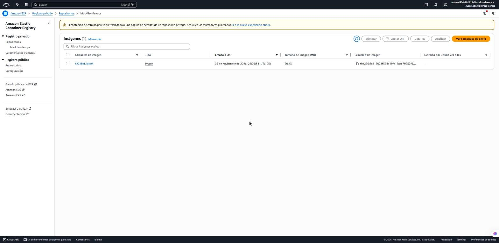

### 3.3 Clúster y definición de la tarea

| Dato | Valor |
|---|---|
| Nombre | `blacklist-devops-cluster` |
| ARN | `arn:aws:ecs:us-east-2:253041091381:cluster/blacklist-devops-cluster` |
| Capacidad | Solo `FARGATE`, con la estrategia por defecto de peso 1 |
| Container Insights | Desactivado |
| Estado | `ACTIVE` |

El clúster solo admite el proveedor `FARGATE`; no se habilitó `FARGATE_SPOT` porque AWS puede
interrumpir esas tareas. Container Insights quedó desactivado, que es el valor por defecto y no suma
costo de métricas.

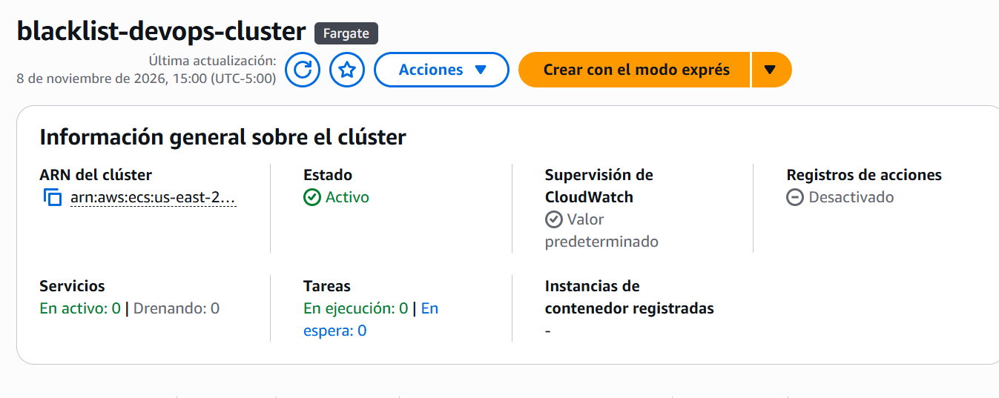

| Dato | Valor |
|---|---|
| Familia y revisión | `blacklist-devops-task:1` |
| ARN | `arn:aws:ecs:us-east-2:253041091381:task-definition/blacklist-devops-task:1` |
| Estado y fecha | `ACTIVE`, 8 de noviembre de 2026, 14:52:21 (UTC-05:00) |
| Compatibilidad | Fargate, modo de red `awsvpc`, Linux `X86_64` |
| CPU y memoria | 256 (0,25 vCPU) y 512 MB |
| Rol de ejecución | `arn:aws:iam::253041091381:role/blacklist-devops-ecs-execution-role` |
| Contenedor | `blacklist-devops`, esencial, puerto 8000 |
| Imagen | `253041091381.dkr.ecr.us-east-2.amazonaws.com/blacklist-devops:f224bef` |
| Variable sin secreto | `APP_ENV=production` |
| Secretos | `DATABASE_URL` y `JWT_SECRET_KEY`, por referencia a Parameter Store |
| Registros | `awslogs`, grupo `/ecs/blacklist-devops`, región `us-east-2`, prefijo `ecs` |

La definición usa el mínimo de Fargate, 256 (0,25 vCPU) y 512 MB, y alcanzó: la tarea arrancó a la
primera y se mantuvo estable durante la validación. El contenedor escucha en el 8000, el mismo puerto
del `Dockerfile` y de los grupos de destino. La imagen es la de la 1.7 con la etiqueta del commit.
`APP_ENV=production` va en `environment` porque no es un secreto; `PROXY_FIX_X_FOR` no se define
porque su valor por defecto, `1`, corresponde a un solo intermediario delante de la aplicación, el
balanceador.

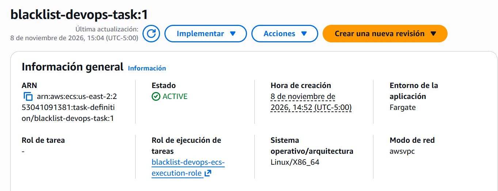

`DATABASE_URL` y `JWT_SECRET_KEY` no están en la definición: aparecen en `secrets` como referencias a
los parámetros `SecureString` de la 1.8, y solo el rol de ejecución puede leerlos. La definición no
contiene ningún valor.

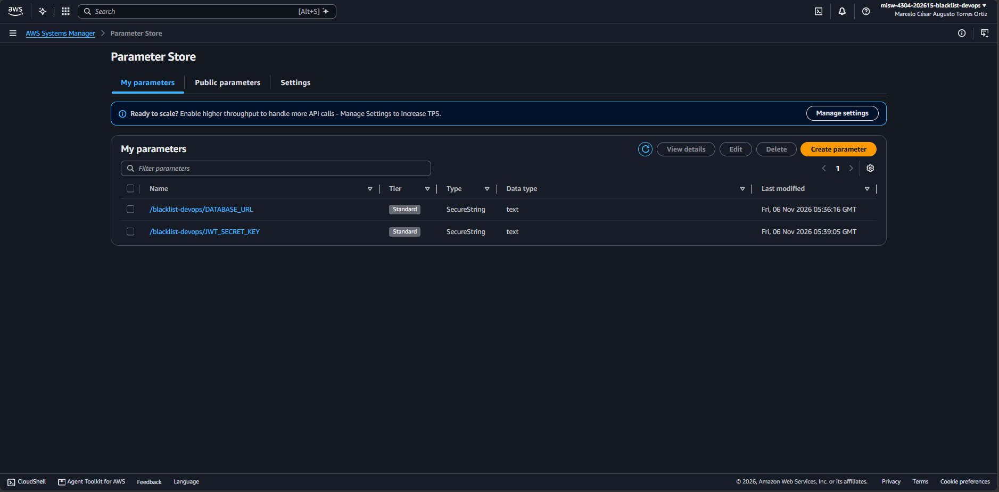

El grupo `/ecs/blacklist-devops` se creó antes de la definición, con retención de 7 días. El
contenedor escribe allí con el controlador `awslogs` y el prefijo `ecs`.

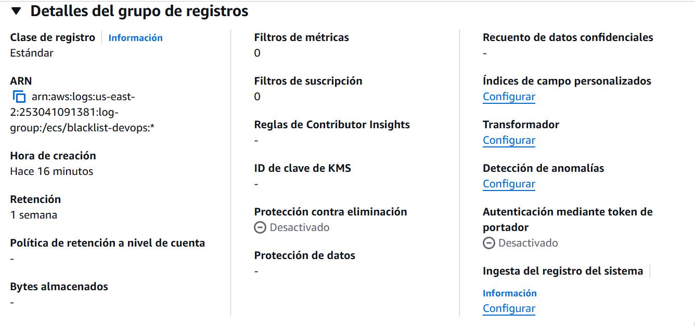

### 3.4 Red y balanceador

| Recurso | Nombre | Identificador |
|---|---|---|
| Balanceador | `blacklist-devops-alb` | `arn:aws:elasticloadbalancing:us-east-2:253041091381:loadbalancer/app/blacklist-devops-alb/d9dba4feaa922997` |
| Listener | HTTP:80 | `arn:aws:elasticloadbalancing:us-east-2:253041091381:listener/app/blacklist-devops-alb/d9dba4feaa922997/04ed0dc80674856c` |
| Grupo de destino azul | `blacklist-devops-tg-azul` | `arn:aws:elasticloadbalancing:us-east-2:253041091381:targetgroup/blacklist-devops-tg-azul/a1b8d09bac2aeac7` |
| Grupo de destino verde | `blacklist-devops-tg-verde` | `arn:aws:elasticloadbalancing:us-east-2:253041091381:targetgroup/blacklist-devops-tg-verde/4e13b6b7d966bc95` |
| Grupo de seguridad del balanceador | `blacklist-devops-alb-sg` | `sg-0b172a6837b065ba8` |
| Grupo de seguridad de las tareas | `blacklist-devops-tareas-sg` | `sg-007c5af5ee30b3237` |
| Grupo de seguridad de la RDS | `blacklist-db-sg` | `sg-069b2890759666c52` |
| Subredes | Tres públicas de la VPC por defecto | `subnet-08762e34c015fc2b4`, `subnet-06c85448a683b7fab` y `subnet-065be203aededfc61` |
| Nombre DNS | `blacklist-devops-alb` | `blacklist-devops-alb-663902063.us-east-2.elb.amazonaws.com` |

El balanceador es el único punto de entrada público: atiende HTTP en el puerto 80 desde `0.0.0.0/0`,
sin dominio ni certificado, como el entorno de Beanstalk. Las tareas solo aceptan el 8000 desde el
grupo de seguridad del balanceador. La RDS acepta el 5432 desde el grupo de las tareas y, mientras se
conserve el entorno de Beanstalk de la Entrega 2, desde `blacklist-app-sg` (`sg-042dcb7316bd23a0c`);
esa regla sigue en `blacklist-db-sg` aunque hoy ninguna instancia la use. Las tres subredes son
públicas y la tarea tiene IP pública, porque no hay NAT gateway ni *endpoints* de VPC, que cobran por
hora en el plan gratuito. En el despliegue manual, el *listener* de producción reenvía al grupo azul;
el verde queda libre para que CodeDeploy registre la versión nueva y cambie el tráfico. La salud se
comprueba en `/ping` con código 200, cada 15 s, con 5 s de espera y dos comprobaciones para sano y dos
para no sano; la anulación de registro es de 30 s. Ninguna de las pantallas de las capturas mostró el
aviso de características avanzadas.

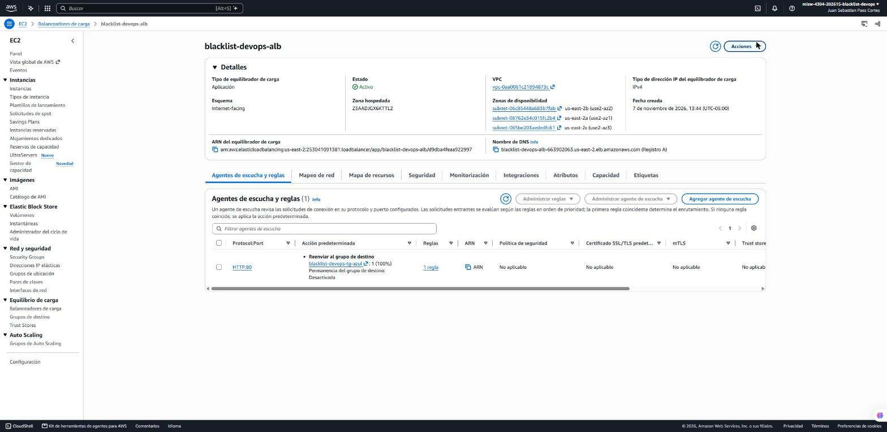

### 3.5 Servicio y validación

Datos del servicio en el despliegue manual:

| Dato | Valor |
|---|---|
| Nombre | `blacklist-devops-service` |
| ARN | `arn:aws:ecs:us-east-2:253041091381:service/blacklist-devops-cluster/blacklist-devops-service` |
| Clúster | `blacklist-devops-cluster` |
| Definición | `blacklist-devops-task:1` |
| Tipo de lanzamiento | Fargate, versión de plataforma 1.4.0 |
| Controlador de despliegue | `CODE_DEPLOY` |
| Tareas | 1 deseada, 1 en ejecución y 0 pendientes |
| Red | Tres subredes públicas, `blacklist-devops-tareas-sg` e IP pública |
| Balanceador | `blacklist-devops-tg-azul`, contenedor `blacklist-devops`, puerto 8000 |
| Periodo de gracia de salud | 60 s |
| Estado | Estable, con el destino azul `healthy` |
| URL del API | `http://blacklist-devops-alb-663902063.us-east-2.elb.amazonaws.com` |

El servicio se creó con una tarea, tipo de lanzamiento Fargate y controlador de despliegue
`CODE_DEPLOY`, que es el que habilita el azul/verde con los dos grupos de destino. La tarea quedó
registrada en el grupo azul, con un periodo de gracia de salud de 60 s: la salud necesita dos
comprobaciones de 15 s y así ECS no reemplaza la tarea mientras Gunicorn arranca. El servicio alcanzó
el estado estable con 1 tarea en ejecución, 0 pendientes y el destino azul `healthy`.

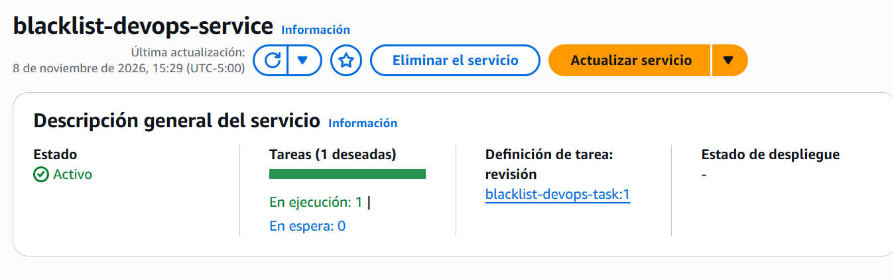

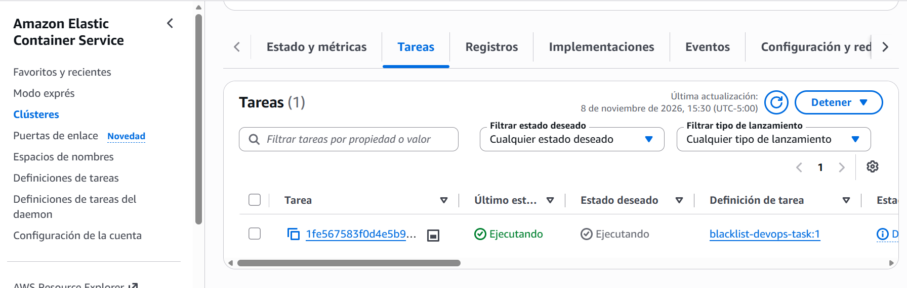

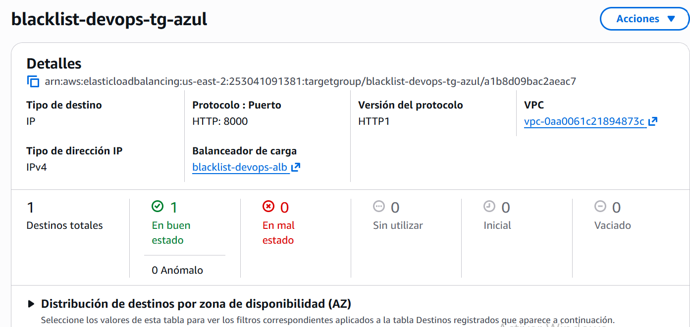

La validación se hizo contra la URL del balanceador, desde CloudShell:

```bash
URL=http://blacklist-devops-alb-663902063.us-east-2.elb.amazonaws.com
curl -i $URL/ping
```

`GET /ping`, sin token, respondió 200 con `{"version": "f224bef"}`, la etiqueta de la imagen del
despliegue manual.

Para los otros dos endpoints se generó un token estático con la clave del parámetro
`/blacklist-devops/JWT_SECRET_KEY`, con las mismas reclamaciones que `scripts/generar_token.py`. La
clave se leyó a una variable sin mostrarla y se borró al terminar; el token quedó en una variable de
la sesión y no se imprimió ni se guardó.

```bash
curl -i -X POST $URL/blacklists -H "Authorization: Bearer $TOKEN" -H "Content-Type: application/json" \
  -d '{"email":"fargate-1-11@example.com","app_uuid":"3f2c7a52-6b1e-4d7a-9d57-1a5a0f4b2c11","blocked_reason":"prueba de la tarea 1.11"}'

curl -i $URL/blacklists/fargate-1-11@example.com -H "Authorization: Bearer $TOKEN"
```

El `POST` respondió 201 con `{"msg": "Email agregado a la lista negra", "id": 19}` y el `GET` 200 con
`is_blacklisted: true` y `blocked_reason: "prueba de la tarea 1.11"`. El `POST` dejó la fila `id` 19
en `blacklist-db`, la base compartida con las entregas anteriores, así que la validación usó
PostgreSQL real y no SQLite. El balanceador atiende HTTP sin TLS, así que el token viaja sin cifrar
entre el cliente y el balanceador; es una limitación conocida y queda anotada.

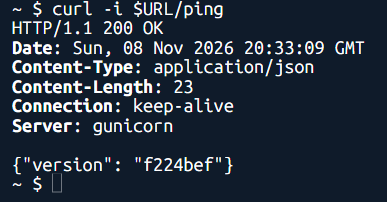

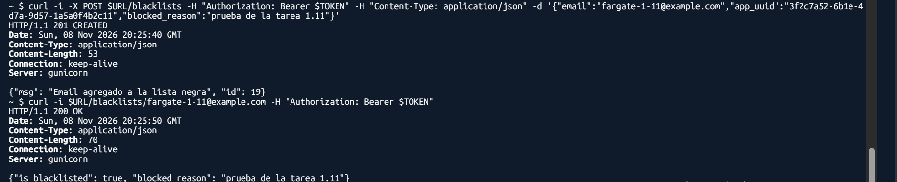

**Estado al cierre de esta sección.** Después de la validación manual, el pipeline desplegó la
revisión 3 de `blacklist-devops-task` con la imagen `168dd91` y movió el *listener* de producción al
grupo verde, que tiene 1 destino sano; el servicio quedó apuntando a ese grupo y sigue con 1 tarea en
ejecución. La revisión 1, la del despliegue manual, sigue `ACTIVE` y es la base de la familia. Las
capturas de esta sección son del despliegue manual, anteriores a ese despliegue; las ejecuciones
automáticas se documentan en las secciones 5 a 7.

### 3.6 Versiones y costo

| Componente | Versión |
|---|---|
| Python | 3.13.16 (`python:3.13.16-slim` del espejo público de ECR) |
| Gunicorn | 26.2.0, 2 workers |
| Usuario del contenedor | `appuser`, UID 10001 |
| Imagen | `f224bef`, `linux/amd64`, 60,43 MB |
| Digest | `sha256:8c217021f564a49fe178ce79257f97776bb64c581919b57b1dcd4fb476ddb644` |

El resto del stack —Flask 3.1.3, SQLAlchemy 2.1.4, marshmallow 4.3.1, Flask-JWT-Extended 4.7.4,
Werkzeug 3.1.9 y psycopg 3.3.6— es el de la sección 1. La imagen parte de `python:3.13.16-slim` y
corre con Gunicorn, dos workers y el usuario `appuser` (UID 10001), sin privilegios. `/ping` responde
la etiqueta del commit, así que la versión que atiende se rastrea hasta el commit que la produjo; en
el despliegue manual respondió `f224bef`.

| Recurso | Costo |
|---|---|
| Tarea de Fargate | 0,0123 USD/h (0,25 vCPU + 0,5 GB) |
| Balanceador y sus IPv4 | 0,0375 USD/h |
| Servicio de ECS | Sin costo |
| Grupo de registros | Ingesta y almacenamiento mínimos, retención de 7 días |
| Total con el servicio encendido | Unos 0,05 USD/h |

Con el servicio encendido, la tarea y el balanceador cuestan unos 0,05 USD/h; el diseño redondea a
0,06 USD/h y estima cerca de 1,5 USD por día sin la RDS. Para dejar de pagar la tarea se baja el
servicio a cero con `aws ecs update-service ... --desired-count 0`; el balanceador sigue cobrando
aunque no haya tareas, así que los recursos solo se encienden mientras se trabaja y se graba.

El despliegue manual es la base que el pipeline reproduce: la misma familia de definición y el mismo
servicio, con la diferencia de que CodeDeploy registra una revisión nueva con la imagen del commit y
mueve el tráfico sin intervención. Las secciones 5 a 7 documentan esas ejecuciones.

## 4. Archivos de configuración y pipeline

[PENDIENTE: tarea 3.3 (#213).]

## 5. Pipeline de CI fallido

[PENDIENTE: tarea 3.4 (#214).]

## 6. Pipeline de CI y CD exitosos

La sección 3 cerró con la revisión 3 de `blacklist-devops-task` (`168dd91`) y el tráfico en el grupo
de destino verde. Esta sección documenta la ejecución que desplegó la revisión 4 (`db6e990`) y
devolvió el tráfico al grupo azul. Es el punto 2 del documento del enunciado (8 %): un CI exitoso
seguido de un CD exitoso, con hallazgos y capturas de los servicios de AWS.

La ejecución es del **9 de noviembre de 2026**, en la cuenta del proyecto y la región `us-east-2`.
Las horas están en UTC-05:00. No se creó infraestructura nueva: se usaron el clúster, el servicio, el
balanceador y los grupos de destino de la sección 3. La configuración de los archivos y del pipeline
se documenta en la sección 4; esta sección se centra en la ejecución.

### 6.1 Resultado de la ejecución

| Dato | Valor |
|---|---|
| Commit | `db6e99013812c059c32fe62e50e1cfcc8f7d21ee` (`db6e990`), *merge commit* del PR #250 en `main`, 17:59:35 |
| Disparador | `WebhookV2`, tipo `PUSH_BRANCH`, rama `main`, 3 s después del *merge* |
| Ejecución | `31b06edb-3f43-44e3-ac71-9af3f42c7f24`, versión 5 del pipeline, **Succeeded** |
| Duración | 8 min 19 s; inicio 17:59:38 y fin 18:07:58, según el resumen de la ejecución |
| Build | `blacklist-devops-ci-build:ba2e2bd9-e129-49d4-9136-b8cb65caae8c` (compilación 28), **Succeeded**: 156 pruebas aprobadas, cobertura del 100 % |
| Imagen | `blacklist-devops:db6e990` y `latest`, el mismo *digest* `sha256:18b1b9cd0ba427568434fb47ef6fdd6153dba4579bfe0a4aa852f6c76973e04f`, 60,43 MB |
| Despliegue | `d-UKCBNTBGL`, aplicación `blacklist-devops-app`, grupo `blacklist-devops-dg`, `CodeDeployDefault.ECSAllAtOnce`, **Succeeded**, sin reversión |
| Definición | `blacklist-devops-task:4`, registrada por la acción *Deploy* (`CodeDeployToECS`) del pipeline con `taskdef.json`; conserva 256/512 y los secretos por referencia |
| Tráfico | El *listener* HTTP:80 pasó de `blacklist-devops-tg-verde` (revisión 3, `168dd91`) a `blacklist-devops-tg-azul` (revisión 4, `db6e990`) |
| Servicio | `blacklist-devops-task:4`, 1 tarea en ejecución |
| `GET /ping` | `{"version": "db6e990"}`, la etiqueta del commit de la promoción |

La ejecución la inició el *push* a `main`, no una persona. La acción *Deploy* del pipeline
registra la revisión 4 de la definición a partir de `taskdef.json` y de `imageDetail.json`, y
CodeDeploy crea el conjunto de tareas de sustitución y mueve el tráfico. La definición conserva los
secretos por referencia a Parameter Store: `DATABASE_URL` y `JWT_SECRET_KEY` no tienen valores en el
archivo ni en las capturas.

### 6.2 Línea de tiempo

| Hora | Evento |
|---|---|
| 17:59:35 | Se fusiona el PR #250 en `main` (*merge commit* `db6e990`) |
| 17:59:38 | Inicia la ejecución `31b06edb`, 3 s después del *push* |
| 17:59:38 – 17:59:43 | *Source*: descarga `db6e990` de GitHub |
| 17:59:44 – 18:03:19 | *Build*: instala Python 3.13.16, ejecuta las pruebas, construye la imagen y la envía a ECR |
| 18:03:11 | La imagen `db6e990` llega a ECR |
| 18:03:20 | Inicia *Deploy*; a las 18:03:21 se registra `blacklist-devops-task:4` y se crea `d-UKCBNTBGL` |
| 18:03:23 – 18:05:26 | `Install`: el conjunto de tareas de sustitución arranca y pasa la verificación de salud en `blacklist-devops-tg-azul` |
| 18:05:27 | `AllowTraffic`: el *listener* de producción pasa al grupo azul (100 % del tráfico) |
| 18:05:28 – 18:07:29 | Espera de 2 minutos y terminación del conjunto de tareas original |
| 18:07:29 | `d-UKCBNTBGL` termina en *Succeeded* |
| 18:07:58 | La etapa *Deploy* y la ejecución terminan en *Succeeded* |

`GET /ping` por el balanceador, consultado cada 33 s durante la ejecución: respondió
`{"version": "168dd91"}` hasta las 18:05:20 y `{"version": "db6e990"}` desde las 18:05:53. Ninguna
consulta falló.

### 6.3 Pipeline y build

La ejecución con las tres etapas en verde. El resumen muestra el desencadenador: el commit `db6e990`
enviado a `main` con el mensaje de la promoción.


Línea temporal: *Source* 5 s, *Build* 3 min 35 s y *Deploy* 4 min 37 s.


Fases del build, todas en *Realizado correctamente*. La versión de origen resuelta es `db6e990` y el
iniciador es `codepipeline/blacklist-devops-ci-pipeline`.


Registro del build: cobertura del 100 % y `156 passed`, seguido de las validaciones de `COMMIT_ID`,
`AWS_ACCOUNT_ID` y `AWS_DEFAULT_REGION`, el inicio de sesión en ECR y el `docker build` con la
etiqueta del commit.


Envío a ECR: `db6e990` y `latest` con el mismo *digest*, `imageDetail.json` con la dirección de la
imagen y el artefacto con `imageDetail.json`, `taskdef.json` y `appspec.yaml`.


### 6.4 Imagen en ECR y despliegue azul/verde

Repositorio `blacklist-devops`: la imagen `latest, db6e990` de las 18:03:11, extraída por Fargate a
las 18:03:42.


`d-UKCBNTBGL`: los cuatro pasos completados y el 100 % del tráfico en el conjunto de tareas de
sustitución.


La tabla de conjuntos de tareas no se había refrescado: todavía muestra el conjunto original como
`ACTIVE` con 1 tarea, aunque el paso 4 (terminación del conjunto original) ya aparece completado a
las 18:07:29. La terminación se comprueba por el paso 4 y por el estado del servicio, no por esa
tabla.

*Listener* HTTP:80 del balanceador, que ahora reenvía a `blacklist-devops-tg-azul`.


La verificación de salud del grupo de destino consulta `/ping` cada 15 s, con 5 s de espera, dos
comprobaciones para sano y dos para no sano; la tarea nueva pasó antes del cambio de tráfico.
`GET /ping` no requiere
token y no consulta la base, así que la versión se comprueba sin depender de la RDS:

```bash
URL=http://blacklist-devops-alb-663902063.us-east-2.elb.amazonaws.com
curl -s $URL/ping
# {"version": "db6e990"}
```

El grupo de despliegue tiene la reversión automática activa ante `DEPLOYMENT_FAILURE`; en esta
ejecución no se activó porque el despliegue terminó en *Succeeded*. El CD fallido y la reversión se
documentan en la sección 7.

### 6.5 Hallazgos

1. **El commit en `main` dispara el pipeline completo.** La ejecución inició 3 s después del *merge*,
   con el disparador `WebhookV2` y `PUSH_BRANCH` sobre `main`. La 1.16 se había comprobado con una
   ejecución manual (`6ff261a0`, iniciada con `StartPipelineExecution`); esta es la primera que inicia
   sola un commit.
2. **El despliegue depende del CI.** *Deploy* empezó 1 s después de que terminó *Build*. Las pruebas
   son el primer comando de la fase `build`: si una falla, CodeBuild detiene la fase ahí y no se
   ejecuta el `docker build`. Además, `post_build` solo envía la imagen a ECR si
   `CODEBUILD_BUILD_SUCCEEDING` es `1`. El `set -e` no es lo que impide el envío; solo hace fallar el
   build si falla el envío. Ese caso es la sección 5.
3. **La versión desplegada es trazable al commit.** La etiqueta de la imagen, la definición
   `blacklist-devops-task:4` y `/ping` dicen `db6e990`, que es el commit del *push*. `latest` apunta
   al mismo *digest*.
4. **No hubo corte de servicio.** El conjunto de tareas nuevo arrancó y pasó la verificación de salud
   en el grupo azul antes de recibir tráfico. El cambio del *listener* fue a las 18:05:27 y ninguna
   consulta a `/ping` falló. El conjunto anterior siguió dos minutos más en el grupo verde, disponible
   para revertir, antes de terminarse.
5. **Los grupos de destino se alternan.** El despliegue de la 1.16 dejó el tráfico en el grupo verde;
   este lo pasó al azul. El siguiente despliegue usará el verde.
6. **La instalación de Python ocupa casi todo el build.** `INSTALL` tardó 172 s, porque `pyenv`
   compila Python 3.13.16 en cada ejecución. Las pruebas tardaron menos de 1 s y el `docker build` y
   el envío, unos 22 s. Es la parte que se puede acortar si hace falta, con una imagen de compilación
   que ya traiga esa versión.
7. **CodeDeploy muestra el despliegue como «Acción del usuario».** Es el nombre que da a los
   despliegues creados por una llamada a su API, que en este caso hizo la acción *Deploy* del
   pipeline: `d-UKCBNTBGL` es el identificador externo de esa acción en la ejecución `31b06edb`.
   Nadie lo inició a mano.

### 6.6 Cumplimiento del punto 2 del documento

| Requisito del punto 2 (8 %) | Evidencia |
|---|---|
| Ejecución de CI exitosa: commit, build y pruebas | Secciones 6.1 y 6.2; figuras 6.1 a 6.4 |
| Imagen del contenedor en ECR con la etiqueta del commit | Sección 6.3; figuras 6.5 y 6.6 |
| CD exitoso en Fargate sin intervención manual | Sección 6.4; figuras 6.7 y 6.8; hallazgos 1 y 7 |
| Aplicación respondiendo con la versión nueva | Secciones 6.2 y 6.4; `/ping` con `db6e990` |
| Hallazgos y capturas de los servicios de AWS | Secciones 6.3 a 6.5; ocho figuras y siete hallazgos |

Con esta ejecución, el punto 2 del documento queda cubierto: el commit disparó el CI, el build
ejecutó las 156 pruebas y publicó la imagen, y CodeDeploy desplegó la revisión 4 en Fargate sin
intervención manual; `/ping` confirmó la versión nueva. El CI fallido y el CD fallido se documentan
en las secciones 5 y 7.

## 7. CI exitoso y CD fallido, con reversión

[PENDIENTE: tarea 3.6 (#216).]

## 8. Enlaces, decisiones y conclusiones

[PENDIENTE: tarea 3.7 (#217).]
