# Proyecto 1 · Entrega 1: Despliegue manual de un microservicio en AWS Elastic Beanstalk

| | |
|---|---|
| Curso | MISW 4304 · DevOps · Universidad de los Andes (periodo 202615) |
| Entrega | Entrega 1: despliegue manual de un microservicio sobre un servicio PaaS |
| Grupo | Blacklist DevOps |
| Integrantes | Marcelo César Torres · Héctor José Melgarejo · Juan Sebastián Páez · Jean Pierre Betancourt |
| Fecha | 18 de octubre de 2026 |

## Contenido

1. Descripción del microservicio
2. Arquitectura del despliegue
3. Enlaces de la entrega
4. Paso a paso de la creación y el despliegue en AWS Elastic Beanstalk (punto 1 del documento, 10 %)
5. Estrategias de despliegue (punto 2 del documento, 20 %)
6. Pruebas del API
7. Limitaciones y decisiones
8. Conclusiones

## 1. Descripción del microservicio

El microservicio administra la lista negra global de emails de la organización. Los sistemas internos
lo usan para agregar un email a la lista y para consultar si un email está en ella. Es un único
servicio REST en Python con Flask, protegido con un token Bearer, que persiste la información en
PostgreSQL sobre Amazon RDS.

| Método | Ruta | Descripción | Respuestas |
|---|---|---|---|
| POST | `/blacklists` | Agrega un email a la lista negra. Cuerpo: `email`, `app_uuid` (UUID obligatorio) y `blocked_reason` (opcional, máximo 255 caracteres). Guarda además la IP de origen y la fecha y hora de la solicitud | 201 con `msg` e `id`; 400 con `msg` y `errors`; 401 sin token o con token inválido; 409 si el email ya está |
| GET | `/blacklists/<string:email>` | Indica si el email está en la lista y el motivo | 200 con `is_blacklisted` y `blocked_reason`; 401 sin token o con token inválido |
| GET | `/ping` | Health check del balanceador. No requiere token ni consulta la base | 200 con `{"version": ...}` |

Stack: Python 3.13, Flask 3.1.3, Flask-SQLAlchemy 3.1.1 (SQLAlchemy 2.1.4), Flask-RESTful 0.3.10,
Flask-Marshmallow 1.5.0 (marshmallow 4.3.1), Flask-JWT-Extended 4.7.4, Werkzeug 3.1.9, PostgreSQL 16
con el driver psycopg 3 y Gunicorn 26.2.0 como servidor WSGI.

El código está organizado por capas: `domain` (entidad, validación del email, errores y reloj),
`application` (casos de uso *agregar* y *consultar*, y el puerto del repositorio) e `infrastructure`
(recursos HTTP, esquema de validación, autenticación y repositorio SQLAlchemy). El email se normaliza a
minúsculas y sin espacios al guardar y al consultar.

## 2. Arquitectura del despliegue

```
Cliente (Postman / sistemas internos)
        │  HTTP, Authorization: Bearer <token>
        ▼
Application Load Balancer (público, 3 zonas de us-east-2)
        │  health check GET /ping → 200
        ▼
Auto Scaling group: 3 a 6 instancias t3.micro (Amazon Linux 2023)
  nginx → Gunicorn (2 workers) → Flask
        │  PostgreSQL 5432, solo desde el grupo de las instancias
        ▼
Amazon RDS PostgreSQL 16 (db.t4g.micro, sin acceso público)
```

| Componente | Configuración |
|---|---|
| Cuenta y región | `misw-4304-202615-blacklist-devops`, región `us-east-2` (Ohio) |
| Aplicación y entorno | `blacklist-devops` / `Blacklist-devops-env` |
| Plataforma | Python 3.13 running on 64bit Amazon Linux 2023, versión `4.13.10` (Python 3.13.16) |
| Balanceador | Application Load Balancer público, subredes públicas en `us-east-2a`, `-2b` y `-2c` |
| Cómputo | Auto Scaling de 3 a 6 instancias `t3.micro` (`x86_64`) |
| Base de datos | RDS `blacklist-db`, PostgreSQL 16.13, `db.t4g.micro`, 20 GB gp3, una zona, sin acceso público |
| Red | `blacklist-app-sg` para las instancias; `blacklist-db-sg` solo admite 5432 desde `blacklist-app-sg` |
| Roles de IAM | Servicio: `blacklist-eb-service-rol`. Instancias: `blacklist-ec2-instance-rol` |
| Configuración | `DATABASE_URL`, `JWT_SECRET_KEY`, `APP_ENV` y `PROXY_FIX_X_FOR` como propiedades del entorno; ningún secreto en el repositorio |
| Configuración reproducible | Configuración guardada `blacklist-base`, con la que se recrea el entorno con la misma URL |

Para guardar la IP del cliente y no la del balanceador, la aplicación lee el encabezado
`X-Forwarded-For` con `ProxyFix` de Werkzeug. En Beanstalk la solicitud pasa por el balanceador y por
el nginx de la instancia, y cada uno agrega una entrada al encabezado (`cliente, balanceador`). La
primera versión desplegada (`v1`) tomaba un solo salto y guardó la IP privada del balanceador
(`172.31.21.107`). La versión `v1.1` lee el número de saltos de la propiedad `PROXY_FIX_X_FOR`, que en
el entorno vale `2`, y guarda la IP pública del cliente. Con dos saltos, una entrada falsa enviada por
el cliente queda a la izquierda y no se toma. La consulta de la tabla desde una instancia muestra los
dos registros:


## 3. Enlaces de la entrega

| Recurso | Enlace |
|---|---|
| Repositorio de GitHub | https://github.com/mc-torreso1-uniandes-edu-co/misw-4304-blacklist-devops |
| URL del entorno | http://blacklist-devops-misw.us-east-2.elasticbeanstalk.com |
| Workspace de Postman | https://www.postman.com/misw-4304-202615-devops/blacklist-devops/overview |
| Documentación publicada del API | https://documenter.getpostman.com/view/58851546/2sBYHRVMSR |
| Video de sustentación | [PENDIENTE: enlace del video] |

Notas aclaratorias:

- **Repositorio.** Es privado. Si el tutor necesita acceso, debe suministrar su usuario de GitHub para
  agregarlo como colaborador.
- **Entorno.** Según la aclaración del tutor sobre los recursos de AWS, el entorno solo está encendido
  mientras se trabaja y se graba el video: se encendió el 15 de octubre de 2026 y se apaga después de
  grabar, así que la URL puede no responder durante la calificación. Si el tutor cita a una
  sustentación síncrona, el equipo vuelve a provisionar el ambiente en unos 20 minutos, con la misma
  URL, a partir de la configuración guardada, el snapshot de la base y las versiones cargadas. Mientras
  tanto, el funcionamiento del API se ve en el video y en las secciones 4 a 6.
- **Postman.** El workspace y la documentación publicada son públicos y se abren sin cuenta. Para
  ejecutar las solicitudes hace falta el token, que no se publica en ningún lugar.
- **Video.** Está en el OneDrive de la Universidad, compartido con cualquiera que tenga el enlace.

## 4. Paso a paso de la creación y el despliegue en AWS Elastic Beanstalk

Cubre el punto 1 del documento (10 %): a. configuración de RDS, b. configuración del proyecto en
Beanstalk y c. configuración de los health checks.

La infraestructura se creó y se desplegó manualmente, con la consola de AWS y la AWS CLI, sin
servicios de CI/CD. Antes de crear
los recursos se verificó la cuenta, la región y la cuota de vCPU, que limita cuántas instancias
pueden existir a la vez durante las estrategias que agregan instancias.


### 4.a Configuración de RDS

Base de datos PostgreSQL creada con la plantilla de capa gratuita, sin acceso público y con un grupo
de seguridad que solo admite conexiones desde las instancias de la aplicación.

| Parámetro | Valor |
|---|---|
| Identificador | `blacklist-db` |
| Motor | PostgreSQL 16.13 |
| Clase y almacenamiento | `db.t4g.micro` (2 vCPU, 1 GiB), 20 GB gp3 sin escalado automático |
| Usuario y base inicial | `blacklist` / `blacklist` (contraseña autoadministrada, fuera del repositorio) |
| Disponibilidad | Una zona (`us-east-2c`), sin Multi-AZ |
| Acceso público | Desactivado |
| Grupo de seguridad | `blacklist-db-sg`: PostgreSQL 5432 solo desde `blacklist-app-sg` |
| Supervisión | Monitoreo mejorado desactivado |


La cadena de conexión se registra solo como propiedad `DATABASE_URL` del entorno de Beanstalk. Las
tablas las crea la aplicación al iniciar.


### 4.b Configuración del proyecto en AWS Beanstalk

Antes del entorno se creó el grupo de seguridad de las instancias, `blacklist-app-sg`, sin reglas de
entrada. Se conserva aunque se termine el entorno, para que la regla de la base siga vigente cada vez
que se recrea.


El entorno se creó en modo estándar con estos parámetros:

| Parámetro | Valor |
|---|---|
| Aplicación / entorno | `blacklist-devops` / `Blacklist-devops-env` |
| Prefijo de URL | `blacklist-devops-misw` |
| Plataforma | Python 3.13 running on 64bit Amazon Linux 2023, `4.13.10` |
| Proxy y WSGI | nginx; la aplicación arranca con el `Procfile` (`gunicorn --bind :8000 --workers 2 application:application`) |
| Acceso al servicio | Rol de servicio `blacklist-eb-service-rol` y perfil de instancia `blacklist-ec2-instance-rol`; sin par de llaves EC2 |
| Red | VPC por defecto, IP pública en las instancias, 3 zonas de disponibilidad |
| Instancias | `t3.micro`, `x86_64`, grupo `blacklist-app-sg` |
| Capacidad | Auto Scaling con balanceo de carga, mínimo 3 y máximo 6 instancias |
| Balanceador | Application Load Balancer público |
| Actualizaciones administradas | Desactivadas |
| Registros en CloudWatch | Desactivados |
| Propiedades del entorno | `APP_ENV`, `DATABASE_URL`, `JWT_SECRET_KEY` (valores fuera del documento) y `PROXY_FIX_X_FOR = 2` |


**Primer despliegue (15 de octubre de 2026).** La versión `v1` se empaquetó desde `main` con el script
del repositorio (`scripts/empaquetar.py`), que ejecuta las pruebas y genera el `.zip` con el archivo
`VERSION` que devuelve `/ping`. El paquete se probó en una carpeta limpia antes de cargarlo y se cargó
una sola vez como versión de aplicación `v1`. Después se inició la RDS y se creó el entorno desde la
configuración guardada `blacklist-base` con esa versión. La creación tomó 3 min 13 s y terminó con
salud *Ok* en las 3 instancias.


Al recrear el entorno desde la consola, el formulario propone el rol de servicio
`aws-elasticbeanstalk-service-role` en lugar de `blacklist-eb-service-rol`, y la creación falla
porque la configuración guardada usa este último para las actualizaciones administradas. El entorno se
creó con la AWS CLI desde `blacklist-base`, que conserva los roles de la plantilla. El procedimiento
quedó documentado en la carpeta `docs/despliegues/` del repositorio.

**Versión `v1.1`.** La verificación en AWS mostró que `v1` guardaba la IP del balanceador (sección 2).
Se generó `v1.1` desde `main`, que ya leía `PROXY_FIX_X_FOR`, y se desplegó junto con la propiedad
`PROXY_FIX_X_FOR = 2` en una sola actualización del entorno (política *All at once*, 1 minuto). La
propiedad también se agregó a `blacklist-base`. Con `v1.1` en las 3 instancias, el POST y el GET
responden contra RDS desde Postman con el environment de AWS:


### 4.c Configuración de los health checks

El balanceador comprueba cada instancia con `GET /ping`. Ese endpoint no requiere token y no consulta
la base, así que mide si la aplicación responde sin depender de credenciales ni de RDS. La misma ruta
se fija también en el paquete, en `.ebextensions/01-health-check.config`, para que cada despliegue
conserve la configuración:

```yaml
option_settings:
  aws:elasticbeanstalk:environment:process:default:
    HealthCheckPath: /ping
    MatcherHTTPCode: "200"
```

| Parámetro del proceso `default` | Valor |
|---|---|
| Puerto y protocolo | 80, HTTP |
| Ruta de comprobación | `/ping` |
| Código HTTP esperado | 200 |
| Tiempo de espera | 5 s |
| Intervalo | 15 s |
| Umbral de buen estado / mal estado | 3 / 5 comprobaciones |
| Demora en la anulación del registro | 20 s |
| Informes de salud | Mejorados (*enhanced*) |


Con el entorno en ejecución, la pestaña *Estado y supervisión* muestra la salud *Ok* del entorno y de
las 3 instancias, que reciben las comprobaciones del balanceador y las solicitudes de los clientes:


## 5. Estrategias de despliegue

Cubre el punto 2 del documento (20 %): cuatro estrategias con más de una instancia, cada una con los
puntos a–f.

Las estrategias se ejecutaron sobre el mismo entorno, con Auto Scaling de mínimo 3 y máximo 6
instancias, en este orden: All at once (`v2-allatonce`), Rolling (`v3-rolling`), Rolling with
additional batch (`v4-rollingbatch`) e Immutable (`v5-immutable`). Cada versión cambia la etiqueta que
devuelve `/ping`, lo que permite ver qué instancias atienden la versión nueva durante el despliegue.

**Método de medición, común a las cuatro estrategias:**
- Tiempo total: desde el evento de inicio del despliegue hasta el evento de finalización en la pestaña
  *Eventos* del entorno.
- Instancias: lista de instancias del entorno en EC2 antes, durante y después del despliegue.
- Disponibilidad: el monitor del repositorio (`scripts/monitor_disponibilidad.py`) consulta `/ping`
  cada segundo durante todo el despliegue y registra la hora, el código HTTP, la versión y la latencia
  de cada respuesta en un CSV de `docs/despliegues/`. Un corte de conexión se registra como código 0
  y no detiene el monitor. Al detenerlo resume las respuestas que no fueron 200, la mayor caída (desde
  la primera respuesta que no fue 200 hasta la siguiente respuesta 200), las versiones observadas y la
  ventana en la que respondieron dos versiones.
- Paquetes: cada versión se generó desde `main` y se probó en una carpeta limpia antes de cargarla. Las
  cuatro tienen el mismo código que `v1.1` y solo cambian la etiqueta de `VERSION`.

### 5.1 All at once (`v2-allatonce`)

| Dato | Valor |
|---|---|
| Política y lote | `AllAtOnce` (sin lotes: se actualiza el 100 % de las instancias) |
| Versión anterior → nueva | `v1.1` → `v2-allatonce` |
| Fecha y hora de inicio | 15 de octubre de 2026, 21:51:25 (UTC-5) |
| (a) Instancias antes / máximo durante / después | 3 / 3 / 3 (`t3.micro`, una por zona); no se crearon instancias adicionales |
| (c) Tiempo total | **0 min 21 s**: de "Environment update is starting" (21:51:25) a "Environment update completed successfully" (21:51:46) |
| (d) Instancias iniciales o nuevas | **Iniciales**: los mismos 3 IDs antes y después (`i-087c560a12e0ffa07`, `i-05159b8ef3f935e9d` e `i-0f7acc80fdc24a7d3`), lanzados el 15 de octubre a las 14:44:09 |
| Solicitudes del monitor: total / no 200 | 480 / 5: 475 con `200` y 5 con `502`; disponibilidad del 98,96 % |
| Caída observada | 5 s: de 21:51:34.9 hasta la siguiente respuesta `200` a las 21:51:39.9 |
| Ventana con dos versiones respondiendo | Ninguna |

**(b) Cómo se validó que el despliegue estaba en ejecución:** con cuatro fuentes. El monitor
consultó `/ping` cada segundo y registró la versión de cada respuesta: `v1.1` hasta las 21:51:33 y
`v2-allatonce` desde las 21:51:39. Los eventos del entorno marcan el inicio, el despliegue en las
instancias y el final. La pestaña *Estado y supervisión* mostró las 3 instancias en *Ok* con la
implementación 3. Y `/ping` respondió `{"version": "v2-allatonce"}` al terminar.

**(e) Capturas:**


El registro completo del monitor está en `docs/despliegues/v2-allatonce.csv` y el detalle de la
estrategia, en la misma carpeta.

**(f) Hallazgos:**
- **Disponibilidad:** hubo una caída total de 5 s (5 solicitudes seguidas con `502`) entre la última
  respuesta de `v1.1` y la primera de `v2-allatonce`. Las 3 instancias reiniciaron la aplicación al
  mismo tiempo y el balanceador no tuvo ninguna instancia sana a la cual enviar las solicitudes.
- **Capacidad:** durante la caída atendían 0 de 3 instancias; antes y después, las 3.
- **Duración:** 21 s, la más corta, porque no crea instancias ni actualiza por lotes.
- **Costo:** sin instancias adicionales.
- **Rollback:** volver a `v1.1` exige otro despliegue completo, con otra caída.
- **Salud del entorno:** la salud mejorada pasó a *Info* 4 s después de terminar el despliegue y
  volvió a *Ok* un minuto más tarde. La consola no muestra la caída; el monitor sí la registra.
- **Cuándo conviene:** entornos de desarrollo o pruebas, o ventanas de mantenimiento en las que se
  acepta una interrupción breve.

### 5.2 Rolling (`v3-rolling`)

| Dato | Valor |
|---|---|
| Política y lote | `Rolling`, tipo de lote `Fixed`, tamaño de lote 1 |
| Versión anterior → nueva | `v2-allatonce` → `v3-rolling` |
| Fecha y hora de inicio | 15 de octubre de 2026, 23:13:05 (UTC-5) |
| (a) Instancias antes / máximo durante / después | 3 / 3 / 3 (`t3.micro`, una por zona); no se crearon instancias adicionales |
| (c) Tiempo total | **8 min 10 s**: de "Environment update is starting" (23:13:05) a "Environment update completed successfully" (23:21:15) |
| (d) Instancias iniciales o nuevas | **Iniciales**: se actualizaron por lotes las mismas 3 instancias (`i-0f7acc80fdc24a7d3`, `i-087c560a12e0ffa07` e `i-05159b8ef3f935e9d`); la implementación pasó de 3 a 4 en las tres |
| Solicitudes del monitor: total / no 200 | 1.069 / 0; disponibilidad del 100 % |
| Caída observada | Ninguna |
| Ventana con dos versiones respondiendo | 4 min 41 s: de 23:13:50 a 23:18:31, con 151 cambios de versión entre solicitudes consecutivas |

**(b) Cómo se validó que el despliegue estaba en ejecución:** el monitor consultó `/ping` cada segundo
durante 17 min 48 s (1.069 solicitudes, todas con `200`) y registró 578 respuestas de
`v2-allatonce` y 491 de `v3-rolling`, con las dos versiones alternándose mientras el balanceador
repartía solicitudes entre instancias ya actualizadas y pendientes. Los eventos del entorno marcan los
tres lotes, uno por instancia, y la espera de cada una en el balanceador. La pestaña *Estado y
supervisión* mostró al final las 3 instancias en *Ok* con la implementación 4, y `/ping` respondió
`{"version": "v3-rolling"}`.

**(e) Capturas:**

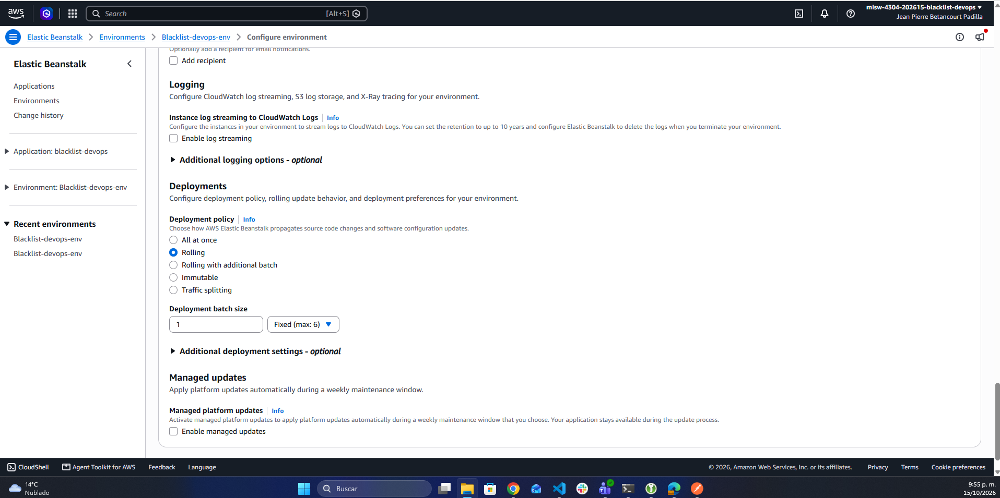

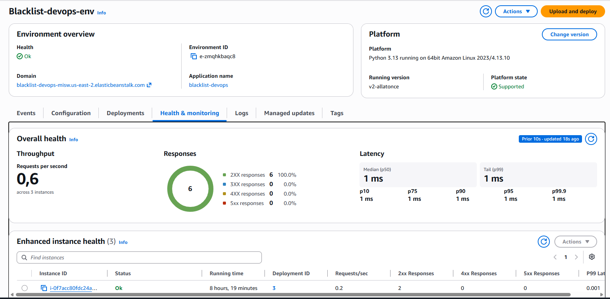

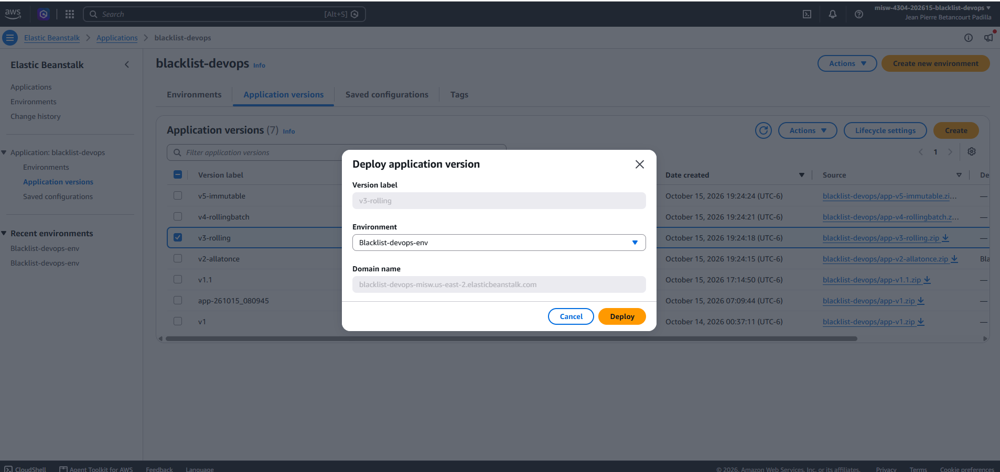

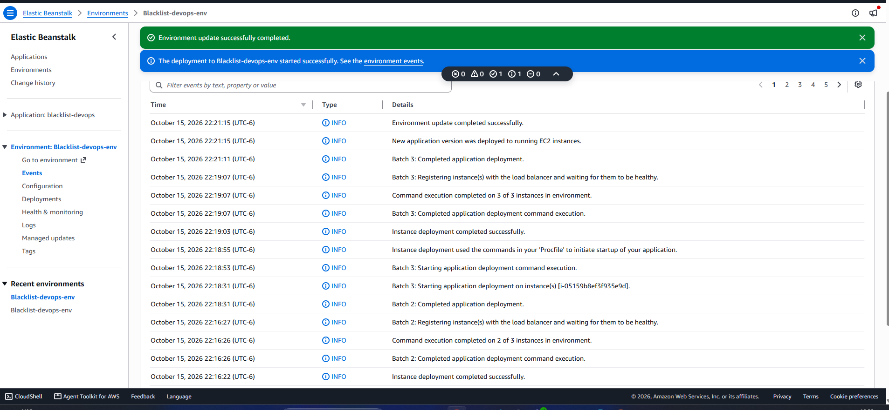

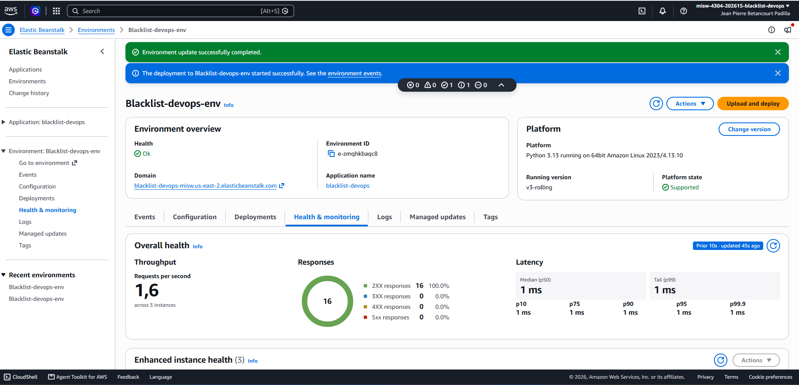

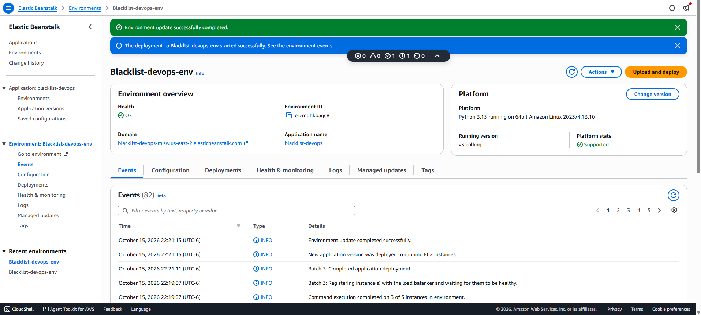

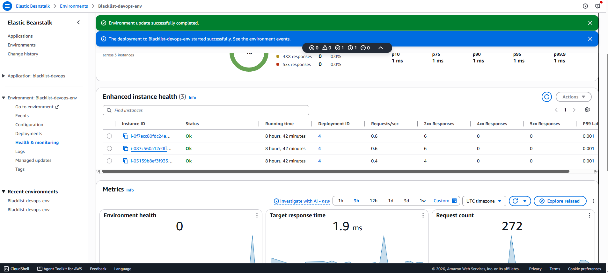

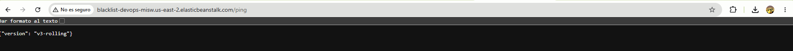

El registro completo del monitor está en `docs/despliegues/v3-rolling.csv` y el detalle de la
estrategia, en la misma carpeta.

**(f) Hallazgos:**
- **Disponibilidad:** no hubo respuestas distintas de `200`: el balanceador solo envió solicitudes a las
  instancias sanas durante todo el proceso, a diferencia de All at once.
- **Salud durante el despliegue:** el entorno pasó a *Degraded* a las 23:13:48, cuando una de las tres
  instancias estaba fuera del balanceador; a *Info* a las 23:14:47; y volvió a *Ok* a las 23:22:47.
- **Capacidad:** se mantuvieron 3 instancias, pero con lote de 1 el servicio funcionó con 2 de 3
  mientras se actualizaba cada una, un tercio menos de capacidad.
- **Convivencia de versiones:** las dos versiones respondieron durante 4 min 41 s. Si una versión no
  fuera compatible con la anterior, ese sería el periodo de riesgo.
- **Duración:** 8 min 10 s, unas 23 veces la de All at once (21 s). Cada lote esperó 2 min 4 s a que
  el balanceador marcara la instancia como sana (23:13:46 a 23:15:50, 23:16:27 a 23:18:31 y 23:19:07 a
  23:21:11); el despliegue en cada instancia tomó unos 35 s.
- **Costo:** sin instancias adicionales ni capacidad temporal extra.
- **Rollback:** volver a la versión anterior exige otro despliegue Rolling completo.
- **Cuándo conviene:** cuando se quiere evitar una caída total y se acepta un despliegue más largo y
  con menos capacidad mientras dura.

### 5.3 Rolling with additional batch (`v4-rollingbatch`)

| Dato | Valor |
|---|---|
| Política y lote | `RollingWithAdditionalBatch`, tipo de lote `Fixed`, tamaño de lote 1 |
| Versión anterior → nueva | `v3-rolling` → `v4-rollingbatch` |
| Fecha y hora de inicio | 16 de octubre de 2026, 11:41:49 (UTC-5) |
| (a) Instancias antes / máximo durante / después | 3 / 4 / 3: las 3 permanentes más 1 instancia adicional temporal (`t3.micro`) |
| (c) Tiempo total | **9 min 19 s**: de "Environment update is starting" (11:41:49) a "Environment update completed successfully" (11:51:08) |
| (d) Instancias iniciales o nuevas | **Mixto**: se creó `i-03d76ef45d72321de` (nueva, lote adicional), se actualizaron en su lugar `i-0f7acc80fdc24a7d3` e `i-05159b8ef3f935e9d` (iniciales) y se terminó `i-087c560a12e0ffa07` (inicial, excedente) |
| Solicitudes del monitor: total / no 200 | 891 / 0; 100 % de las solicitudes registradas (82 s sin muestrear, en 28 pausas de 3 a 4,6 s del equipo que ejecutó el monitor) |
| Caída observada | Ninguna |
| Ventana con dos versiones respondiendo | 7 min 38 s: de 11:43:23 a 11:51:01, con 173 cambios de versión entre solicitudes consecutivas |

**(b) Cómo se validó que el despliegue estaba en ejecución:** el monitor consultó `/ping` cada segundo
durante 16 min 12 s y registró 374 respuestas de `v3-rolling` y 517 de `v4-rollingbatch`, con las dos
versiones alternándose mientras avanzaban los lotes. Los eventos del entorno muestran el lote adicional
(lote 1, la instancia nueva), los lotes 2 y 3 sobre las instancias iniciales y la terminación de la
instancia excedente. La lista de instancias de EC2 mostró 4 durante el despliegue, y *Estado y
supervisión* mostró al final las 3 finales en *Ok* con `v4-rollingbatch`.

**(e) Capturas:**

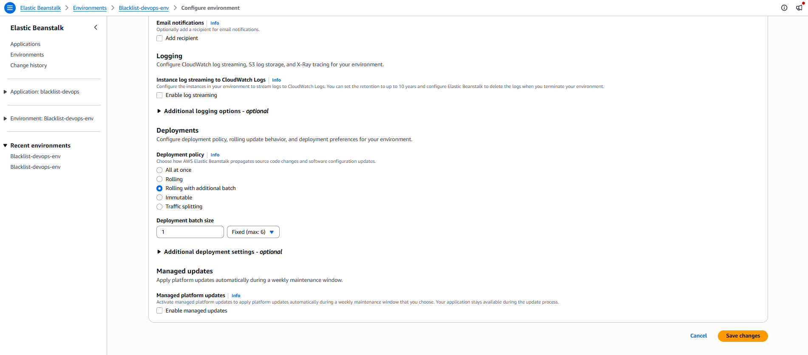

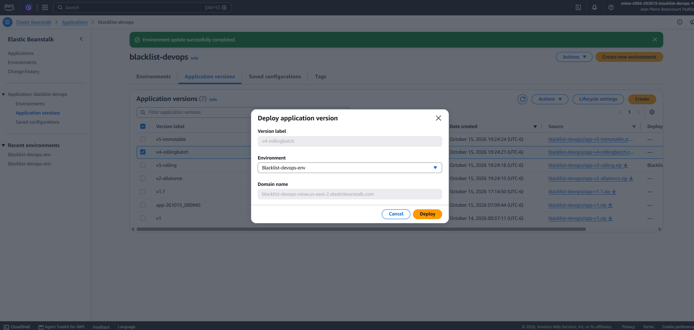

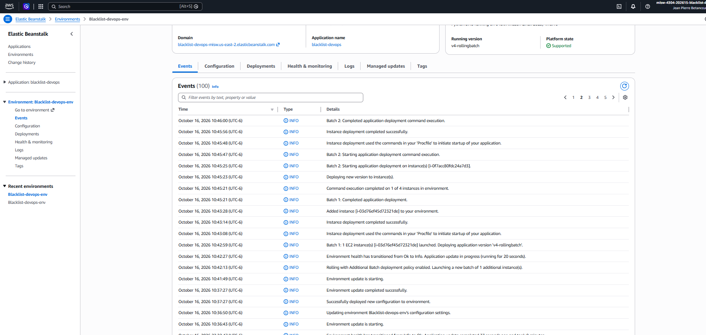

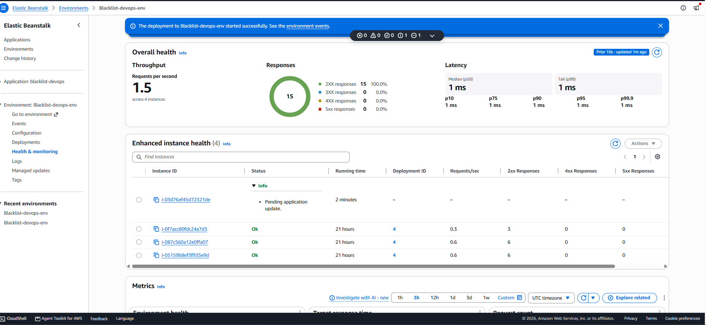

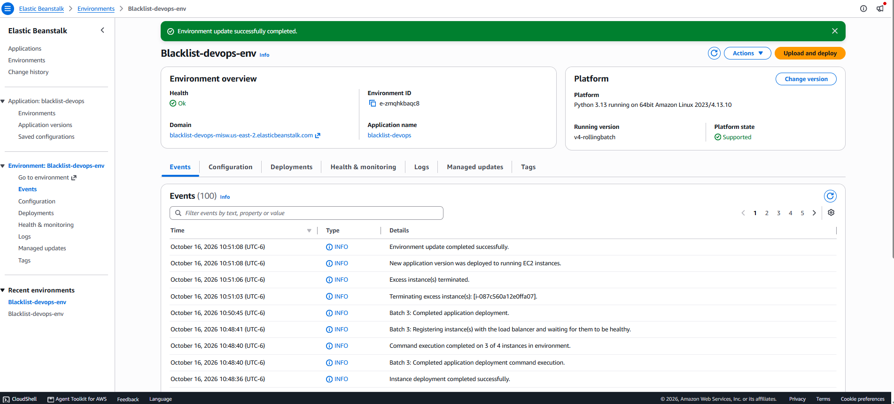

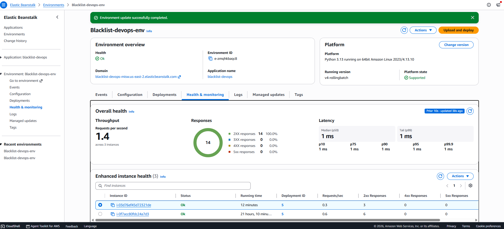

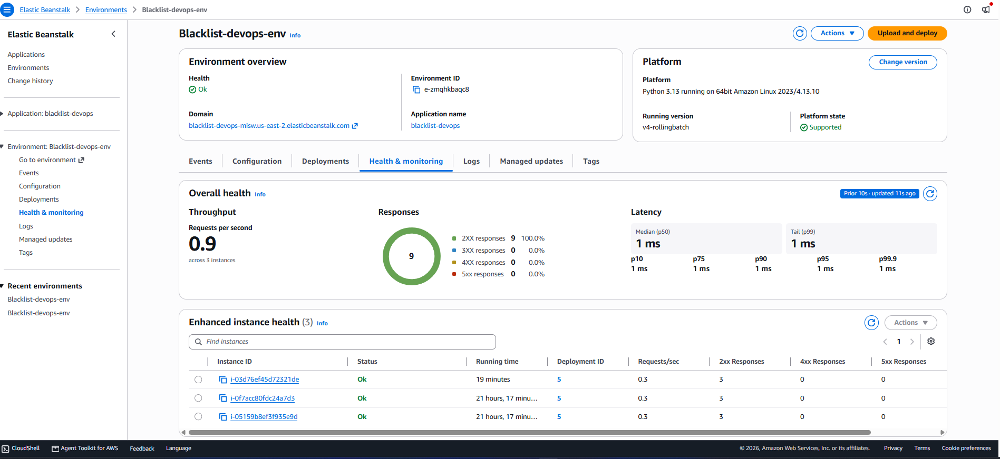

El registro completo del monitor está en `docs/despliegues/v4-rollingbatch.csv` y el detalle de la
estrategia, en la misma carpeta.

**(f) Hallazgos:**
- **Capacidad adicional:** AWS lanzó una instancia temporal y el máximo simultáneo fue de 4. Esa
  instancia no se retiró: se quedó como parte del grupo y AWS terminó una de las iniciales como
  excedente, por lo que no quedaron exactamente los mismos IDs.
- **Disponibilidad:** ninguna respuesta distinta de `200` entre las registradas.
- **Convivencia de versiones:** las dos versiones respondieron durante 7 min 38 s.
- **Duración:** 9 min 19 s, mayor que Rolling (8 min 10 s) porque primero crea, verifica y registra
  el lote adicional.
- **Salud del entorno:** pasó a *Warning* a las 11:46:27 porque el balanceador no marcó sana 1 de las
  4 instancias, y volvió a *Info* un minuto después. Al terminar, pasó a *Degraded* a las 11:52:27
  (3 instancias en línea por debajo del mínimo temporal de 4) y volvió a *Ok* a las 11:54:27, con el
  grupo de Auto Scaling de nuevo en mínimo 3, deseadas 3 y máximo 6.
- **Costo:** una instancia `t3.micro` adicional durante el despliegue; no se crea un entorno paralelo.
- **Cuándo conviene:** cuando se quiere conservar capacidad durante la actualización y se acepta un
  despliegue más largo y el costo temporal de una instancia adicional.

### 5.4 Immutable (`v5-immutable`)

| Dato | Valor |
|---|---|
| Política | `Immutable` |
| Versión anterior → nueva | `v4-rollingbatch` → `v5-immutable` |
| Fecha y hora de inicio | 16 de octubre de 2026, 15:14:59 (UTC-5) |
| (a) Instancias antes / máximo durante / después | 3 / 6 / 3: las 3 originales más un grupo temporal de 3 instancias nuevas (`t3.micro`); el máximo se mantuvo de 15:20:22 a 15:25:21 |
| (c) Tiempo total | **16 min 53 s**: de "Environment update is starting" (15:14:59) a "Environment update completed successfully" (15:31:52) |
| (d) Instancias iniciales o nuevas | **Nuevas**: las 3 instancias originales (`i-03d76ef45d72321de`, `i-05159b8ef3f935e9d` e `i-0f7acc80fdc24a7d3`) se reemplazaron por 3 nuevas (`i-03fe22026ed9d318f`, `i-0098c4e8e6a8c5e7a` e `i-035cd4a8c3e597263`) |
| Solicitudes del monitor: total / no 200 | 1.189 / 0; 100 % de las solicitudes registradas (113 s sin muestrear, en 37 pausas de unos 4 s del equipo que ejecutó el monitor) |
| Caída observada | Ninguna |
| Ventana con dos versiones respondiendo | 13 min 14 s: de 15:16:48 a 15:30:02, con 325 cambios de versión entre solicitudes consecutivas |

**(b) Cómo se validó que el despliegue estaba en ejecución:** el monitor consultó `/ping` cada segundo
durante 21 min 41 s y registró 512 respuestas de `v4-rollingbatch` y 677 de `v5-immutable`. Los eventos
del entorno muestran la creación del grupo temporal, la validación de salud de la primera instancia
nueva, el lanzamiento de las otras dos, el traspaso al grupo permanente y el retiro de las originales.
*Estado y supervisión* mostró al final las 3 instancias nuevas en *Ok* con `v5-immutable`, y un único
grupo de Auto Scaling, sin grupo temporal. `/ping` respondió `{"version": "v5-immutable"}`.

**(e) Capturas:**

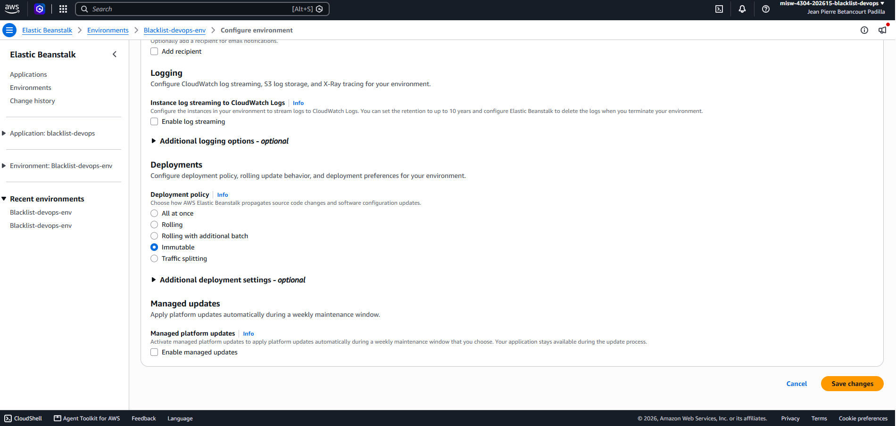

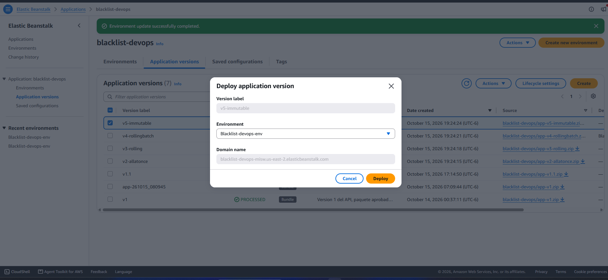

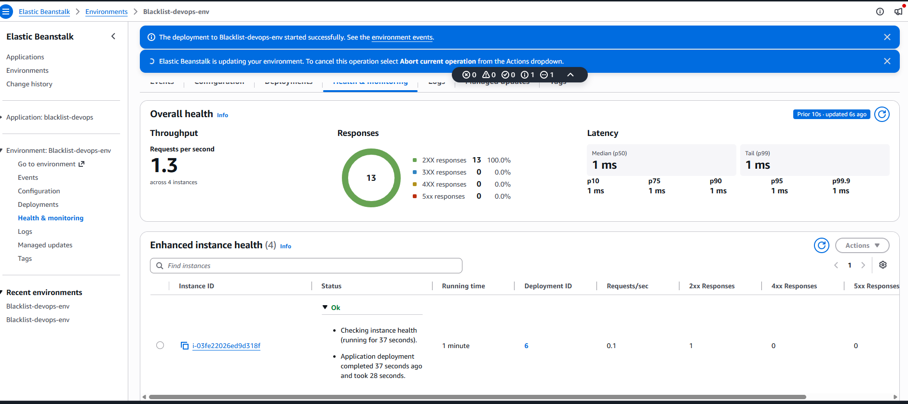

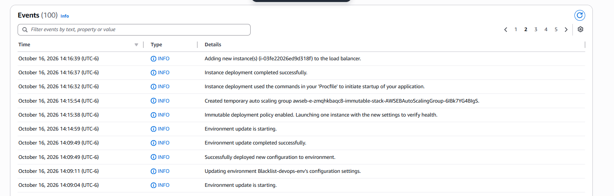

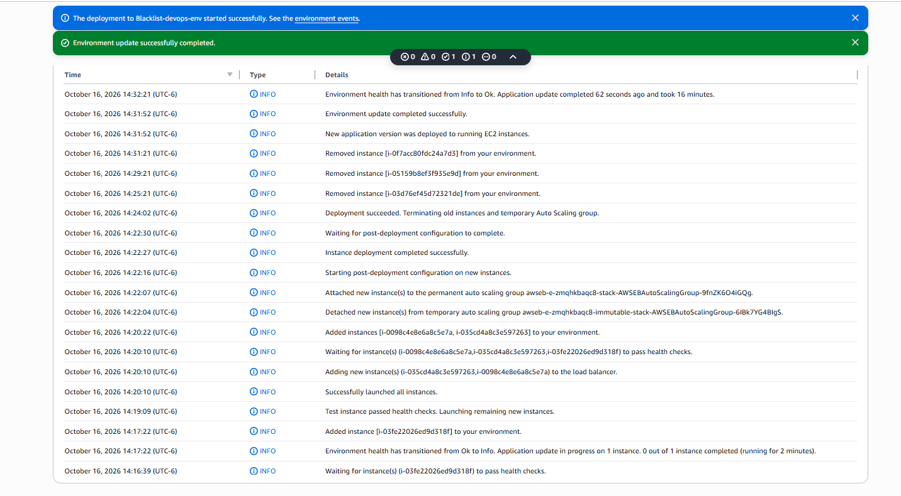

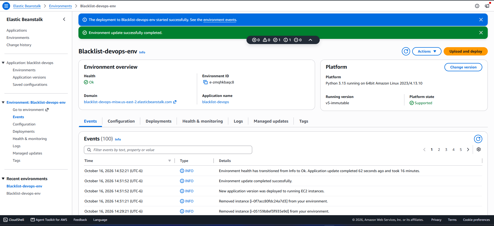

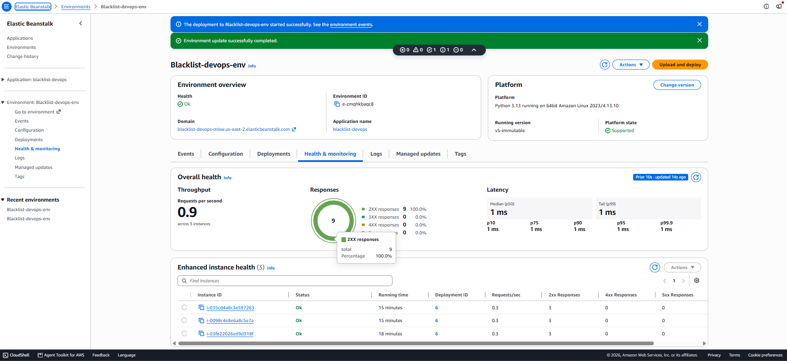

El registro completo del monitor está en `docs/despliegues/v5-immutable.csv` y el detalle de la
estrategia, en la misma carpeta.

**(f) Hallazgos:**
- **Capacidad:** llegó a 6 instancias simultáneas, 3 originales y 3 nuevas. La cuota de 32 vCPU alcanzó
  de sobra para 6 `t3.micro` (12 vCPU).
- **Disponibilidad:** ninguna respuesta distinta de `200` entre las registradas.
- **Convivencia de versiones:** las dos versiones respondieron durante 13 min 14 s, la mayor de las
  estrategias, mientras se validaba el grupo nuevo.
- **Duración:** 16 min 53 s, la mayor de las cuatro, por la creación, validación, traspaso y
  terminación de grupos e instancias.
- **Reemplazo:** las 3 instancias originales se retiraron solo después de que las nuevas pasaron los
  health checks y quedaron en el grupo permanente.
- **Rollback:** es seguro antes del traspaso: basta terminar el grupo temporal y el grupo original
  sigue intacto.
- **Costo:** hubo más de 3 instancias durante 14 min (de 15:17:22 a 15:31:21) y las 6 simultáneas durante 4 min 59 s (de 15:20:22 a 15:25:21): el mayor costo temporal de las cuatro.
- **Cuándo conviene:** cuando se priorizan la validación completa de la versión nueva y un rollback
  rápido sobre la velocidad del despliegue.

### 5.5 Comparación de las estrategias

| Estrategia | Tiempo total | Instancias (antes / máx. / después) | Caída observada | Instancias iniciales o nuevas |
|---|---|---|---|---|
| All at once | 0 min 21 s | 3 / 3 / 3 | Sí: 5 s, 5 respuestas `502` | Iniciales |
| Rolling | 8 min 10 s | 3 / 3 / 3 | No: 0 respuestas no-200 (100 %) | Iniciales, por lotes |
| Rolling with additional batch | 9 min 19 s | 3 / 4 / 3 | No: 0 respuestas no-200 | Mixto: 1 nueva, 2 iniciales actualizadas y 1 inicial terminada |
| Immutable | 16 min 53 s | 3 / 6 / 3 | No: 0 respuestas no-200 | Nuevas: las 3 originales reemplazadas |

**Lectura de la comparación:**
- **All at once** es la más rápida (21 s) y la única con caída total (5 s con respuestas `502`); las
  otras tres no registraron respuestas distintas de `200`.
- **Rolling** no usa instancias extra y mantiene el servicio, pero trabaja con 2 de 3 instancias
  durante cada lote y toma 8 min 10 s.
- **Rolling with additional batch** agrega una instancia temporal para no reducir la capacidad y toma
  9 min 19 s, solo 1 min 9 s más que Rolling.
- **Immutable** es la más lenta (16 min 53 s) y la de mayor costo temporal (6 instancias), pero valida
  la versión en instancias nuevas antes de reemplazar las originales y permite un rollback seguro.

## 6. Pruebas del API

La colección de Postman `Blacklist API – Lista negra global` tiene 11 escenarios con 2 tests cada uno.
Cubren el POST válido, el POST sin motivo, el duplicado (409), el email con formato inválido, el
`app_uuid` que no es UUID y el motivo de más de 255 caracteres (400), la falta de token (401), la
consulta de un email que está y de uno que no está, y el health check. Cada endpoint está documentado
con ejemplos de solicitud y respuesta en la documentación publicada (sección 3). La colección y los
environments `blacklist-local` y `blacklist-aws` están versionados en `postman/`; entre ellos solo
cambia `base_url`.

| Prueba | Entorno | Resultado |
|---|---|---|
| Pruebas automáticas (pytest) | SQLite en memoria | 85 pruebas aprobadas (60 de la aplicación y 25 del monitor de disponibilidad), cobertura del 100 % de `app/` |
| Colección de Postman | Aplicación local con SQLite | 22 de 22 tests aprobados |
| Colección de Postman | Gunicorn y PostgreSQL en contenedores | 22 de 22 tests aprobados |
| IP del cliente con `X-Forwarded-For` | Gunicorn y PostgreSQL en contenedores | Se guarda la IP del cliente enviada en el encabezado |
| Persistencia después de reiniciar | Gunicorn y PostgreSQL en contenedores | Los registros se conservan y el GET responde 200 |
| Paquete `v1` antes de cargarlo | Carpeta limpia, Gunicorn en contenedor | Paquete verificado y cargado con el mismo SHA-256 |
| Paquetes `v2-allatonce` a `v5-immutable` antes de cargarlos | Carpeta limpia, Gunicorn en contenedor | `/ping` con su etiqueta, POST 201, GET 200 y 401 sin token en los cuatro |
| POST y GET | Entorno de Beanstalk con `v1.1` | 201 y 200 contra RDS (figuras 28 y 29) |
| Colección de Postman | Entorno de Beanstalk con `v1.1` | 22 de 22 tests aprobados, 0 errores, respuesta promedio de 129 ms |
| IP del cliente detrás del balanceador | Entorno de Beanstalk | Con `v1`, la del balanceador; con `v1.1` y `PROXY_FIX_X_FOR = 2`, la del cliente (figura 1) |


El detalle de las pruebas locales, de los paquetes y de las pruebas contra AWS está en la carpeta
`docs/pruebas/` del repositorio.

## 7. Limitaciones y decisiones

**Plan gratuito de AWS.** La cuenta del equipo usa el plan gratuito, que impone restricciones:
- Una sola región: todo el despliegue está en `us-east-2` (Ohio).
- Sin grupos de IAM: los permisos se asignan con los roles del proyecto y las personas se agregan por
  la página del equipo de la cuenta.
- Algunas opciones de la consola muestran el aviso de "características avanzadas" y no se activan. Se
  verificó que las políticas de despliegue *Rolling*, *Rolling with additional batch* e *Immutable* se
  pueden elegir y aplicar sin ese aviso. *All at once* es la política por defecto del entorno.
- Para controlar el costo, el entorno solo está encendido mientras se trabaja: se encendió para el
  primer despliegue y sigue así durante las pruebas contra AWS y las estrategias, hasta grabar el
  video. Después se termina el entorno y se elimina la RDS con un snapshot final. La configuración
  guardada `blacklist-base`, el snapshot y las versiones cargadas permiten recrearlo con la misma URL.
  El costo de referencia con el entorno encendido es de unos 0,07 USD por hora, y el balanceador es el
  componente que más pesa.

**Postman gratuito.** El workspace es público y pertenece al equipo de Postman del grupo, como lo
permite el enunciado. Para colaborar, la colección y los environments se exportan en formato JSON y se
versionan en `postman/`. El token solo se carga como valor actual de la variable, nunca como valor
inicial, para que no quede publicado.

**Versión de Flask.** El enunciado permite usar las versiones que el equipo prefiera. Se eligió Flask
3.1 (3.1.3) sobre Python 3.13 para trabajar con versiones con soporte, en lugar de Flask 1.1.4. La
migración implicó estos cambios:
- `@jwt_required()` con paréntesis (Flask-JWT-Extended 4.x).
- Manejadores de token ausente o inválido que responden 401, porque Flask-JWT-Extended 4.x responde
  422 por defecto. `PROPAGATE_EXCEPTIONS = True` para que Flask-RESTful no convierta esos errores en
  500.
- Consultas con la sintaxis de SQLAlchemy 2 (`db.select`) y fechas con zona horaria.
- Driver psycopg 3 en lugar de psycopg2, con URL `postgresql://`.

**Token estático.** El enunciado permite definir el token "por simplicidad" de forma estática. El
equipo usa un único token firmado con la clave del entorno (`JWT_SECRET_KEY`), sin expiración, generado
una vez con `scripts/generar_token.py`. No hay endpoints de registro, inicio de sesión ni renovación.

**Health check `/ping`.** Responde solo `{"version": ...}`, sin token y sin consultar la base. Así el
balanceador no marca las instancias como no saludables por un problema de credenciales o de la base, y
la versión permite seguir cada estrategia de despliegue.

**IP del cliente detrás del balanceador.** La prueba local simulaba un solo proxy, pero en Beanstalk
hay dos: el balanceador y el nginx de cada instancia. Con `v1` se guardaba la IP del balanceador. En
lugar de fijar otro valor en el código, el número de saltos se configura con la propiedad
`PROXY_FIX_X_FOR` (por defecto 1), que en el entorno vale 2. No se usa un valor mayor que el número
real de proxies, porque un cliente podría enviar un `X-Forwarded-For` falso y se guardaría esa IP. El
hallazgo se corrigió con `v1.1` antes de las estrategias, así que las cuatro versiones guardan la IP
del cliente.

**Configuración de la aplicación.** `APP_ENV` acepta `development`, `production` o `testing`; si queda
vacía se usa `development`. En el entorno de Beanstalk vale `production`. `PROXY_FIX_X_FOR` debe ser un
entero mayor o igual a 1; otro valor detiene el arranque con un mensaje claro.

## 8. Conclusiones

**Resultado.** El microservicio de lista negra quedó desplegado de forma manual en AWS Elastic Beanstalk,
con PostgreSQL en Amazon RDS, y responde POST, GET y `/ping` con el token estático. La colección de
Postman pasa 22 de 22 tests contra la URL del entorno y la IP guardada es la del cliente. Se ejecutaron
las cuatro estrategias de despliegue sobre el mismo entorno de 3 instancias, con versiones que solo
cambian la etiqueta de `VERSION`, así que las diferencias medidas se deben a la estrategia.

**Compromiso entre tiempo, disponibilidad y costo.**

| Estrategia | Tiempo | Disponibilidad medida | Costo temporal | Convivencia de versiones |
|---|---|---|---|---|
| All at once | 21 s | Caída total de 5 s | Ninguno | Ninguna |
| Rolling | 8 min 10 s | Sin caída; 2 de 3 instancias durante cada lote | Ninguno | 4 min 41 s |
| Rolling with additional batch | 9 min 19 s | Sin caída | 1 instancia adicional | 7 min 38 s |
| Immutable | 16 min 53 s | Sin caída | Hasta 3 instancias adicionales (6 en total) | 13 min 14 s |

Ninguna estrategia fue mejor en las tres dimensiones. All at once gana en tiempo y costo, pero es la
única que dejó el servicio sin responder. Las otras tres evitaron la caída a cambio de más tiempo, y
Immutable es la que más tiempo y más capacidad temporal necesitó.

**Estrategia recomendada para este servicio.** El servicio lo consultan sistemas internos de toda la
empresa, así que una caída de unos segundos tiene impacto. Por eso se descarta All at once fuera de
entornos de desarrollo o pruebas. Para las actualizaciones habituales se recomienda **Rolling with
additional batch**: no tuvo caída, conserva la capacidad de las 3 instancias durante la actualización
y solo tardó 1 min 9 s más que Rolling, a cambio de una instancia adicional temporal. Para cambios con
más riesgo, como una actualización de dependencias o un cambio en el esquema de la base, se recomienda
**Immutable**: valida la versión en instancias nuevas antes de tocar las originales y permite un
rollback seguro mientras no se traspasa el grupo nuevo.

Con las tres estrategias que mantienen el servicio, las dos versiones responden a la vez durante entre 4
y 13 minutos. Cada versión debe ser compatible con la anterior, en especial en lo que toca a la base
de datos, que es compartida.

**Lecciones del despliegue manual.**
- **La prueba local no cubrió la IP del cliente.** Con un solo proxy simulado el código funcionaba,
  pero en Beanstalk hay dos (el balanceador y el nginx de la instancia) y la primera versión guardó la
  IP del balanceador. Se detectó consultando la tabla desde una instancia y se corrigió con una
  propiedad del entorno (`PROXY_FIX_X_FOR`), sin cambiar el código. Conviene verificar en el entorno real
  cada dato que depende de la infraestructura.
- **La consola de Beanstalk no refleja la caída de All at once.** La salud mejorada pasó a *Info* 4 s
  después de terminar el despliegue y nunca mostró los 5 s de respuestas `502`; solo el monitor externo
  las registró. Para medir disponibilidad hace falta un monitor propio.
- **La medición también necesita verificación.** El monitor se corrigió tras una revisión para que un
  corte de conexión no lo detuviera, y en dos estrategias tuvo pausas del equipo que lo ejecutó
  (82 s y 113 s sin muestrear); se documentaron en lugar de ocultarlas.
- **Crear el entorno desde la consola falló dos veces** porque el formulario propone otro rol de
  servicio que el de la configuración guardada. Se creó con la AWS CLI y el procedimiento quedó
  documentado para recrear el ambiente.
- **El plan gratuito no impidió ninguna de las cuatro estrategias.** Ninguna mostró el aviso de
  "características avanzadas"; la cuota de 32 vCPU alcanzó para el máximo de 6 instancias.
- **Probar el paquete antes de cargarlo** (contenido, instalación limpia y `/ping` con su etiqueta) y
  no regenerarlo después permitió desplegar siempre lo que se había probado.

**Siguientes pasos.** Quedan fuera de esta primera iteración, pero serían los más valiosos: servir el
API por HTTPS (hoy el token Bearer viaja por HTTP), emitir el token con expiración y rotación, y
automatizar el despliegue y su medición cuando el curso lo permita.
