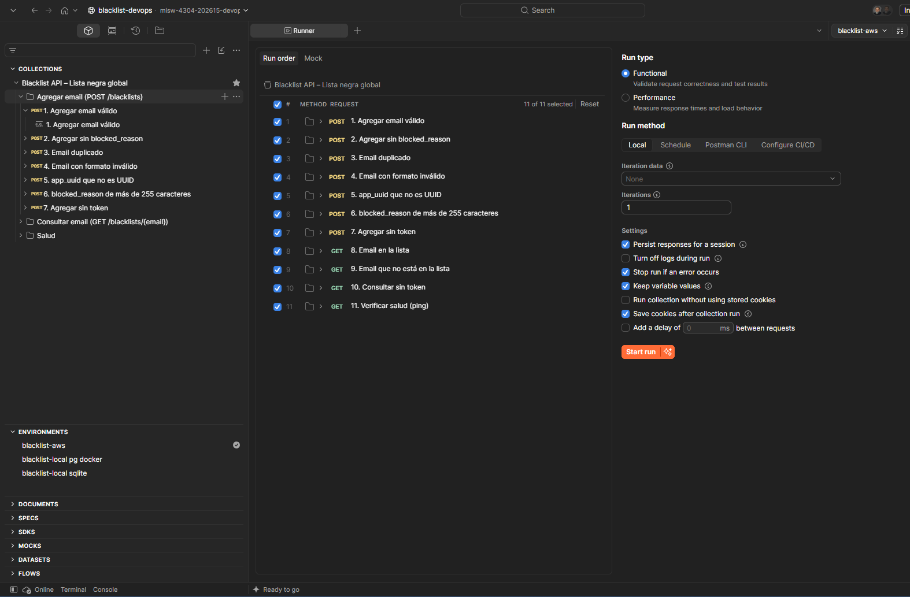
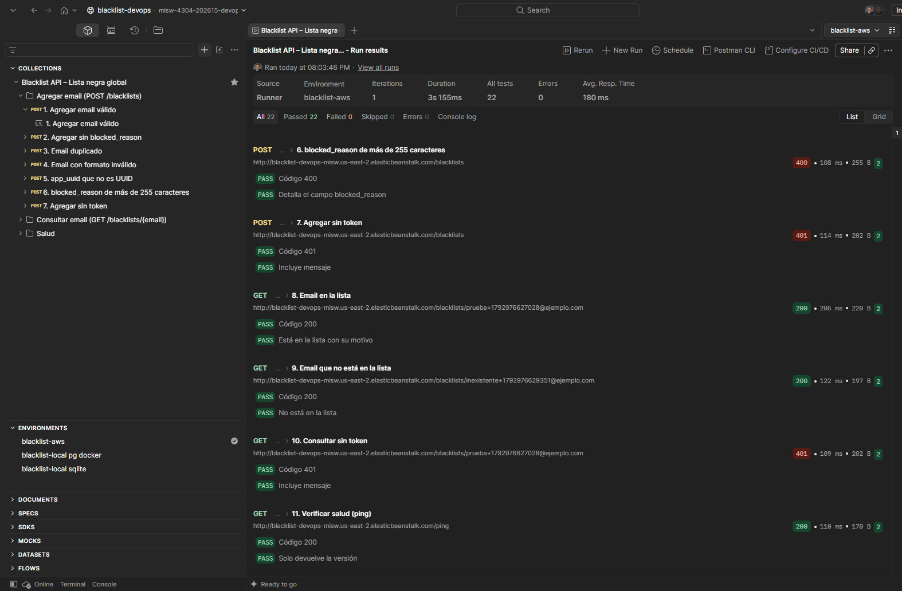
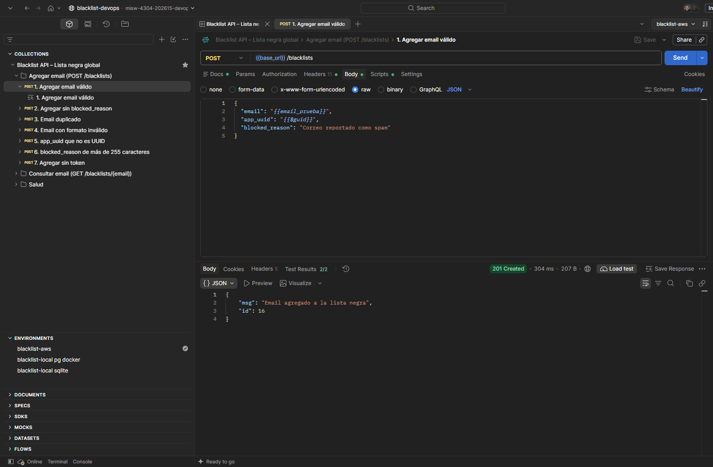
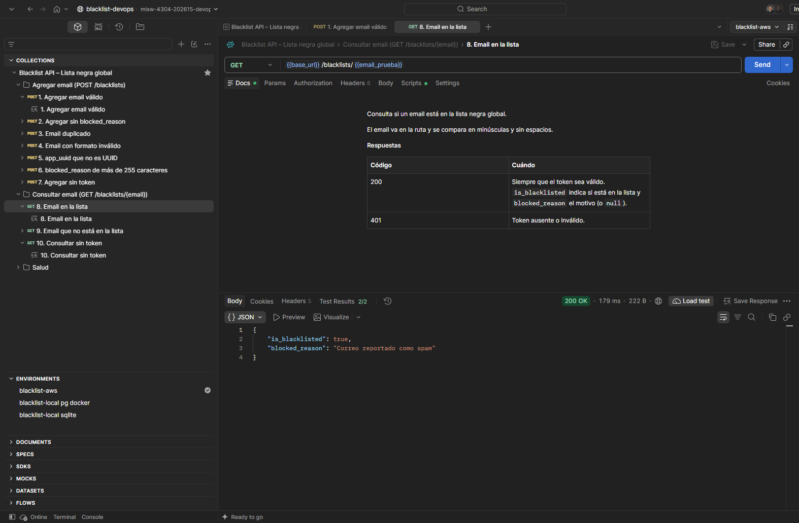

# Entrega 2 · Colección de Postman contra el entorno de Beanstalk

Tarea 2.12 (#116) · Épica E2 · Pruebas

Este documento registra la ejecución de la colección de Postman contra la aplicación desplegada en AWS
Elastic Beanstalk con el artefacto del pipeline (versión `b0e9d03`, tarea 2.11, `docs/ci/2.11-despliegue-manual.md`).
Es la evidencia del entregable "aplicación en ejecución sobre AWS Beanstalk accesible vía Postman" del
enunciado (`docs/entrega-2-integracion-continua.md`). Sigue el procedimiento de la Entrega 1
(`docs/pruebas/2.3b-pruebas-aws.md`).

## 1. Resultado

| Dato | Valor |
|---|---|
| Fecha | 25 de octubre de 2026, 20:03 (UTC-05:00) |
| Herramienta | Runner de Postman, ejecución funcional local, 1 iteración |
| Colección | *Blacklist API – Lista negra global*, 11 escenarios, en el orden de la colección |
| Ambiente | `blacklist-aws`, `base_url` = `http://blacklist-devops-misw.us-east-2.elasticbeanstalk.com` |
| Versión desplegada | `b0e9d03` (`/ping` → `{"version": "b0e9d03"}`) |
| Pruebas | **22 aprobadas de 22**, 0 fallidas, 0 omitidas |
| Errores | 0 |
| Duración | 3 s 155 ms |
| Tiempo de respuesta promedio | 180 ms |
| Token | Token estático cargado solo como valor actual del ambiente; no aparece en las capturas ni en `postman/` |

## 2. Escenarios

Cada escenario tiene dos pruebas: el código de respuesta y el contenido del cuerpo.

| # | Escenario | Código esperado | Resultado |
|---|---|---|---|
| 1 | Agregar email válido | 201 | 201, `msg` e `id`; 2 de 2 |
| 2 | Agregar sin `blocked_reason` | 201 | 2 de 2 |
| 3 | Email duplicado | 409 | 2 de 2 |
| 4 | Email con formato inválido | 400 | 2 de 2 |
| 5 | `app_uuid` que no es UUID | 400 | 400; 2 de 2 |
| 6 | `blocked_reason` de más de 255 caracteres | 400 | 400; 2 de 2 |
| 7 | Agregar sin token | 401 | 401; 2 de 2 |
| 8 | Email en la lista | 200 | 200, `is_blacklisted: true` y el motivo; 2 de 2 |
| 9 | Email que no está en la lista | 200 | 200, `is_blacklisted: false`; 2 de 2 |
| 10 | Consultar sin token | 401 | 401; 2 de 2 |
| 11 | Verificar salud (`/ping`) | 200 | 200, solo la versión; 2 de 2 |

La colección genera correos únicos en cada ejecución (`prueba+<marca de tiempo>@ejemplo.com`), así que no
choca con los registros que ya están en la base. Los escenarios 3 y 8 usan el email que crea el 1.

## 3. Evidencia visual

Configuración del runner: colección, 11 escenarios en orden, ambiente `blacklist-aws` y 1 iteración.

Resultado: 22 de 22, 0 errores, 3 s 155 ms y 180 ms de promedio; escenarios 5 a 10 con la URL de Beanstalk.

Resultado: escenarios 6 a 11, incluido `/ping`.

Escenario 1: 201 con `msg` e `id`.

Escenario 8: 200 con `is_blacklisted: true` y el motivo.

Las capturas no muestran el token ni la pestaña de encabezados. Se recortó el panel lateral derecho de la
aplicación de Postman, que no forma parte de la evidencia.

## 4. Hallazgos

1. **La aplicación desplegada desde el pipeline responde el contrato completo.** Las 22 pruebas pasan
   contra `b0e9d03`, el paquete que generó CodeBuild y se desplegó a mano en la tarea 2.11.
2. **La base conserva los datos de la Entrega 1.** El alta del escenario 1 devolvió el `id` 16: la RDS
   `blacklist-db` es la misma de la Entrega 1 (se mantuvo detenida y se volvió a encender en la tarea 2.10),
   y los identificadores continúan.
3. **Tiempos similares a la Entrega 1.** El promedio fue de 180 ms, frente a 129 ms en la ejecución del
   15 de octubre (`docs/pruebas/2.3b-pruebas-aws.md`); la diferencia es pequeña.

## 5. Cumplimiento de la tarea

| Criterio de la tarea 2.12 (#116) | Estado | Evidencia |
|---|---|---|
| Ejecutar la colección contra la URL del entorno con el token estático, sin exponerlo | Cumplido | Secciones 1 y 3 |
| Los 11 escenarios pasan | Cumplido | 22 de 22 pruebas, sección 2 |
| Captura del resultado | Cumplido | Sección 3 |
| La colección pasa completa contra la URL de Beanstalk | Cumplido | Sección 1 |
