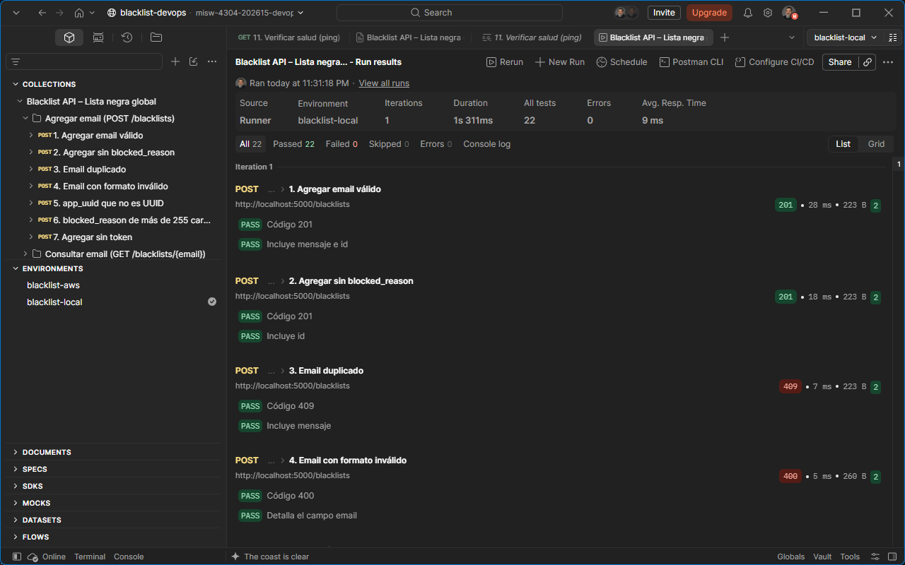
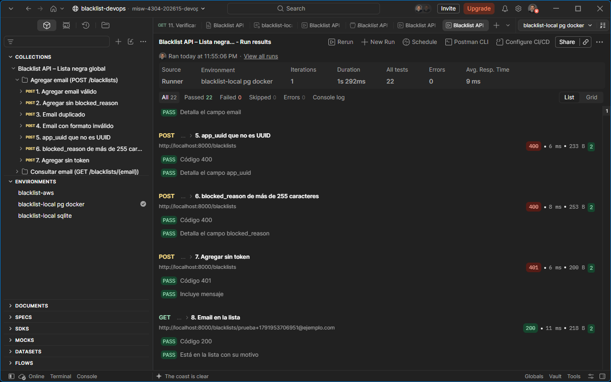
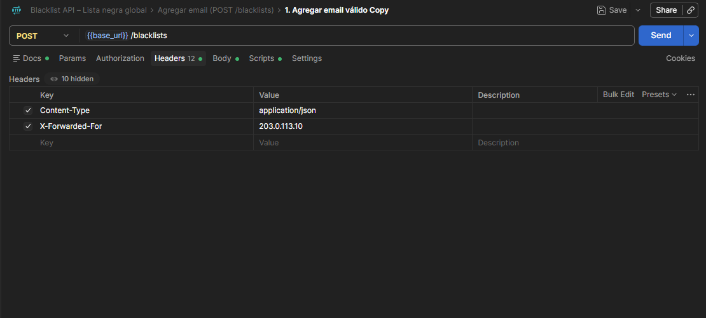
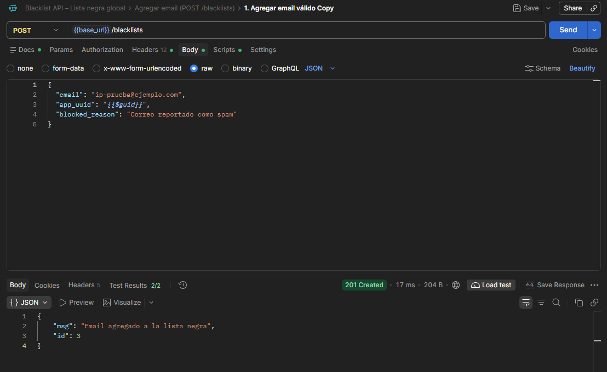
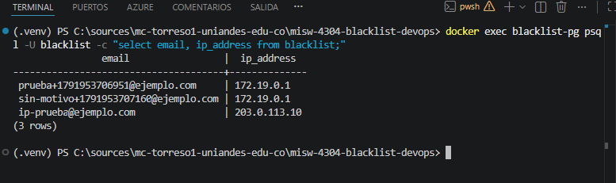
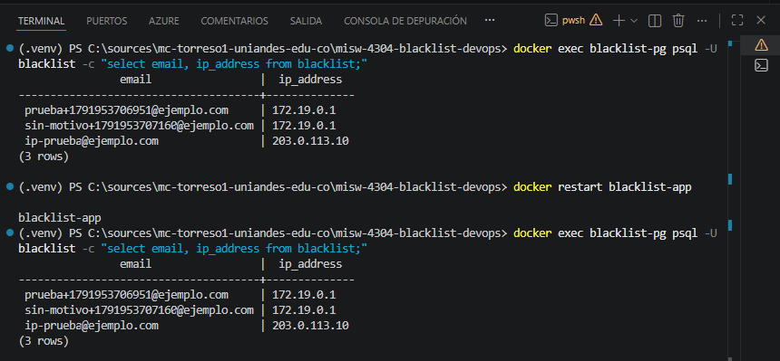
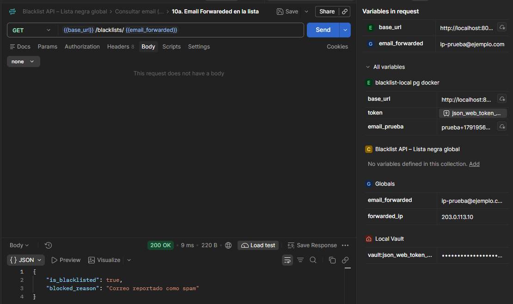

# 2.3 Pruebas locales en Postman

Issue #22 · Épica #24 (Pruebas) · Milestone `Entrega 1`

Ejecución de los escenarios de la colección `Blacklist API – Lista negra global` contra la aplicación
en local, y prueba de nivel 3: la aplicación en ejecución como en Beanstalk (Gunicorn y PostgreSQL).
Pruebas realizadas el **13 de octubre de 2026** sobre el código de `main` (versión 1 del API).

La prueba del paquete (nivel 4) y la ejecución contra AWS se documentan en sus propias tareas (#42 y
#43).

## 1. Resumen

| Prueba | Entorno | Resultado |
|---|---|---|
| Escenarios en local | `flask run` + SQLite, `http://localhost:5000` | 22 de 22 tests aprobados, 0 errores |
| Escenarios en nivel 3 | Gunicorn en contenedor + PostgreSQL en contenedor, `http://localhost:8000` | 22 de 22 tests aprobados, 0 errores |
| IP del cliente detrás de un proxy (`ProxyFix`) | Nivel 3 | Se guarda `203.0.113.10`, la IP enviada en `X-Forwarded-For` |
| Persistencia después de reiniciar la aplicación | Nivel 3 | Los 3 registros siguen en la base y el GET por el API responde 200 después de `docker restart` |

## 2. Procedimiento para reproducir

Pasos para repetir las pruebas desde un clon del repositorio en Windows (PowerShell), en la raíz del
proyecto. Procedimiento verificado el 14 de octubre de 2026. Los valores entre `<>` son de ejemplo y
no se registran en el repositorio.

### 2.1 Requisitos

- Entorno de Python 3.13.16 creado como indica la sección "Crear el entorno" del README.
- Docker Desktop en ejecución (solo para el nivel 3).
- Postman de escritorio: la versión web no llega a `localhost`.
- Los archivos de `postman/`: `blacklist-api.postman_collection.json` y
  `blacklist-local.postman_environment.json`.

### 2.2 Configuración local y token

```powershell
copy .env.example .env
python -c "import secrets; print(secrets.token_hex(32))"
```

Completar `.env` así, sin comillas, porque el mismo archivo se pasa a Docker con `--env-file`, que no
las quita:

```
DATABASE_URL=sqlite:///local.db
JWT_SECRET_KEY=<clave generada con el comando anterior>
APP_ENV=development
```

`APP_ENV` no puede quedar vacío: con `APP_ENV=` la aplicación no arranca (`KeyError: ''`). Se deja en
`development` o se borra la línea.

Generar el token estático con el entorno activado y copiarlo:

```powershell
.venv\Scripts\Activate.ps1
python scripts/generar_token.py
```

### 2.3 Preparación de Postman

1. Importar la colección y el environment `blacklist-local`.
2. En `blacklist-local`, pegar el token en **Current value** de la variable `token`. Nunca en
   **Initial value**: el workspace es público y ese valor se comparte.
3. Para el nivel 3, duplicar el environment y cambiar `base_url` a `http://localhost:8000`.
4. Ejecución: **Run collection** con el environment correspondiente, 1 iteración y los escenarios en el
   orden de la colección (1 a 11). Resultado esperado: 22 tests aprobados.

### 2.4 Escenarios en local (SQLite)

```powershell
$env:FLASK_APP = "application"
python -m flask run
```

Con la aplicación en `http://localhost:5000`, ejecutar la colección con `blacklist-local`. La base
queda en `instance\local.db`; para empezar con la base vacía, detener el servidor y borrar ese archivo
(`Remove-Item instance\local.db`).

### 2.5 Nivel 3: Gunicorn y PostgreSQL en Docker

Red y base de datos:

```powershell
docker network create blacklist-net
docker run -d --name blacklist-pg --network blacklist-net `
  -e POSTGRES_USER=blacklist -e POSTGRES_DB=blacklist -e POSTGRES_PASSWORD=<clave_local> `
  postgres:16
docker exec blacklist-pg pg_isready -U blacklist -d blacklist
```

Repetir `pg_isready` hasta que responda `accepting connections`. Luego, la aplicación con el código del
repositorio montado en `/app` y el comando del `Procfile`:

```powershell
docker run -d --name blacklist-app --network blacklist-net -p 8000:8000 `
  -v "${PWD}:/app" -w /app --env-file .env `
  -e DATABASE_URL=postgresql://blacklist:<clave_local>@blacklist-pg:5432/blacklist `
  python:3.13.16-slim `
  sh -c "pip install -q --root-user-action=ignore -r requirements.txt && gunicorn --bind :8000 --workers 2 application:application"
```

- `--env-file .env` entrega `JWT_SECRET_KEY` y `APP_ENV` sin escribirlos en la terminal; `-e
  DATABASE_URL` reemplaza el valor de SQLite del `.env` por la base del contenedor.
- La instalación de dependencias tarda alrededor de un minuto. La aplicación está lista cuando
  `curl.exe http://localhost:8000/ping` responde `{"version": "local"}`.
- Las tablas se crean al iniciar. Con 2 workers, `docker logs blacklist-app` puede mostrar
  `No se pudieron crear las tablas al iniciar la aplicación` con `UniqueViolation`: los dos workers
  intentan crear la tabla a la vez, uno lo logra y el otro registra el error. No afecta las pruebas
  (`docker exec blacklist-pg psql -U blacklist -d blacklist -c "\dt"` muestra la tabla `blacklist`).

Con la aplicación lista, ejecutar la colección con la copia del environment (`base_url` en el puerto
8000).

### 2.6 IP del cliente detrás de un proxy

Petición manual en Postman, fuera de la colección, con el environment del puerto 8000:

- `POST {{base_url}}/blacklists`
- Encabezados: `Authorization: Bearer {{token}}`, `Content-Type: application/json` y
  `X-Forwarded-For: 203.0.113.10`
- Cuerpo:

```json
{
  "email": "ip-prueba@ejemplo.com",
  "app_uuid": "0b8f6a52-6f0c-4c1e-9a8e-5f1d2c3b4a5e",
  "blocked_reason": "Correo reportado como spam"
}
```

Respuesta esperada: **201 Created**. Si el email ya existe en la base, la respuesta es 409. Luego se
consulta la IP guardada:

```powershell
docker exec blacklist-pg psql -U blacklist -d blacklist -c "select email, ip_address from blacklist;"
```

El registro de `ip-prueba@ejemplo.com` debe tener `203.0.113.10`.

### 2.7 Persistencia después de reiniciar

```powershell
docker restart blacklist-app
docker exec blacklist-pg psql -U blacklist -d blacklist -c "select email, ip_address from blacklist;"
```

Cuando `/ping` vuelva a responder, enviar en Postman `GET {{base_url}}/blacklists/ip-prueba@ejemplo.com`
con `Authorization: Bearer {{token}}`. Respuesta esperada: **200 OK** con `"is_blacklisted": true`.

### 2.8 Limpieza

```powershell
docker rm -f blacklist-app blacklist-pg
docker network rm blacklist-net
```

Al borrar el contenedor `blacklist-pg` se borran también sus datos.

## 3. Escenarios en local (SQLite)

| Parámetro | Valor |
|---|---|
| Aplicación | `python -m flask run` en Windows, con el `.venv` (Python 3.13.16) |
| Base de datos | SQLite (`DATABASE_URL=sqlite:///local.db`, archivo en `instance/`) |
| Environment de Postman | `blacklist-local` (`base_url = http://localhost:5000`) |
| Token | Generado con `scripts/generar_token.py` y la `JWT_SECRET_KEY` del `.env` local; cargado solo como valor actual |
| Ejecución | Runner de Postman, 1 iteración, 13 de octubre de 2026, 23:31 |

Resultado: **22 tests aprobados de 22** (11 escenarios, 2 tests cada uno), 0 errores, duración
1 s 311 ms y tiempo de respuesta promedio de 9 ms.



## 4. Nivel 3: aplicación en ejecución como en Beanstalk

### 4.1 Montaje

Los comandos para levantarlo están en la sección 2.5.

| Componente | Configuración |
|---|---|
| Red de Docker | `blacklist-net` |
| Base de datos | Contenedor `blacklist-pg`, imagen `postgres:16`, usuario y base `blacklist` |
| Aplicación | Contenedor `blacklist-app`, imagen `python:3.13.16-slim`, dependencias de `requirements.txt` |
| Comando de arranque | El del `Procfile`: `gunicorn --bind :8000 --workers 2 application:application` |
| Variables | `DATABASE_URL` (PostgreSQL del contenedor) y `JWT_SECRET_KEY` (la misma del `.env` local); los valores no se registran |
| Environment de Postman | Copia de `blacklist-local` con `base_url = http://localhost:8000` |

### 4.2 Escenarios

Ejecución: runner de Postman, 1 iteración, 13 de octubre de 2026, 23:55.

Resultado: **22 tests aprobados de 22**, 0 errores, duración 1 s 292 ms y tiempo de respuesta
promedio de 9 ms. La captura muestra los escenarios 5 a 8; el resumen superior cubre los 22 tests.



### 4.3 IP del cliente detrás de un proxy

En Beanstalk, el balanceador agrega el encabezado `X-Forwarded-For` con la IP del cliente, y la
aplicación la toma con `ProxyFix(x_for=1)`. Para simularlo, se envió un POST con
`X-Forwarded-For: 203.0.113.10` y el email `ip-prueba@ejemplo.com`.



Respuesta: **201 Created**, `{"msg": "Email agregado a la lista negra", "id": 3}`.



Consulta en la base:

```
docker exec blacklist-pg psql -U blacklist -c "select email, ip_address from blacklist;"
```

| email | ip_address |
|---|---|
| `prueba+1791953706951@ejemplo.com` | `172.19.0.1` |
| `sin-motivo+1791953707160@ejemplo.com` | `172.19.0.1` |
| `ip-prueba@ejemplo.com` | `203.0.113.10` |

Los registros creados por la colección, sin el encabezado, guardan `172.19.0.1`, la puerta de enlace
de la red de Docker desde la que llegan las solicitudes del equipo. El registro con el encabezado
guarda `203.0.113.10`: la aplicación usa la IP del cliente y no la del intermediario.



### 4.4 Persistencia después de reiniciar

Se reinició el contenedor de la aplicación (`docker restart blacklist-app`) y se repitió la consulta:
los 3 registros siguen en la base con los mismos datos.



Después del reinicio, el API también los devuelve: `GET /blacklists/ip-prueba@ejemplo.com` responde
**200 OK** con `{"is_blacklisted": true, "blocked_reason": "Correo reportado como spam"}`. El token se
tomó del almacén local de Postman y no aparece en la captura.



## 5. Observaciones

- Cada ejecución de la colección genera un email nuevo (`prueba+<marca de tiempo>@ejemplo.com`), así
  que se puede repetir sin limpiar la base.
- `/ping` responde `{"version": "local"}` al correr desde el repositorio; la etiqueta de versión solo
  cambia en los paquetes generados con el script de empaquetado.
- Los environments usados en Postman (`blacklist-local sqlite` y `blacklist-local pg docker`) son
  copias locales de `blacklist-local` que solo cambian `base_url`; los archivos de `postman/` no
  cambian.
- En Windows, la extensión compilada de SQLAlchemy puede quedar bloqueada por el control de
  aplicaciones; el procedimiento está en la sección "Problemas conocidos en Windows" del README.

## 6. Estado de la tarea

| Criterio | Estado |
|---|---|
| Los 11 escenarios pasan contra el entorno local | Cumplido (SQLite y nivel 3) |
| Nivel 3: Gunicorn con el comando del `Procfile` y PostgreSQL | Cumplido |
| `X-Forwarded-For` guardado como IP del cliente | Cumplido |
| Datos persistentes después de reiniciar | Cumplido (consulta a la base y GET por el API) |
| Evidencia del runner para el documento y el video | Cumplido |
| Procedimiento para reproducir las pruebas | Cumplido (sección 2) |
| Newman (opcional) | No ejecutado |
