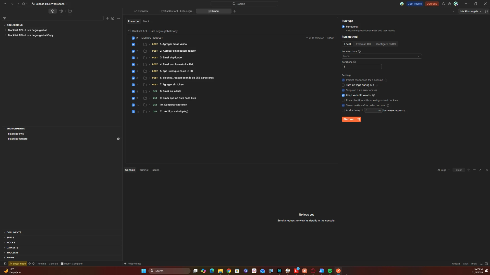
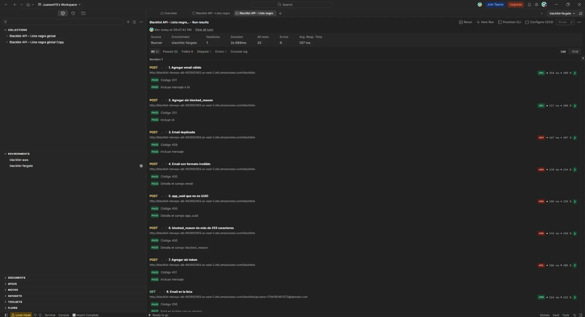
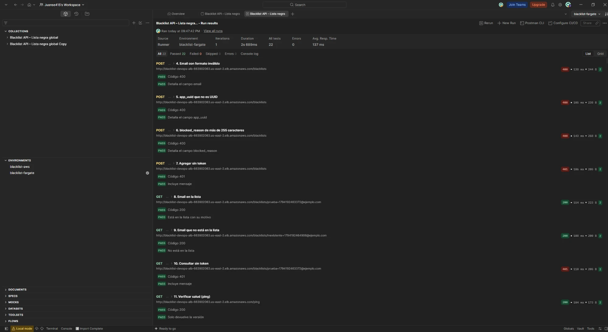

# Entrega 3 · Colección de Postman contra el servicio de Fargate

Tarea 2.1 (#205) · Épica E3 · Pruebas

Este documento registra la ejecución de la colección de Postman contra el servicio de Fargate creado a mano en la
1.11 (#199), detrás del balanceador `blacklist-devops-alb` de la 1.9 (#197). Es la evidencia del entregable
"aplicación en ejecución sobre AWS Fargate accesible vía Postman" del enunciado
(`docs/entrega-3-entrega-continua.md`) y sigue el procedimiento de la Entrega 2 (`docs/pruebas/2.12-postman-aws.md`).

## 1. Resultado

| Dato | Valor |
|---|---|
| Fecha | 8 de noviembre de 2026, 21:47:42 (UTC-05:00) |
| Herramienta | Runner de Postman de escritorio, ejecución funcional local, 1 iteración |
| Colección | *Blacklist API – Lista negra global*, la de `postman/blacklist-api.postman_collection.json`, 11 escenarios en el orden de la colección |
| Environment | `blacklist-fargate`, `base_url` = `http://blacklist-devops-alb-663902063.us-east-2.elb.amazonaws.com` |
| Versión desplegada | `168dd91` (`/ping` → `{"version": "168dd91"}`), revisión 3 de `blacklist-devops-task` en el grupo de destino verde |
| Pruebas | **22 aprobadas de 22**, 0 fallidas, 0 omitidas |
| Errores | 0 |
| Duración | 2 s 689 ms |
| Tiempo de respuesta promedio | 137 ms |
| Token | Token estático cargado solo como valor local del environment; no aparece en las capturas ni en `postman/` |

La versión que atiende es la del primer despliegue automático de la 1.16 (#203), que reemplazó a la `f224bef` del
despliegue manual de la 1.11 sobre el mismo servicio, balanceador y base de datos.

## 2. Environment de Fargate

Environment `blacklist-fargate`, exportado a `postman/blacklist-fargate.postman_environment.json`. Solo cambia
`base_url` respecto de `blacklist-aws`:

| Variable | Valor inicial (público) | Valor local |
|---|---|---|
| `base_url` | `http://blacklist-devops-alb-663902063.us-east-2.elb.amazonaws.com` | Igual |
| `token` | `REEMPLAZAR_CON_TOKEN` | El token estático del equipo; no se sincroniza ni se exporta |
| `email_prueba` | `prueba@ejemplo.com` | Lo fija el escenario 1 con una marca de tiempo |

`base_url` es el nombre DNS del balanceador (1.9, sección 1), con HTTP en el puerto 80, como el entorno de Beanstalk de
la Entrega 2. `blacklist-aws` se conserva con la URL de Beanstalk como evidencia de la Entrega 2.

Antes de la ejecución se comprobó el token contra el balanceador con `GET /blacklists/<email>`: respondió 200. La
clave de `/blacklist-devops/JWT_SECRET_KEY` (1.8, #196) es la que firmó el token del equipo.

## 3. Escenarios

Cada escenario tiene dos pruebas: el código de respuesta y el contenido del cuerpo.

| # | Escenario | Código esperado | Resultado |
|---|---|---|---|
| 1 | Agregar email válido | 201 | 201, mensaje e `id`; 2 de 2 |
| 2 | Agregar sin `blocked_reason` | 201 | 201 e `id`; 2 de 2 |
| 3 | Email duplicado | 409 | 409 con mensaje; 2 de 2 |
| 4 | Email con formato inválido | 400 | 400, detalla el campo `email`; 2 de 2 |
| 5 | `app_uuid` que no es UUID | 400 | 400, detalla el campo `app_uuid`; 2 de 2 |
| 6 | `blocked_reason` de más de 255 caracteres | 400 | 400, detalla el campo `blocked_reason`; 2 de 2 |
| 7 | Agregar sin token | 401 | 401 con mensaje; 2 de 2 |
| 8 | Email en la lista | 200 | 200, `is_blacklisted: true` y su motivo; 2 de 2 |
| 9 | Email que no está en la lista | 200 | 200, `is_blacklisted: false`; 2 de 2 |
| 10 | Consultar sin token | 401 | 401 con mensaje; 2 de 2 |
| 11 | Verificar salud (`/ping`) | 200 | 200, solo la versión; 2 de 2 |

La colección genera correos únicos en cada ejecución (`prueba+<marca de tiempo>@ejemplo.com`), así que no choca con
los registros que ya están en la base. Los escenarios 3 y 8 usan el email que crea el 1. Los escenarios 1 y 2
dejaron dos filas nuevas en `blacklist-db`, la base compartida con las entregas anteriores.

## 4. Evidencia visual

Configuración del runner: colección, 11 escenarios en orden, ejecución funcional local, 1 iteración y environment
`blacklist-fargate`.

Resultado: 22 de 22, 0 errores, 2 s 689 ms y 137 ms de promedio; escenarios 1 a 8 con la URL del balanceador.

Escenarios 4 a 11, incluido `/ping`.

Las capturas no muestran el token, la pestaña de encabezados ni la consola.

## 5. Procedimiento

1. Confirmar que el servicio está estable y que `GET {{base_url}}/ping` responde 200 con `{"version": ...}`.
2. Importar en Postman `postman/blacklist-api.postman_collection.json` y
   `postman/blacklist-fargate.postman_environment.json`.
3. Elegir el environment `blacklist-fargate` y poner el token estático solo en el **valor local** de `token`, de tipo
   secreto.
4. *Run collection*: los 11 escenarios en el orden de la colección, 1 iteración, ejecución funcional.
5. Tomar las capturas de la configuración y del resultado, sin el token.

## 6. Notas

- **Workspace público:** el environment `blacklist-fargate` está en el repositorio. El workspace público
  `blacklist-devops` es de un solo dueño en el plan gratuito, así que su dueño lo importa desde
  `postman/blacklist-fargate.postman_environment.json`. La ejecución se hizo con la misma colección y el mismo
  environment importados en Postman de escritorio.
- **Runner de Postman web:** un primer intento desde el runner de Postman en el navegador devolvió 401 en todos los
  escenarios con token, aunque la misma solicitud enviada sola respondía 200: ese runner no tomó el valor solo local
  del token. No se usó como evidencia. El valor del token no se pasó a un valor compartido para evitarlo.
- **HTTP sin TLS:** el token viaja sin cifrar entre el cliente y el balanceador (1.3, sección 7). Es una limitación
  conocida del documento de la entrega.

## 7. Cumplimiento de la tarea

| Criterio de la tarea 2.1 (#205) | Evidencia |
|---|---|
| Environment de Fargate con la URL del balanceador; el token solo en el valor local, nunca en el inicial | Sección 2; `postman/blacklist-fargate.postman_environment.json`. La importación en el workspace público queda a cargo de su dueño (sección 6) |
| Ejecutar la colección completa contra Fargate y guardar el resultado en `docs/pruebas/` | Secciones 1, 3 y 4 de este documento |
| Exportar el environment a `postman/` (JSON v2.1) sin el token | `postman/blacklist-fargate.postman_environment.json`, con `token` = `REEMPLAZAR_CON_TOKEN` |
| DoD: la colección pasa contra Fargate | Sección 1: 22 de 22, 0 errores |
| DoD: ningún archivo ni valor inicial de Postman expone el token | Sección 2 y capturas de la sección 4 |
