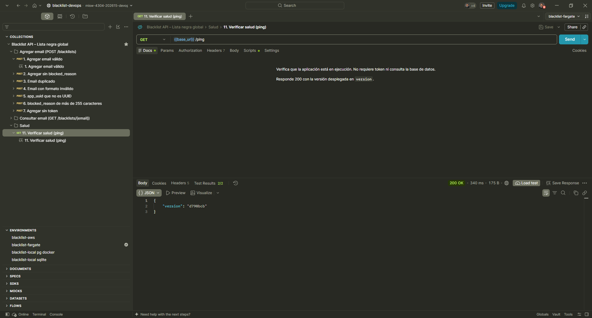
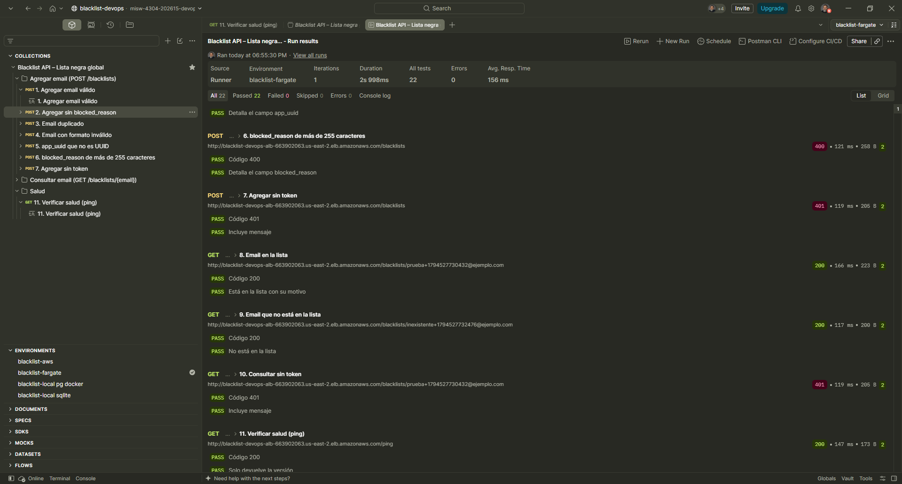

# Entrega 3 · Colección de Postman contra la versión final en Fargate

Tarea 2.6 (#210) · Épica E3 · Pruebas

Este documento registra la ejecución de la colección de Postman contra la versión final, desplegada por el pipeline
después del CD fallido de la 2.5 (#209). Es la evidencia del entregable "aplicación en ejecución sobre AWS Fargate
accesible vía Postman" del enunciado (`docs/entrega-3-entrega-continua.md`) con la versión que queda en `main`, y
sigue el procedimiento de la 2.1 ([2.1-postman-fargate.md](2.1-postman-fargate.md), sección 5).

## 1. Resultado

| Dato | Valor |
|---|---|
| Fecha | 12 de noviembre de 2026, 18:55:30 (UTC-05:00) |
| Herramienta | Runner de Postman de escritorio, 1 iteración |
| Colección | *Blacklist API – Lista negra global*, la de `postman/blacklist-api.postman_collection.json`, 11 escenarios en el orden de la colección |
| Environment | `blacklist-fargate`, `base_url` = `http://blacklist-devops-alb-663902063.us-east-2.elb.amazonaws.com` |
| Versión desplegada | `d790bcb` (`/ping` → `{"version": "d790bcb"}`), `blacklist-devops-task:6` en el grupo de destino verde, desplegada por la ejecución `72376863` del pipeline |
| Pruebas | **22 aprobadas de 22**, 0 fallidas, 0 omitidas |
| Errores | 0 |
| Duración | 2 s 998 ms |
| Tiempo de respuesta promedio | 156 ms |
| Token | Token estático cargado solo como valor local del environment; no aparece en las capturas ni en `postman/` |

El resultado se registra en este documento y en las capturas, como en la 2.1: exportar los resultados del Runner
requiere un plan de pago de Postman, que el equipo no usa.

## 2. Escenarios

Cada escenario tiene dos pruebas: el código de respuesta y el contenido del cuerpo. Los 11 escenarios pasaron con
2 de 2.

| # | Escenario | Código esperado |
|---|---|---|
| 1 | Agregar email válido | 201 |
| 2 | Agregar sin `blocked_reason` | 201 |
| 3 | Email duplicado | 409 |
| 4 | Email con formato inválido | 400 |
| 5 | `app_uuid` que no es UUID | 400 |
| 6 | `blocked_reason` de más de 255 caracteres | 400 |
| 7 | Agregar sin token | 401 |
| 8 | Email en la lista | 200 |
| 9 | Email que no está en la lista | 200 |
| 10 | Consultar sin token | 401 |
| 11 | Verificar salud (`/ping`) | 200 |

Los escenarios 1 y 2 dejaron dos filas nuevas en `blacklist-db`, con correos únicos por la marca de tiempo
(`prueba+1794527730432@ejemplo.com`).

## 3. Evidencia visual

`GET /ping` desde Postman con el environment `blacklist-fargate`: 200 con `{"version": "d790bcb"}` y 2 de 2 pruebas.

Resultado del Runner: 22 de 22, 0 errores, 2 s 998 ms y 156 ms de promedio; escenarios 6 a 11 con la URL del
balanceador.

Las capturas no muestran el token, la pestaña de encabezados ni la consola.

## 4. Cumplimiento

| Criterio de la tarea 2.6 (#210) | Evidencia |
|---|---|
| Ejecutar la colección con el environment de Fargate de la 2.1 y guardar el resultado en `docs/pruebas/` | Secciones 1 a 3 de este documento |
| `GET /ping` con la versión final | Sección 3: `d790bcb`, el *merge commit* de la promoción #268 |
| DoD: la colección pasa contra Fargate con la versión final desplegada por el pipeline | Sección 1: 22 de 22, 0 errores |
